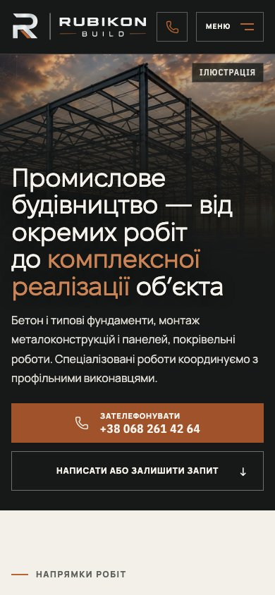
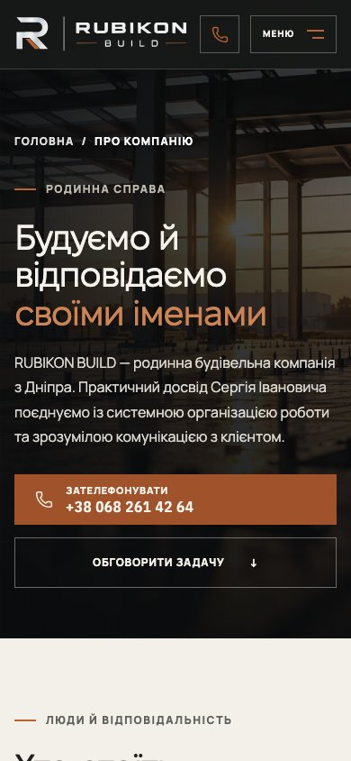
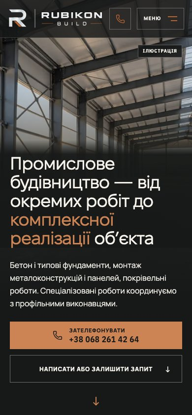
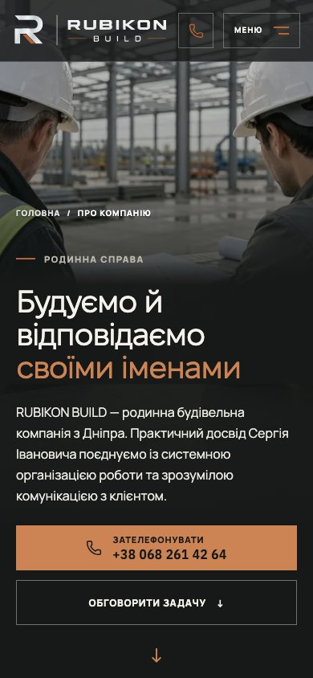
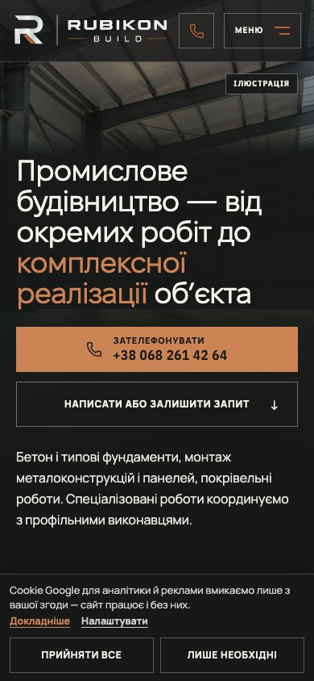
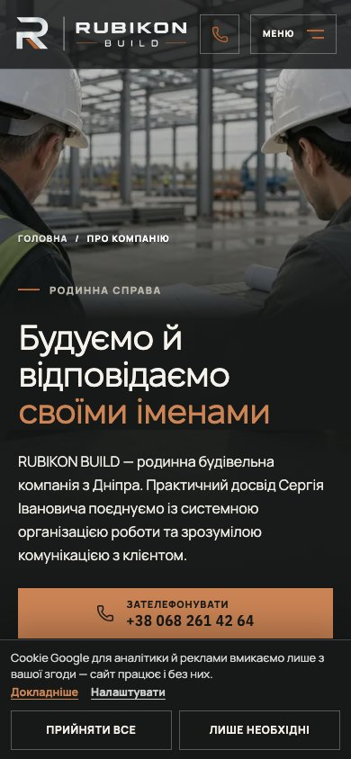
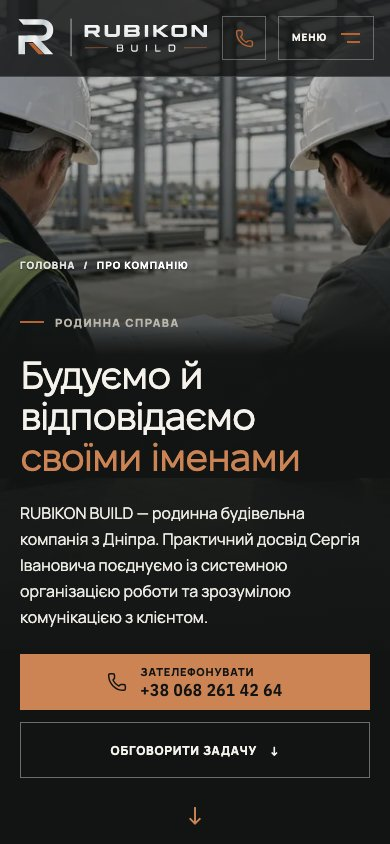

# H1 + P5 · мобільний перший екран · перегляд власником

Головна отримала обрану ілюстрацію H1, «Про нас» — P5 зі збереженням обох умовних фахівців. Шапка інтегрована у сцену: 82% темного фону на початку, 97% після прокручування або при відкритому меню, без blur. Поточні українські тексти, контакти та tablet/desktop-медіа збережені. Це Draft для перегляду; Stage 01 HOLD залишається, merge/deploy не погоджені.

## Перегляд реальної збірки

Локальне порівняння: http://127.0.0.1:8766/implementation/ — перемикачі сторінки, теми, першого візиту та ширини 390/820/1440. Живі сторінки: http://127.0.0.1:4186/ і http://127.0.0.1:4186/pro-nas. Живі заявки не надсилалися.

Нижче — кадри виробничих збірок, не окремого прототипу. «До» — remote main 6cf74f2, «після» — ця гілка. Для повторюваності кадрів рух вимкнений через reduced motion.

| Головна · 390×844 | Про нас · 390×844 |
|---|---|
| До:  | До:  |
| Після:  | Після:  |
| Перший візит:  | Перший візит:  |
| Темна тема:  | Темна тема:  |

На першому візиті HOME кнопка дзвінка лишається над справжнім cookie-банером при 390×844; дії тимчасово стоять перед незміненим описом. На малих телефонах/при збільшенні тексту секція може бути вищою за екран; дзвінок у закріпленій шапці доступний. Довгий текст можна прочитати прокручуванням, відповівши на банер. Consent-компонент і його текст не редагувалися.

## Геометрія й медіа

- Телефонна сцена HOME діє до 760px, About — до 600px. Обидві: min-height:100svh; height:auto, safe-area, контактні цілі від 44×44px.
- Фокус H1/P5: 50% 30%. P5: clamp(530px,77svh,740px). Градієнт під заголовком росте разом із текстом; додаткового скрипта resize або blur немає.
- SSR, preload та гідратоване зображення вибирають один poster. На сцену — лише три WebP: 480/768/1024. [Походження та фактичні бюджети](../design/2026-10-16-mobile-first-impression.md). PNG-майстри збережені в дослідних матеріалах власника, не в публічному delivery.
- Межі 600/601 і 760/761 перевірені. Поза відповідною phone-межею геометрія Hero/заголовка, CSS шапки та джерела poster точно збіглися з main в обох темах, зокрема на 820/1440px. Desktop-монтажі й константи не змінені.

## Перевірки й обмеження

Lint, явний typecheck, виробнича збірка та 1393 unit-тести пройшли. Виробничий браузерний прогін: 260 пройшли / 22 штатні project skips — Hero, перший контакт, consent, критичні маршрути. Ретраї не додавалися. Нові перевірки включені в чинний обов’язковий hero-video.spec.ts без зміни workflow.

Перевірено 320/375/390/430 ×667/844/932, обидві теми та стани consent, 200% розміру тексту, змодельований верхній safe-area, Escape/повернення фокуса, меню/scroll/очищення стану після зміни маршруту, один poster після hydration і відсутність телефонних MP4. CSS-стрес не є емуляцією iOS Dynamic Type.

Консервативний піксельний замір фону під кожним рядком заголовка перевірений у 16 комбінаціях сторінки/теми/consent/розміру. Збільшений текст спочатку не проходив 3:1; градієнт, прив’язаний до заголовка, виправляє це. Мінімум у фінальних зразках — 5,461:1. Для вимірювання саме фото-фону фіксований банер прихований через opacity, залишаючись у DOM зі збереженням компактної композиції; довгі рядки читаються прокручуванням над ним. Це цільова перевірка, не повна WCAG-сертифікація.

Ранній перехід за звичайним посиланням до форми міг відбутися до підключення її click-обробника. Це відтворено й на чистій main. Форма тепер враховує #inquiry після hydration і при зміні hash. Чинна перевірка відкриття форми збережена; API, надсилання й аналітика не змінені.

**До merge залишаються:** справжній iPhone Safari з відкритими/згорнутими панелями та text zoom; погодження власником реальних станів consent/тем; visual-freeze і перегляд лише потрібних Linux-відмінностей за DEC-18. Еталони, workflow, ретраї, пороги, аналітика, security та Rulesets не змінені. Цей PR не знімає Stage 01 HOLD.

## Холодне завантаження · локальна діагностика

По три холодні запуски кожної сторінки/збірки на тому самому Mac M1: Chromium, 390×844/DPR2, cache disabled, 150ms затримки / 1,6Mbit download / 0,75Mbit upload, CPU 4×, reduced motion, optional consent denied. Спостереження до 1,5с після network idle. Незмінна baseline зібрана з main; нові заміри — фінальний CSS. Це не field p75, не справжній iPhone, не production CDN і не висновок про проходження Core Web Vitals.

[Усі сирі зразки](media/mobile-first-impression/cold-production-samples.json). LCP-елемент у всіх зразках — IMG.direction-hero-poster. Байти/запити — вся початкова навігація, не лише Hero.

| Сторінка / збірка | LCP трьох запусків, мс | Медіана LCP, мс | Байти навігації | Запити | CLS |
|---|---|---:|---:|---:|---:|
| HOME / main | 7340, 7324, 7332 | 7332 | 1,540,592 | 63 | 0 |
| HOME / H1/P5 | 7944, 7964, 7964 | 7964 | 1,570,809 | 64 | 0 |
| Про нас / main | 4512, 4496, 4508 | 4508 | 944,309 | 58 | 0 |
| Про нас / H1/P5 | 4512, 4500, 4504 | 4504 | 949,294 | 59 | 0 |

HOME у цьому повільному локальному профілі приблизно на 0,6с повільніша; About — практично без різниці. Це чесно зафіксований компроміс, не обіцянка прискорення. Обидві вихідні сторінки вже мають високий LCP у цьому профілі; вузький дизайн-PR не вирішує загальну швидкість сайту.

Обидві сторінки запитують один poster і жодного відео. Малий компонент стану шапки додає один запит. H1 1024w — 140186 байтів; P5 — 73792. Оцінка одного нестисненого RGBA-буфера 1024×1536 — 6MiB; фактичні пам’ять браузера та час decode не вимірювалися. Раніше вибране HOME-зображення мало 752×678 (~1,95MiB RGBA), About — 768×1152 (~3,38MiB).

На телефоні залишаємо статику. Autoplay додасть запити, трафік і decode поверх уже суттєвого завантаження сторінки. Оптимізація desktop-каденсу PR #197 не доводить phone-performance. Майбутній optional clip потребуватиме окремого бюджету й перевірки на пристрої: muted/playsinline, poster-first, reduced motion/save-data та безпечний fallback, коли стан енергозбереження визначити неможливо.

## Рішення власника перед freeze

1. Погодити реальний перший візит і додатковий захист читабельності в обох темах.
2. Прийняти виміряний компроміс швидкості HOME або замовити вузьке порівняння стиснення перед freeze.
3. Пройти приймання на iPhone Safari; після цього — freeze і перегляд Linux-еталонів. Merge/deploy потребують окремого рішення.

Якщо після окремо погодженого впровадження потрібен rollback: разом відкотити вузькі коміти цієї гілки, повернувши попередні phone poster, геометрію й шапку. Міграцій даних або security-змін немає.

## Контроль desktop

[Головна · світла](media/mobile-first-impression/selected-home-light-1440.jpg) · [головна · темна](media/mobile-first-impression/selected-home-dark-1440.jpg) · [Про нас · світла](media/mobile-first-impression/selected-about-light-1440.jpg) · [Про нас · темна](media/mobile-first-impression/selected-about-dark-1440.jpg). Повне порівняння з main збережене в локальній галереї.
