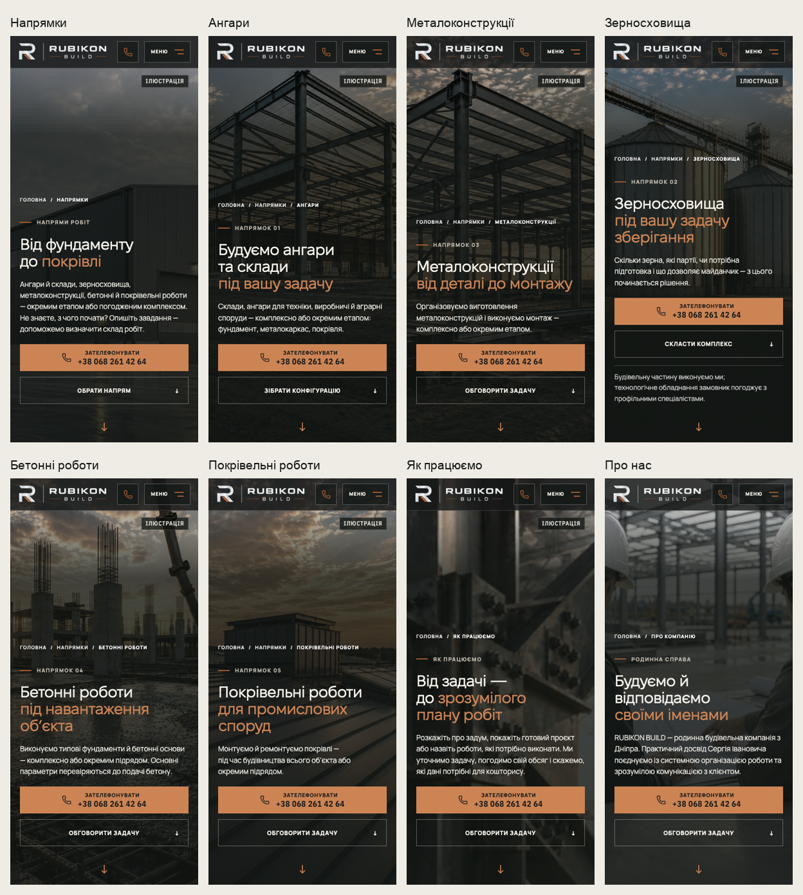

# Apply the accepted HOME composition to public phone Heroes

The owner accepted HOME preview `1397f535` on a physical iPhone12 and explicitly requested the same composition across the remaining mobile pages. Draft #206 remains stacked on #205 at752cc01; Stage01 HOLD remains. No merge or production deployment.

## Result

Eight public inner-page Heroes now follow the accepted HOME layout at≤760px: directions, hangars, metal structures, grain storage, concrete works, roofing, process and about. The approved HOME is untouched. Tablet/desktop composition above760px is preserved.

- Shared `phone-hero.css` explicitly opts in these Heroes. Its outer scene uses100lvh + max(64px, bottom-safe-area), with100svh fallback; inner content uses100svh - the67px header plus safe top. A12px reserve plus bottom safe area keeps the normal-flow44px cue above the small visible fold. Content can grow naturally without clipping.
- The image fills the scene. One continuous graphite gradient protects the copy; the About headline's former dark pseudo-panel is suppressed. All existing assets, theme selection, reduced-motion behavior and video boundaries remain. Grain's existing image mask still conceals fabricated drawing dimensions; it is deliberately retained.
- Compact66px phone nav,186px logo,≥44px controls; phone/tablet translucency and dense scroll/menu states remain. No viewport JavaScript or blur added.
- Headings follow the HOME type rhythm, body copy15px/1.55, buttons56px. Factual copy and all phone/inquiry/configurator/planner actions remain unchanged. Large phone text can wrap within the call.
- About's existing cue moves into normal flow. New cues on the other pages use existing next-content anchors or an id on the existing overview section. No new sibling interrupts the desktop first-section inscription. The configurator retains its drawing-first native landing. Legacy `/planner-preview` is explicitly excluded.

At390×844 all eight scene/photo frames reach908px and their cue targets end at832px. Seven primary calls end at696px; grain's retained responsibility note puts its primary call at599.8px. Short screens and200% text may require scrolling, without clipping or removing content.

## Comparisons

These are Chromium screenshots at390×844 without drawn Safari controls; physical Safari acceptance is still required for the newly changed pages.

## Verification and limits

- Build/lint/typecheck and1393 unit tests pass. The eight new page-behavior regressions first fail on the accepted baseline, then pass with the opt-in layout. The production Hero/static-image/rhythm suite passes81/81; final breakpoint-scoping smoke and the exact Cloudflare version are recorded in the PR.
- Chromium128/128 and WebKit128/128 layout cases pass across320/375/390/430 widths, heights664/667/844/932, both themes, first visits, text enlargement and simulated47/34px safe areas. Thirty-two additional200% text checks wait for computed font sizes and layout frames before measuring, and pass. No horizontal overflow, escaping call text or uncovered scene edges found.
- All38 control screenshots are pixel-identical: both themes, all nine routes at820/1440px, and approved HOME at390px. One invalid before capture had an unloaded background; it was replaced from the exact accepted immutable preview with image readiness checked.
- Cold unthrottled local Chromium390×844 observations for the new inner Heroes: CLS0; LCP108–536ms across both themes. These are diagnostics, not Lighthouse/mobile-network budget acceptance. The earlier delayed-font HOME CLS, main analytics and Lighthouse issues remain open.
- Independent review caught and resolved the desktop inscription adjacency, legacy planner scope and enlarged call-number wrapping issues. An existing mobile static-Hero regression exposed layout shifts caused by an added cookie-dependent reserve; that reserve was removed. Consent behavior itself is unchanged. Existing native configurator landing is verified through its visible drawing layout rather than an arbitrary section-top offset.
- No snapshot baselines, existing retries or thresholds, CI workflows, rulesets, analytics/CSP/SEO, video assets or image-loading policies changed. Local HTTP WebKit removes only upgrade-insecure-requests in the harness; HTTPS preview checks require no accommodation. No leads submitted.

Review the eight new phone pages on the iPhone with Safari controls expanded/collapsed, especially grain's longer responsibility note, About's portrait crop and the configurator jump. The exact immutable preview and final HTTPS smoke result belong to the PR description. Select «Лише необхідні» in a fresh/private context; existing preview consent can enable production GA4.
