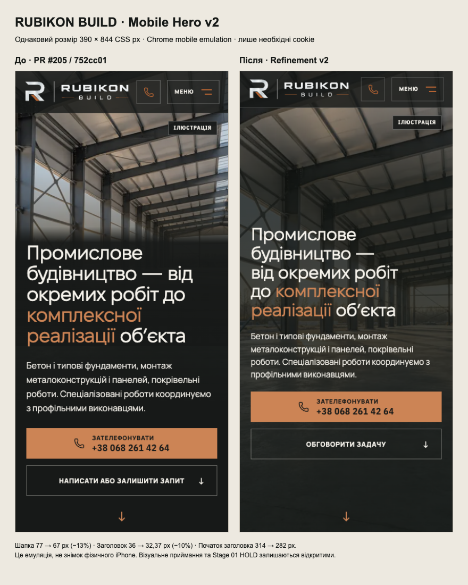

# Mobile HOME Hero refinement v2 · 18 October 2026

Draft for owner review on physical iPhone 12. Stage 01 HOLD remains. No merge or production deployment.

## Base and scope

This is stacked on PR #205, `design/mobile-first-impression-h1-p5`, exact `752cc01c6a4a8eb175bdfbe40f696e205249348f` (verified against GitHub). Main is `6cf74f2005e6da010405b1e6eea4f516be621447`; Wave01 PRs #201–204 are merged. The original local analytics checkout has unrelated uncommitted work and was not edited.

The new branch is `design/mobile-hero-refinement-v2`. Its PR targets #205's branch to keep the review limited to this refinement. Rebase/retarget only after the parent is incorporated; the existing PR Fast Gate targets main, so a stacked PR does not automatically run that gate. Required integration checks must run on the eventual main-targeting PR. No workflow or gate policy was changed.

## Product changes

- HOME ≤760px: the selected H1 industrial illustration covers the whole growing Hero. A single multi-stop graphite shade replaces the image cutoff and heading's opaque backing. Fixed early shade stops protect enlarged copy; the scene still shows through at the bottom.
- Crop/focal point: `48% 38%` in the full-height frame, preserving the steel roof perspective. Media files, preload, priority, fetch policy and desktop video #197 remain unchanged.
- Heading: `clamp(1.8125rem, 8.3vw, 2.1875rem)`, line height 1.08, natural wrapping. Claim unchanged. Description unchanged at 15px / 1.55.
- **Copy for owner review:** mobile HOME only, «НАПИСАТИ АБО ЗАЛИШИТИ ЗАПИТ» → **«ОБГОВОРИТИ ЗАДАЧУ»**. Same link, `#inquiry`, `data-open-inquiry`, form action and tracking behavior. CSS-hidden label alternatives give one accessible name at each width.
- HOME mobile header: 77→67px; logo maximum 210→186px, softer borders. Effective call/menu/brand targets remain ≥44px; existing focus, keyboard, menu, scroll and route behavior remain.
- `min-height:100svh`, safe-area allowances and content-driven growth remain. No fixed clipping, new blur, mobile video, dependencies, analytics/CSP/SEO changes or changes to About/desktop design.

## Same-size comparison

Chrome mobile emulation, optional cookies denied, same 390×844 viewport. This is a render of exact PR #205 and the candidate, not the user's physical-device screenshot.

| Measurement | Before | After |
|---|---:|---:|
| Header height | 77px | 67px (−13%) |
| Heading font | 35.997px | 32.37px (−10.1%) |
| Heading top | 313.84px | 281.63px (32.22px higher) |
| Heading block | 189.84px | 174.77px |
| Lead line height | 26.08px | 23.25px |
| Lead block | 104.31px | 93px |
| Photo height | 650.91px | 844px |
| Primary/secondary targets | 56px | 56px |

## Verification

- Lint, explicit typecheck, production build passed. Unit suite: 90 files / 1393 tests passed.
- New regression tests were RED against exact baseline: old accessible CTA name and image ending 146.375px before the bottom of the 320×667 Hero. They pass on the candidate.
- Hero suite: 55 tests passed on the production candidate, including both pages' existing playback, picture hydration, consent, themes, safe areas, growth, menu/route/keyboard and scroll contracts.
- Focused HOME smoke/contact/rhythm and desktop late-font checks: 13 passed. The inherited smoke image-family expectation was reproduced failing on unchanged baseline and updated from `hero-mobile-` to the already-selected `hero-h1-`; eagerness/priority assertions remain.
- **Inherited failure, not waived:** mobile `typography.spec.ts` late-font HOME test is 0.05784928724246045 CLS on both exact baseline and candidate, against <0.01. Baseline identity independently checked (77px header, old label, shortened image). No assertion/retry/timeout change.
- No snapshot baseline changes or visual-freeze label (DEC-18). Independent code review found no actionable issues.

## Preview safety and existing CI

Use the existing Cloudflare branch build only. Branch version previews do not promote website code to the production route. They still use existing application bindings and consent behavior: production GA4 is loaded after analytics consent even on workers.dev. Review in a fresh/private context and select **«Лише необхідні»**. All automated checks deny analytics or intercept Google; no lead was submitted. No manual Wrangler deploy, merge, production config or ruleset change.

Existing main failures remain outside scope: Main Regression run38930168436 (live analytics flaky case); Nightly39011761008 (HOME and standard Lighthouse). This refinement does not close Stage01 or grant visual approval.

## Owner handoff

On the physical iPhone12, assess the image/gradient as one continuous scene, the headline wrapping and copper contrast, the smaller logo/header and comfortable phone/menu targets. Check with Safari's address bar expanded and collapsed, light/dark, first-visit cookie banner and larger text. Confirm the new CTA wording and form opening without submitting a real lead. Small/zoomed screens can scroll naturally; fitting all content into a rigid first fold is deliberately not a guarantee.
