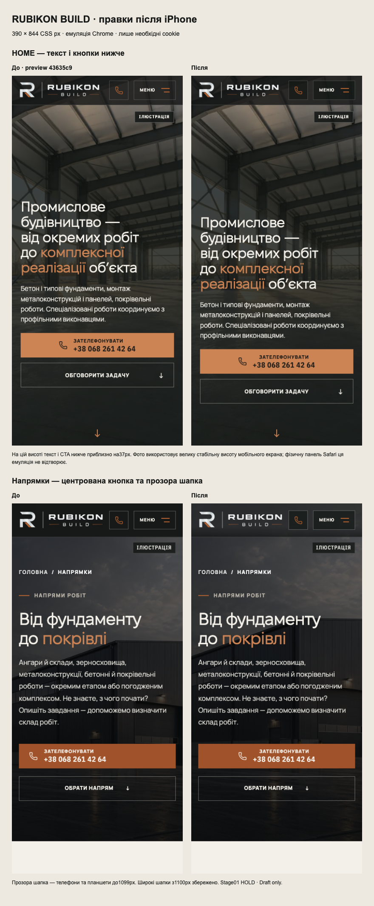

# iPhone owner feedback — centred calls and compact headers

18 October 2026. Continues Draft #206 from exact owner-reviewed preview43635c9. Base remains #205 (`752cc01`). Stage01 HOLD remains; no merge or production deployment.

## Latest owner correction — only the photograph extends below the visible area

The owner clarified from the next physical iPhone screenshot: the photo should continue behind Safari's controls, while the heading, description and both CTA buttons must sit higher. This supersedes the previous36.61px downward adjustment described below.

- Keep the outer scene at `100lvh` (with `100svh` fallback), but size its copy wrapper against `100svh - header`. The extra large-viewport area is photograph only; it no longer pulls the content down.
- Place the scroll cue in the copy wrapper's normal flow, after the actions, rather than at the bottom of the large scene. Text zoom can grow the wrapper naturally.
- At390×844, heading top318.23→282.23px and CTA row bottom748→712px. Photo height remains844px. Shared CTA centring and all approved compact/wide header behavior are unchanged.
- A regression models664px visible space with an844px photo scene and the normal32.37px heading. Before correction the secondary CTA ended at786px. The corrected CTA and scroll cue stay within the visible area while the image still reaches844px. The model is appended to the local CSS response so hydration cannot remove a temporary fixture style.
- Production Hero suite58/58, unit1393/1393, build/lint/typecheck passed. The regression fixture's readiness and persistence are checked explicitly; a further12/12 Chrome/WebKit model cases pass across three visible heights and both themes. Real Safari browser chrome still requires owner confirmation.

The following sections and comparison describe the previousadbe6c0 iteration and remain as history.

## Final behavior

- Call CTA icon+label groups are centred consistently, with centred label/number text and symmetric horizontal padding. The shared conversation call label is centred too. Contact destinations, wording and tracking behavior are unchanged.
- Mobile HOME content is bottom-aligned with96px + bottom-safe-area clearance. At390×844 the heading and buttons move36.61px lower (heading top281.63→318.23px; primary CTA top587.39→624px). First-visit cookie handling and small-height overrides continue to prioritize reachable calls.
- HOME now uses stable `100lvh` with `100svh` fallback. The image already covers the complete growing Hero, so the intent is to continue the scene beneath Safari's floating controls and keep the next pale section outside that initial area. Enlarged content can still grow and scroll. Dynamic viewport-height JavaScript was not added.
- Every compact header (≤1099px, the site's existing burger breakpoint) uses the translucent treatment. HOME/About keep their current phone/tablet tint policies; other pages use82% on phones and72% on tablets. Scroll>32px or an open menu uses97%. The single state observer lives in SiteHeader and follows route/width changes; desktop HOME/About keep their previous behavior, and other desktop routes clear the state.
- Direction and directions-hub imagery continues behind the compact header. Only the overlay's top is masked; the existing shade is restored by the header's bottom, preserving the copy treatment below it.
- Compact phone/menu controls keep≥44px targets and a60% graphite backing. A measured tablet icon contrast of2.071:1 over the newly exposed bright image was corrected to3.372:1. No blur was added. Wide-screen headers are unchanged (global call centring is explicitly site-wide).

[Apple's viewport explanation](https://developer.apple.com/videos/play/wwdc2022/10048/) defines `lvh` for the largest viewport with browser controls retracted. Headless WebKit cannot reproduce Safari's floating toolbar itself; the exact bottom appearance still needs the owner's physical iPhone review.

## Validation

- Build, lint, typecheck passed; unit suite90 files /1393 tests passed.
- Three new real-behavior regressions first failed on43635c9 (label alignment, missing shared header state, HOME title top281.625px). They pass on the candidate and now live inside the existing mandatory Hero spec, with their setup scoped to their describe block. No CI modification.
- Production Hero suite58/58 passed. It includes call centring across nine routes at390/1024/1440, compact header/menu/scroll on those routes and privacy policy, desktop cleanup, lower HOME layout, and existing video/image/theme/consent/safe-area contracts.
- Focused menu/navigation/contact tests:5 passed /5 existing project skips. No retries or assertion thresholds changed.
- HOME layout matrix: Chromium64/64 and WebKit64/64, widths320/375/390/430, heights667/844/932 plus390×664, both themes, first/denied consent,200% text and simulated safe areas. No layout failures. Matrix predates only the controls' background backing, which changes no geometry.
- Header boundary controls:390/820/1024/1099/1100/1440, light/dark on HOME, directions and metalwork. Twelve baseline/candidate wide-header screenshot pairs (1100 and1440, three routes, both themes) are pixel-identical. Header/menu state contracts span all public Hero routes.
- Independent final code review found no actionable issues. No snapshot baselines were updated (DEC-18); visual acceptance remains with the owner.

## Preview and remaining acceptance

[Branch preview](https://design-mobile-hero-refinement-v2-rubikon-build.leusd100.workers.dev/) is generated by the existing Cloudflare branch workflow. Use a fresh/private browser and «Лише необхідні» because the existing preview can enable production GA4 after consent. No leads were submitted. No analytics/CSP/SEO changes, mobile video, desktop video assets, rulesets or production config changes.

Final HTTPS preview smoke must corroborate image loading, centred calls, header states and desktop appearance without local WebKit's HTTP-only CSP accommodation. The immutable URL and exact successful Cloudflare version are recorded in the PR description.

The pre-existing mobile delayed-font HOME CLS failure (0.0578493 on both original baseline and v2, limit<0.01), main analytics flake and Lighthouse acceptance remain outside this change. This round does not declare Stage01 accepted. Stacked PR Fast Gate still targets main; required integration checks must run after appropriate retargeting.

Owner review: assess whether the lower content feels balanced, both call-label lines feel centred, the scene reaches behind Safari controls with bars expanded/collapsed, and phone/tablet transparency stays readable. Physical iPhone and tablet testing remains open.
