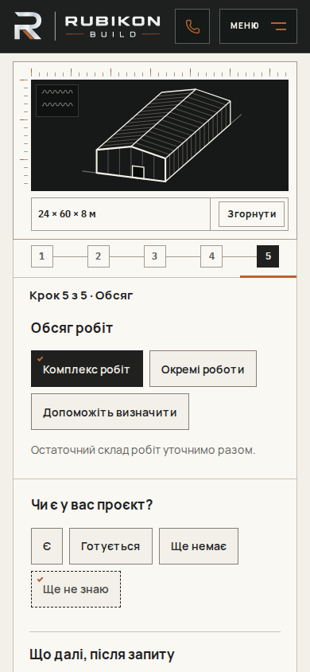
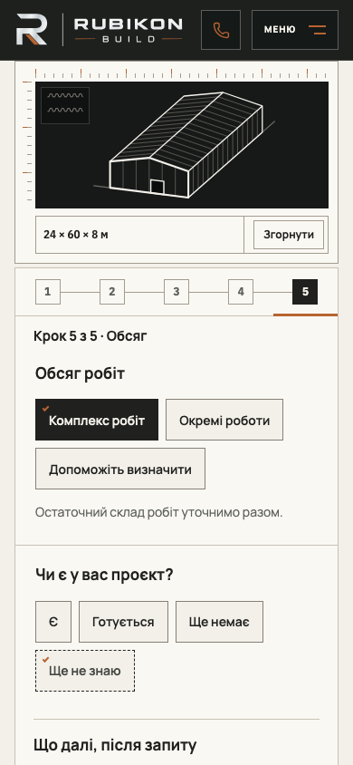
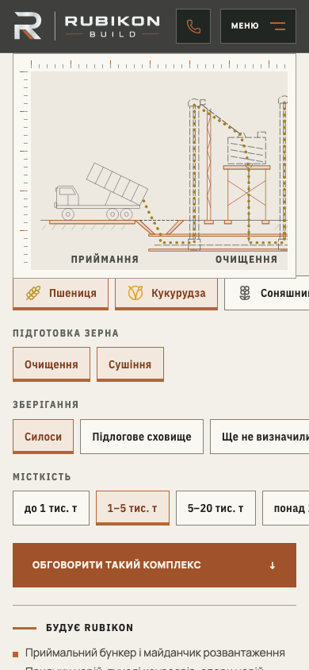

# Phone header clearance follow-up · 18 October2026

After #206, full Main Regression39122467033 found seven deterministic Angary mini-preview/tab-clearance failures and three smoke tests expecting retired photo families. Shards2/3 and both full visual shards passed. This follow-up fixes those omissions without changing the accepted Hero design.

Embedded phone mini-preview top and focus clearance now use the shared compact header edge; its hold/let-go observer measures the actual header bottom. Header border-box observation updates lines when safe-area padding changes alone or alongside a sheet resize. Existing observer/media cleanup remains. Independent review also identified the live grain drawing's old77px edge; it now shares the compact edge. Legacy77px fallback and tablet101px behavior remain. Generic anchor margins are unchanged.

Smoke expectations now name approved H1/P5 photo families. Existing no-video, pause-control, decorative-alt and illustration-provenance assertions remain. No additional tests skipped; thresholds/retries/workflows/analytics/security policies and visual baselines are unchanged.

Validation: four0/47px sticky cases failed before the fix; header-only safe-area test failed before observer correction. Final complete Angary interactive, configurator-sheet and grain-page desktop suites82passed/1existing skip; complete desktop/mobile smoke42passed/6existing skips. Production build passed. Independent delta review has no remaining findings. CI validation is linked from the PR.

The failed initial83-case local run captured a new grain test setup race: it read the header before injected safe-area CSS had applied. The test now asserts67+safeTop first, then measures and scrolls; no layout assertion relaxed. Final rerun82passed/1skip.

## Visual evidence

Before: actual Linux CI screenshot from de21ee3 / run39122467033 / shard1 / artifact12135485147, first failing mini alignment assertion. After: Mac production build, same390×844 viewport and scope step. Platforms differ; these are geometry evidence, not pixel-identical comparisons or baseline updates. Header/mini edge was67/77px; after67/67px. With simulated47px safe area both edges114px. Actual iPhone testing is not claimed.

Stage01 HOLD and separate analytics/Lighthouse/delayed-font CLS work remain open. No live leads submitted. Rollback: reviewed revert of this follow-up; reverting would restore the demonstrated clearance defects.
