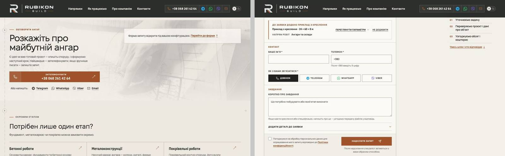

# Handoff · /angary: «Обговорити цю конфігурацію» на десктопі лишає біля форми під штампом (PDO-02)

| | |
|---|---|
| Дата | 2026-10-19 |
| Виконавець | Claude Code |
| Підстава | OD-PX-01 «APPROVED FOR IMPLEMENTATION IN DRAFT PRs»; Premium Experience Review 18.10, PDO-02 (ANG-09), крок W1-02 |
| Рев'ю | Незалежне — очікується: ChatGPT (через GitHub). Рішення — Дмитро |
| PR | Draft. **Merge і deploy не виконувались і не дозволені** без окремого OK Дмитра (DEC-30) |
| Гілка / base | `fix/angary-lenis-anchor` від `main` `d45d450` (у рев'ю був `d723f57`; між ними лише #208, CI) |
| Коміти | `f24d6c0` тести (RED на main) · `e123d80` виправлення · цей handoff |
| Змінено | `app/components/inquiry/revealAttachedBrief.ts` (+24 рядки), `tests/e2e/configurator-phase4-inquiry.spec.ts` (+3 тести), `tests/unit/inquiry/revealAttachedBrief.test.ts` (+3 тести, fake-клік отримав `stopPropagation`/`eventPhase`) |
| Не змінено | `SmoothScroll.tsx` і параметри Lenis (lerp, `anchors: true`); тексти, вигляд; еталони (DEC-18); наявні перевірки |

## Проблема

Від 1181 px, коли Lenis увімкнено і reduced motion немає, «Обговорити цю конфігурацію» відкриває форму під штампом і ставить фокус на бриф. Але сторінку при цьому везе в кінець, до рядка «Форма запиту відкрита під вашою конфігурацією. Перейти до форми ↑». Бриф у фокусі лишається на ~4 800 px над вікном.

Відтворено на main `d45d450` (локальний production build, клік, жодне поле не заповнювалось):

| Двигун, ширина | Умова | «Обговорити»: scrollY | Верх брифу |
|---|---|---|---:|
| Chromium 1181 | Lenis | 1349 → 6618 | −4488 |
| Chromium 1280 | Lenis | 1311 → 6637 | −4545 |
| Chromium 1440 | Lenis | 1440 → 7034 | −4758 |
| Chromium 1920 | Lenis | 1536 → 7516 | −5033 |
| WebKit 1440 | Lenis | 1498 → 7033 | −4757 |
| Chromium 1440 | `?lenis=off` · reduce · 1180 · 390 (контроль) | → 2159 / 2159 / 2171 / 3238 | 117 |

- На 1440 у кінець так само ведуть «Обговорити вартість вашого ангара», «Обговорити з керівником будівельного напряму», «Надіслати бриф ↑» і «Залишити запит» у FAQ, у Chromium і WebKit.
- Enter з клавіатури на «Обговорити» дає те саме: 7034, бриф на −4758.

**Причина, доведена виконанням.**

- На `window` сторінки висить лише один click-слухач, і це Lenis (`onClick` з `lenis.mjs` 1.3.26, bubble; другий — службовий слухач Playwright).
- Lenis бере кожне посилання на якір цієї сторінки й робить `scrollTo(hash)`. `defaultPrevented` він не перевіряє.
- `revealAttachedBrief` робив лише `preventDefault()`, тож Lenis їхав до `#inquiry` у кінці сторінки.
- Контроль: той самий клік, зупинений на `document`, лишає сторінку на 2159, а бриф — на 117 px.

Наявні тести Phase 4 працюють з `reducedMotion: 'reduce'`, де Lenis не стартує, тому дефекту не бачили.

## Зміна

Клік, який `revealAttachedBrief` узяв на себе, далі не йде до `window`. Те саме вже зроблено для `#configurator` у `HangarConfigurator`.

- **Клік із React-обробника посилання** зупиняється на `document`. Там його отримують React і слухачі сторінки (`trackContact`, `HangarConfigurator`), але не Lenis.
- **Клік із capture-слухача `ConversationFormToggle`** (CTA з `data-open-inquiry`: вартість, штамп, FAQ) потребує іншого. Цей слухач бачить клік раніше за посилання, і `stopPropagation()` там зупинив би й власний `onClick` посилання. Тому такий клік зупиняється на зворотному шляху вгору: одноразовим слухачем на `document`, що бере лише цей самий клік. Якщо клік туди не дійшов, слухач знімається на наступному кліку і нічого не зупиняє.

**Відхилення від варіанта A аудиту.** Простий `stopPropagation()` у `revealAttachedBrief` зламав би capture-шлях. Посилання з `data-open-inquiry` і власним `onClick` (`PrefillInquiryLink`, `FormatPrefillLink` пишуть рядок у «Коротко про завдання») при прикріпленому брифі втратили б цей рядок. Сьогодні жодна сторінка не поєднує таке посилання з брифом: на `/planner-preview` немає посилань ситуацій, а на `/zernoskhovyshcha` немає планувальника. Тому ризик прихований, а не живий, і закріплено його unit-тестом. Предки п'яти посилань /angary власних React-обробників кліку не мають (перевірено за `__reactProps`).

Звичайні якорі без узятого брифу й далі йдуть через Lenis плавно. Перевірено перше посилання-якір HOME (`#inquiry`, 43 / 41 кадр руху), `#configurator` (34 / 34) і CTA вартості без брифу (41 / 41) — ті самі цілі до й після.

## Перевірка

**RED → GREEN.**

- e2e у `configurator-phase4-inquiry.spec.ts` **на main падають 3/3**, на гілці проходять:
  - 1181 і 1920: «Обговорити» лишає бриф під шапкою, `html.lenis` перевіряється, тож тест не пройде мовчки без Lenis;
  - 1440: те саме для рядка «Перейти до форми ↑», вузла маршруту, CTA вартості, CTA штампа й FAQ.
- Unit: **на main падають 4/10**, на гілці 10/10.

**Після.** «Обговорити» → бриф на 117 px у всіх п'яти випадках з Lenis (1181 → 2013, 1280 → 1975, 1440 → 2159, 1920 → 2366, WebKit 1440 → 2159). Усі п'ять CTA з брифом теж → 117. Enter з клавіатури: 2159, бриф 117, `:focus-visible`. Контрольні випадки не змінились.

**Локально, production build гілки:**

| Набір | Результат |
|---|---|
| `configurator-phase4-inquiry.spec.ts`, desktop + mobile | 10 passed, 10 skipped (mobile — за задумом файлу) |
| angary-\*, configurator-\* (без visual), ux-conversion-phase2, grain-planner-handoff, form, first-contact, pr-critical, smoke, inquiry-brief-handoff; desktop + mobile, 4 workers | 623 passed, 161 skipped, 7 failed |
| ці 7 окремо, на main і на гілці | 7/7 і 7/7 passed — тайм-аути під навантаженням машини, не регресія |
| Unit | 1396/1396 (main 1393 + 3) |
| `tsc`, `eslint .`, `git diff --check` | чисто |

**CI.** PR Gate (inquiry job запускає `configurator-phase4-inquiry.spec.ts`) і Main Regression на гілці (`workflow_dispatch`): посилання й результат — у коментарі до PR.

**Разом із PDO-01 і PDO-03** (гілки `fix/inquiry-phone`, `fix/inquiry-sent-focus`): конфліктів немає. Збірка main + три гілки: inquiry- і configurator-набори 156/156 (43 skip).

## Ризики

- Хтось на `window` міг розраховувати отримати саме ці кліки. У перевіреному стані (лише необхідні cookie, Turnstile stub) на `window` є лише Lenis. Справжній gtag з увімкненою аналітикою не перевірявся: це був би живий тег.
- Трекпад і колесо в справжньому Safari і Chrome (L4) не перевірялись. WebKit — Playwright-емуляція.

## Що не входить

- **PDO-26** (`data-lenis-prevent` на діалозі «Розгорнути»): роадмап ставить його в той самий крок W1-02, але погодження OD-PX-01 — на три дефекти. Окремий PR, якщо скажете.
- **Варіант B аудиту** (`anchors: false` і власний слухач, що поважає `defaultPrevented`) прибрав би весь клас дефектів, але зачіпає всі якорі сайту на ≥ 1181 px. Пропоную разом із PDO-26 і PDO-95.

## Докази

Приватний пакет доказів поза репозиторієм (SHA256SUMS `3f59bc8b…`):

| Файл | SHA-256 |
|---|---|
| `r02-angary-before.json` | `d541df9d512631cc6064dd3fb3f6d6e4c64aefe4fb75994363fee32b2f4a490b` |
| `r02-angary-after.json` | `165c92e8e090604463c6aed95fdb1beba55e5fb81ed73cea78e1ccf22391f8bb` |
| `r02b-cause-before.json` (слухачі на `window`, контроль зі stop на `document`) | `71b42b5e35c5579482d184a5a4378c8717a51fd3269edd00b6904cfac958c4b3` |
| `r02c-anchors-before.json` / `-after.json` (звичайні якорі) | `0c0c3788ffa1d133…` / `ff32022217701662…` |
| `r02d-keyboard-before.json` / `-after.json` | `779070de0d32ad73…` / `3d3ecca725af044b…` |
| `PDO-02-red-main-d45d450.log`, `PDO-02-unit-red-main.log` | `8003badf5c0fb92b…`, `cc054fefd216f8bb…` |
| `PDO-02-green-broad.log`, `PDO-02-broad-failures-recheck.log` | `7d3c8e8b60b2fbec…`, `524078d3ffa3068e…` |

Метод: Playwright 1.62.1, Chromium і WebKit. Усі хости, крім застосунку, заблоковані. Turnstile — stub. Жодної заявки не надсилалось.
