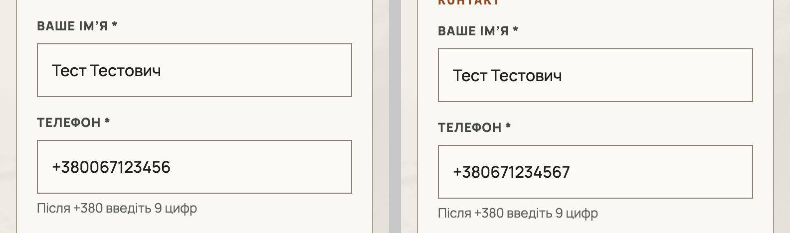
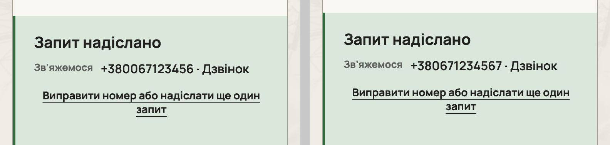

# Handoff · Форма запиту: «0XX…» після +380 більше не зберігає чужий номер (PDO-01)

| | |
|---|---|
| Дата | 2026-10-19 |
| Виконавець | Claude Code |
| Підстава | OD-PX-01 «APPROVED FOR IMPLEMENTATION IN DRAFT PRs»; Premium Experience Review 18.10, PDO-01 (B2B-01), крок W1-01 |
| Рев'ю | Незалежне — очікується: ChatGPT (через GitHub). Рішення — Дмитро |
| PR | Draft. **Merge і deploy не виконувались і не дозволені** без окремого OK Дмитра (DEC-30) |
| Гілка / base | `fix/inquiry-phone` від `main` `d45d450` (у рев'ю був `d723f57`; між ними лише #208, CI) |
| Коміти | `491f371` тести (RED на main) · `b5df739` виправлення · цей handoff |
| Змінено | `app/lib/inquiry/phone.ts` (новий), `app/components/ProjectInquiryForm.tsx` (+20 рядків), `tests/e2e/form.spec.ts` (+6 тестів), `tests/unit/inquiry/phone.test.ts` (новий, 17 випадків) |
| Не змінено | `app/api/leads/route.ts` і `PHONE_PATTERN`; `pattern` поля; тексти, підказки й повідомлення; вигляд форми; формат номера в «Запит надіслано»; еталони (DEC-18); workflows |

## Проблема

Поле «Телефон» стартує з «+380», має `maxLength={13}` і `pattern="\+380[0-9]{9}"`. Людина набирає номер так, як він записаний, — «067…» — після префікса:

- «0671234567» → у полі «+380067123456»: зайвий 0 лишається, остання цифра губиться, поле валідне;
- `POST /api/leads` (тут — `route.fulfill`) отримує `+380067123456`, сервер такий номер приймає (`/^\+380\d{9}$/`);
- зайва 10-та цифра після +380 так само мовчки обрізалась у «валідний» номер;
- вставка «+38 067 123 45 67» обрізалась до «+38 067 123 4», з повідомленням.

**Відтворено на main `d45d450`** (локальний production build, лід замоковано, тільки фіктивні номери): 9 способів вводу × Chromium 1440 / Chromium 390 / WebKit 390 = 27 випадків. **12 надіслали неправильний номер**, 6 — правильний, 9 зупинились на повідомленні формату. Кнопка, Enter у полі й blur поводяться однаково.

**Причина.** Префікс у полі разом з обмеженням довжини: друга «0» національного формату займає місце останньої цифри, а `pattern` на 9 будь-яких цифр після +380 приймає результат.

## Зміна

- `normalizeUaPhone` (`app/lib/inquiry/phone.ts`) переписує в `+380XXXXXXXXX` лише однозначні записи українського номера з пробілами, дужками, дефісами, крапками й плюсами:
  - `380` + 9 цифр;
  - `3800` + 9 (звичне «0XX…» після префікса);
  - `380380` + 9 (повний номер вставлено після префікса);
  - `0` + 9 (префікс стерто).
  
  Національна частина має починатися не з 0. Усе інше, зокрема літери й іноземні номери, повертається як є, і поле саме показує формат.
- Нормалізація працює на `blur` поля і в `onClick` кнопки «Надіслати запит», не в `onSubmit`: нативна перевірка йде між click і submit. Enter у полі теж проходить через click кнопки (implicit submission). Якщо номер змінився, поле перевіряється наново (`setCustomValidity('')`, повідомлення під полем знімається).
- `maxLength` 13 → 20, щоб браузер не обрізав номер до перевірки. Сервер і далі обрізає до 20 (`clip(body.phone, 20)`).

## Перевірка

**RED → GREEN.**

- e2e у `form.spec.ts` (`phone number as people type it`, 6 тестів) **на main падають 6/6**, на гілці проходять:
  - «0XX…» після +380: кнопкою, Enter у полі, після виходу з поля;
  - вставка трьох видів;
  - зайва цифра → повідомлення, жодного запиту й Turnstile;
  - 390 px (isMobile, tap).
- Unit `phone.test.ts`: 17/17 (на main модуля немає).

**Локально, production build гілки** (`vinext start`, лід — `route.fulfill`):

| Набір | Результат |
|---|---|
| `form.spec.ts`, desktop | 45/45 (39 наявних + 6 нових) |
| consent, ux-conversion-phase2, configurator-inquiry-handoff, configurator-phase4-inquiry, grain-planner-handoff, first-contact, angary-configurator-data; desktop + mobile | 166 passed, 36 skipped (наявні skip), 0 failed |
| Unit | 1410/1410 (main 1393 + 17) |
| `tsc`, `eslint .`, `git diff --check` | чисто |

**Відтворення до/після.** Ті самі 27 випадків:

| | Правильний номер | Чужий номер | Не надіслано, повідомлення |
|---|---:|---:|---:|
| main `d45d450` | 6 | **12** | 9 |
| гілка | 21 | **3** | 3 |

- «3 чужі» — це номер із пропущеною цифрою: «+380» і «0» + 8 цифр. Main його так само приймає; закрити цей випадок можна лише зміною перевірки, див. питання 1.
- «3 не надіслано» — 10 цифр після +380. Раніше такий номер мовчки обрізався, тепер поле показує повідомлення.

**CI.** PR Gate (inquiry job запускає `form.spec.ts`) і Main Regression на гілці (`workflow_dispatch`): посилання й результат — у коментарі до PR.

**Разом із PDO-02 і PDO-03** (гілки `fix/angary-lenis-anchor`, `fix/inquiry-sent-focus`). Три гілки зливаються без конфліктів у будь-якому порядку (`git merge-tree`). Окрема збірка main + усі три гілки: inquiry- і configurator-набори 156/156 (43 skip).

## Ризики

- Нормалізація торкається лише значень, які однозначно є українським номером. Помилка в ній відхилила б правильний номер, тому unit покриває 9 форм, що стають `+380671234567`, і 8, що лишаються як є, а e2e — усі шляхи вводу.
- Програмний `form.requestSubmit()` пройшов би повз click кнопки. У коді його немає.
- Автозаповнення «067…» в iOS і Chrome на пристрої не перевірено (L5). Нормалізація на click його покриває, але це висновок, а не замір.

## Питання власнику

1. **Відхиляти «+3800…».** Аудит радив `pattern \+380[1-9][0-9]{8}` на клієнті й `PHONE_PATTERN /^\+380[1-9]\d{8}$/` на сервері (тоді «+3800…» → 400). Це зміна контракту API і перевірки, тому тут вона не зроблена. Без неї номер із пропущеною цифрою після «0» проходить, як і на main. Якщо так, потрібне й нове формулювання повідомлення: нинішнє «після +380 — 9 цифр» для «+380067123456» вводить в оману, бо цифр там справді 9.
2. **Нормалізація на сервері.** Сайт уже надсилає канонічний номер. Серверна нормалізація потрібна лише для інших клієнтів API — чи вони є?
3. **Формат номера в «Запит надіслано».** Аудит пропонував «+38 0XX XXX XX XX». Це зміна тексту й вигляду панелі, тож тут її не зроблено.

## Межі

Не зроблено: зміни API або серверної перевірки, тексти, вигляд, еталони, merge, deploy, governance. Варіант B аудиту («+380» міткою поза полем) не пропонується: він змінив би еталони `homepage-inquiry-*`.

## Докази

Приватний пакет доказів поза репозиторієм (скрипти відтворення, JSON, логи, знімки; SHA256SUMS `3f59bc8b…`):

| Файл | SHA-256 |
|---|---|
| `r01-phone-before.json` | `fad5d64a178b8642dbabbe3d195f06e4e3d06ee1a57d0f64d40ab155761cd2a8` |
| `r01-phone-after.json` | `744e52bcfe3c25c0bc1914080ab670b31ea7ad24815faf6f2259dad442fd2b78` |
| `PDO-01-red-main-d45d450.log` | `8fdcbc8ba08d009235281071f41949fd199f2c5c1754a8d2d74c1fdf172d29ae` |

Метод: Playwright 1.62.1, Chromium і WebKit. Усі хости, крім застосунку, заблоковані; у Chromium DNS-захист `MAP * ~NOTFOUND`. Turnstile — stub із `turnstile.helpers.ts`. Справжніх заявок не надсилалось.
