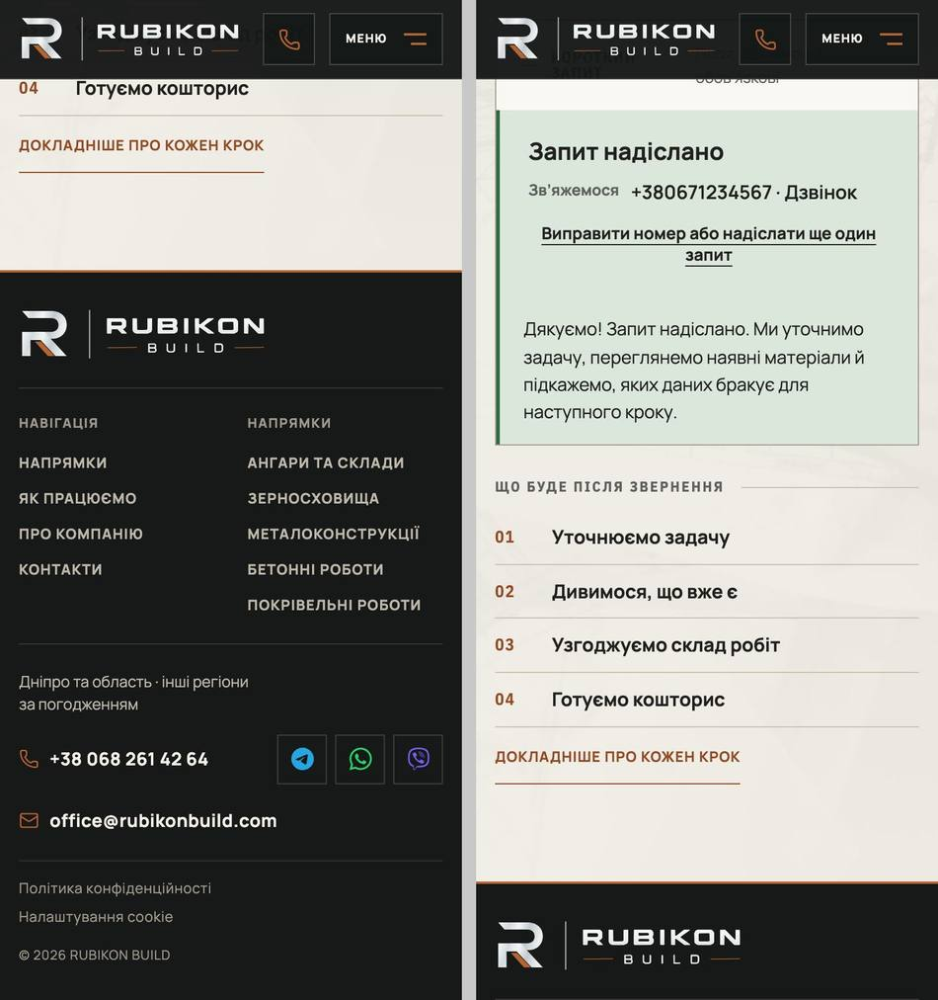
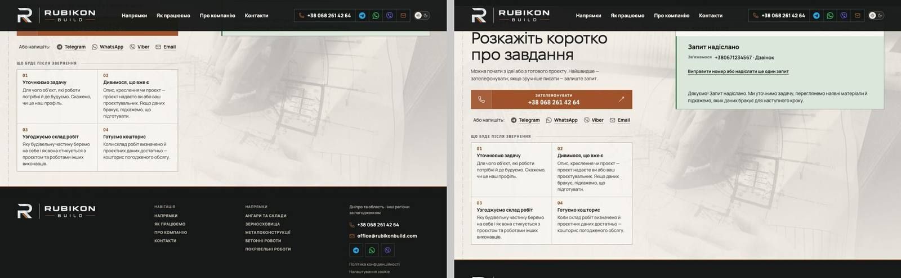

# Handoff · Форма запиту: «Запит надіслано» видно, і фокус на ньому (PDO-03)

| | |
|---|---|
| Дата | 2026-10-19 |
| Виконавець | Claude Code |
| Підстава | OD-PX-01 «APPROVED FOR IMPLEMENTATION IN DRAFT PRs»; Premium Experience Review 18.10, PDO-03 (GAP-06), крок W1-03 (лише PDO-03; PDO-65 не входить) |
| Рев'ю | Незалежне — очікується: ChatGPT (через GitHub). Рішення — Дмитро |
| PR | Draft. **Merge і deploy не виконувались і не дозволені** без окремого OK Дмитра (DEC-30) |
| Гілка / base | `fix/inquiry-sent-focus` від `main` `d45d450` (у рев'ю був `d723f57`; між ними лише #208, CI) |
| Коміти | `4320fe3` тести (RED на main) · `c530539` виправлення · цей handoff |
| Змінено | `app/components/ProjectInquiryForm.tsx` (+24 рядки), `app/globals.css` (+6 рядків), `tests/e2e/form.spec.ts` (+6 тестів) |
| Не змінено | жодного тексту, зокрема подвійне «Запит надіслано» (PDO-65, OD-PX-38); вигляд панелі; логіка надсилання й аналітики; еталони (DEC-18) |

## Проблема

Після збереженого запиту поля ховаються (`hidden`), а панель «Запит надіслано» стає на їхнє місце. Форма скорочується на всю свою висоту, але сторінка не прокручується і фокус не переноситься. Кнопка, що мала фокус, зникає, і фокус падає на `body`.

Відтворено на main `d45d450` справжнім надсиланням через форму, з `POST /api/leads` → `route.fulfill` (аудит лише симулював цей стан у DOM):

| Двигун, ширина, сторінка, дія | Шапка | Панель до (px від верху вікна) | Фокус до | Панель після | Фокус після |
|---|---:|---|---|---|---|
| Chromium 390 /, tap | 67 | −423 … −266 | body | 93 … 250 | панель |
| Chromium 390 /, tap, темна тема | 67 | −423 … −266 | body | 93 … 250 | панель |
| WebKit 390 /, tap | 67 | −424 … −266 | body | 93 … 251 | панель |
| Chromium 1024 /, click | 101 | −274 … −117 | body | 117 … 274 | панель |
| Chromium 1440 /, click (Lenis) | 101 | −120 … 38 | body | 117 … 275 | панель |
| Chromium 1440 /, Enter (Lenis) | 101 | −120 … 38 | body | 117 … 275 | панель |
| Chromium 1440 /, click, reduce | 101 | −120 … 38 | body | 117 … 275 | панель |
| WebKit 1440 /, click (Lenis) | 101 | −172 … −14 | body | 117 … 275 | панель |
| Chromium 1440 /angary, під штампом (Lenis) | 101 | −173 … 15 | body | 117 … 305 | панель |
| Chromium 390 /angary, під штампом | 67 | −637 … −426 | body | 93 … 304 | панель |

## Зміна

- `InquirySentPanel` отримує `ref` і `tabIndex={-1}`.
- Після submit, що зберіг запит, і лише тоді, панель:
  - бере фокус (`focus({ preventScroll: true })`);
  - прокручується `scrollIntoView({ block: 'nearest' })`: плавно, а з reduced motion одразу;
  - `nearest` не рухає сторінку, якщо панель уже вся у вікні.
- Панель повертається й сама, коли конфігурацію змінили, а потім повернули до надісланої. Це сторінку не рухає: прапорець `revealSent` ставить лише успішний submit.
- CSS, так само, як у брифа:
  - `scroll-margin-top` 117 px, а до 760 px — 93 px;
  - `:focus` без рамки, `:focus-visible` — рамка фокуса (F135).
  
  Після кліку мишею чи дотику рамки немає, після Enter з клавіатури вона є.

**Взаємодії.**

- **Lenis (≥ 1181 px).** Нативна плавна прокрутка панелі з Lenis доходить до кінця: 117 px у Chromium і WebKit, на HOME і на /angary.
- **FocusClearance.** Після Enter панель `:focus-visible`, тож FocusClearance її перевіряє. Панель стоїть на 117 px за шапки 101, а цього ≥ 101 + 12, тож додаткової прокрутки немає.
- **Клавіатура.** Tab з панелі веде на «Виправити номер або надіслати ще один запит», Enter на ній повертає фокус у поле телефону, як і раніше.

## Перевірка

**RED → GREEN.**

- e2e у `form.spec.ts` (`«Запит надіслано» after a saved request`, 6 тестів) **на main падають 6/6**, на гілці проходять:
  - 1440 і 1024;
  - клавіатура (`:focus-visible`, Tab, Enter);
  - reduced motion;
  - /angary під штампом;
  - 390 (isMobile, tap).
- Кожен тест перевіряє фокус на панелі й те, що вся панель у вікні нижче шапки.

**Локально, production build гілки:**

| Набір | Результат |
|---|---|
| `form.spec.ts`, desktop | 45/45 (39 наявних + 6 нових) |
| consent, ux-conversion-phase2, configurator-inquiry-handoff, configurator-phase4-inquiry, grain-planner-handoff, first-contact, angary-configurator-data, inquiry-brief-handoff, pr-critical, smoke; desktop + mobile | 325 passed, 51 skipped (наявні skip), 0 failed |
| Нові тести під навантаженням (12 повторів, 6 workers) | 36/36 |
| Unit | 1393/1393 |
| `tsc`, `eslint .`, `git diff --check` | чисто |

**CI.** PR Gate (inquiry job запускає `form.spec.ts`) і Main Regression на гілці (`workflow_dispatch`): посилання й результат — у коментарі до PR.

**Разом із PDO-01 і PDO-02.**

- Обидва PR змінюють `ProjectInquiryForm.tsx` і `form.spec.ts`, тому ефект панелі стоїть після `handleSubmit`, а не поруч із кодом PDO-01. `git merge-tree` чистий в обох порядках, і з `fix/angary-lenis-anchor` теж.
- Збірка main + три гілки: inquiry- і configurator-набори 156/156 (43 skip) у другому прогоні.
- У першому прогоні (4 workers, машина під навантаженням) тест «/angary під штампом» один раз не дочекався панелі у вікні за 5 с. Артефакти перезаписав наступний прогін, причину не встановлено. Далі: 5/5 окремо, 3/3 скриптом, 36/36 під навантаженням. Наслідок того самого прогону — два тести `grain-planner-handoff`; цей файл під таким навантаженням падає і на main (1 з 54 там, 1 з 54 на гілках).

## Ризики

- Фокус на панелі й живий регіон статусу («Дякуємо! Запит надіслано…») можуть озвучити підтвердження двічі. Прибрати повтор — це зміна текстів, PDO-65 (OD-PX-38), тут її немає.
- VoiceOver на iPhone (L5) не перевірявся.
- Стан помилки (`SAVE_FAILED`) не змінено: прокрутка до рядка статусу після помилки належить до PDO-65.

## Помічено попутно (не змінено)

У `globals.css` правило `@media (max-width: 760px) { .inquiry-config-brief { scroll-margin-top: 93px } }` стоїть перед базовим `.inquiry-config-brief { scroll-margin-top: 117px }` і тому ніколи не діє: бриф і на 390 px стає на 117. Нове правило для панелі має правильний порядок. Чи вирівнювати бриф — окреме питання.

## Докази

Приватний пакет доказів поза репозиторієм (SHA256SUMS `3f59bc8b…`):

| Файл | SHA-256 |
|---|---|
| `r03-sent-before.json` | `e918c74f8c057fdf275ebbac1cc68d55d5f90d4c5a4b097979500ce71c240093` |
| `r03-sent-after.json` | `251529a2e7f9c50d10bf7afee8d1e9d332b664d69212484db3450bc53a41e11d` |
| `PDO-03-red-main-d45d450.log` | `f6879eca9bdce22526362396f9fbce4cb5f3d8286dca299443cd103b512e2aa2` |
| `combined-suites.log` / `combined-suites-2.log` | `bdd944f62bd96273…` / `8e2aa31b7fad349b…` |
| `grain-handoff-load-main-vs-combined.log` | `2a1b474113b5000d…` |

Метод: Playwright 1.62.1, Chromium і WebKit. Усі хости, крім застосунку, заблоковані. Turnstile — stub. Лід — `route.fulfill`. Тільки фіктивні дані; справжніх заявок не надсилалось.
