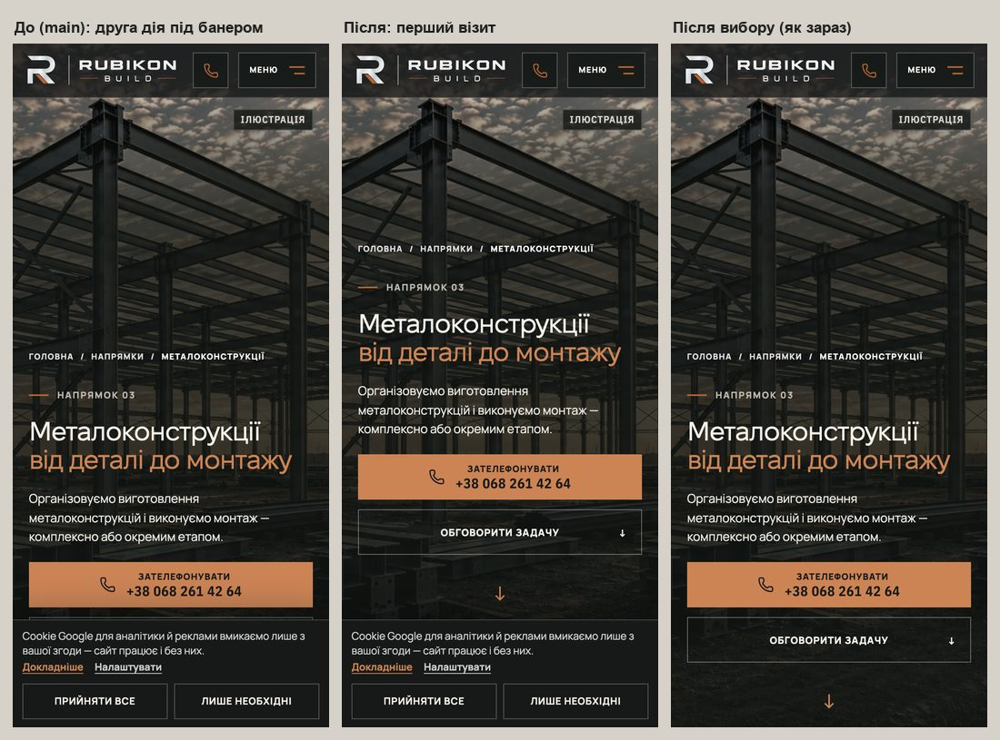
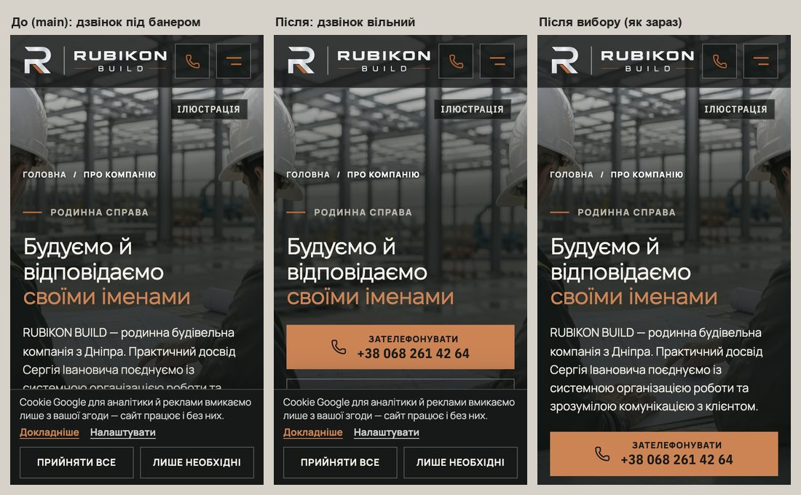
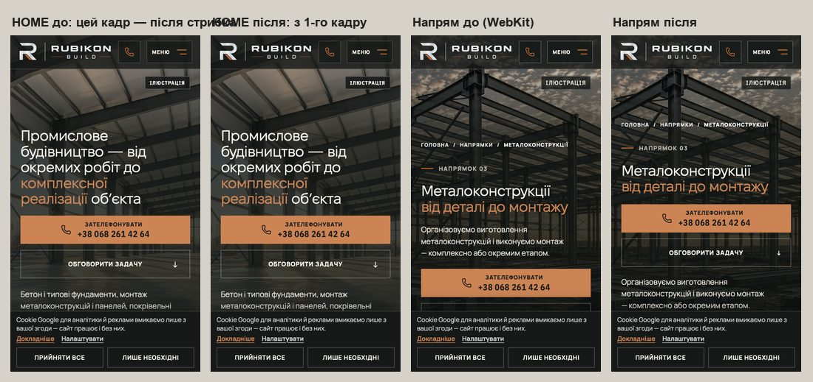

# Handoff · Банер cookie на першому візиті не лягає на дії телефонного героя (PDO-09)

| | |
|---|---|
| Дата | 2026-10-20 |
| Виконавець | Claude Code |
| Підстава | Рішення власника 20.10: «PDO-09 — OD-PX-11 (a)»: резерв під банер у телефонному герої лише на першому візиті (прапорець `data-consent-pending` до першого відмальовування), на низьких телефонах дії перед лідом, як на HOME; текст і логіка банера не змінюються. Premium Experience Review 18.10: PDO-09 (GLB-01, MISSED-global-chrome-1, MISSED-page-pro-nas-1), крок W1-08 |
| Рев'ю | Незалежне рев'ю очікується через GitHub. Рішення — за Дмитром |
| PR | Draft. **Merge і deploy не виконувались. Без окремого OK Дмитра вони не дозволені** (DEC-30). Гілка — прототип `design/*`: до мітки `visual-freeze` візуальні набори в CI відкладені (docs/ci-tier-model.md) |
| Гілка / base | `design/consent-pending-hero` від `main` `18efb1f`. Усі file:line специфікації звірено з `18efb1f` (після рев'ю в main прийшли #206–#215) |
| Коміти | `89aff6e` — код і тести · цей handoff |
| Змінено | `app/lib/consentStorage.ts` (новий: два ключі згоди, атрибут, inline-скрипт, `clearConsentPending`), `app/lib/consent.ts` (ключі тепер реекспортуються звідти, значення ті самі), `app/layout.tsx` (+1 скрипт у `<head>` після `THEME_INIT_SCRIPT`), `app/components/AnalyticsConsent.tsx` (+3 виклики `clearConsentPending`), `app/phone-hero.css` (+22 рядки, усе під `:root[data-consent-pending]`), `app/home-v2.css` (правило першого візиту HOME: прапорець замість `body:has(> .cookie-banner)`), `tests/e2e/consent-pending-hero.spec.ts` (новий, 35 тестів, лише desktop-chromium — кожен задає своє вікно), `tests/unit/consent-storage.test.ts` (новий, 22 тести) |
| Не змінено | Банер: текст, кнопки, порядок, «Прийняти все» не підсилено; логіка згоди, `readConsentState` / `writeConsentState`, gtag і Consent Mode; CSP (`'unsafe-inline'` уже в `script-src`); `--cookie-banner-clearance` (прокрутка й футер); композиція героїв без прапорця; `responsive-a11y-phase1.spec.ts` (тест :330–341 не залежить від `body:has`); SEO; workflows, retries, пороги; еталони (DEC-18) |

## Проблема

Банер cookie фіксований унизу і монтується лише після гідратації (`AnalyticsConsent.tsx`, `requestAnimationFrame`). Дії телефонного героя внутрішніх сторінок вирівняні по низу `100svh` (`phone-hero.css`), тож на першому візиті банер лягає на них. На HOME правило першого візиту було прив'язане до `body:has(> .cookie-banner)` і вмикалося вже після відмальовування — герой стрибав.

**Повторно перевірено на main `18efb1f`.** Локальний production build (`vinext start`), Playwright 1.62.1, емуляція телефона (isMobile, touch, DPR 2), перший візит: у `localStorage` нічого, справжній банер, нічого не натиснуто, замір через 3,2 с після `load`. Усі хости, крім застосунку, заблоковані. Вісім внутрішніх сторінок: /napryamky, /angary, /zernoskhovyshcha, /metalokonstruktsii, /betonni-roboty, /pokrivelni-roboty, /pro-nas, /yak-pratsyuiemo.

| Вікно | Банер, верх / висота | Дзвінок героя під банером | Друга дія під банером | Стрілка під банером | HOME: зсув при появі банера |
|---|---|---|---|---|---:|
| 320×568 | 447 / 121 px | **8 з 8** (56 з 56 px; /napryamky — 52) | частково або нижче екрана | — | 0,1986 |
| 375×667 | 546 / 121 px | 1 з 8 (/napryamky, 2 px) | **8 з 8** (32–56 з 56 px) | 7 з 8 | 0,1272 |
| 390×664 | 543 / 121 px | 0 | **8 з 8** (35–50 px) | 7 з 8 | 0,1117 |
| 390×844 | 711 / 133 px | 0 | **7 з 8** (53 з 56 px) | 8 з 8 | 0,1654 |
| 430×932 | 817 / 115 px | 0 | **7 з 8** (35 px) | 8 з 8 | 0,1144 |

- На внутрішніх сторінках сам банер нічого не зсуває (layout-shift 0): він просто лягає зверху.
- HOME: H1, `hero-copy` і стрілка зсуваються через 4–16 мс після монтування банера (215–501 мс після старту). Chromium позначає цей зсув як `hadRecentInput`, тому в лабораторний CLS він не потрапляє, хоча нічого не натискали. Дзвінок HOME над банером на всіх п'яти вікнах; друга дія на 320×568 перекрита на 34 px.
- Дзвінок у шапці (44×44) над банером на всіх 45 замірах — гарантія #178 тримається.
- Висота банера залежить від вікна: 120,8 px під його власним правилом короткого телефона (`max-height: 740px`, портрет), 133,4 px на 320–393 px завширшки вище за 740 px, 115,2 px від 412 px. Числа однакові в Chromium і WebKit.

Знахідка рев'ю підтвердилась. На 320×568 стан гірший, ніж записано 18.10: дзвінок перекритий на всіх восьми сторінках, а не на двох.

## Зміна

- **Прапорець до першого відмальовування.** `app/lib/consentStorage.ts` — новий модуль без `'use client'`: серверний `layout.tsx` вбудовує з нього рядок скрипту (з клієнтського модуля константа прийшла б як client reference). Там же визначено обидва ключі згоди (`rubikon-consent-state` і застарілий `rubikon-analytics-consent`). `consent.ts` їх реекспортує, тож скрипт і банер читають ті самі константи, а всі імпорти лишились як були.
- **Скрипт у `<head>`** стоїть одразу після `THEME_INIT_SCRIPT`. Він ставить `data-consent-pending` на `<html>` рівно тоді, коли `readConsentState()` поверне `null`: немає дійсного вибору під поточним ключем, немає `granted` / `denied` під застарілим, або сховище кидає виняток. CSP не змінювали: `'unsafe-inline'` уже є в `script-src` (`csp.ts`), скрипт виконується на production-збірці без жодного порушення.
- **Хто знімає прапорець** (`AnalyticsConsent.tsx`):
  - `applyChoice` — будь-яка відповідь у банері, разом із його закриттям;
  - `syncConsent` — вибір зроблено в іншій вкладці;
  - монтування — якщо вибір знайдено, а скрипт чомусь вирішив інакше: тоді місце не лишається під банером, якого не буде.
  Логіка згоди, `writeConsentState` і gtag не змінені.
- **Резерв під банер** (`phone-hero.css`, ≤760 px, лише під `:root[data-consent-pending]`). `--consent-banner-reserve` = висота банера + 12 px: **145 px**, а там, де діє власне правило банера для короткого телефона (`max-height: 740px`, портрет), **133 px**. Плюс `env(safe-area-inset-bottom)`. Це `padding-bottom` у `.phone-hero-content`, тож дії стоять над банером із першого кадру.
- **Короткий телефон** (`max-width: 760px` і `max-height: 740px`). Порядок як на HOME: дії → лід → примітка (/zernoskhovyshcha) → стрілка. На /napryamky і /pro-nas лід і дії лежать у спільному `.subhero-side`, тому він стає `display: contents`, а лід дістає 18 px зверху.
- **HOME** (`home-v2.css`). Те саме правило першого візиту (`padding-top: 116px`, дії перед лідом) тепер вмикає прапорець, а не `body:has(> .cookie-banner)`, і низ — той самий `--consent-banner-reserve` замість `max(66px, --cookie-banner-clearance)`, яку вимірювали вже після появи банера. Герой не стрибає.
- **Без прапорця нічого не змінюється:** усі нові правила під `:root[data-consent-pending]`. Після «Лише необхідні» чи повторного візиту герой точно такий, як на main (див. «Перевірка»).

## Перевірка

Рівні: **L2** — емуляція Chromium, **L3** — Playwright WebKit (емуляція, не Safari). Фізичного iPhone не було, L5 не перевірявся: перший візит у приватному вікні на iPhone 12 перевіряє власник.

**RED → GREEN** (`consent-pending-hero.spec.ts`, локальний production build, desktop-chromium + mobile-chromium; у mobile-chromium усі 35 пропущено — явні вікна):

| | Passed | Failed | Skipped |
|---|---:|---:|---:|
| main `18efb1f` (нові тести, код main) | 3 | **32** | 35 |
| гілка `89aff6e` | **35** | 0 | 35 |

- **Що падає на main (32):**
  - перший візит, дзвінок (і на ≥375 — друга дія) повністю над банером і під шапкою, дзвінок шапки над банером: 23 з 24 (320×568, 375×667, 390×844 × 8 сторінок);
  - прапорець на `<html>` до розбору `<body>` і жодного layout-shift при появі банера, HOME і /metalokonstruktsii на 390×844 і 375×667: 4 з 4. HOME на main дає зсув 0,1036 (H1 333 → 279);
  - «Лише необхідні» знімає прапорець, а герой після вибору й на повторному візиті однаковий (вимір до 0,1 px), на коротшому телефоні під час питання дії перед лідом, після — лід перед діями; HOME, /metalokonstruktsii, /napryamky, /pro-nas: 4 з 4;
  - нечитабельне значення під поточним ключем — і прапорець, і банер: 1 з 1.
- **Що проходить і на main, бо це запобіжники:** вибір під поточним або застарілим ключем — ні прапорця, ні банера (2); 390×844 /zernoskhovyshcha — там друга дія була вільна й на main (1).
- **Unit** `consent-storage.test.ts`: скрипт із `<head>` виконується як класичний скрипт і порівнюється з `readConsentState()` на тому самому сховищі в 17 станах (поточний ключ, застарілий, биті JSON, порожньо, масив, число, обидва ключі), плюс сховище з винятком і без `localStorage`. Перевірено мутацією: без гілки застарілого ключа падають 3 випадки.

**Заміри на гілці** (той самий метод, що в «Проблемі»). Chromium і WebKit дали однакові числа на всіх 45 комбінаціях:

| Вікно | Дзвінок героя під банером | Друга дія під банером | Стрілка під банером | Зсув / рух H1 при появі банера (HOME і 8 сторінок) |
|---|---|---|---|---|
| 320×568 | **0 з 8** (дзвінок 335–430, банер з 447) | 8 з 8, частково (12–51 px) — прийнято | 0 | 0 |
| 375×667 | 0 | **0 з 8** | 7 з 8 (як на main) | 0 |
| 390×664 | 0 | **0 з 8** | 7 з 8 (як на main) | 0 |
| 390×844 | 0 | **0 з 8** | 1 з 8 (/zernoskhovyshcha; на main 8 з 8) | 0 |
| 430×932 | 0 | **0 з 8** | 0 (на main 8 з 8) | 0 |

- **Без руху.** Chromium: сума всіх layout-shift на першому візиті — 0 на 45 з 45 (на main HOME 0,09–0,20). WebKit не має записів layout-shift, тому там рахували позицію H1 і дзвінка в кожному кадрі перші 3 с: 0 змін на гілці; на main H1 HOME стрибає на 8 px (375×667) і 122 px (390×844).
- **Після вибору — як зараз.** Після «Лише необхідні» і на повторному візиті атрибута немає, а H1, лід, дзвінок, друга дія й стрілка збігаються з main до 0,00 px: Chromium 90 порівнянь (45 × 2), WebKit 36. Знімки з наперед збереженим вибором (320/375/390 × HOME, /metalokonstruktsii, /pro-nas у Chromium і 375 у WebKit) — 12 з 12 піксель у піксель як на main.
- **CSP.** На production-збірці жодного `securitypolicyviolation`, прапорець стоїть (Chromium і WebKit).
- **Банер** той самий: 45 з 45 замірів дають ту саму висоту й верх, що на main; «Прийняти все» не підсилене.

**Набори на гілці** (локальний production build, desktop-chromium + mobile-chromium):

| Набір | Результат |
|---|---|
| `consent-pending-hero`, `first-contact`, `consent`, `analytics-consent` (2 тести «GA4 consent gating», що не вантажать gtag) | **109 passed, 37 skipped** (35 — явні вікна нового файлу, 2 — наявні skip `consent.spec`), 0 failed |
| Раніше на тому самому коді застосунку: ще `smoke`, `pr-critical`, `responsive-a11y-phase1`, `hero-video`, `page-hero-rhythm`, `analytics-contract` (Layer A, без справжнього gtag) | **419 passed, 83 skipped, 0 failed** |
| Unit (`vitest run`) | 1435 / 1435 |
| `tsc`, `eslint .`, `git diff --check` | чисто |

- Три «живі» тести `analytics-consent.spec.ts` (GA4 endpoints, signals, lead → real gtag) свідомо не запускались: вони завантажують справжній gtag.js. Зміна аналітики не торкається.
- **Повний прогін E2E і локальне порівняння visual не завершено:** на прохання lead їх зупинено. Решту покриє CI Main Regression на гілці. Обірваний прогін доказом не вважається.
- **Інцидент у моїх прогонах, до коміту.** Перша версія нового тесту клала під застарілий ключ значення `'granted'`. Без маршруту для Google це завантажує справжній gtag.js: до 3 переглядів сторінки /angary з 127.0.0.1 могли дійти до GA4 20.10 (один прогін на main, два на гілці). Guard `e2e-google-intercept.test.ts` це впіймав. До коміту значення замінено на `'denied'`, а файл отримав той самий regex-маршрут для Google, що й `consent.spec.ts`.

## Еталони (DEC-18)

Не оновлювались, і не мають змінитися: `visual.spec.ts` перед кожним знімком натискає «Лише необхідні», а після вибору прапорця немає й герой збігається з main піксель у піксель (див. вище). Локальне порівняння рендерів visual main ↔ гілка не робили (рішення lead). Підтвердить CI на `visual-freeze`.

## Ризики

- **Скрипт і `consent.ts` мають читати одне.** Ключі тепер визначено один раз (`consentStorage.ts`), а `consent.ts` їх реекспортує. Правило «вибір дійсний» відтворено в скрипті окремо, і цю паралель тримає unit-тест на 17 станах. Якщо зміниться `parseConsentState` (скажімо, з'явиться третя категорія), треба оновити скрипт, а в тест додати новий стан.
- **Резерв фіксований.** Він дорівнює виміряній висоті банера + 11,6 / 12,2 px. Якщо банер стане вищим (новий текст, інший запасний шрифт, збільшений текст у системі), перекриття повернеться на різницю — не гірше, ніж зараз. Від 412 px банер має 115 px, тож над ним 30 px запасу.
- **Відхилення від рев'ю.** 133 px діє там, де діє власне правило банера для короткого телефона (`max-height: 740px`, портрет), а не на `max-width: 375px`, як записано в GLB-01. На 375×812 банер 133,4 px, і резерв 133 перекрив би дзвінок на 0,4 px. На 390×664 банер 120,8 px, і 145 дали б зайві 12 px.
- **HOME на ≥390×844.** На першому візиті дії на 11 px (390×844) і 29 px (430×932) вищі, ніж у сьогоднішньому стані після стрибка: тепер резерв, а не виміряне `--cookie-banner-clearance`. До 390×664 включно — так само. Правило HOME більше не реагує на банер, відкритий повторно з футера («Налаштування cookie»). Раніше в цей момент герой поза екраном перебудовувався.
- **«Налаштувати»** розгортає банер приблизно до 352 px, а резерв не росте. Поки людина читає налаштування, герой знову під банером, як і сьогодні. Рев'ю прийняло це як дію самої людини.
- **Залишки.** На 320×568 друга дія частково під банером на 8 з 8 сторінок; на 375×667 і 390×664 стрілка під банером на 7 з 8. Обидва випадки прийнято специфікацією.
- **Телефон боком** (667×375, 740×360). Дзвінок під банером і на main, і на гілці, тож тут без покращення, але й не гірше. HOME там більше не стрибає (0,11–0,14 → 0).
- **Після вибору** дії повертаються донизу. Це відбувається після дотику, тож у CLS не рахується.
- **EN.** Англійський банер вищий, тож для `lang="en"` потрібні окремі значення резерву, виміряні на EN-банері.
- **CSP.** Скрипт тримається на `'unsafe-inline'`. Якщо його замінять на nonce чи хеші, у список треба внести і `THEME_INIT_SCRIPT`, і цей скрипт.

## Відкат

`git revert 89aff6e` — один коміт: код, CSS і тести. Еталонів і даних немає. Без скрипту атрибут не з'являється, і все повертається до main.

## Відкриті питання

1. **L5.** Перший візит у приватному вікні на iPhone 12 (OD-PX-05): дії над банером, герой не стрибає; після «Лише необхідні» — звична композиція.
2. **HOME на ≥390×844**: прийняти дії на 11–29 px вищими (єдиний резерв для всіх героїв) чи підігнати HOME під колишнє виміряне значення?
3. **320×568**: дзвінок вільний, друга дія частково під банером. Підтвердити, що так і лишаємо.
4. **EN-резерв** — окремим кроком, коли з'явиться EN-банер.

## Пропоновані оновлення control (лише після OK власника)

- PDO-09 → «реалізовано в draft PR (`design/consent-pending-hero`), чекає L5 і CI Main Regression».
- W1-08 → виконано. Уточнити: 133 px — за правилом банера для короткого телефона, не за шириною ≤375.
- GLB-01 → на `18efb1f` дзвінок героя на 320×568 перекритий на 8 з 8 сторінок, а не на 2 (повторна перевірка 20.10).
- DEC-18 → еталонів PDO-09 не змінює (підтвердити на CI).
- Нотатка про можливі до 3 хітів GA4 з 127.0.0.1 20.10 (див. «Інцидент»).

## Докази

Пакет доказів — приватний, поза репозиторієм. Він містить:

- скрипти замірів і знімків;
- JSON;
- логи RED/GREEN, наборів і unit;
- кадри першого візиту й після вибору на 320×568, 375×667, 390×844 для HOME, /metalokonstruktsii, /pro-nas (Chromium) і на 375×667 (WebKit) — main і гілка.

| Файл | SHA-256 |
|---|---|
| `measure-main-chromium.json` | `283c49cfb2986217c769a016771d87bfe359f8bdaffeaaef0f3720187125a109` |
| `measure-branch-chromium.json` | `549b4e312168cbd55f9080be4a9aa2b669eef24889f4fe032f9a79f5caf90719` |
| `measure-main-webkit.json` | `7a01f90eb05d24de2e7975100ae534f8259baf3ac1ee45c6ba17cb4393f54fa9` |
| `measure-branch-webkit.json` | `9dd73e71545de1a9ded87c3a53dbff9d3c15b5cf26700671bc5d9f66fe99b0a5` |
| `red-main-18efb1f.log` | `de3a80954e95ee5fb2b1004d76993658fde968b044cc0cda782c979264e24e43` |
| `green-branch.log` | `bcb92a56ab35152f6b8f8d6145794f85c9499c0e0f7c4f07fc59c41d1752ee2a` |
| `vitest-branch.log` | `f2e9b4f6c917f874845512a76967b71e1d909618145b3802a880668d34bc58a4` |

**Метод.** Playwright 1.62.1, Chromium і WebKit, локальний `vinext start`.

- Збірки: main `18efb1f` і гілка.
- Усі хости, крім застосунку, заблоковані.
- У WebKit через звичайний HTTP у тестовому route з CSP документа прибрано лише `upgrade-insecure-requests`; CSP застосунку не змінювали.
- Перший візит — без збереженого вибору.
- У банері натискали лише «Лише необхідні», «Прийняти все» — ніколи.
- Форм не надсилали.
- Еталони не оновлювали: `--update-snapshots` не запускали.
