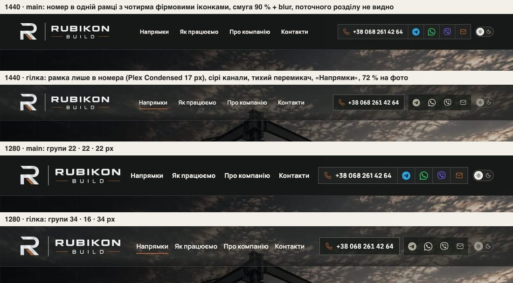
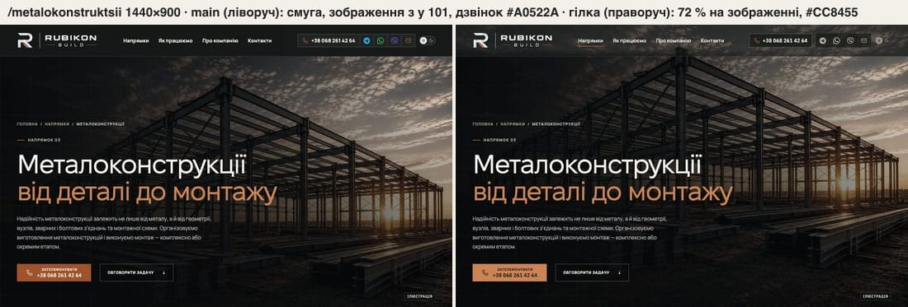
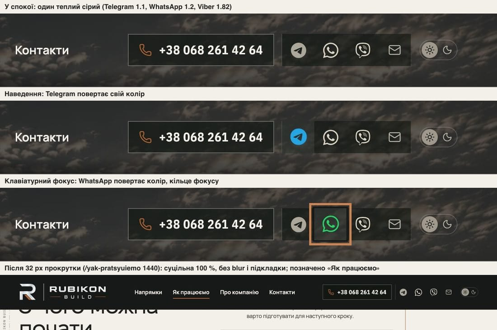

# Handoff · Шапка і головна дія першого екрана: ієрархія, поточний розділ, одна модель, світла мідь (PDO-19, PDO-57, PDO-18, PDO-17)

> **Частково замінено 21.10:** шапка «Збалансована» й оригінальні месенджери — див. [2026-10-21-header-balanced.md](2026-10-21-header-balanced.md). Сірі месенджери й латка (PDO-19), 72 % (PDO-18), риска #B76432 і виняток `/zernoskhovyshcha` за pathname нижче — історія. PDO-57, PDO-17 і одна модель шапки чинні.

| | |
|---|---|
| Дата | 2026-10-20 |
| Виконавець | Claude Code |
| Підстава | Рішення власника 20.10: «1) W1-09 шапка — OD-PX-08 (a), OD-PX-09 (a), OD-PX-10 (a), еталони після мого перегляду». Premium Experience Review 18.10: PDO-19 (DSK-01, GLB-02, GLB-03), PDO-57 (GLB-08), PDO-18 (BEN-01, GLB-04, CLR-06, MOT-05), PDO-17 (CLR-02). Крок W1-09 |
| Рев'ю | Незалежне рев'ю очікується через GitHub. Рішення — за Дмитром |
| PR | Draft відкриває lead після свого перегляду. **Merge і deploy не виконувались. Без окремого OK Дмитра вони не дозволені** (DEC-30). Гілка — прототип `design/*`: до мітки `visual-freeze` візуальні набори в CI відкладені (docs/ci-tier-model.md) |
| Гілка / base | `design/header-first-screen` від `main` `5085ad0` (після #206–#218). Специфікацію писали на `d723f57`; кожне посилання файл:рядок знайдено заново на `5085ad0` |
| Коміти | `7e51bd1` PDO-19 · `6b19846` PDO-57 · `c625a11` PDO-18 · `71e4e5d` PDO-17 · цей handoff. Кожен коміт має власні тести й відкочується окремо (`git revert` кожного з чотирьох на вершині гілки — без конфліктів, перевірено) |
| Змінено | **PDO-19:** `app/globals.css`; тести `tests/e2e/header-hierarchy.spec.ts` (новий), `tests/e2e/company-email.spec.ts`. **PDO-57:** `app/components/PrimaryNavLinks.tsx`, `app/components/SiteChrome.tsx`, `app/globals.css`; `tests/e2e/header-current-section.spec.ts` (новий). **PDO-18:** `app/globals.css`, `app/components/HeroHeaderState.tsx`, `app/napryamky/directions.css`; `tests/e2e/header-first-screen.spec.ts` (новий), `tests/e2e/hero-video.spec.ts`. **PDO-17:** `app/theme.css`, `app/phone-hero.css`, `app/home-v2.css`, `app/pro-nas/about.css`, `app/components/process/cost-factors.css`; `tests/e2e/action-on-graphite.spec.ts` (новий) |
| Не змінено | Телефонна шапка і модель шапки ≤1099 px (72 / 82 %, 97 % після прокрутки); висота шапки (101 px) і якорі; банер cookie («Прийняти все» не підсилено); /zernoskhovyshcha на ≥1100 px (смуга до W2-12); CSP, аналітика, SEO, workflows, retries, пороги; еталони (DEC-18) |

## Проблема

**Повторно перевірено на main `5085ad0`.** Локальний production build, Playwright 1.62.1 (Chromium; WebKit — L3). Згода — «лише необхідні», запити до Google відповідають порожнім 200, нічого не натискали.

- **Ієрархія (PDO-19).** Номер — Manrope 16 / 750 (15 на 1100–1279), навігація — Manrope 16 / 720; обрамлений елемент праворуч один — спільна рамка контактів, у якій номер стоїть поруч із чотирма іконками. Фірмові TG / WA / VB — єдині насичені плями смуги; найсвітліша пляма — кноб теми #F5F2EB. Проміжки «логотип → навігація · між пунктами · навігація → контакти» на `/metalokonstruktsii`: 1100 — 13 · 11 · 13 px, 1181 — 12 · 18 · 12, 1280 — 22 · 22 · 22, 1366 — 62 · 22 · 62, 1440 — 83 · 31 · 83.
- **Поточний розділ (PDO-57).** `aria-current="page"` є, правила для нього немає: риска під пунктом має ширину 0 і в шапці, і в меню. На сторінках напрямів не позначено нічого.
- **Модель шапки (PDO-18).** На ≥1100 px `/napryamky`, п'ять сторінок напрямів і `/yak` мають смугу 90 % + `blur(18px)`, зображення на сторінках напрямів і `/napryamky` починається з y 101; стану «scrolled» на цих ширинах немає. HOME, `/pro-nas` і всі вужчі екрани кладуть шапку 72 % на зображення.
- **Мідь (PDO-17).** Дзвінок героя ≥761 px — #A0522A / #F5F2EB (на телефоні після #206 — #CC8455 / графіт), кнопка штампа `/angary` і бриф X-Ray — #A0522A. Hover брифу — #F5F2EB на #B76432 = **3,85 : 1**; активний номер чинника `.cf-number` — **3,78 : 1** (Light) і **4,11 : 1** (Dark).

## Зміна

### 1 · PDO-19 — ієрархія шапки (`7e51bd1`, OD-PX-08 a)

- Номер — **єдиний обрамлений елемент**: власна рамка 44 px (лінія rgba(245,242,235,.34), підкладка rgba(17,21,18,.6)), IBM Plex Sans Condensed 600 17 px, .03em — як мідний дзвінок героїв; на 1180–1279 — 15 px. Спільна рамка контактів прибрана.
- Месенджери в шапці, її меню й футері — **один теплий сірий** до наведення (прийом контактного блоку, DEC-46 PROPOSED): `grayscale(1) sepia(.3) brightness(1.1 | 1.2 | 1.82)` для Telegram / WhatsApp / Viber. **Колір повертається на hover і на клавіатурному фокусі.** Іконка пошти сіра (#BDB7AC), на hover і фокусі — мідь. Мідь лишається лише біля номера.
- Роздільник між номером і письмовими каналами, ліній між клітинками немає. Над зображенням (HOME, `/pro-nas`) канали мають ту саму підкладку, що номер.
- Тихий перемикач теми: трек rgba(245,242,235,.2) без заливки, кноб #9E988D.
- Навігація 600; на 1280–1439 крок 16 px і клітинки 40 px.
- **Компактна шапка (дзвінок і «Меню») — до 1179 px (GLB-03 A).** Десктопний рядок — з 1180 px. На 1180–1279 навігація 15 px з кроком 14 px (див. «Відхилення»).
- Номер у футері — тією самою гарнітурою (Plex Condensed 600, на піксель більший за пошту поруч).

### 2 · PDO-57 — поточний розділ (`6b19846`)

- Наявна мідна риска під пунктом з `aria-current` стоїть постійно.
- На сторінці напряму «Напрямки» позначено як розділ (`aria-current="true"`). Шляхи напрямів передає серверний `SiteChrome`, тож дані напрямів не потрапляють у клієнтський чанк навігації.
- У меню позначений пункт мідний (#CC8455, 5,89 : 1). «Контакти» (#inquiry) не позначається ніколи.

### 3 · PDO-18 — одна модель шапки (`c625a11`, OD-PX-09 a)

- На ≥1100 px герої `/napryamky`, п'яти сторінок напрямів і `/yak` лежать під шапкою **72 % без blur**, зображення з y 0 (`.service-subhero-media`, слайди `/napryamky` у `directions.css`); тінь героя знята під шапкою маскою, як на HOME. Канали над зображенням — на підкладці.
- Стан «scrolled» на всіх сторінках і ширинах (`HeroHeaderState`). Після 32 px на ≥1100 px шапка **суцільна: 100 %, без blur, без підкладки каналів**. ≤1099 px — як було (97 %).
- Сторінки без героя (політика, 404, сторінка помилки) — **94 % без blur**.
- **`/zernoskhovyshcha` лишається на смузі до W2-12**: на ≥1100 px стан не ставиться, смуга 90 % + blur, зображення з y 101.

### 4 · PDO-17 — світла мідь головної дії на графіті (`71e4e5d`, OD-PX-10 a)

- `theme.css`: на `.hero, .subhero, .service-subhero, .proc-hero, .privacy-hero, .page-section-dark, .angary-process` — `--color-action` #CC8455, hover #DDA27A, підпис — графіт `--color-dark` (5,89 : 1 у Light, 6,17 у Dark; hover 8,01 / 8,39). На папері лишається #A0522A зі світлим підписом (5,03 : 1).
- Прибрано три локальні дублі телефонної кнопки (`phone-hero.css`, `home-v2.css`, `about.css`) — телефонні герої рендеряться так само (`homepage-hero-mobile-375` без змін).
- Бриф X-Ray — #CC8455 з графітом (6,17 : 1), hover #DDA27A (8,39 : 1).
- Активний `.cf-number` — заливка й підпис дії поверхні: #A0522A / #F5F2EB (5,03 : 1) у Light, #CC8455 / графіт у Dark.
- Шапки, футера й банера cookie правило не торкається.
- Обхід DOM на 11 сторінках у двох темах на 1440: кожна мідна заливка на графіті — #CC8455 з графітом, на папері — #A0522A зі світлим; світлих карток у темних секціях, які перемкнулися б, немає.

## Перевірка

Рівні: **L2** — Chromium, **L3** — Playwright WebKit (емуляція, не Safari). Фізичного Safari не було: **прокрутку в справжніх Safari і Chrome дивиться власник (L4)**.

**RED → GREEN** (чотири нові файли, desktop-chromium + mobile-chromium, локальний production build):

| | Passed | Failed | Skipped |
|---|---:|---:|---:|
| main `5085ad0` (нові тести, код main) | 2 | **12** | 12 |
| гілка | **14** | 0 | 12 |

- Два тести, що проходять на main, — запобіжники незмінного: смуга `/zernoskhovyshcha` і банер cookie («Прийняти все» контурна, як «Лише необхідні»). Skipped — тести іншого проєкту (`test.skip` за `isMobile`).
- `header-hierarchy` (3): рамка лише в номера, гарнітура й кегль, групи ≥ 2 × кроку на 1180 / 1280 / 1440 / 1920; компактна шапка на 1100 і 1179; насичених пікселів в іконці ≤0,5 % у спокої і >10 % на hover і клавіатурному фокусі (HOME і `/metalokonstruktsii`), сірі іконки у футері, сіра пошта, сірий кноб.
- `header-current-section` (2 + 1 mobile): рівно один позначений пункт з рискою на всю ширину на `/pro-nas`, `/yak-pratsyuiemo`, `/napryamky` і «Напрямки» на `/metalokonstruktsii`, `/angary`, `/zernoskhovyshcha`; на HOME — жодного; у меню 390 px — мідний.
- `header-first-screen` (3): 6 сторінок × 1100 / 1280 / 1440 / 1920 — 72 %, без blur, зображення з y 0, маска тіні; після прокрутки 100 % без blur і підкладки; HOME і `/pro-nas` після прокрутки 100 %; політика і 404 — 94 %; смуга зерносховища.
- `action-on-graphite` (5): дзвінок героя на 6 сторінках і «На головну» на 404, кнопка штампа `/angary` — #CC8455 з графітом ≥4,5 : 1 і hover ≥4,5 : 1 в обох темах; бриф X-Ray і активний номер чинника ≥4,5 : 1; банер cookie.

**Набори на гілці** (локальний production build; desktop-chromium + mobile-chromium; широкий набір — CI Main Regression):

| Набір | Результат |
|---|---|
| 19 файлів, що торкаються шапки, навігації, теми, героїв і банера: `hero-video`, `page-hero-rhythm`, `smoke`, `pr-critical`, `theme`, `responsive-a11y-phase1`, `company-email`, `first-contact`, `consent`, `consent-pending-hero`, `not-found`, `cost-factors`, `directions-hero-sequence`, `direction-static-hero`, `grain-page`, `angary-interactive`, `yak-formats-scope`, `ux-conversion-phase2` і нові тести | 647 passed, 146 skipped, 5 failed — усі 5 за таймаутом під навантаженням (`angary-interactive:680`, `hero-video:553`, `page-hero-rhythm:92` ×2, `smoke:124`); ті самі тести окремо: **14 / 14 passed** |
| `home-proof-contour` — тести брифу X-Ray (`-g "brief\|resting split\|swipes them"`) | 11 passed, 1 skipped |
| Нові файли + `company-email` + `hero-video` після поділу тестів на чотири файли | 156 passed, 32 skipped |
| Unit (`vitest run`) | 1436 / 1436 (92 файли) |
| `tsc`, `eslint .` (без `dist/`), `git diff --check` | чисто |

**WebKit (L3)**, допоміжний скрипт поза репозиторієм; `upgrade-insecure-requests` знято з CSP лише в тестовому route. `/metalokonstruktsii` 1440 / 1180: 72 % без blur, зображення з y 0, Plex Condensed 600 17 / 15 px, сірий Telegram, «Напрямки» з рискою, дзвінок #CC8455; після прокрутки — суцільна без blur. 1100 — компактна шапка. HOME і `/napryamky` — те саме. `/zernoskhovyshcha` — смуга 90 % + blur(18px), зображення з y 101, стан не ставиться.

**Контраст на 1440** (пікселі). Навігація і номер — проти **найсвітлішого пікселя** під текстом (текст прозорий, решта як у рендері: тон шапки, підкладки, зображення). Іконка — її відрендерена заливка проти найсвітлішого пікселя її клітинки без іконки (WCAG 1.4.11). Відеогерої (HOME, `/pro-nas`) — кожен із 5 кліпів у 5 точках, береться найгірший кадр; `/napryamky` на гілці — усі 5 слайдів (на main — один, під смугою 90 %). Мінімум навігації · номер · TG / WA / VB / пошта, main → гілка:

| Тема | Сторінка | Навігація | Номер | TG / WA / VB / пошта |
|---|---|---|---|---|
| Light | `/` | 7,46 → **7,46** | 12,67 → **12,67** | 5,12 / 7,16 / 3,11 / 3,14 → **5,87 / 9,64 / 9,43 / 5,93** |
| Light | `/pro-nas` | 7,02 → **7,02** | 12,52 → **12,52** | 5,06 / 7,06 / 3,04 / 2,89 → **5,81 / 9,51 / 9,33 / 5,04** |
| Light | `/napryamky` | 15,83 → **7,41** | 14,14 → **12,46** | → **5,70 / 9,30 / 9,03 / 5,66** |
| Light | `/angary` | 15,96 → **10,31** | 14,14 → **12,91** | → **5,84 / 9,69 / 9,50 / 5,40** |
| Light | `/metalokonstruktsii` | 15,96 → **6,64** | 14,14 → **12,97** | → **5,62 / 9,55 / 9,63 / 5,37** |
| Light | `/betonni-roboty` | 15,96 → **7,13** | 14,14 → **13,52** | → **6,53 / 9,46 / 9,37 / 5,41** |
| Light | `/pokrivelni-roboty` | 15,96 → **6,33** | 14,14 → **13,68** | → **6,43 / 10,12 / 9,93 / 5,21** |
| Light | `/yak-pratsyuiemo` | 15,80 → **13,06** | 13,80 → **11,99** | → **6,18 / 9,73 / 9,66 / 5,09** |
| Dark | `/` | 7,94 → **7,94** | 12,97 → **12,97** | → **6,01 / 9,87 / 9,65 / 6,02** |
| Dark | `/pro-nas` | 7,47 → **7,47** | 12,82 → **12,82** | → **5,95 / 9,74 / 9,55 / 5,16** |
| Dark | решта 6 сторінок | 16,55–16,69 → **12,95–14,37** | 14,66–15,16 → **12,29–15,90** | → **≥ 6,32 / 9,96 / 9,89 / 5,17** |

- Навігація й номер ≥4,5 : 1 скрізь (мінімум **6,33**, «Контакти» на `/pokrivelni-roboty`, Light). На внутрішніх сторінках контраст нижчий, ніж під смугою, бо шапка тепер на зображенні, — і в межах, які вже має HOME.
- Кожна сіра іконка ≥3 : 1 (мінімум **5,04**, пошта на `/pro-nas`; Telegram ≥5,62). На main фірмовий Viber мав 3,04–3,11 на відеогероях, а мідна пошта — **2,89** на `/pro-nas`.

**Групи шапки** (`/metalokonstruktsii`, «логотип → навігація · крок · навігація → контакти», px):

| | 1180 | 1181 | 1280 | 1366 | 1440 | 1920 |
|---|---|---|---|---|---|---|
| main | 50 · 11 · 50 | 12 · 18 · 12 | 22 · 22 · 22 | 62 · 22 · 62 | 83 · 31 · 83 | 123 · 40 · 123 |
| гілка | 45 · 14 · 45 | 31 · 14 · 31 | 36 · 16 · 36 | 76 · 16 · 76 | 80 · 31 · 80 | 120 · 40 · 120 |

Проміжок груп ≥ 2 × кроку на кожній ширині від 1180 px; горизонтальної прокрутки немає. Логотип 226 px на 1180 і 256 px з 1181, як на main.

## Еталони (DEC-18)

Їх не оновлювали. Процедура: preview → мітка `visual-freeze` → перегляд кожного diff в артефакті `changed-area-visual-diff` → OK власника → PNG (darwin і linux; linux — з артефакту того самого head).

Рендери main і гілки порівнювали між собою (`visual-chromium`, локально), бо darwin-еталони на main застарілі. Main проти main: 66 / 66 у межах допуску. Гілка проти main **у допуску наборів проходить 66 / 66** (threshold 0,25 / 0,2, maxDiffPixelRatio 0,02 / 0,01), тож CI на цих цілях може не впасти, хоча вони змінились. Фактично змінюються (частка пікселів з різницею каналу > 8):

| Ціль | Частка | Причина |
|---|---:|---|
| `homepage-hero-desktop-1440` | 1,71 % | шапка в кадрі (рамка номера, сірі канали, тихий перемикач) і дзвінок #CC8455 |
| `homepage-hero-tablet-768` | 2,05 % | дзвінок #CC8455 (≥761 px) |
| `homepage-real-object-desktop-1440` | 0,64 % | бриф X-Ray |
| `homepage-real-object-tablet-768` | 1,09 % | бриф X-Ray |
| `homepage-real-object-mobile-375` | 3,69 % | бриф X-Ray |
| `grain-planner-desktop-initial` | 8,47 % | **поза списком специфікації:** знімок `/planner-preview` захоплює фіксовану шапку — тепер суцільна 100 % і нова ієрархія |
| `grain-planner-desktop-result` | 9,30 % | те саме |

- **Без змін (0 пікселів):** `header-logo-*` і `footer-logo-*` (усі 4 + 2), `process-*` (активного `.cf-number` у кадрі немає), решта `visual.spec.ts`, `grain-planner-mobile-*`, `configurator-*-visual` (у трьох `configurator-*` — 0,001 %, стовпчик 1–2 px на правому краї кадру, поза шапкою).

## Відхилення від специфікації

1. **Після прокрутки — 100 %, не 97 %.** Варіант (a) OD-PX-09, який обрав власник, — «72 % угорі / 100 % після 32 px / 94 % без героя, без підкладки каналів»; 97 % — варіант (b). Так на ≥1100 px; ≤1099 px лишились 97 % (телефонна шапка не змінюється).
2. **GLB-03 A: межа компактної шапки 1099 → 1179 px**, як в OD-PX-08 (a). Межа моделі шапки лишилась 1099 / 1100: ≤1099 — як було; на 1100–1179 компактна шапка лежить на зображенні внутрішніх героїв за новою моделлю (72 %), без героя — 94 %, на зерносховищі — смуга. `matchMedia` у `HeroHeaderState` на 1179 не переносили: після PDO-18 стан від ширини не залежить (лише виняток зерносховища ≥1100). `company-email.spec.ts` перевіряє кнопку пошти з 1180 px.
3. **1180–1279: навігація 15 px, крок 14 px** — у специфікації цього немає. З кроком 18 px на 1181 між групами лишалось 11 px (логотип там уже 256 px). Логотип і `header-logo-desktop-1181` не змінились.
4. **Telegram `brightness(1.1)`** — за реєстром і roadmap (07 §7.2 мав .85, концепт — .75). Найгірший кадр — ≥5,62 : 1.
5. **Сірі месенджери й мідний поточний пункт — також у мобільному меню**, як у реєстрі (PDO-19 п. 5, PDO-57). Сам рядок телефонної шапки не змінено.
6. **Графітовий підпис дії — `var(--color-dark)`** за реєстром: у Dark на графітових поверхнях підпис #121413 замість #171918 (так уже було на телефонних героях).

## Ризики

- **Частина людей шукає месенджер за кольором.** Колір повертається на hover і клавіатурному фокусі; на дотик (телефон, меню) кольору до натискання немає. Сірі канали в шапці, меню й футері поширюють DEC-46 (PROPOSED, у DECISIONS.md рядка немає) за межі контактного блоку.
- **Ілюстрації внутрішніх героїв на ≥1100 px стали на 101 px вищими** — кадрування змінилось; це переглядає рішення handoff 18.10 (широка смуга шапки) і коментар у `globals.css`, який його фіксував. Мітка «Ілюстрація» видима.
- **1100–1179 px**: тепер компактна шапка (дзвінок і «Меню») замість повного рядка — так обрано в OD-PX-08 (a). EN-підписи на 1280 не перевірялись (PDO-85 / W3-09).
- **`/planner-preview`** (сторінка-прев'ю на шаблоні напряму, не в навігації) отримала нову модель; через це змінюються два знімки `grain-planner-desktop-*`.
- **CI під навантаженням.** Нові багатосторінкові тести мають `test.setTimeout` 60–90 с; локально під 6 воркерами один такий тест раз упав за таймаутом 30 с, після цього таймаути додано.

## Відкат

`git revert 71e4e5d` (мідь), `git revert c625a11` (модель), `git revert 6b19846` (поточний розділ), `git revert 7e51bd1` (ієрархія) — кожен окремо, разом із відповідними PNG після freeze.

## Відкриті питання

1. **Еталони.** OK на 7 цілей після перегляду в `changed-area-visual-diff`, зокрема на два `grain-planner-desktop-*`, яких не було в специфікації.
2. **1180–1279: навігація 15 px з кроком 14 px** — прийнятно? Альтернатива — логотип 226 px до 1279 (тоді зміниться `header-logo-desktop-1181`).
3. **Номер чинника на кресленні** (`.cf-badge` у `CostFactorsFigure`) лишився #B76432 з підписом кольору фону (3,78 / 4,11 : 1) — у реєстрі названо лише `.cf-number`. Вузли аркушів змін на `/yak` (`.cs-node`, #B76432 зі світлим) — теж поза цим кроком (PDO-87).
4. **L4 / L5.** Прокрутка в справжніх Safari і Chrome (кадри не гірші) і вигляд на preview — у власника.
