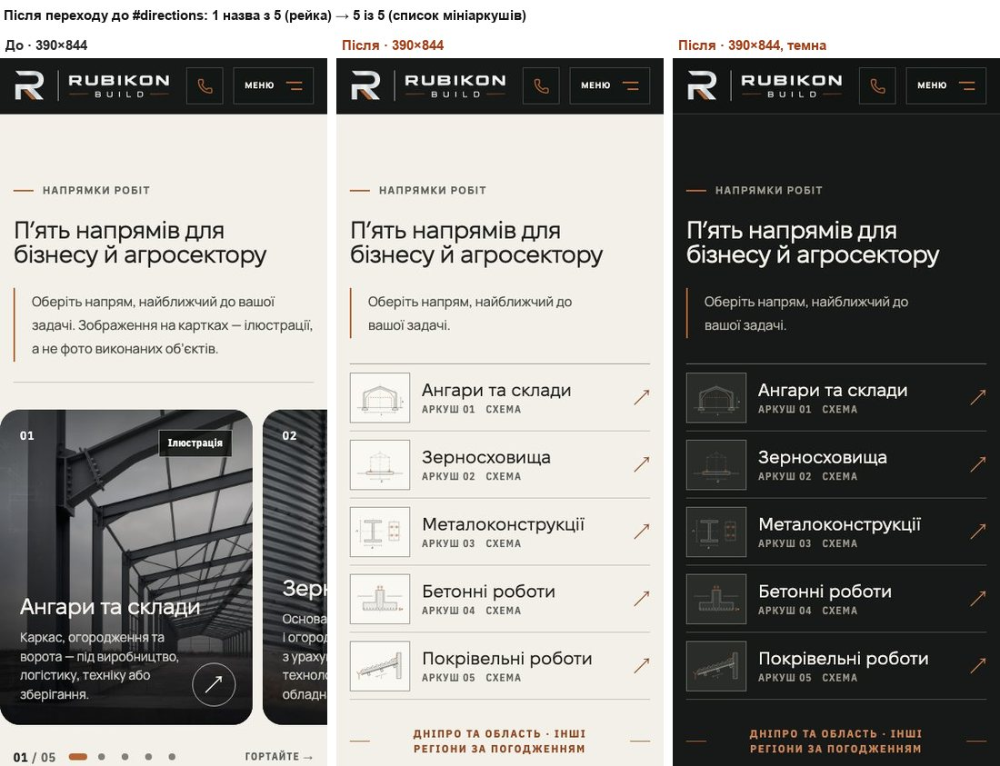
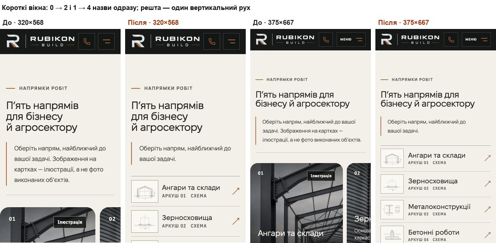
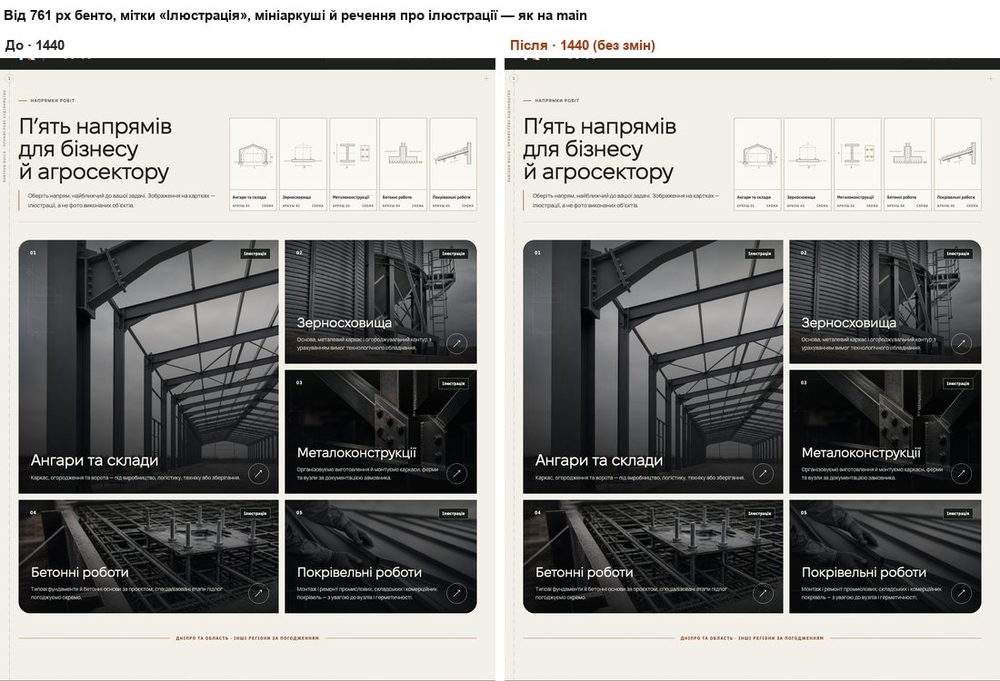

# Handoff · HOME на телефоні: п’ять напрямів — список мініаркушів замість стрічки карток (PDO-42 a)

| | |
|---|---|
| Дата | 2026-10-20 |
| Виконавець | Claude Code |
| Підстава | Рішення власника 20.10: «PDO-42: реалізуй варіант (a) — мініаркуші-креслення на ≤760 px, речення про ілюстрації сховати на телефоні, десктопне бенто без змін. Draft PR з handoff і доказами, еталони після мого перегляду, без merge». Premium Experience Review 18.10: PDO-42 (HOME-04, HOME-05, CMP-04), OD-PX-21 (a) |
| Рев'ю | Незалежне рев'ю очікується через GitHub. Рішення — за Дмитром |
| PR | Draft. **Merge і deploy не виконувались. Без окремого OK Дмитра вони не дозволені** (DEC-30). Гілка — прототип `design/*`: до мітки `visual-freeze` візуальні набори в CI відкладені (docs/ci-tier-model.md) |
| Гілка / base | `design/home-phone-directions` від `main` `5085ad0`. Посилання реєстру звірені з `5085ad0`: розмітка — `app/page.tsx:33–42` (у реєстрі :36–38), правила стрічки — `app/home-v2.css:146–184` (у реєстрі :135–166) |
| Коміти | `4b1e9d3` — код і тести · цей handoff |
| Змінено | `app/page.tsx` (список під заголовком; речення про ілюстрації — `span.hv2-image-note`), `app/components/home-v2/DirectionsSheets.tsx` (новий `DirectionsSheetList`), `app/components/home-v2/directions-sheets.css` (стилі списку, лише ≤760 px), `app/home-v2.css` (правила стрічки замінено: картки й речення на телефоні не показуються), `app/components/home-v2/DirectionsRail.tsx` — видалено. Тести: новий `tests/e2e/home-phone-directions.spec.ts`; оновлені `pr-critical.spec.ts`, `theme.spec.ts`, коментар у `home-directions-sheets.spec.ts` |
| Не змінено | Бенто від 761 px: розмітка карток (`DirectionCards.tsx`), мітки «Ілюстрація», зображення, заокруглені кути (CMP-04 — окреме рішення), мініаркуші в заголовку від 1200 px, `catalog-drawing.css`; шапка сайту; CSP, аналітика, SEO, workflows, retries, пороги; еталони (DEC-18) |

## Проблема

**Повторно перевірено на main `5085ad0`.** Локальний production build, Playwright (Chromium, емуляція телефона). Згода — «лише необхідні», запити до сторонніх хостів не виходять за межі машини, нічого не натискали. Після переходу до `#directions` верх розділу стоїть під шапкою 67 px. Назву враховано, якщо вона вся у вікні: під шапкою, вище нижнього краю, у межах ширини екрана.

| Вікно | Видно назв (з 5) | Висота розділу, px |
|---|---:|---:|
| 320×568 | **0** | 952,7 |
| 375×667 | **1** | 921,9 |
| 390×844 | **1** | 939,4 |
| 430×932 | **1** | 987,5 |

- П’ять напрямів — горизонтальна стрічка карток 4 : 5 на 84 % ширини (88 % до 340 px). Інші чотири назви — праворуч за краєм екрана або нижче.
- Під стрічкою «01 / 05», п’ять кнопок-крапок 28×32 px (CSS) і «Гортайте →». На телефоні в розділі 10 зупинок Tab (за розміткою): 5 карток і 5 крапок.
- Телефон 390×844 під час прокрутки сторінки завантажує 5 ілюстрацій напрямів: 322 732 байти webp.
- У підзаголовку речення «Зображення на картках — ілюстрації…» стоїть над картками.

## Зміна

**Телефон (≤760 px).** Під заголовком — список із п’яти рядків-посилань (`DirectionsSheetList`, `<ul role="list">`). Розмітка — справжній список у порядку табуляції, а не CSS на `aria-hidden`-колонці заголовка.

- Рядок 80 px на всю ширину: мініаркуш `CatalogDrawing` того напряму в рамці 72×60, назва (Fixel Display 21 px), під нею смужка аркуша «Аркуш NN   Схема» (12 px, як у мініаркушах заголовка), праворуч мідна ↗. Між рядками — `--color-border`, над першим — `--color-border-strong`. Візуально це концепт A з рев’ю.
- Кожен рядок веде туди ж, куди картка (`href` з `directions.ts`). Доступна назва — лише назва напряму: схема, смужка й стрілка мають `aria-hidden`. `role="list"` — бо VoiceOver знімає роль списку з `list-style: none`.
- Аналітичних атрибутів на картках немає (перевірено). Нових не додано.
- **Кегль назви:** `min(21px, колонка / 9,59)`. «Металоконструкції» з `letter-spacing: -.01em` — 9,22 em (виміряно) × 1,04, той самий запас, що в `--display-fit`. На 320 px назва ≈18 px, і це слово стоїть в одному рядку. Від 362 px — 21 px. З CSS концепту на 320 слово (194 px при 21 px) не вміщалося в колонку 160 px. До 360 px проміжки в рядку 10 px, а колонка стрілки 22 px: так назва зберігає більше кегля.
- Рамка мініаркуша стає мідною на `:focus-visible` і на `:hover` (лише `hover: hover`), як картка підсвічує свій аркуш на широкому екрані. Кільце фокуса — загальне правило сайту.
- Схеми в рядках стоять готові, без анімації появи. Анімація мініаркушів у заголовку від 1200 px не змінилась.

**Картки й речення на телефоні.** `.direction-grid` і `span.hv2-image-note` на ≤760 px мають `display: none`.
- Текст підзаголовка той самий: `textContent` побайтно збігається. Друге речення лише загорнуте в `span` з початковим пробілом.
- Лінію під заголовком (на телефоні) замінила лінія над списком: 30 px від підзаголовка, рядок про географію — 32 px під останнім рядком (як у концепті).
- Зображення карток — `loading="lazy"`, тож на телефоні вони більше не завантажуються. На 390 px — 0 запитів (було 5, 322 732 байти).

**`DirectionsRail.tsx` видалено** разом із правилами стрічки (`home-v2.css`): «01 / 05», крапками, «Гортайте →», правилами 340 px. Карток на телефоні більше немає, тож клієнтський компонент зі слухачами scroll / resize був би мертвим кодом. Реєстр пропонував саме це.

**Від 761 px — без змін.** Розмітка карток не змінювалась. Обгортка `div.hv2-rail` зникла, але не мала стилів. На 761 / 768 / 1024 / 1200 / 1440 px порівняно 425 вимірів розділу main і гілки. Серед них: рамки заголовка й підзаголовка, кількість рядків, мініаркуші, рамки 5 карток, номерів, міток «Ілюстрація», назв, описів і стрілок, `currentSrc` зображень, радіуси, рядок про географію, висота сторінки, порядок табуляції. Збігаються **415**. Решта 10 — це лише записи «є / немає» для списку (прихований) і `.hv2-rail-nav` (відсутній).

## Перевірка

Рівні: **L2** — емуляція Chromium, **L3** — Playwright WebKit (емуляція iPhone 13 і Desktop Safari, не Safari). Фізичного iPhone не було, L5 не перевірявся. **До merge власник дивиться HOME на iPhone 12** (OD-PX-05).

**Назви після переходу до розділу, гілка** (Chromium; верх розділу під шапкою 67 px):

| Вікно | Видно одразу | Скільки прокрутити до всіх п’яти | Висота розділу main → гілка, px |
|---|---:|---|---|
| 320×568 | 2 / 5 | один вертикальний рух на 199 px (35 % екрана) | 952,7 → **891,9** |
| 375×667 | 4 / 5 | 63 px | 921,9 → **845,8** |
| 390×844 | **5 / 5** | — (остання назва на 112 px вище краю) | 939,4 → **847,5** |
| 430×932 | **5 / 5** | — (на 222 px вище краю) | 987,5 → **825,6** |

- Стрілка ↓ героя (`href="#directions"`) ставить розділ на `scroll-margin-top` 88 px, тобто на 21 px нижче. Тоді: 390 і 430 — 5 / 5; 375×667 — 3 / 5 (+84 px); 320×568 — 2 / 5 (+220 px).
- Горизонтальних жестів немає на жодній ширині. Горизонтальної прокрутки сторінки немає.
- Для порівняння, концепт A на тому самому `5085ad0` на 390 давав 875,5 px і 5 / 5. Гілка нижча на 28 px, бо приховане речення забирає рядок підзаголовка.

**RED → GREEN** (`home-phone-directions.spec.ts`, desktop-chromium + mobile-chromium, локальний production build):

| | Passed | Failed | Skipped |
|---|---:|---:|---:|
| main `5085ad0` (новий тест, код main) | 4 | **9** | 13 |
| гілка | **13** | 0 | 13 |

- **4 тести (mobile), 320×568 / 375×667 / 390×844 / 430×932:** у розділі один список із 5 пунктів. Кожен напрям — одне видиме посилання з назвою напряму і правильним `href`, у порядку даних. Жодна картка, кнопка чи зображення не показується, ніщо в розділі не прокручується вбік. Рядки ≥44 px заввишки і ≥80 % ширини екрана. Після переходу до розділу на 390 і 430 видно всі 5 назв. На 320×568 і 375×667 п’ять назв вміщаються в один екран під шапкою, і одна вертикальна прокрутка менше пів екрана показує їх усі.
- **1 тест (mobile), 390:** Tab проходить 5 рядків по порядку, на кожному кільце фокуса ≥2 px. Наступний Tab не потрапляє в приховані картки.
- **1 тест (mobile), 320:** кожне слово кожної назви — в одному рядку і в межах своєї колонки. «Металоконструкції» — одне слово. Назва не заходить на мініаркуш і стрілку.
- **3 тести (mobile), 320 / 390 / 760:** `textContent` підзаголовка повний, а видимий текст — лише перше речення.
- **4 тести (desktop), 761 / 768 / 1024 / 1440 — запобіжник, проходять і на main:** списку немає, підзаголовок видно повністю. 5 карток видно, на кожній «Ілюстрація», номер, назва й зображення. Геометрія мозаїки — колонки 1,15fr / ,85fr, ряди 360 / 360 / 330, проміжок 18 px, перша картка на два ряди — з точністю 0,5 px. Зупинки Tab у розділі — 5 карток.
- Skipped — це тести іншого проєкту (`test.skip` за `isMobile`).

**Оновлені тести:**
- **`pr-critical.spec.ts`, «homepage direction-card titles keep their words whole»:** на ≤760 px картки приховані, і старий тест там проходив би з нульовими розмірами. Тепер він міряє назви рядків списку тим самим способом: найширше слово ≤ ширини назви, назва не на стрілці. Додано 320 px і перевірку, що назви показані. На main фази телефона падають (8 = 320 / 360 / 375 / 390 × 2 проєкти). Десктопні ширини не змінились.
- **`theme.spec.ts`, два тести переходу HOME → `/metalokonstruktsii`:** натискають показане посилання (картку від 761 px, рядок на телефоні). Раніше на телефоні вони клікали картку в стрічці.
- **`home-directions-sheets.spec.ts`:** лише коментар. Тест «на 390 у заголовку немає аркушів» лишається правдою, бо список стоїть під заголовком, а не в ньому.

**Набори.** Desktop-chromium + mobile-chromium, локальний production build. Браузер не міг розв’язати жодне ім’я, крім застосунку (DNS-захист 16.10):

| Набір | main `5085ad0` | гілка |
|---|---|---|
| `home-phone-directions` (новий) | 4 passed, 9 failed, 13 skipped | **13 passed**, 13 skipped |
| `pr-critical` | 8 failed (телефонні фази оновленого тесту), решта passed | усі passed (skipped — інший проєкт) |
| `home-directions-sheets`, `theme`, `words-whole`, `heading-scale` | passed | passed |
| `typography` | 3 failed (late fonts, mobile: CLS 0,0568 / 0,0578 / 0,0578) | **3 failed** (ті самі: 0,0578 / 0,0578 / 0,0585) |
| Разом сім файлів | 197 passed, 20 failed, 59 skipped | **214 passed, 3 failed, 59 skipped** |
| `smoke` (лише Google-імена не розв’язуються) | 43 passed, 7 skipped | 43 passed, 7 skipped |
| WebKit (L3, допоміжний конфіг; iPhone 13 і Desktop Safari) | 3 passed, **1 failed** (телефонний список), 2 skipped | **4 passed**, 2 skipped |
| Unit (`vitest run`) | — | 1435 / 1435 (92 файли) |
| `tsc`, `eslint .` (без `dist/`), `git diff --check` | — | чисто |

- **Late fonts:** відомий збій main, від цієї зміни не залежить (див. handoff PDO-05).
- **Smoke під повним DNS-захистом:** 9 десктопних тестів маршрутів падали лише на консольній помилці `net::ERR_NAME_NOT_RESOLVED`. Це зовнішній запит, який заблокував сам захист. З захистом лише для імен Google smoke на main і гілці однаковий — 43 / 43.
- **Vitest:** перший повний прогін дав 2 таймаути (5 с) у `grain-complex.test.ts` під навантаженням локального сервера. Файл окремо — 9 / 9, повтор усього набору — 1435 / 1435.
- **WebKit 390:** 5 назв по 21 px, рядки 80 px, усі 5 у вікні після переходу. На 320 і 375 назви ті самі, що в Chromium: 18,14 px («Металоконструкції» 167 із 174 px) і 21 px (194 із 215 px), кожна в одному рядку, крім «Покрівельні роботи» на 320 (два рядки, перенос між словами).
- **CSP у WebKit:** для WebKit по HTTP з CSP документа прибрано `upgrade-insecure-requests` — лише в тестовому route, не в застосунку.

**Широкий набір локально не запускався — його покриває CI Main Regression на гілці.**

## Еталони (DEC-18)

Їх не оновлювали. Процедура за DEC-18 (OD-PX-04 a): preview → мітка `visual-freeze` → перегляд diff в артефакті `changed-area-visual-diff` → OK власника. Лише після цього оновлюються переглянуті PNG, darwin і linux. Linux беруть з артефакту того самого head.

**Візуальний прогін** (`visual.spec.ts`, visual-chromium, локально). Рендери main і гілки порівнювали між собою, а не з PNG у репозиторії. Рендери main відтворюються: main проти main — 33 із 33 у межах допуску набору.

- **Змінюється, поза допуском (1):** `homepage-directions-mobile-375` — 343×758 → 343×682: стрічка → список, підзаголовок на рядок коротший. Разом 1 × 2 платформи = **2 PNG**.
- **Піксельні відмінності в межах допуску (2):** `homepage-inquiry-mobile-375`, `homepage-real-object-mobile-375`. Вміст той самий: розділ напрямів вище став на 76 px коротший, і текст та фонова текстура растеризуються з іншою фазою. Локально обидва проходять поріг набору (threshold 0,25, maxDiffPixelRatio 0,02). На Linux, якщо впадуть, їх теж треба переглянути.
- **Піксель у піксель (30):** усі `*-tablet-768` і `*-desktop-1440`, зокрема `homepage-directions-tablet-768` і `homepage-directions-desktop-1440`, а також решта `*-mobile-375`.

Реєстр чекав і `homepage-directions-{tablet-768,desktop-1440}`, але через кути (CMP-04). Кути в цю зміну не входять, тож ці дві цілі не змінюються.

## Ризики

- **Телефон втрачає великі ілюстрації напрямів.** Вони лишаються на десктопі й на сторінках напрямів. Так вирішив власник, і про це попереджав реєстр.
- **Короткі вікна.** На 320×568 і 375×667 п’ять назв видно не одразу після переходу, а після однієї вертикальної прокрутки: 199 і 63 px (зі стрілкою героя — 220 і 84 px). Горизонтальних жестів немає. Див. «Відкриті питання», п. 1.
- **Кегль на вузьких екранах.** На 320–361 px назви 18–21 px, на 320 — 18,14 px, щоб «Металоконструкції» не ламалась (words-whole). Linux рендерить Fixel ≈1,7 % ширше. Запас ×1,04 це покриває: на 320 лишається 7 px.
- **Темна тема** еталонами не знімається. Рендер 390 у темній темі — у доказах вище, його бачить лише власник.
- **Анімація.** Схеми в рядках на телефоні статичні. Щоб вони «креслились» при появі, як аркуші в заголовку, треба додати `.dsl` до правил `catalog-drawing.css`. У концепті цього не було.

## Відкат

`git revert 4b1e9d3` — один коміт: розмітка, CSS, видалений `DirectionsRail.tsx` і тести. Еталонів він не торкається.

## Відкриті питання

1. **320×568 і 375×667.** Прийнятна одна вертикальна прокрутка (63–220 px) до п’ятої назви? Щоб усі 5 були одразу, треба 64-піксельні рядки або менший відступ розділу, а це поза погодженим концептом.
2. **Смужка аркуша.** Тут «Аркуш 01   Схема» з проміжком, як у мініаркушах заголовка й у концепті A. У брифі написано «Аркуш NN · Схема». Додати «·»?
3. **Наступні кроки поза цим PR.** Телефонні гілки `sizes` у `DirectionImageCards` (84 % / 88 % ширини) і їхній коментар тепер нічого не вибирають. Безпечно, бо зображення на телефоні не завантажуються, але це прибирання для окремого PR. Кути карток (CMP-04) — окреме рішення власника.
4. **L5.** HOME на iPhone 12 до merge (OD-PX-05): список, Tab / VoiceOver, темна тема.
