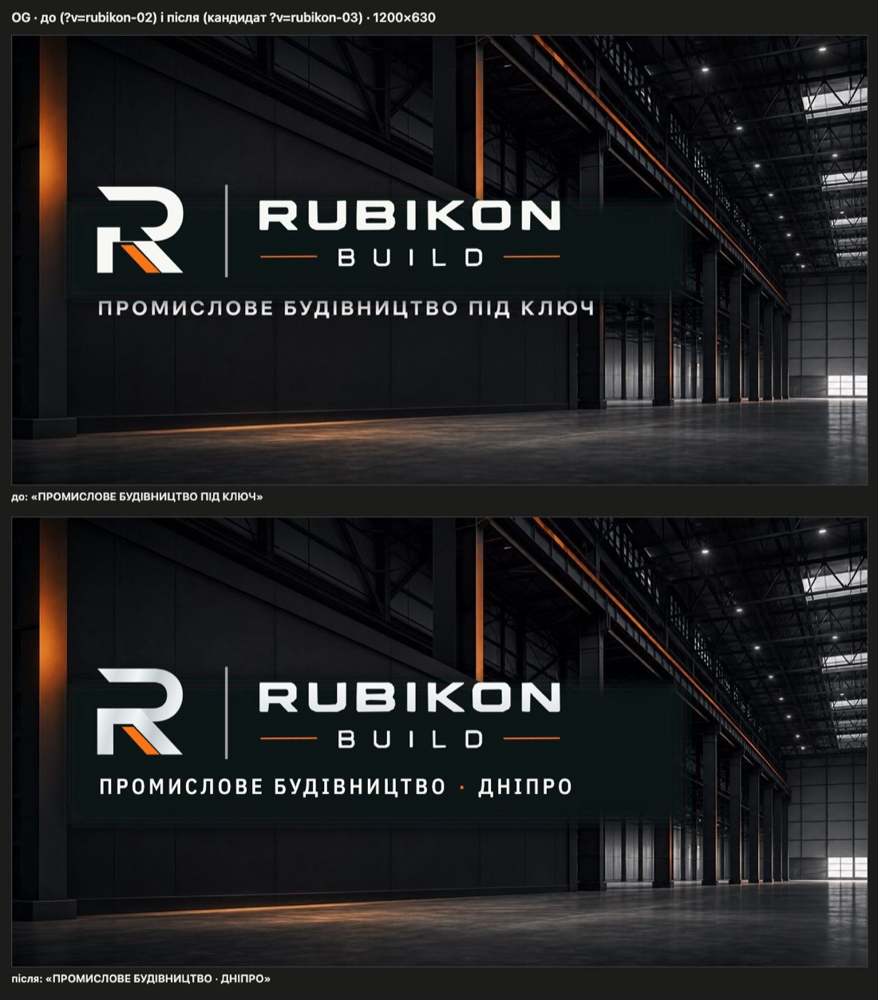
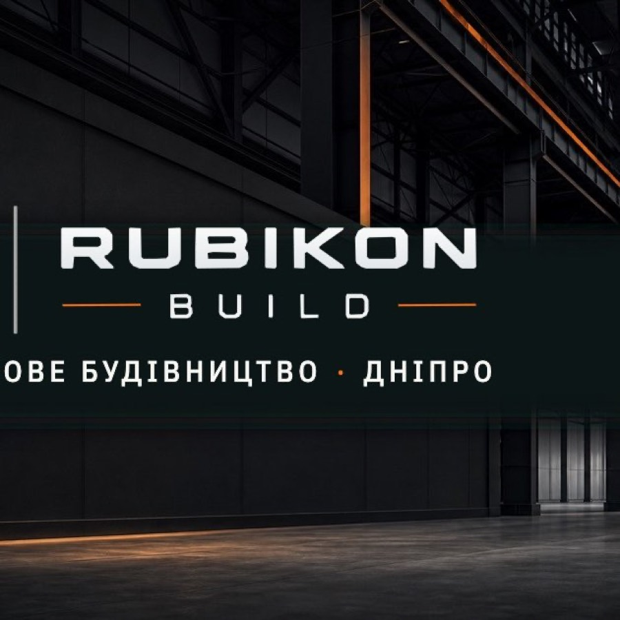

# Handoff · OG-превʼю без «ПІД КЛЮЧ»: «Промислове будівництво · Дніпро» (PDO-32)

| | |
|---|---|
| Дата | 2026-10-20 |
| Виконавець | Claude Code |
| Підстава | Рішення власника 20.10: **OD-PX-13, варіант A** («Промислове будівництво · Дніпро»). Premium Experience Review 18.10, PDO-32, крок W1-10 |
| Рев'ю | Незалежне — очікується: ChatGPT (через GitHub). Рішення — Дмитро |
| PR | Draft. **Merge і deploy не виконувались і не дозволені** без окремого OK Дмитра (DEC-30) |
| Гілка / base | `content/og-image` від `main` `d4b11c0` |
| Коміти | `447067b` зображення, генератор, версія · цей handoff |
| Змінено | `public/og.jpg`, `public/og.png`, `public/brand/og-tagline-uk.png` (новий шар), `scripts/render-og-tagline.mjs` (новий), `scripts/generate-brand-assets.mjs` (смуга + шар), `app/layout.tsx` і `app/polityka-konfidentsiinosti/page.tsx` (`?v=rubikon-02` → `rubikon-03`) |
| Не змінено | Фон `og-social-background.jpg`, логотип і його місце, решта брендових ассетів (байт у байт), OG-зображення інших сторінок, тексти сайту, метадані крім версії, еталони, workflows |

## Проблема

Превʼю посилання на HOME і політику конфіденційності (`/og.jpg`) каже «ПРОМИСЛОВЕ БУДІВНИЦТВО ПІД КЛЮЧ». Матриця публічних тверджень дозволяє «під ключ» лише з межами («у погодженому обсязі; проєктування, дозволи й спеціальні системи — окремо»), а превʼю — перше, що бачить людина, якій переслали посилання.

**Причина.** Теза вшита в сам фон `public/brand/og-social-background.jpg` (разом зі старим словесним знаком). Генератор `--social` прикривав знак м'якою графітовою смугою й ставив логотип, а теза під смугою лишалася видимою. Чистого оригіналу фону в репозиторії немає (файл незмінний з #78/#90).

## Зміна

- `generate-brand-assets.mjs --social`: смуга 136 → 197 px заввишки, тож прикриває й стару тезу (вона стояла на y 372–395, x 122–814 з 1200×630); поверх логотипа накладається шар тези.
- `render-og-tagline.mjs`: рендерить шар `og-tagline-uk.png` (1200×630, прозорий) шрифтом самого сайту — IBM Plex Sans Condensed Medium з `app/fonts`, вбудованим у сторінку рендера. Результат закомічено, тож збірка бренду, як і раніше, не залежить від шрифтів машини. Текст: «ПРОМИСЛОВЕ БУДІВНИЦТВО · ДНІПРО», 30 px, трекінг 0,16 em, на місці старої тези; розділювач — помаранчевий з логотипа (`#FF7415`), слова — ivory логотипа (`#F7F7F4`).
- `?v=rubikon-03` у трьох місцях `layout.tsx` і в політиці, щоб месенджери перечитали превʼю.

## Перевірка

- Після `node scripts/generate-brand-assets.mjs --social` змінились лише `public/og.jpg` і `public/og.png`; решта згенерованих логотипів та іконок — байт у байт ті самі.
- `og.jpg`: 1200×630, JPEG, 141 641 Б (було 141 979 Б). Пікселі тексту: стару тезу прибрано, нова стоїть у рядках y 366–392.
- Production build гілки: `og:image` на 10 сторінках — `/og.jpg?v=rubikon-03` на HOME і політиці; інші 8 сторінок мають власні зображення (не змінювались). Файл віддається з `image/jpeg`.
- `tsc --noEmit`, `eslint` змінених файлів — чисто. Тестів, що посилаються на `og.jpg` або `rubikon-02`, немає.
- Звірка з `PUBLIC_CLAIM_MATRIX`: «промислове будівництво» — категорія з H1 сайту; «Дніпро» — місто компанії, як у title сайту («…у Дніпрі»); нових тверджень немає.

## Ризики й відкат

- Ризик L. Месенджери кешують превʼю — тому новий `?v=`. Перевірка вами: превʼю в Telegram і Viber після деплою.
- Квадратна мініатюра (деякі месенджери обрізають центр) зрізає знак «R» і початок тези — **так само, як до зміни**; композиція не змінювалась. Окреме питання.

- Відкат: revert цього PR (повертає старий файл і `?v=rubikon-02`).
- EN: текст вшито в зображення. Для EN — окремий шар (`og-tagline-en.png`) і окремий файл превʼю тим самим генератором; тут не робилось.

## Поза обсягом (знахідка для окремої задачі)

OG-зображення інших 8 сторінок (`/media/concepts/direction-*-v2.jpg`, `/media/about-industrial-concept.jpg`, WebP на /napryamky): портретні або 3:2 замість 1,91:1, 350–733 КБ, без мітки «Ілюстрація»; WebP частина месенджерів не показує. Цей PR їх не чіпає.

## Пропоновані оновлення control (лише після OK Дмитра)

- `DECISIONS.md`: зафіксувати OD-PX-13 = A (20.10).
