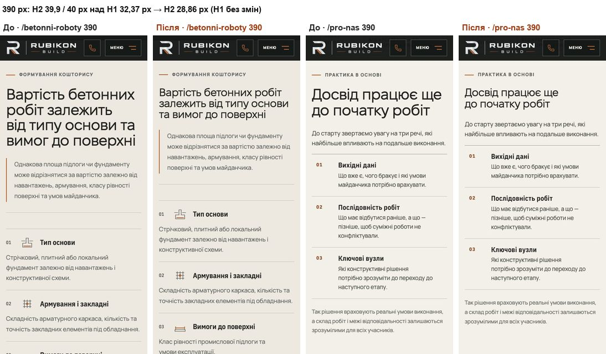
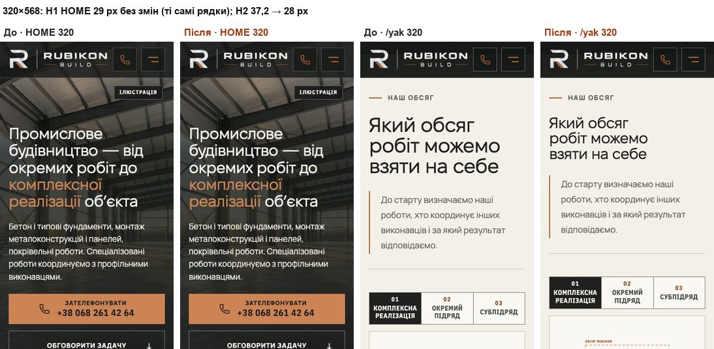
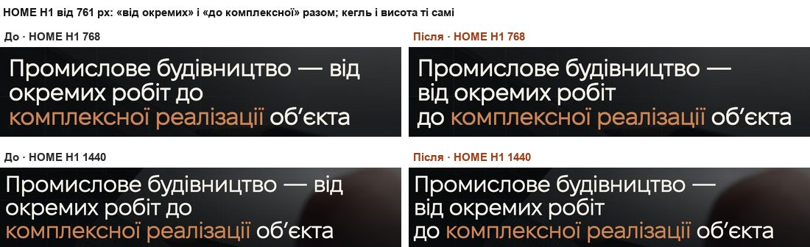

# Handoff · Телефон і планшет: H2 не більший за H1, пари в H1 HOME від 761 px (PDO-05)

| | |
|---|---|
| Дата | 2026-10-20 |
| Виконавець | Claude Code |
| Підстава | Рішення власника 20.10: «1) PDO-05 — OD-PX-14 A з планшетом (46→38), OD-PX-15 — пари лише ≥761; еталони після мого перегляду». Premium Experience Review 18.10: PDO-05 (TYP-01) і PDO-44 п. 1. Крок W1-07 |
| Рев'ю | Незалежне рев'ю очікується через GitHub. Рішення — за Дмитром |
| PR | Draft. **Merge і deploy не виконувались. Без окремого OK Дмитра вони не дозволені** (DEC-30). Гілка — прототип `design/*`: до мітки `visual-freeze` візуальні набори в CI відкладені (docs/ci-tier-model.md) |
| Гілка / base | `design/phone-type-scale` від `main` `18efb1f` (після #209–#215). Специфікацію писали на `d4b11c0`. Усі посилання файл:рядок звірені з `18efb1f`, два уточнення — у «Відкритих питаннях» |
| Коміти | `cec9fbe` — код і тести · цей handoff |
| Змінено | `app/globals.css` (токен `--title-section` на телефоні й від 761 px; `--display-phone-scale` прибрано), `app/conversation.css`, `app/home-v2.css`, `app/angary/angary-editorial.css`, `app/zernoskhovyshcha/grain-editorial.css`, `app/pro-nas/about.css`, `app/configurator-preview/configurator.css`, `app/components/directions/direction-template.css` (телефонні H2 на токені, «Пов’язані напрямки» 26 px), `app/components/home-v2/HomeV2Hero.tsx` (два `span.hv2-keep` у H1). Тести: новий `tests/e2e/heading-scale.spec.ts`; оновлені `tests/unit/fixel-display-font.test.ts` і `tests/fixtures/typography-en-lab-headings.json` |
| Не змінено | Телефонний H1 (Mobile Hero v2: `home-v2.css` і `phone-hero.css`); текст H1 (`textContent` той самий); `.conversation h2` на 768 px (видимий крок не погоджено); H3 і назви карток (W3-02); `/configurator-preview` і його знімки; CSP, аналітика, SEO, workflows, retries, пороги, бюджети висоти; еталони (DEC-18) |

## Проблема

**Повторно перевірено на main `18efb1f`.** Локальний production build, Playwright 1.62.1. Згода — «лише необхідні», запити до сторонніх хостів заблоковано, нічого не натискали. Міряли обчислений `font-size` видимого `main h1` і кожного видимого `main h2`. Приховані (`display:none`, `sr-only`, `aria-hidden`) не рахувались.

- **Телефони, Chromium (L2).** На 320×568, 375×667, 390×844 і 430×932 більші за H1 **200 із 216** видимих H2: 53, 53, 48 і 46 із 54 відповідно. H1 : H2 — від 0,73 (`/pro-nas`, 320 і 375: H1 29 px, `.about-story-copy h2` 40 px) до 0,85 (`/angary`, 320).
- **Планшет 768×1024.** Більші за H1 33 із 54 H2: 46 px проти 44 (HOME) і 44,54 (решта). H1 : H2 = 0,96–0,97.
- **WebKit 390 (L3)** збігається з Chromium до сотих.
- **H1 HOME від 761 px.** Chromium на 768–1920 px: «Промислове будівництво — від / окремих робіт до / комплексної реалізації об’єкта». WebKit: «…будівництво — / від окремих робіт до / …». Рядок закінчується на «від» чи «до».

Числа збігаються зі специфікацією (production `d4b11c0`). Різниця в кількості H2 (там 204 із 220) — від змін #212–#215.

## Зміна

**Токен телефона, варіант A** (`globals.css`, блок ≤760 px): `--title-section: clamp(1.75rem, 7.4vw, 2rem)`. Це 28 / 28 / 28,86 / 31,82 px на 320 / 375 / 390 / 430. Одиниці `rem`, як у телефонного H1, тож при збільшеному шрифті браузера співвідношення H1 : H2 зберігається. `--display-phone-scale` став невикористаним, його прибрано.

**Шість локальних телефонних H2 тепер беруть токен** (усі — на ≤760 px):
- `.conversation h2` (`conversation.css`);
- `.hv2-signature-head h2` на HOME (`home-v2.css`), `line-height: 1.02` лишився;
- `.angary-section-heading h2` і `.faq-grid h2` на `/angary` (`angary-editorial.css`);
- H2 смуги «Як RUBIKON реалізує» на `/zernoskhovyshcha` (`grain-editorial.css`) — нове телефонне правило;
- `.about-story-copy h2` на `/pro-nas` (`about.css`) — нове телефонне правило;
- `.hangar-configurator-embedded .hc-hero h2` (`configurator.css`). Правило діє лише для вбудованої смуги, тобто для `h2`. `/configurator-preview` має `h1` і своїх розмірів не змінює.

«Пов’язані напрямки» на телефоні — 26 px (`direction-template.css`). На `/angary` це «Потрібен лише один етап?».

**Планшет (OD-PX-14 «так»).** `globals.css`: `--title-section: clamp(2.375rem, 4.5vw, 4.5rem)`. На 768 px H2 46 → 38 px. Від ≈1022 px 4.5vw більше за 46 px, тож там нічого не змінюється. `.conversation h2` на 768 лишився 44 px, тому на HOME H1 = H2 = 44 px: умова «≤» виконується, але видимого кроку немає. Це відомий результат: видимий крок (`min(var(--title-section), …)`) власник не погоджував.

**H1 HOME, пари (OD-PX-15 — лише ≥761 px).**
- Розмітка: `від окремих робіт до <em>комплексної реалізації</em>`. Акцент один (`<em>`), а не два.
- CSS (`home-v2.css`, лише `@media (min-width: 761px)` і лише `:lang(uk)`): пара — одна нерозривна коробка `inline-block; width: max-content; max-width: 100%`, як захист акценту в `globals.css` (`main h1 em`). `em` усередині пари знову `inline`.
- На телефоні `span` стилів не мають, переноси Mobile Hero v2 ті самі.

## Перевірка

Рівні: **L2** — емуляція Chromium, **L3** — Playwright WebKit (емуляція, не Safari). Фізичного iPhone не було, L5 не перевірявся. **До merge власник дивиться HOME і одну сторінку напрямку (наприклад `/betonni-roboty`) на iPhone 12** (OD-PX-05).

**RED → GREEN** (`heading-scale.spec.ts`, desktop-chromium + mobile-chromium, локальний production build):

| | Passed | Failed | Skipped |
|---|---:|---:|---:|
| main `18efb1f` (новий тест, код main) | 0 | **11** | 11 |
| гілка | **11** | 0 | 11 |

- **9 тестів (mobile):** на кожній із 9 сторінок на 320×568, 375×667, 390×844, 430×932 і 768×1024 кожен видимий `main h2` ≤ `main h1`. На main — 233 порушення (200 на телефонах і 33 на 768).
- **1 тест (desktop):** H1 HOME на 768 і 1440 px — «від окремих» і «до комплексної» в одному рядку, жоден рядок не закінчується на «від» чи «до». З перевизначенням інтервалів тексту (WCAG 1.4.12) пари не виходять за H1, бічної прокрутки немає. На main падає: пари розірвані на обох ширинах.
- **1 тест (mobile):** на 320 і 390 px `span.hv2-keep` має `inline` / `normal`, а рядки й висота H1 ті самі, що в H1 без цих `span`. На main падає, бо `span` немає. Це запобіжник для телефонного H1.
- Skipped — це тести іншого проєкту (`test.skip` за `isMobile`).

**WebKit (L3)**, допоміжний конфіг поза репозиторієм. CSP без `upgrade-insecure-requests` — лише в тестовому route.
- main: 9 із 9 сторінок падають на 390×844 (H2 39–40,95 px проти H1 32,37), пари на 768 падають.
- гілка: результати — у таблиці наборів нижче.

**H1 / найбільший H2, px: main → гілка** (Chromium; WebKit 390 збігається до сотих):

| Сторінка | 320×568 | 375×667 | 390×844 | 430×932 | 768×1024 |
|---|---|---|---|---|---|
| `/` | 29 / 37,2 → **28** | 29 / 39,38 → **28** | 32,37 / 40,95 → **28,86** | 35 / 44 → **31,82** | 44 / 46 → **44** |
| `/napryamky` | 29 / 37,2 → **28** | 29 / 38,36 → **28** | 32,37 / 39,9 → **28,86** | 35 / 42,78 → **31,82** | 44,54 / 46 → **44** |
| `/angary` | 29 / 34 → **28** | 29 / 37,5 → **28** | 32,37 / 39 → **28,86** | 35 / 42 → **31,82** | 44,54 / 46 → **44** |
| `/zernoskhovyshcha` | 29 / 37,2 → **28** | 29 / 38,36 → **28** | 32,37 / 39,9 → **28,86** | 35 / 42,78 → **31,82** | 44,54 / 46 → **44** |
| `/metalokonstruktsii` | 29 / 37,2 → **28** | 29 / 38,36 → **28** | 32,37 / 39,9 → **28,86** | 35 / 42,78 → **31,82** | 44,54 / 46 → **44** |
| `/betonni-roboty` | 29 / 37,2 → **28** | 29 / 38,36 → **28** | 32,37 / 39,9 → **28,86** | 35 / 42,78 → **31,82** | 44,54 / 46 → **44** |
| `/pokrivelni-roboty` | 29 / 37,2 → **28** | 29 / 38,36 → **28** | 32,37 / 39,9 → **28,86** | 35 / 42,78 → **31,82** | 44,54 / 46 → **44** |
| `/yak-pratsyuiemo` | 29 / 37,2 → **28** | 29 / 38,36 → **28** | 32,37 / 39,9 → **28,86** | 35 / 42,78 → **31,82** | 44,54 / 46 → **44** |
| `/pro-nas` | 29 / 40 → **28** | 29 / 40 → **28** | 32,37 / 40 → **28,86** | 35 / 42,78 → **31,82** | 44,54 / 46 → **44** |

- H1 не змінився ні кеглем, ні кількістю рядків, ні висотою на жодній сторінці й ширині (порівняння main і гілки).
- H2 > H1: 200 із 216 → **0** на телефонах, 33 із 54 → **0** на 768. На 768 найбільший H2 — `.conversation h2` 44 px. Решта H2 там 38 px.
- 1280×800 і 1440×900: H2 57,6 і 64,8 px, як на main.
- H3 ≤ H2 на кожній сторінці й ширині (рівність є лише на `/pokrivelni-roboty`: «Пов’язані напрямки» 26 = `.direction-entry-list h3` 26, різні секції). Горизонтальної прокрутки немає ніде.

**Висота сторінки, px (гілка − main)** — жодна сторінка не стала вищою:

| Сторінка | 320×568 | 375×667 | 390×844 | 430×932 | 768×1024 | 1280 / 1440 |
|---|---:|---:|---:|---:|---:|---:|
| `/` | −91 | −131 | −138 | −144 | −24 | 0 |
| `/napryamky` | −132 | −139 | −146 | −152 | −24 | 0 |
| `/angary` | −88 | −139 | −142 | −90 | −83 | 0 |
| `/zernoskhovyshcha` | −276 | −243 | −285 | −293 | −57 | 0 |
| `/metalokonstruktsii` | −411 | −378 | −396 | −413 | −57 | 0 |
| `/betonni-roboty` | −332 | −330 | −346 | −361 | −44 | 0 |
| `/pokrivelni-roboty` | −339 | −289 | −303 | −347 | −82 | 0 |
| `/yak-pratsyuiemo` | −277 | −340 | −357 | −373 | −131 | 0 |
| `/pro-nas` | −236 | −216 | −181 | −180 | −32 | 0 |

**H1 HOME, рядки** (Chromium і WebKit, 320 / 375×667 / 375×812 / 390 / 430 / 761 / 768 / 1024 / 1280 / 1440 / 1920):
- **≤430 px:** рядки й висота ті самі, що на main, в обох рушіях, з перевизначенням інтервалів і без. Зсув прямокутників слів — ≤0,04 px у Chromium і ≤0,90 px (субпіксельно) у WebKit.
- **≥761 px:** «Промислове будівництво — / від окремих робіт / до комплексної реалізації об’єкта» в обох рушіях. Жоден рядок не закінчується на «від» чи «до» (на main таких рядків 1–2). Висота та сама: 135 / 163 / 204 / 229 / 239 px. `textContent` побайтно той самий. `em` і пари не виходять за H1, зокрема з перевизначенням інтервалів.
- **Перевизначення інтервалів на 761–768 px:** H1 стає на рядок вищим, 330 → 396 px (6 рядків замість 5), бо пара «від окремих робіт» не ділиться. Вміст не губиться. Від 1024 px висота з перевизначенням та сама.

**CLS «late fonts»** (`typography.spec.ts`; Pixel 7 = mobile-chromium, Desktop Chrome 1440×900; кожен `.woff2` затримано на 3 с, перший візит). Main і гілка — на одному Mac, кожне значення — окремий прогін:

| Маршрут | main `18efb1f` | гілка |
|---|---|---|
| mobile `/` | 0,0686 ×3; ще 12 прогонів: 10 × 0,0676–0,0686, 2 × 0,220–0,221 | 0,2201 / 0,0676 / 0,2210; ще 17 прогонів: 15 × 0,0676–0,0688, 2 × 0,2210 |
| mobile `/angary` | 0,0578 ×3 | 0,0574 / 0,0578 / 0,0574 |
| mobile `/metalokonstruktsii` | 0,0578 ×3 | 0,0578 / 0,0585 / 0,0578 |
| desktop `/` | 0,0041 ×3 | 0,0031 / 0,0036 / 0,0024 |
| desktop `/angary`, `/metalokonstruktsii` | 0,0003–0,0004 | 0,0003–0,0004 |

- Звичайні значення однакові (0,0574–0,0688): зсув дає банер cookie (заміна шрифту Manrope, висота 205 → 187 px) і hero під ним. Від H2 він не залежить.
- **Викиди ≈0,22 є і на main** (2 із 15 прогонів), і на гілці (4 із 20) з однаковими джерелами: `div.hero-copy` і `h1` HOME зсуваються вгору 522 → 468 → 400 px за 1,2–1,7 с, ще до заміни шрифтів. Це наявна гонка першого екрана HOME з банером, не ця зміна.
- Тест на mobile падає на main і на гілці однаково: 3 із 3, поріг 0,01.

**Набори на гілці.** На прохання lead локальну перевірку звужено. Desktop-chromium + mobile-chromium, локальний production build:

| Набір | main `18efb1f` | гілка |
|---|---|---|
| `heading-scale` (новий) | 0 passed, 11 failed, 11 skipped | 11 passed, 11 skipped |
| `words-whole` | 10 passed, 10 skipped | 10 passed, 10 skipped |
| `typography` | 32 passed, 3 failed (late fonts, mobile), 17 skipped | 32 passed, **3 failed** (late fonts, mobile: 0,0686 / 0,0578 / 0,0578 — ті самі числа, що на main), 17 skipped |
| `grain-page` (бюджети висоти) | 34 passed, 6 skipped | 34 passed, 6 skipped |
| `phase3-shorter-pages` (бюджети висоти) | 31 passed, 1 skipped | 31 passed, 1 skipped |
| WebKit (L3, допоміжний конфіг; iPhone 13 і Desktop Safari) | 2 passed (перевірка harness), 11 failed: 9 сторінок на 390, пари на 768 / 1440, телефонний H1 без `span` | **13 passed**, 11 skipped (інший проєкт) |
| Unit (`vitest run`) | — | 1413 / 1413 (91 файл) |
| `tsc`, `eslint .` (без `dist/`, де лежить локальна збірка), `git diff --check` | — | чисто |

Разом п'ять файлів: гілка — 118 passed, 3 failed, 45 skipped; main — 107 passed, 14 failed, 45 skipped. Нових падінь немає.

**Широкий набір локально на гілці не завершено — його покриває CI Main Regression на гілці.** Це pr-critical, smoke, responsive-a11y-phase1, page-hero-rhythm, hero-video, configurator-sheet, theme та інші.
- На main цей набір (19 файлів, 722 тести) дав 538 passed, 166 skipped, 18 failed: 11 — новий тест (RED), 3 — CLS «late fonts», 4 — `configurator-sheet` за таймаутом 30 с під навантаженням чотирьох воркерів.
- На гілці той самий прогін зупинено на 327 із 722 тестів, коли lead звузив перевірку. До зупинки впали лише тести з таймаутом 30–55 с під тим самим навантаженням: `configurator-sheet` (5, такі самі є на main), `hero-video.spec.ts:490` (4) і `smoke.spec.ts:603` (1). Перезапущені окремо з одним воркером, `hero-video:490` і `smoke:603` дали 5/5 passed. `configurator-sheet` окремо не перезапускали. Жоден із цих тестів не перевіряє кеглі заголовків.

**Еталони — візуальний прогін** (`visual.spec.ts`, visual-chromium, локально): рендери main і гілки порівнювали між собою, а не з PNG, бо darwin-еталони на main застарілі. Рендери main відтворюються: main проти main — 33 із 33 у межах допуску набору. Результат — у наступному розділі.

## Еталони (DEC-18)

Їх не оновлювали. Процедура за DEC-18 (OD-PX-04 a): preview → мітка `visual-freeze` → перегляд кожного diff в артефакті `changed-area-visual-diff` → OK власника. Лише після цього оновлюються переглянуті PNG, darwin і linux. Linux беруть з артефакту того самого head.

**Змінюються, поза допуском набору (18):**

| Ціль | Висота знімка main → гілка | Причина |
|---|---|---|
| `homepage-directions-mobile-375` | 819 → 758 | H2 38,36 → 28 |
| `homepage-inquiry-mobile-375` | 744 → 724 | `.conversation h2` |
| `directions-hub-mobile-375` | 1550 → 1529 | H2 |
| `direction-cost-mobile-375` | 1008 → 937 | H2, 4 → 3 рядки |
| `direction-faq-mobile-375` | 756 → 750 | H2 |
| `process-route-mobile-375` | 1565 → 1515 | H2 |
| `process-scope-mobile-375` | 1220 → 1159 | H2 |
| `process-responsibility-mobile-375` | 1541 → 1481 | H2 |
| `process-terms-mobile-375` | 2833 → 2812 | H2 |
| `homepage-directions-tablet-768` | 1447 → 1431 | H2 46 → 38 (**немає в списку специфікації**) |
| `directions-hub-tablet-768` | 1404 → 1396 | H2 46 → 38 |
| `direction-cost-tablet-768` | 795 → 771 | H2 46 → 38 |
| `direction-faq-tablet-768` | 499 → 488 | H2 46 → 38 |
| `process-route-tablet-768` | 1428 → 1420 | H2 46 → 38 |
| `process-scope-tablet-768` | 1172 → 1155 | H2 46 → 38 |
| `process-responsibility-tablet-768` | 2398 → 2382 | H2 46 → 38 (**немає в списку специфікації**) |
| `process-terms-tablet-768` | 2480 → 2464 | H2 46 → 38 (**немає в списку специфікації**) |
| `homepage-hero-desktop-1440` | 1440 × 900 | переноси H1, 3,6 % пікселів |

**Змінюється в межах допуску (1):** `homepage-hero-tablet-768`. Переноси H1, 2,3 % пікселів відрізняються, але локально знімок проходить поріг набору (threshold 0,25, maxDiffPixelRatio 0,02). Специфікація чекала тут змін. На Linux він може пройти або впасти. Якщо впаде, його теж треба переглянути.

**Субпіксельні відмінності, вміст той самий, у межах допуску (4):** `homepage-inquiry-tablet-768`, `homepage-real-object-mobile-375`, `homepage-real-object-tablet-768` (секції вище стали коротшими на дробову величину, і текст та фото растеризуються з іншою фазою), `direction-faq-desktop-1440` (25 пікселів, різниця ≤1 рівня).

**Без змін (10):** `homepage-hero-mobile-375` і всі інші `*-desktop-1440`.

Специфікація чекала 16 цілей (9 + 2 + 5). Фактично змінюються 19: ще три планшетні (`homepage-directions-tablet-768`, `process-responsibility-tablet-768`, `process-terms-tablet-768`). У кожній є H2 на `--title-section`, який на 768 px зменшується з 46 до 38 px, як і погоджено в OD-PX-14. Нічого іншого в цих кадрах не змінюється. Разом 19 × 2 платформи = 38 PNG.

## Ризики

- **H2 28 px поруч із H3 26 px.** На HOME телефонний H2 28–31,82 px, а назви карток 26–29 px. На `/pokrivelni-roboty` «Пов’язані напрямки» 26 = `.direction-entry-list h3` 26. Крок між H2 і H3 малий (1,08–1,10), обидва в Fixel. Це розв’язує W3-02 (`--type-h2-minor`, `--type-h3`, PDO-60). До того — перегляд власника.
- **Бюджети висоти.** `grain-page.spec.ts` (≤12,6 екрана на 390×844, ≤9,15 на 1440) і `phase3-shorter-pages.spec.ts` задають лише верхні межі. Сторінки коротшають: `/zernoskhovyshcha` на 390 — 10356 → 10071 px (12,27 → 11,93 екрана). 1440 не змінюється. Бюджети не звужували.
- **CLS.** Не гірше, ніж на main, див. таблицю. Викид ≈0,22 на HOME mobile є і на main. Він виникає до заміни шрифтів і з H2 не пов’язаний.
- **Короткі вікна ≤760 × ≤740 px, ширші за ≈392 px** (Pro Max / Plus у Safari з панелями, телефон у ландшафті). Там телефонний H1 — 29 px (`max-height: 740px`), а H2 за варіантом A — 29,08–32 px. Отже H2 > H1 на 0,08–3 px. На main у тих самих вікнах було 39–44 px. На 390 px (iPhone 12) цього немає: 28,86 ≤ 29. Див. «Відкриті питання», п. 1.
- **`text-wrap: balance`** переставляє переноси всіх телефонних H2. Висячі короткі слова не перевірялись — це TYP-03 / W3-02. Темну тему еталони не знімають, її бачить лише власник.

## Відкат

`git revert cec9fbe` — один коміт: CSS, розмітка H1 і тести. Еталонів він не торкається.

## Відкриті питання

1. **Короткі вікна (Pro Max у Safari, ландшафт).** Додати до блоку `@media (max-width: 760px) and (max-height: 740px)` рядок `:root { --title-section: 1.75rem; }` (28 px під H1 29 px)? Це не змінює жодної ширини з критеріїв приймання і жодної візуальної цілі (375×812 вище за 740 px). Але це виходить за погоджений варіант A, тому в PR не додано.
2. **Еталони.** Список цілей ширший за специфікацію на три планшетні. Вони прямо випливають з погодженого планшета (46 → 38). Потрібен OK власника на всі 19 після перегляду в `changed-area-visual-diff`.
3. **Посилання специфікації.** `conversation.css:132` діє на ≥1181 px і ≤900 px висоти, а не на ≤1180 px. 44 px на 768 дає базове правило `conversation.css:47` (`clamp(44px, 4.4vw, 66px)`). Висновок специфікації (H1 = H2 = 44 на HOME) від цього не змінюється. Правило для конфігуратора — `.hangar-configurator-embedded .hc-hero h2`, як у §3.2 (у концепті було `:is(h1, h2)`; вбудована смуга рендерить лише `h2`).
4. **Перевизначення інтервалів на 761–768 px.** H1 HOME на рядок вищий (330 → 396 px). Прийнятно?
5. **L5.** HOME і `/betonni-roboty` на iPhone 12 до merge (OD-PX-05), а також H1 HOME на 320 і 390 px: переноси ті самі, що на main.

## Пропоновані оновлення control (лише після OK власника)

- PDO-05 → «реалізовано в draft PR, чекає перегляду власника і `visual-freeze`».
- PDO-44 п. 1 → пари в H1 HOME від 761 px — у цьому PR. Варіант P (пари на телефоні) не береться (OD-PX-15).
- W1-07 → виконано, крім питання 1 (короткі вікна), якщо власник його візьме.
- OD-PX-14 → A з планшетом (20.10); видимий крок для `.conversation h2` на 768 не береться.
- DEC-18 → після перегляду оновити 19 цілей зі списку вище (darwin і linux з того самого head).
- W3-02 → забрати крок H2 / H3 (28 проти 26 px) і `--type-h2-minor` для «Пов’язаних напрямків».

## Фікстура EN і unit-тест

- **`typography-en-lab-headings.json`.** Ключ «від окремих робіт до» був одним текстовим вузлом H1. Тепер це три вузли: «від окремих» (у `span`), « робіт » і «до » (у другому `span`, перед `em`). Старий ключ більше нічого не знаходив би, і лабораторний EN-H1 лишився б наполовину українським без жодного падіння. Тепер три ключі: «від окремих» → «from individual», «робіт» → «work packages», «до» → «to». Покриття те саме: H1 повністю англійський. За `lang="en"` пари не склеюються (`:lang(uk)`), а `em` поводиться як на main.
- **`fixel-display-font.test.ts`.** Замість буквального старого токена перевіряє обидва нові значення `--title-section` і те, що `--display-phone-scale` у `globals.css` більше немає. На main нова перевірка падає.

## Докази

Пакет доказів — приватний, поза репозиторієм. Він містить:
- скрипти замірів;
- JSON;
- логи RED/GREEN, наборів, CLS і джерел зсувів;
- кадри до/після на 320, 390, 768 і 1440 px для HOME, `/pro-nas`, `/betonni-roboty`, `/yak-pratsyuiemo`;
- рендери visual для main і гілки.

| Файл | SHA-256 |
|---|---|
| `measure-main-chromium.json` | `b0da2892c25a2b81b6987e1e3c392b9bb99d1dcf06cf6f3bba41bc5f2dc6fd27` |
| `measure-branch-chromium.json` | `ce717e2e64d1c0f8069041109fef311a7d8e1d42d718137f90d374ecb233ac76` |
| `measure-main-webkit.json` | `727fa303f505ad5de6435170c558e3610c2d52b69df394dfa8752a13674089d8` |
| `measure-branch-webkit.json` | `f1d9dcc84f5a627e5796678fa7ac09dac7d0ec1da87d96bd0e195d07fff84c91` |
| `h1lines-main-chromium.json` | `91e020d9eebf410a76c1bfcbadf85565f69b09aefafebd1e97f1ba19abf9dcfa` |
| `h1lines-branch-chromium.json` | `898cca3dc60c3cff3bea25bc4515fc21922b4d43c99b829959f1c410337fa063` |
| `h1lines-main-webkit.json` | `e8d8d754595e7312cc4cef32cbbd12d5b5fb54e6988a7e2ce9e38226a9ed61d2` |
| `h1lines-branch-webkit.json` | `0cbca88b37265e4e76c1507a99e43792b8d7a1c82b3cb512db91343f68b9c1ed` |
| `cls-main.json` | `da34667439f4294b3b2c222514f7643d10ae9ba2333ade63b82ef28c66ab3816` |
| `cls-branch.json` | `4a537a8d0616b448fe83d519d1049f197a2fadef6f3a5843d1293492a8b829f6` |
| `red-main-18efb1f.log` | `fdb8dc420edc0d3db4eb00e64098630c58801df35f1198580fd4c0e655422e82` |
| `green-branch.log` | `852e72eebc2acd12eea641c245f997a89a8044422ece5472afde22a4ed3a1a5a` |
| `narrow-branch.log` | `9a62608fed4367415fbf2903d1bf32bef6e8dbefe603c37dfccf2d5d4ff6d40b` |
| `visual-pixel-diff.log` | `dc435a177067f7b0f9c29ac3267a149979fa653b7a5fc632d64feea33e0e953e` |

**Метод.** Playwright 1.62.1, Chromium і WebKit, локальний `vinext start` на одному порту — збірки main `18efb1f` і гілки по черзі.
- Усі хости, крім застосунку, заблоковані.
- Згода cookie задана як «лише необхідні». «Прийняти все» не натискали.
- Форм не надсилали.
- Еталони не оновлювали: `--update-snapshots` не запускали, PNG у репозиторій не додавали.

## Еталони: погоджено власником 20.10 (DEC-18)

Власник переглянув пари «зараз / новий» і погодив **21 ціль**: «Погоджую 21 еталон для #217 (DEC-18)». Їх на 2 більше, ніж передбачав локальний прогін на Mac: `homepage-inquiry-tablet-768` і `homepage-real-object-tablet-768` на Linux виходять за допуск, а `grain-planner-mobile-390-initial` (`/planner-preview`) бере той самий токен H2.

Нові PNG — фактичні Linux-рендери з артефактів `main-visual-blob-1/2` прогону Main Regression [39413801403](https://github.com/leusd100/rubikon-build/actions/runs/39413801403) на голові гілки `9e97bee`. Кожен рендер побайтово однаковий в усіх спробах. Перед заміною кожен `-expected.png` з CI звірено з файлом у репозиторії. Між `9e97bee` і фінальною головою влито лише main з #218: він знімків не змінює, бо `visual.spec` знімає після «Лише необхідні». Фінальний PR Gate з `visual-freeze` перевіряє ці еталони на останньому коміті.

| Ціль | SHA-256 (16) |
|---|---|
| `grain-planner-mobile-390-initial` | `4edc029dee9a9e24` |
| `direction-cost-mobile-375` | `6e6bac4006516330` |
| `direction-cost-tablet-768` | `d8af2439ef4ec0a3` |
| `direction-faq-mobile-375` | `a862e8ad63e6fa43` |
| `direction-faq-tablet-768` | `8427fc9217213a21` |
| `directions-hub-mobile-375` | `c605c88c8d944541` |
| `directions-hub-tablet-768` | `b096ae5d53752589` |
| `homepage-directions-mobile-375` | `7f685f8fd45a7de2` |
| `homepage-directions-tablet-768` | `7f5036967ed0a1c4` |
| `homepage-hero-desktop-1440` | `ab2c0cbd9a7910d4` |
| `homepage-inquiry-mobile-375` | `96cf013ae0807281` |
| `homepage-inquiry-tablet-768` | `ea58e6094fd68148` |
| `homepage-real-object-tablet-768` | `700c55fd7f843aea` |
| `process-responsibility-mobile-375` | `9199ed4b461bca9a` |
| `process-responsibility-tablet-768` | `12c3796ba1cff379` |
| `process-route-mobile-375` | `c1fd355dccc080c7` |
| `process-route-tablet-768` | `d879f4b481ab455a` |
| `process-scope-mobile-375` | `b1f2690e16b89492` |
| `process-scope-tablet-768` | `a6a340a2c5e15362` |
| `process-terms-mobile-375` | `4c2b645e3665d193` |
| `process-terms-tablet-768` | `e1176747a9044643` |

Darwin-еталони, пороги й ретраї не змінювались.
