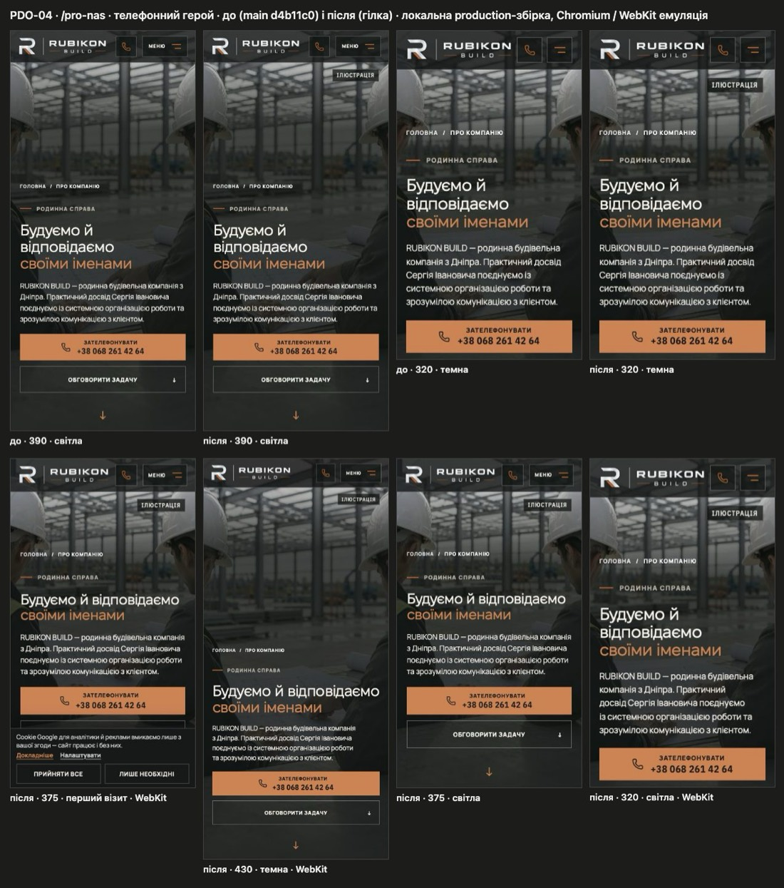

# Handoff · /pro-nas: мітка «Ілюстрація» на телефонному герої з умовними людьми (PDO-04)

| | |
|---|---|
| Дата | 2026-10-20 |
| Виконавець | Claude Code |
| Підстава | Рішення власника 20.10: **OD-PX-12, варіант A** («Ілюстрація» на телефонному герої /pro-nas). Переглядає рішення 30.09 для цього кадру. Premium Experience Review 18.10, PDO-04 (ABT-01), крок W1-04 |
| Рев'ю | Незалежне — очікується: ChatGPT (через GitHub). Рішення — Дмитро |
| PR | Draft. **Merge і deploy не виконувались і не дозволені** без окремого OK Дмитра (DEC-30) |
| Гілка / base | `fix/pro-nas-illustration-label` від `main` `d4b11c0` |
| Коміти | `a61f2c6` виправлення й тести · цей handoff |
| Змінено | `app/pro-nas/page.tsx` (мітка + коментар про рішення), `app/pro-nas/about.css` (+7 рядків), `app/components/AboutHeroVideo.tsx` (коментар), `tests/e2e/smoke.spec.ts`, `tests/e2e/pr-critical.spec.ts` |
| Не змінено | Зображення P5 і його `alt=""`; розкладка героя; десктопне й планшетне відео (мітка там прихована, медіаполітика — PDO-39); інші сторінки; тексти; еталони (DEC-18); workflows |

## Проблема

На телефоні (≤600 px) герой «Про компанію» показує кадр P5 — згенеровану ілюстрацію з двома анонімними фахівцями — просто під заголовком «Будуємо й відповідаємо своїми іменами». Мітки походження немає. Рішення 30.09 спиралося на те, що «концептуальне зображення каже про це в alt-тексті», але в чинного кадру `alt=""` (декоративний), тож ні зряча людина, ні скрінрідер не дізнаються, що це не команда. Решта шести концептуальних героїв сайту мають мітку «Ілюстрація».

**Відтворено на `d4b11c0`:** мітки немає в жодному з 20 станів (320/375/390/430, світла й темна теми, перший візит з банером cookie; Chromium і Playwright WebKit, емуляція).

## Зміна

- У `section.about-subhero` — та сама `span.hero-provenance`, що на інших героях (клас `about-hero-provenance`), з текстом «Ілюстрація».
- `about.css`: мітка `display: none`, на `max-width: 600px` — `display: block`, тобто лише там, де показується кадр P5 (`AboutHeroVideo`, `STATIC_QUERY`). Місце й вигляд — спільні правила телефонного героя (`globals.css .hero-provenance`, `phone-hero.css`).
- Коментарі в `page.tsx` і `AboutHeroVideo.tsx` фіксують: рішення 30.09 переглянуто для цього кадру рішенням власника 20.10 (OD-PX-12 A).

## Перевірка

**RED → GREEN.**
- `smoke.spec.ts` «about hero uses one still on phones, never the video»: нові очікування — мітка видима, текст «Ілюстрація», у першому екрані нижче шапки, не перетинає крихти й H1. **На `d4b11c0` падає**, на гілці проходить.
- `pr-critical.spec.ts` «/pro-nas shows who answers…»: замість «на сторінці немає слова Ілюстрація» — рівно одна мітка, і це мітка героя. **На `d4b11c0` падає** («Expected 1, Received 0»), на гілці проходить.
- Новий `smoke.spec.ts` «about hero stamp belongs to the phone still only»: понад 600 px мітка прихована.

**Локально, production build гілки** (`vinext start`; усі сторонні й не-GET запити заблоковані, заявок не надсилалось):

| Набір | Результат |
|---|---|
| smoke, pr-critical, responsive-a11y-phase1, words-whole, page-hero-rhythm, hero-video, pro-nas-practice, pro-nas-capability, first-contact; desktop-chromium + mobile-chromium | **381 passed, 59 skipped (наявні skip проєктів), 0 failed** |
| `tsc --noEmit`, `eslint` змінених файлів | чисто |

**Геометрія (20 станів, Chromium і WebKit, емуляція):** мітка 98×26 px, верх на y 81 при шапці 67 px; праворуч з полем 20 px; крихти починаються з y 155 (320) … 424 (430), H1 — з 252 … 521; на першому візиті банер cookie — з y 546 (375×667) і 711 (390×844). Перетинів немає.

**Контраст тексту мітки, по пікселях:** текст мітки зроблено прозорим, найсвітліший піксель підкладки в її межах, колір тексту накладено на нього. **4,99–5,18 : 1** у всіх 16 станах (AA ≥ 4,5). Для порівняння — чинна мітка на /metalokonstruktsii: 5,05–7,09 : 1.

**Рівні:** L2 Chromium-емуляція, L3 Playwright WebKit-емуляція. Справжній iPhone Safari не перевірявся — це крок власника. Локальний WebKit через HTTP потребує в тестовому стенді прибрати з CSP документа `upgrade-insecure-requests`; застосунок і його CSP не змінювались.

## Еталони (DEC-18)

Сторінкових візуальних еталонів /pro-nas немає (`tests/e2e/visual.spec.ts` знімає /, /napryamky, /betonni-roboty, /angary, /yak-pratsyuiemo) — нічого не оновлювалось і не має оновлюватись.

## Ризики й відкат

- Ризик L. Мітка не перехоплює дотики (`pointer-events: none`), стоїть поза потоком; на 600/601 px поведінка перемикається разом із кадром.
- Відкат: revert цього PR повертає стан рішення 30.09.
- EN: «Illustration» коротше за «Ілюстрація» — запас є.

## Відкриті питання

- Варіант C реєстру (кадр без людей) лишається на майбутнє; цей PR його не робить.
- Десктопне відео /pro-nas і його мітка — окреме рішення (PDO-39, OD-PX-06).

## Пропоновані оновлення control (лише після OK Дмитра)

- `DECISIONS.md`: зафіксувати OD-PX-12 = A (20.10) і перегляд рішення 30.09 для телефонного кадру /pro-nas.
