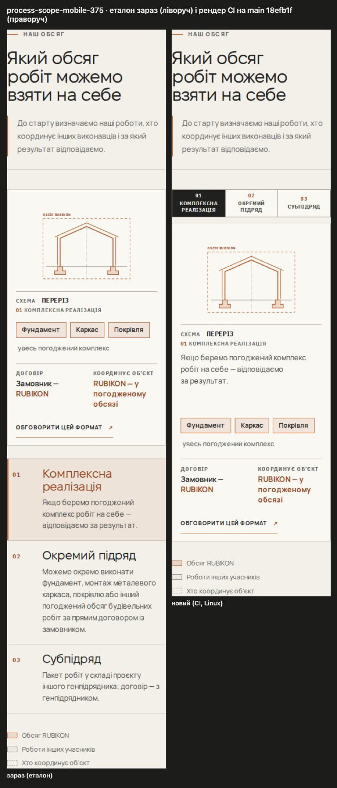
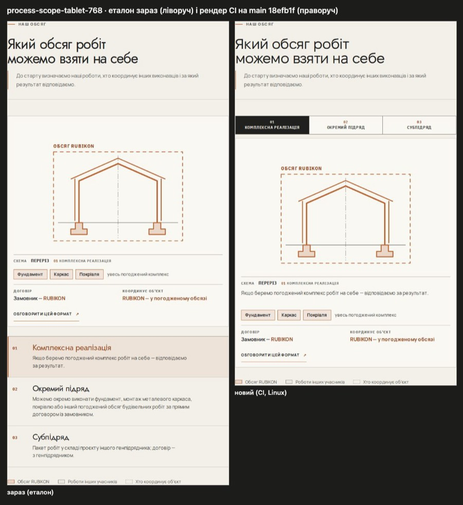
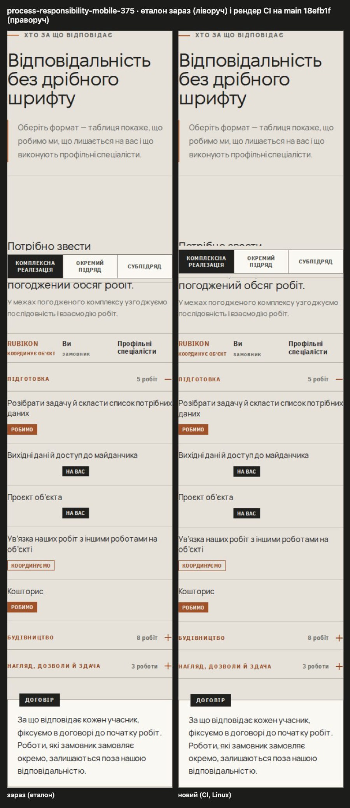
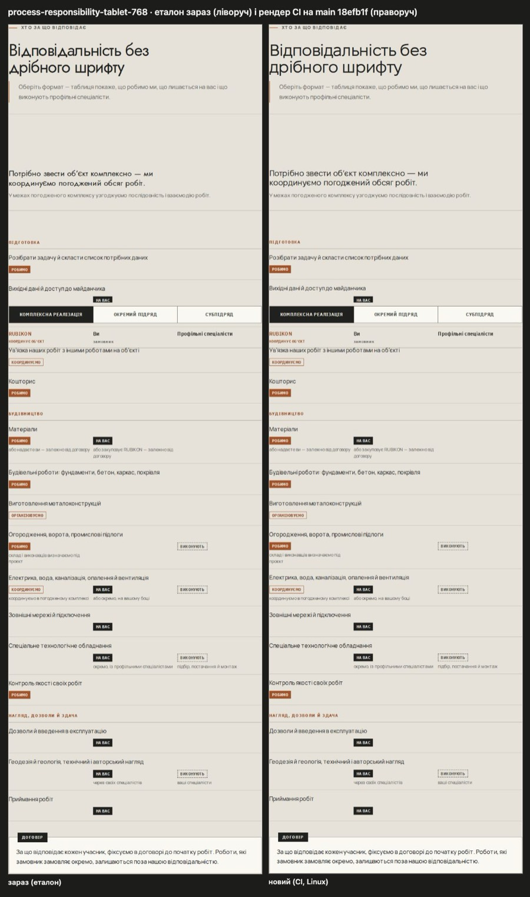
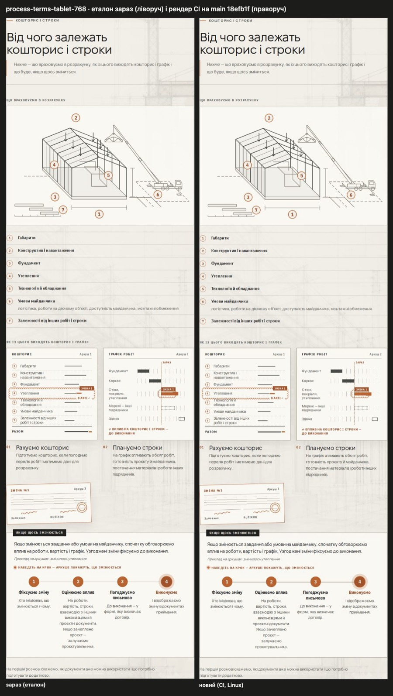

# Handoff · Візуальні еталони /yak-pratsyuiemo після #215 (PDO-06)

| | |
|---|---|
| Дата | 2026-10-20 |
| Виконавець | Claude Code |
| Підстава | Рішення власника 20.10 до #215: «еталони 375/768 — після мого перегляду»; 20.10 після merge #215: «Draft PR з еталонами після #215 (покажи мені картинки до/після)». DEC-18: еталони оновлюються лише з OK власника — цей PR і є перегляд |
| Рев'ю | Власник — візуально, за картинками нижче. Незалежне — ChatGPT (через GitHub) |
| PR | Draft. **Merge лише з OK Дмитра** (DEC-30, DEC-18) |
| Гілка / base | `test/process-baselines-after-215` від `main` `18efb1f` |
| Змінено | 5 Linux-еталонів у `tests/e2e/visual.spec.ts-snapshots/` (нижче) |
| Не змінено | Код, тести, пороги, ретраї, workflows; darwin-еталони (вони й так застарілі на main і в CI не використовуються); решта Linux-еталонів |

## Чому

#215 (формати рядком над кресленням, PDO-06) злито без мітки `visual-freeze`, тож Main visual на `main` `18efb1f` (run [39397704565](https://github.com/leusd100/rubikon-build/actions/runs/39397704565), job «Main visual (2/2)») впав на 5 цілях. Нові PNG узято з артефакту `main-visual-blob-2` (ID 12253111087) того самого прогону: кожен `-actual.png` побайтово однаковий в усіх трьох спробах CI, а `-expected.png` збігається з файлом у репозиторії до заміни.

| Ціль | Було → стало (px) | Причина | SHA-256 нового (16) |
|---|---|---|---|
| `process-scope-mobile-375` | 343×1591 → 343×1220 | **Очікувана зміна #215**: формати рядком над кресленням, блок коротший | `ea8a95f9fe0ad8fe` |
| `process-scope-tablet-768` | 712×1492 → 712×1172 | **Очікувана зміна #215** | `589fece0bdd3b015` |
| `process-responsibility-mobile-375` | 343×1568 → 343×1568, 3 % пікселів | Побічна: липкий перемикач форматів потрапляє в знімок секції на кілька px вище, бо сторінка над нею коротша і позиція прокрутки під час зйомки інша. Зміст секції той самий | `f4f47e1c14c8c7a5` |
| `process-responsibility-tablet-768` | 712×2381 → 712×2380 | Побічна: дробове округлення висоти після коротшого блока вище | `9e5ce59c25b39429` |
| `process-terms-tablet-768` | 712×2502 → 712×2503 | Побічна: те саме округлення | `7b712c2966ec5a52` |

`process-scope-desktop-1440` і всі цілі на 1440 не змінились (PDO-06 діє лише до 1050 px).

## До / після (ліворуч — еталон зараз, праворуч — рендер CI на main)

## Перевірка

- Після merge Main visual на `main` має стати зеленим на цих 5 цілях; PR Gate цього PR проганяє змінені візуальні набори.
- Нічого, крім цих 5 PNG і handoff, PR не змінює.

## Відкат

Revert повертає старі PNG — тоді Main visual знову впаде, бо #215 уже в main.
