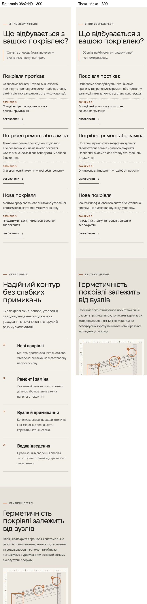
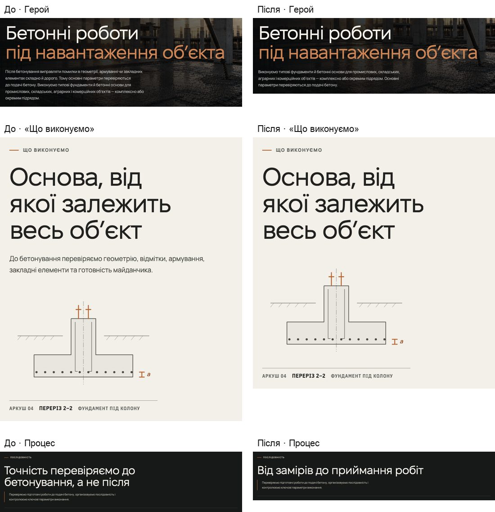
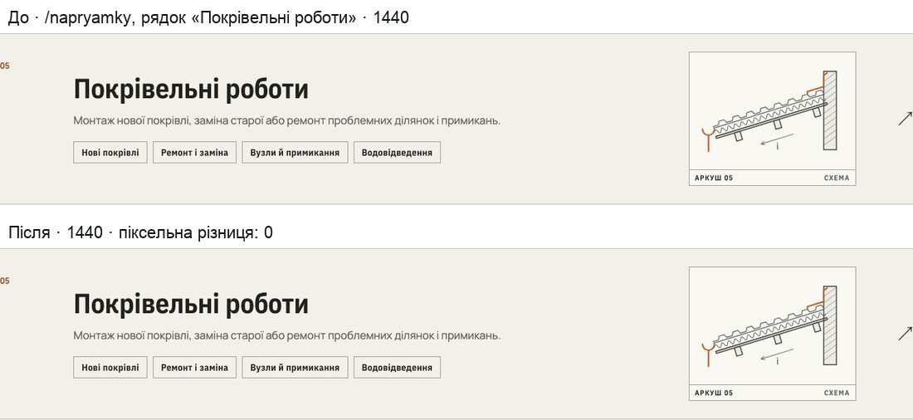

# Handoff · Покрівля й бетон без повторів (PDO-07)

| | |
|---|---|
| Дата | 2026-10-20 |
| Виконавець | Claude Code |
| Підстава | Рішення власника 20.10: «Беремо PDO-07 (B′; тексти R1, R2, R3, C1, C3, C2 = alt-2; згода на зміну Service.description)». Premium Experience Review 18.10, PDO-07 (ROO-01, CON-01, ROO-06), крок W1-05 |
| Рев'ю | Незалежне — очікується: ChatGPT (через GitHub). Рішення — Дмитро |
| PR | Draft. **Merge і deploy не виконувались і не дозволені** без окремого OK Дмитра (DEC-30) |
| Гілка / base | `content/roof-concrete-copy` від `main` `06c2dd9`. Специфікацію писали на `d4b11c0`; між ними лише #212 і #213, `directionPages.ts` вони не змінювали |
| Коміти | `e493bb1` тексти, B′ і тести · цей handoff |
| Змінено | `app/data/directionPages.ts`: тексти R1, R2, C1, C3; у покрівлі немає `overview`, є `catalogKinds`; у бетону немає `overview.text`. `app/types/directionPage.ts`: нове необов’язкове поле `catalogKinds`. `app/napryamky/page.tsx`: читає `catalogKinds ?? overview.items`. Коментарі в `DirectionEntry.tsx` і `DirectionsCatalog.tsx`. `tests/e2e/pr-critical.spec.ts`: 2 нові тести й 1 нова перевірка |
| Не змінено | `introPhone` обох сторінок; крок 01 вузла покрівлі (R6, OD-PX-43); тексти вузлів, підзаголовок процесу бетону, FAQ, вартість, CTA; компоненти й CSS; рядки й чипи /napryamky; meta/OG (`seoDescription`), canonical, FAQPage; еталони (DEC-18); workflows |

## Проблема

Перевірено повторно на локальному production build `main` `06c2dd9` (Chromium, емуляція, L2). Згода — «лише необхідні», reduced motion, сторонні запити заблоковані.

**/pokrivelni-roboty, 9 блоків.**
- Одразу після «З чим звертаються» стоїть «Склад робіт». Два речення в цих сусідніх блоках однакові:
  - «Локальний ремонт пошкоджених ділянок або поетапна заміна наявного покриття.»;
  - «Монтаж профільованого листа або утепленої системи на підготовлену несучу основу.»
- Фон обох блоків однаковий, тож межі між ними не видно.
- Лід ситуацій дослівно збігається з першим реченням ліду контакту.
- «погоджуємо … з урахуванням» трапляється тричі.
- Висота: 10184 px на 390 (12,07 екрана), 8058 px на 1440. Від низу героя до вузла — 3,09 екрана на 390.

**/betonni-roboty.**
- Думка «перевіряємо до бетонування» стоїть у чотирьох блоках поспіль. У блоках 0–3 — 9 видимих вузлів тексту з «до/після бетонування · подачі бетону · заздалегідь».
- H2 вузла «Геометрію та закладні перевіряємо заздалегідь» стоїть поруч із H2 процесу «Точність перевіряємо до бетонування, а не після».
- Десктопний лід героя займає 5 рядків (142 px на 768 і 1440). На 1250×613 герой має 651 px, а «Ілюстрація» закінчується на 631 px, нижче краю вікна.

Ці числа збігаються з оглядом і специфікацією.

## Зміна

| # | Де | Було | Стало |
|---|---|---|---|
| R1 | покрівля, `hero.intro` (також `Service.description`) | «Монтуємо й ремонтуємо покрівлі промислових, складських і комерційних об’єктів. **Вимоги до основи, вузлів і підготовки залежать від задачі.** Можемо виконати покрівлю під час будівництва всього об’єкта або взяти її окремим підрядом.» | «Монтуємо й ремонтуємо покрівлі промислових, складських і комерційних об’єктів. Можемо виконати покрівлю під час будівництва всього об’єкта або взяти її окремим підрядом.» |
| R2 | покрівля, `entry.text` | «Опишіть споруду й стан покрівлі — визначимо наступний крок.» | «Оберіть найближчу ситуацію — з неї почнемо розмову.» |
| R3 | покрівля, `overview` | Блок «Склад робіт»: H2 «Надійний контур без слабких примикань», лід, пункти 01–04, креслення «Переріз 3–3» | **прибрано зі сторінки** (варіант B′) |
| C1 | бетон, `hero.intro` (також `Service.description`) | «Після бетонування виправляти помилки в геометрії, армуванні чи закладних елементах складно й дорого. Тому основні параметри перевіряються до подачі бетону. Виконуємо типові фундаменти й бетонні основи для промислових, складських, аграрних і комерційних об’єктів — комплексно або окремим підрядом.» | «Виконуємо типові фундаменти й бетонні основи для промислових, складських, аграрних і комерційних об’єктів — комплексно або окремим підрядом. Основні параметри перевіряються до подачі бетону.» |
| C2 | бетон, `overview.text` («Що виконуємо») | «До бетонування перевіряємо геометрію, відмітки, армування, закладні елементи та готовність майданчика.» | **без ліду** (alt-2) |
| C3 | бетон, `process.title` | «Точність перевіряємо до бетонування, а не після» | «Від замірів до приймання робіт» |

**B′.** /napryamky брав види робіт для рядка «Покрівельні роботи» з `overview.items`. Якби блок просто прибрали, з рядка на ≥761 px зникли б 4 чипи, і змінився б еталон `directions-hub-tablet-768`. Тому:
- у конфіг покрівлі додано необов’язкове поле `catalogKinds` з тими самими чотирма назвами: «Нові покрівлі», «Ремонт і заміна», «Вузли й примикання», «Водовідведення»;
- `app/napryamky/page.tsx` бере `catalogKinds`, а якщо його немає — `overview.items`, як раніше;
- інші чотири напрями поля не мають і не змінюються.

Тип лишається строгим: `catalogKinds?: readonly string[]`, `tsc` чистий.

**C2 без ліду.** `overview.text` у типі необов’язковий, і `DirectionDetail` уже рендерить лід лише тоді, коли він є. Нічого, крім даних, змінювати не довелося:
- на ≥1051 px креслення «Переріз 2–2» стоїть під H2 зі своїм відступом 44 px;
- на телефоні після H2 одразу йдуть пункти.

Апострофи в нових рядках — `’` (U+2019), як на всьому сайті. Рядки дослівно збігаються з таблицями специфікації. Іншого тексту не змінено.

## Перевірка

**RED → GREEN** (`tests/e2e/pr-critical.spec.ts`; цей файл запускає Fast Gate у PR Gate).

| Тест | main `06c2dd9` | гілка |
|---|---|---|
| `/pokrivelni-roboty goes from the situations straight to the node and says nothing twice next door (PDO-07)`: SSR без `#direction-content` і без H2 «Надійний контур…»; новий лід ситуацій і лід героя; `Service.description` = лід героя; після «З чим звертаються» одразу вузол; жодного речення (≥4 слів) у двох сусідніх блоках | **падає**, desktop + mobile | проходить, desktop + mobile |
| `/betonni-roboty: «Що виконуємо» without a lead, the process from measuring to acceptance (PDO-07)`: SSR без `.lead-copy` у «Що виконуємо»; H2 процесу «Від замірів до приймання робіт»; новий лід героя; `Service.description` = лід героя; 4 пункти на місці; жодного речення в двох сусідніх блоках | **падає**, desktop + mobile | проходить, desktop + mobile |
| `/napryamky rows carry…`: нова перевірка, що в рядку покрівлі ті самі 4 види робіт (запобіжник B′) | проходить (так і має бути) | проходить |

- **На main нові тести впали 4/4** (2 тести × 2 проєкти).
- Детектор повторів окремо прогнано на main: на /pokrivelni-roboty він знаходить обидва речення, на /betonni-roboty — нічого.
- **Запобіжник B′ працює.** Для перевірки `catalogKinds` тимчасово прибрали, тобто зробили варіант B «як написано», і зібрали гілку:
  - перевірка чипів падає (замість 4 видів — порожньо);
  - `directions-hub-tablet-768` розходиться з рендером main (1404 → 1367 px);
  - на 1440 зникнення чипів у межах порогів еталона, тож ловить його лише цей тест.

  Потім зміну повернули, гілку зібрали наново й перевірили ще раз.

**Локально, production build гілки** (`vinext start`; сторонні запити заблоковані, форм не надсилалось). Ті самі 16 наборів прогнано і на main:

| Набір | desktop-chromium (passed / failed / skipped) | mobile-chromium |
|---|---|---|
| pr-critical | 59 / 0 / 0 (main 57 / **2** / 0 — нові RED) | 56 / 0 / 3 (main 54 / **2** / 3) |
| smoke | 23 / 0 / 2 | 20 / 0 / 5 |
| words-whole | 10 / 0 / 0 | 0 / 0 / 10 |
| phase3-shorter-pages | 16 / 0 / 0 | 15 / 0 / 1 |
| ux-conversion-phase2 | 9 / 1\* / 0 | 0 / 0 / 10 |
| public-service-claims | 3 / 0 / 0 | 3 / 0 / 0 |
| typography | 19 / 0 / 7 | 13 / 3\*\* / 10 |
| page-hero-rhythm | 5 / 0 / 0 | 5 / 0 / 0 |
| direction-node, direction-editorial-rhythm, direction-route-cards, direction-static-hero | 20 / 0 / 0 | 20 / 0 / 0 |
| responsive-a11y-phase1 | 19 / 0 / 0 | 0 / 0 / 19 |
| napryamky-key-plan, napryamky-row-sheets | 14 / 0 / 0 | 10 / 0 / 4 |
| sheet-field | 9 / 0 / 0 | 2 / 0 / 7 |
| **Разом** | **гілка 350 passed, 4 failed, 78 skipped · main 347 / 7 / 78** | |

Skip — наявні skip проєктів (тести самі задають вікна або лише для одного проєкту).

\* `ux-conversion-phase2.spec.ts:134` (DEC-46, закриваючий блок) у загальному прогоні впав за таймаутом 30 с. Тест відкриває лише /, /angary, /metalokonstruktsii і /yak-pratsyuiemo, жодну зі змінених сторінок. Окремо на гілці він пройшов 1/1 за 25,1 с, а весь набір `ux-conversion-phase2` — 10/10 (тест за 9,4 с). Під час загальних прогонів цей Mac був завантажений іншими процесами: load average 24–73 при 8 ядрах.

\*\* `typography.spec.ts:70` «late fonts» на mobile для /, /angary і /metalokonstruktsii падає **і на main**, з тим самим CLS 0,0676 для «/». Це не ці сторінки: поріг 0,01 калібрували на Linux.

| Інше | Результат |
|---|---|
| Unit (`vitest run`) | 1413/1413, 91 файл. Зокрема public-service-claims, siteIntegrity, drawing-camera, asset-references, planner/grainPage, delivery-page-presentation — 77/77 |
| `tsc --noEmit`, `eslint .`, `git diff --check` | чисто |

**Заміри до → після** (Chromium, згода «лише необхідні», reduced motion):

| scrollHeight | 390×844 | 768×1024 | 1250×613 | 1440×900 |
|---|---|---|---|---|
| /pokrivelni-roboty | 10184 → **8938** (−1246; 12,07 → 10,59 екрана) | 8880 → 7967 | 7514 → 6622 | 8058 → **7119** (−939) |
| /betonni-roboty | 9018 → **8824** (−194) | 7763 → 7716 | 6701 → 6599 | 7213 → **7064** (−149) |

Числа дослівно збігаються з CONCEPT-оцінкою специфікації: покрівля 8938 / 7119, бетон alt-2 8824 / 7064.

**Критерії приймання специфікації** (§ 6):

| Критерій | Результат |
|---|---|
| Однакові речення в сусідніх блоках | 0 на обох сторінках, на 390, 768, 1250 і 1440 (покрівля: було 2). Спільних фраз з 4 слів у сусідніх блоках — 0 (покрівля: було 1). Між будь-якими блоками повторюється лише номер телефону |
| Покрівля: блоки, висота | 9 → 8 блоків; 8938 ≤ 8950 на 390; 7119 ≤ 7130 на 1440 |
| Покрівля: вузол | від низу героя до вузла 3,09 → **1,62** екрана, до H2 вузла 3,24 → **1,77** (390) |
| Покрівля: «погоджуємо … з урахуванням» | 3 → 2 |
| Покрівля: лід героя на 1440 | 4 → 3 рядки |
| Бетон: H2 вузла й процесу | більше не повторюють «перевіряємо до бетонування» |
| Бетон: десктопний лід | 5 → **3** рядки (142 → 83 px) на 768 і 1440 |
| Бетон: 1250×613 | герой 651 → **613** px; «Ілюстрація» закінчується на 593 px |
| Бетон: вузли «до/після бетонування» в блоках 0–3 | 9 → **7** |
| /napryamky | рядок покрівлі 240 px (768) і 249 px (1440) — без змін; ті самі 4 види; види всіх п’яти рядків однакові до і після; знімок рядка — піксельна різниця 0 на 768 і 1440 |
| SSR /pokrivelni-roboty | немає `id="direction-content"` і «Надійний контур» |
| `Service.description` | дорівнює новому `intro` на обох сторінках (перевіряє тест) |

## Еталони (DEC-18)

**Очікувано — жодних змін, і жоден еталон не оновлювався.**
- `directions-hub-*` не зачеплено завдяки B′.
- `direction-cost-*` знімає блок вартості бетону. Його вміст не змінювався.

Порівняти локально з darwin-еталонами не вийшло. **Вони застарілі вже на main:** на `06c2dd9` усі 6 знімків падають на розмірі (наприклад, `directions-hub-desktop-1440` 1199 → 1591 px). Linux-еталони на Mac не порівнюються. Тому знімки гілки порівняно з рендером main на цьому ж Mac, з порогами самого `visual.spec.ts` (threshold 0,25, maxDiffPixelRatio 0,02):

| Знімок | 375 | 768 | 1440 |
|---|---|---|---|
| `directions-hub` | 0 px різниці | 0 px | 0 px |
| `direction-cost` | 3687 px (1,07 %) | 2176 px (0,38 %) | 4729 px (0,43 %) |

Усі 6 проходять.
- Різниця в `direction-cost` — лише згладжування одного рядка H2 блоку. Сторінка стала коротшою, і блок тепер стоїть на іншій субпіксельній позиції.
- Два прогони гілки між собою дають 0 px.
- Контрольна перевірка: з навмисно хибним еталоном порівняння падає.

Остаточне слово — за Linux-еталонами в CI (Main Regression, visual).

## SEO-наслідки (SEO-роботи не виконувались)

- **`Service.description`** (JSON-LD Service) на обох сторінках = новий `hero.intro` (R1, C1). Цю зміну власник погодив 20.10.
- **Покрівля:**
  - зникають H2 «Надійний контур без слабких примикань» і 4 H3: «Нові покрівлі», «Ремонт і заміна», «Вузли й примикання», «Водовідведення». H2 у `<main>`: на один менше (SSR гілки — 7);
  - зникає фраза «захисту конструкцій від тривалого зволоження»;
  - зникає якір `#direction-content`. Посилань на нього немає, і smoke «every in-site link with a fragment lands on an element that exists» проходить;
  - твердження S08 PUBLIC_CLAIM_MATRIX лишається в героях. Нових тверджень немає.
- **Бетон:** змінюються H2 процесу й лід героя, зникає лід «Що виконуємо».
- meta description і OG (`directions.ts` `seoDescription`), canonical і FAQPage не змінюються.

## Ризики й відкат

- **Ризик L.** Змінено дані двох сторінок і додано одне необов’язкове поле. Компоненти й CSS не змінювались.
- **`catalogKinds` — друге місце для слів.** На сторінці покрівлі ці чотири назви вже не стоять дослівно: їх зміст несуть ситуації, вузол і вартість. Якщо колись змінювати види робіт покрівлі, правити треба `catalogKinds`. Це сказано в коментарі в конфігу й у типі. Тест `pr-critical` тримає рядок /napryamky.
- **Креслення «Переріз 3–3» більше не показується на сторінці.** Його тіло (`Roofing`) і далі малюють аркуші /napryamky і HOME (`CatalogDrawing`). Запис `SHEETS['pokrivelni-roboty']` у `DirectionSectionDrawing.tsx` лишено, щоб відкат був одним revert.
- **Переноси.** На 320–430 px «до» в новому H2 процесу лишається в кінці рядка, а в R2 на 320 — «з». Нерозривних пробілів не додано: у специфікації це на розсуд розробника. `words-whole` проходить.
- **Відкат:** revert коміту `e493bb1`. Тексти, блок «Склад робіт» і лід бетону повертаються, а /napryamky знову бере види з `overview.items`.

## Відкриті питання

1. **Крок 01 вузла покрівлі (R6, ROO-06).** Кандидат «Несуча основа, утеплення й пароізоляція — вузол погоджуємо з урахуванням усіх шарів під покриттям.» потребує технічного OK Сергія Івановича (OD-PX-43, п. 5). Буде окремим PR; цей PR його не торкається.
2. **PDO-101** (P2, Wave 02): повтори на /pro-nas, /yak-pratsyuiemo і /napryamky — наступний крок, поза цим PR.
3. **darwin-еталони `visual.spec.ts` застарілі на main** — це не стосується PDO-07. Їх оновлення — окреме рішення (OD-PX-04 / DEC-18).

## Пропоновані оновлення control (лише після OK Дмитра)

- `DECISIONS.md`: OD-PX-38, п. 3 — R1, R2 (адаптований), R3 через B′, C1, C3, C2 = alt-2; згода на зміну `Service.description` обох сторінок (20.10).
- Статус W1-05 / PDO-07: «Draft PR» (номер — після push), далі — за рішенням про merge.
- OD-PX-43, п. 5 (R6) і PDO-101 лишаються відкритими.

## Докази

Приватний пакет доказів поза репозиторієм:
- скрипти: `shots.cjs` (заміри й знімки до/після), `compose.py`, `detector-check.cjs`, `visual-vs-main.config.ts`;
- JSON із замірами;
- логи прогонів;
- 28 знімків: обидві сторінки на 390 і 1440 на всю висоту і змінені ділянки; герой бетону на 1250×613; рядок /napryamky на 768 і 1440;
- рендери main для порівняння еталонів.

| Файл | SHA-256 |
|---|---|
| `pdo07-before.json` | `f6c0d781ba9bb13ff6251b8fbb612ddc1930e902e1f541199e3e330b3027c414` |
| `pdo07-after.json` | `41dd9676e1dccdefb9d3e7f95574b225434040aef46229c3e7724cfaeba64ff9` |
| `PDO-07-red-main-06c2dd9.log` | `98706dc063ef1cb791618469e14fe6ccdb7e189c2fa51cd4eca29276348ba083` |
| `e2e-main-06c2dd9.log` | `0a24adae57a115b2c446f40d58eb438a66c2a3077f47bccaf4f274e3e6172200` |
| `e2e-branch.log` | `02aa55eec0c9eb68d7be2c743830ad19db8cf1fddce2d6c4cc3a2925f4678d4d` |

**Метод.** Playwright 1.62.1, Chromium. Production build (`vinext build` + `vinext start` на 127.0.0.1) — спершу `main` `06c2dd9`, потім гілка. Згода «лише необхідні» задана в localStorage, кнопок банера не натискали. Усі запити не до застосунку (зокрема Turnstile) і всі не-GET заблоковані; форм не надсилалось. Рівень L2: емуляція Chromium. WebKit і фізичні пристрої не перевірялись.
