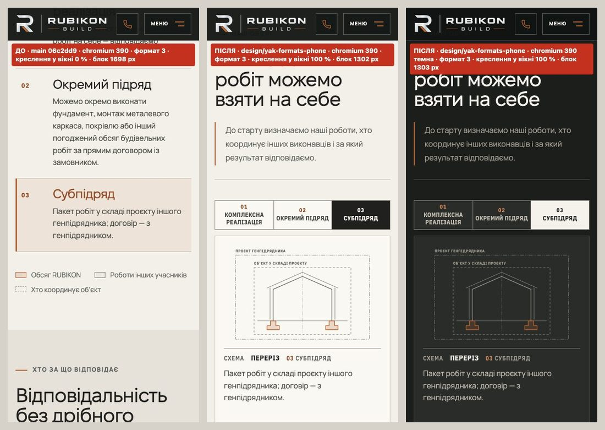
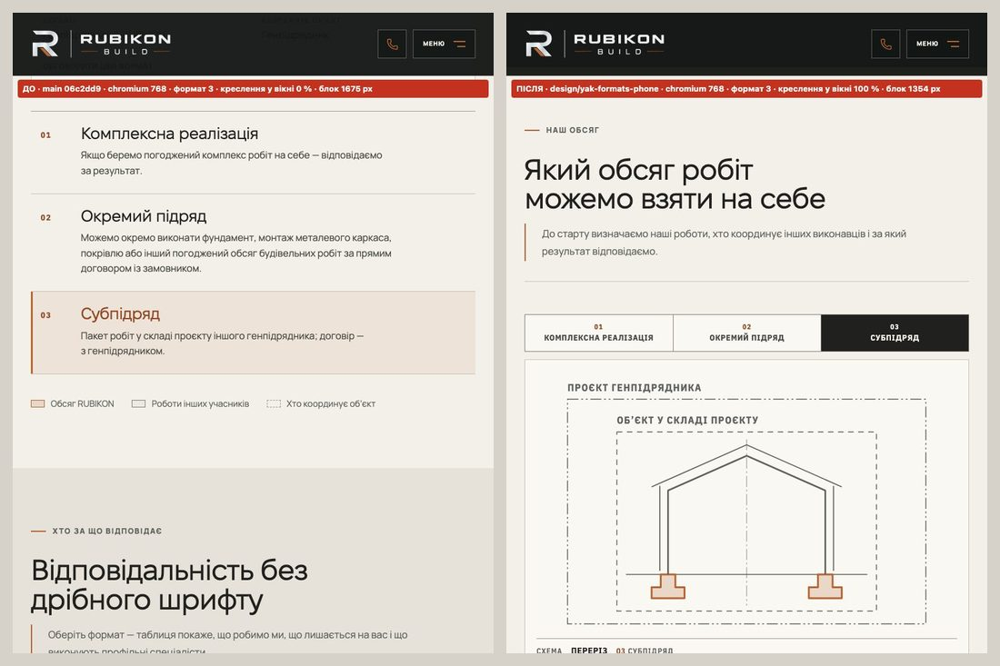
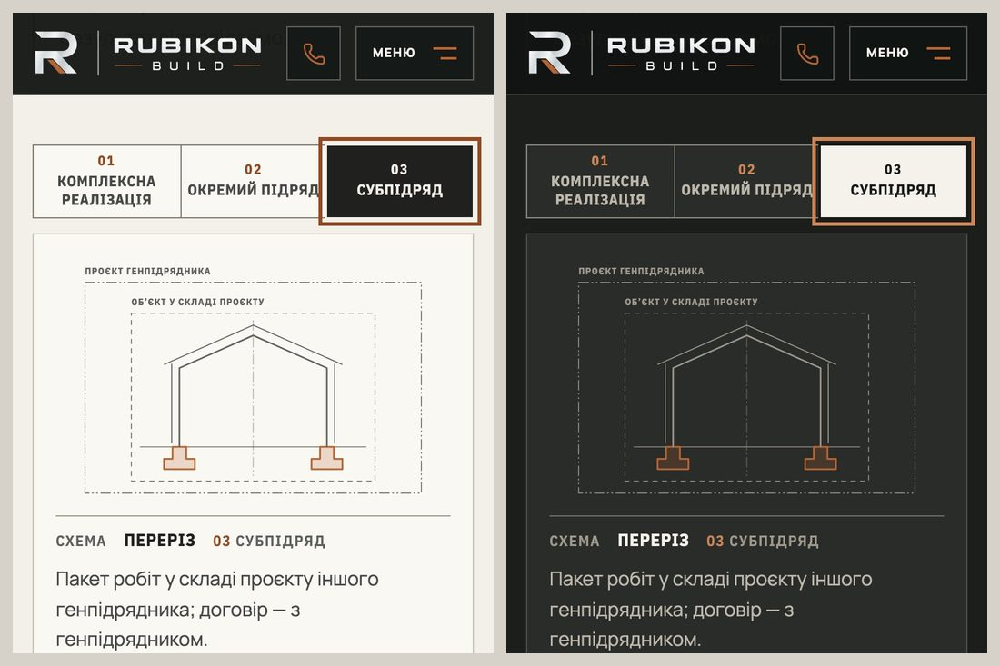

# Handoff · /yak-pratsyuiemo «Наш обсяг»: на телефоні й планшеті формати стоять рядком над кресленням (PDO-06)

| | |
|---|---|
| Дата | 2026-10-20 |
| Виконавець | Claude Code |
| Підстава | Рішення власника 20.10: «PDO-06 (OD-PX-22 a, обмеження нижнього краю прийнято, еталони 375/768 — після мого перегляду)». Premium Experience Review 18.10: PDO-06 (YAK-01) і частина PDO-55 (тур на ≤1050 px). Крок W1-06 |
| Рев'ю | Незалежне рев'ю очікується через GitHub. Рішення — за Дмитром |
| PR | Draft. **Merge і deploy не виконувались. Без окремого OK Дмитра вони не дозволені** (DEC-30). Гілка — прототип `design/*`: до мітки `visual-freeze` візуальні набори в CI відкладені (docs/ci-tier-model.md) |
| Гілка / base | `design/yak-formats-phone` від `main` `06c2dd9`. Специфікацію звіряли з `d4b11c0`. Між ними лише #212 і #213, які стосуються інших сторінок |
| Коміти | `a1bd60e` — код і тести · цей handoff |
| Змінено | `app/components/directions/formats-scope.css` (блок ≤1050 / ≤760 px), `app/components/directions/FormatsScope.tsx` (+14 / −7 рядків: `aria-label` списку, рядок `p.dfmt-chosen`, без туру на ≤1050 px, коментарі), `tests/e2e/yak-formats-scope.spec.ts` (тест туру — на 1440, плюс 11 нових тестів, тобто 21 запуск у двох проєктах; клавіатурний — лише desktop) |
| Не змінено | `app/yak-pratsyuiemo/page.tsx` (легенда на місці); CSS і поведінка на ≥1051 px; тексти (нових слів немає); цикл пакетів і `dfmt-march` (W4-04); перемикач матриці; CSP, аналітика, SEO, workflows, retries, пороги; еталони (DEC-18) |

## Проблема

На ≤1050 px креслення стоїть над списком форматів: `.dfmt-figure { order: -1 }` у `formats-scope.css`. Список вищий за екран. Після торкання формату креслення перемальовується, але вже поза вікном.

**Повторно перевірено на main `06c2dd9`.** Локальний production build, Playwright 1.62.1, reduced motion, cookie — «лише необхідні», запити до сторонніх хостів заблоковано. Торкання в порядку 2 → 3 → 1 у центр кнопки, без попередньої прокрутки. Видимою вважається частина `#obsiah svg.fs` між низом шапки й низом вікна. Chromium (L2) і WebKit (L3) дали однакові числа:

| Вікно | Креслення у вікні: кнопка по центру | Кнопка під шапкою | Кнопка внизу | Висота `#obsiah` |
|---|---|---|---|---:|
| 320×568 | 0/0/0 % | 0/0/0 % | 0/0/0 % | 1881 px |
| 375×667 | 0/0/0 % | 0/0/0 % | 0/0/23 % | 1733 px |
| 390×844 | 0/0/0 % | 0/0/0 % | 8/0/100 % | 1698 px |
| 430×932 | 0/0/2 % | 0/0/0 % | 91/24/100 % | 1633 px |
| 768×1024 | 0/0/17 % | 0/0/0 % | 85/53/100 % | 1675 px |

Тур досі працює на ≤1050 px. Без торкань формат сам змінюється 3 рази за 11 с на 390, 768 і 1440 px, в обох рушіях. Із reduced motion — 0 змін. Числа збігаються зі специфікацією (production, 20.10).

## Зміна

Усе нижче діє лише на ≤1050 px. Сегментований вигляд залежить від `:root[data-theme]`, а цей атрибут ставить head-скрипт. Тому без JavaScript лишається звичайний список з описами.

- **Рядок над кресленням.** `order: -1` прибрано. Три формати стоять одним сегментованим рядком у стилі перемикача матриці:
  - рамка `--color-border-control`, капс 13/12 px;
  - вибраний сегмент — фон `--color-text`;
  - висота задана через `min-height: 58px`, а не `height`, тож довша назва може перейти на другий чи третій рядок.
- **Опис формату.** У кнопці `.dfmt-text` сховано візуально (clip-path), але він лишається в доступній назві. Під підписом креслення з'являється рядок `p.dfmt-chosen` з описом вибраного формату. Він `aria-hidden`, тож скрінрідер не читає опис двічі. Список отримав `aria-label="Формат участі"` — ті самі слова, що в легенді перемикача матриці.
- **Тур вимкнено на ≤1050 px.** Умову перевіряють один раз під час монтування. На ≥1051 px тур, наведення мишею і клік працюють як раніше.
- **Клавіатура.** Фокус нічого не вибирає (дзеркало з матрицею), Enter і Space вибирають. Кільце фокусу — глобальне зовнішнє двоколірне (outline 3 px з offset 4 px плюс `--focus-gap`), а не внутрішнє −6 px перемикача матриці. На вибраному сегменті правило `box-shadow: none` прибрало б `--focus-gap`, тому для `:focus-visible` його повернено.
- **Переноси.** `hyphens: auto` діє лише для `:lang(en)`: українські назви WebKit ділить погано.
- **Легенда** лишилась на місці, як рекомендує специфікація (§8 п. 4). Тому 1440 px не змінюється.
- **Обмеження, прийняте власником.** Якщо рядок стоїть на самому нижньому краю екрана, креслення опиняється під ним. Автопрокрутки немає.

## Перевірка

Рівні перевірки: **L2** — емуляція Chromium, **L3** — Playwright WebKit (емуляція, не Safari). Фізичного iPhone не було, L5 не перевірявся.

**RED → GREEN** (`yak-formats-scope.spec.ts`, desktop-chromium + mobile-chromium, локальний production build):

| | Passed | Failed | Skipped |
|---|---:|---:|---:|
| main `06c2dd9` (нові тести, код main) | 11 | **16** | 1 |
| гілка | **27** | 0 | 1 |

- **Що падає на main (16):**
  - креслення ≥ 90 % у вікні після кожного торкання на 320, 375, 390, 430 і 768 px, з кнопкою по центру й під шапкою; сторінка зсувається не більш ніж на 8 px; три сегменти в одному рядку, кожен ≥ 44 px, без переповнення; рядок над кресленням, і рядок разом із кресленням уміщаються під шапкою — 5 × 2;
  - немає туру протягом 20 с (`page.clock`) на 390 і 768 px — 2 × 2;
  - опис під кресленням (`aria-hidden`) і в назві кнопки — 1 × 2.
- **Що проходить і на main, бо це запобіжники:**
  - reduced motion: після торкань у `#obsiah` немає анімацій довших за 1 мс і немає циклічних;
  - без JavaScript описи видимі, горизонтальної прокрутки немає;
  - тест клавіатури (390, desktop-chromium; у mobile-chromium — skip) теж проходить на main.
- **Тест туру** (`:49`) тепер ставить 1440 × 900 у кожному проєкті. Його перевірки не змінювались, на обох збірках він проходить.

**Набори на гілці.** Desktop-chromium + mobile-chromium, локальний production build. Файли: усі специфікації, що відкривають /yak-pratsyuiemo (окрім visual), разом із pr-critical, smoke, responsive-a11y-phase1, words-whole, typography, page-hero-rhythm і theme — 18 файлів.

| Набір | Результат |
|---|---|
| 18 файлів, 674 тести | **575 passed, 94 skipped** (наявні skip), 5 failed — жоден не про /yak-pratsyuiemo, див. нижче |
| `form.spec.ts:820` (desktop), `ux-conversion-phase2.spec.ts:134` (desktop) | упали під навантаженням паралельного прогону; повторно, з одним воркером, — 2/2 passed |
| `typography.spec.ts:70` «late fonts» на `/`, `/angary`, `/metalokonstruktsii` (mobile) | CLS 0,058–0,069 при порозі 0,01. **На main `06c2dd9` так само 3/3 failed**, з тими самими числами. Падіння локальне й наявне, на цю зміну не впливає |
| WebKit (L3, допоміжний конфіг поза репозиторієм; CSP без `upgrade-insecure-requests` лише в тестовому route) | 18/18: рядок і креслення на 320, 375, 390, 430, 768 px (iPhone 13 і Desktop Safari), без туру на 390 і 768 px, опис |
| Unit (`vitest run`) | 1413/1413 |
| `tsc`, `eslint .`, `git diff --check` | чисто |

**Креслення у вікні після торкань 2/3/1** (гілка, Chromium і WebKit однаково):

| Вікно | Кнопка по центру | Рядок під шапкою | Зсув сторінки | Висота `#obsiah` | Від верху рядка до низу креслення / доступно |
|---|---|---|---:|---:|---|
| 320×568 | 100/100/100 % | 100/100/100 % | 0 | 1881 → **1433** | 1233 → **245** / 501 |
| 375×667 | 100/100/100 % | 100/100/100 % | 0 | 1733 → **1362** | 1110 → **279** / 600 |
| 390×844 | 100/100/100 % | 100/100/100 % | 0 | 1698 → **1302** | 1100 → **289** / 777 |
| 430×932 | 100/100/100 % | 100/100/100 % | 0 | 1633 → **1314** | 1026 → **313** / 865 |
| 768×1024 | 100/100/100 % | 100/100/100 % | 0 | 1675 → **1354** | 1110 → **507** / 923 |

- **Висота блоку** меншає на 319–448 px. На 390 px вона 1302, у межах вимоги специфікації (≤ 1320).
- **Сегменти:** UA — 58 px (рядок 60 px з рамкою), 1–2 рядки назви, переповнення 0. На 390 px «ОКРЕМИЙ ПІДРЯД» уміщається в один рядок із запасом 5 px до країв.
- **EN-заглушки** (+30–57 %, `lang="en"`) на 320–390 px: до 3 рядків, рядок сегментів ≤ 72 px, переповнення 0 в обох рушіях.
- **Тур:**
  - на 390 і 768 px — 0 змін за 11 с (було 3) в обох рушіях;
  - на 1440 px — 3 зміни, як і раніше;
  - із reduced motion після торкань у `#obsiah` 0 анімацій.
- **Axe-core 4.13 на `#obsiah`** (формат 3 вибрано): 0 порушень на 390 і 768 px, у світлій і темній темі. Main теж 0.
- **Контраст.** Кільце фокусу до тла секції — 5,73:1 у світлій темі і 5,59:1 у темній; до невибраного сегмента — 6,15 і 4,71. Назви невибраних сегментів — 8,59 і 7,09, вибраного — 14,21 і 15,80.
- **Банер cookie** (перший візит, 390 px) не закриває ні рядок, ні креслення: низ креслення 681 px, верх банера 711 px.
- **1440 px:** знімок `#obsiah > .shell` до і після побайтово однаковий у Chromium і WebKit, висота 1302 px.

## Еталони (DEC-18)

Їх не оновлювали. За DEC-18 (OD-PX-04 a) процедура така: preview → мітка `visual-freeze` → перегляд кожного diff в артефакті `changed-area-visual-diff` → OK власника. Лише після цього оновлюються переглянуті PNG, darwin і linux. Linux беруть з артефакту того самого head.

| Ціль | Очікування | Локально (Mac, visual-chromium; рендер main порівнювали з рендером гілки) |
|---|---|---|
| `process-scope-mobile-375` | **змінюється** | висота 1591 → 1220 px |
| `process-scope-tablet-768` | **змінюється** | висота 1492 → 1172 px |
| `process-scope-desktop-1440` | **0 різниці** | рендер main і гілки піксель у піксель однаковий, 1332 × 1072, 0 пікселів різниці |
| `process-route-*`, `process-responsibility-*`, `process-terms-desktop-1440` | 0 | у межах допуску набору; на 375 у `process-responsibility` є субпіксельне згладжування тексту, див. «Ризики» |
| `process-terms-mobile-375`, `process-terms-tablet-768` | 0 | **висота відрізняється на 1 px** (2832 → 2833, 2481 → 2480), див. «Ризики» |

Darwin-еталони `process-*` на main застарілі: на самому main локально падають 8 з 12 цілей. Тому порівнювали рендер main із рендером гілки, а не з PNG. Linux-еталони `process-scope-*` за висотою збігаються з локальним рендером main.

## Ризики й відкат

- **Обмеження нижнього краю (прийняте власником).** Якщо рядок стоїть на самому нижньому краю екрана, креслення під ним не видно (0 %). Автопрокрутки немає, як і вирішено в OD-PX-22 (a).
- **Факти «Договір / Координує» під кресленням.** Коли кнопка по центру, вони тепер нижче екрана на всіх ширинах. На main при 430 і 768 px їх часом було видно, бо факти стояли просто над списком. Коли рядок під шапкою, на ≥ 390 px їх видно на 100 % (на main було 0 %), на 320 і 375 px — 0–10 %. Специфікація це передбачала (§4 п. 8).
- **1024 × 768** (iPad у ландшафті, теж ≤ 1050 px). Креслення там велике. З кнопкою по центру воно у вікні на 57 % (на main 0 %), з рядком під шапкою — 100 %. Цієї ширини немає серед критеріїв специфікації.
- **Кільце фокусу поруч із вибраним сегментом.** Мідна сторона кільця, що заходить на темний вибраний сегмент, має до нього 2,48:1 (світла тема) і 2,68:1 (темна). Між ними видно лінію `--focus-gap` кольору тла: вона контрастує із сегментом 14,21:1 у світлій темі і 15,80:1 у темній. Три інші сторони — 4,71–6,15:1. Кадри — у пакеті доказів.
- **Субпіксельний зсув нижчих секцій.** Блок став коротшим на дробову величину: 370,77 px на 375 і 320,59 px на 768. Через це `#koshtorys` починається з іншою дробовою частиною, а знімок елемента округлюється до іншої висоти (+1 / −1 px). Вміст однаковий. Проте `toHaveScreenshot` на різниці розмірів падає незалежно від допуску. Якщо це відтвориться на Linux, `process-terms-mobile-375` і `-tablet-768` теж потребуватимуть перегляду й OK власника, а погоджено лише два `process-scope`.
- **Ширші межі вимкненого туру.** Тур вимикається й на iPad у портреті та у вузьких вікнах десктопа (≤ 1050 px). Це передбачено специфікацією (§4 п. 6).
- **Два однакові перемикачі на сторінці.** Сегментований рядок у `#obsiah` і липкий перемикач матриці в `#vidpovidalnist` тримають один вибір. Рядок у `#obsiah` не липкий.
- **Відкат:** `git revert a1bd60e`. Це один коміт: CSS, три місця в TSX і тести.

## Відкриті питання

1. **PDO-100.** Той самий патерн («керування над результатом») є в YAK-02 (`#koshtorys`, аркуші змін), ABT-03 (/pro-nas) і GRN-01 (модулі зерна). Це Wave 02, OD-PX-23, поза цим PR.
2. **Обмеження нижнього краю** прийняте власником 20.10. Тут записано лише для control.
3. **Легенда у `figure`** (W1-06). Її не переносили, бо інакше змінився б і `process-scope-desktop-1440`. Пропозиція — зробити це разом із W2-02 / W2-05.
4. **Висота `process-terms-*` (±1 px).** Якщо CI покаже цю різницю на Linux: оновлювати ці два еталони після перегляду чи підігнати висоту блоку?
5. **L5.** Перегляд preview на iPhone 12 до merge (OD-PX-05).

## Пропоновані оновлення control (лише після OK власника)

- PDO-06 → «реалізовано в draft PR, чекає перегляду власника і `visual-freeze`».
- PDO-55 → частину «тур на ≤ 1050 px» закриває цей PR. Решта (тур на десктопі, `dfmt-march`, цикл пакетів) — W4-04.
- W1-06 → виконано, крім перенесення легенди: воно переходить у W2-02 / W2-05.
- OD-PX-22 (a) → записати прийняте обмеження нижнього краю (20.10).
- DEC-18 → після перегляду оновити `process-scope-mobile-375` і `-tablet-768` (darwin і linux з того самого head). `process-terms-*` — лише якщо питання 4 вирішено так.

## Докази

Пакет доказів — приватний, поза репозиторієм. Він містить:

- скрипти замірів;
- JSON;
- логи RED/GREEN і наборів;
- кадри до/після на 320, 375, 390, 430, 768 px (світла тема, а на 390 — і темна) і на 1440 px, у Chromium і WebKit;
- кадри фокусу, EN-заглушок, 1050 / 1051 px і банера cookie;
- рендери visual для main і гілки.

| Файл | SHA-256 |
|---|---|
| `measure-before-chromium.json` | `75c05b223a32d65cb3210af92991d0e4cf3f2346d9e31be4fc8d92ef01d72ff8` |
| `measure-after-chromium.json` | `1fc57861f219e0c519a6928b6511ad0402e7bb6a4f5c8fad6b4a070bc5790eae` |
| `measure-before-webkit.json` | `0091feb611b169817d9a9385b5a8de5d6c40f2d77f687ed371da770d9791c12d` |
| `measure-after-webkit.json` | `1d5f386a27940510e0ea63f6fdf48a166e71f6b126a9410a1b5640b5f3d60171` |
| `extra-before-chromium.json` | `821ad961411140cb2397d9cfba3a546715f446be019494b71ceccffcaa80a727` |
| `extra-after-chromium.json` | `1f02a6c225d82b23fdfe5326022ec2f75f18478266b7bdbf19826ffd343fa4c1` |
| `red-main-06c2dd9.log` | `477e4cf1a1135bd9808a0479c7e9e760b14114400022993c8cf0b255f6736a47` |
| `green-branch.log` | `b3ab1c23ce091400737947e0b94d4185045025e11d4e792db239f44556b950f7` |

**Метод.** Playwright 1.62.1, Chromium і WebKit, локальний `vinext start`.

- Збірки: main `06c2dd9` і гілка.
- Усі хости, крім застосунку, заблоковані.
- Згода cookie задана як «лише необхідні». «Прийняти все» не натискали.
- Форм не надсилали.
- Еталони не оновлювали: `--update-snapshots` не запускали.
