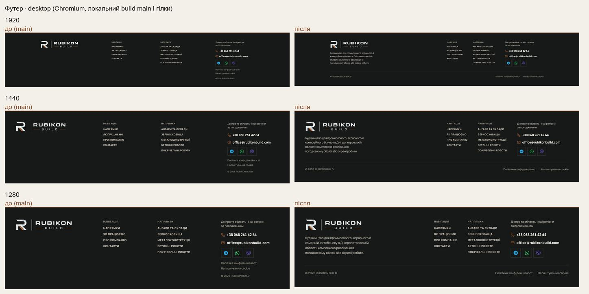
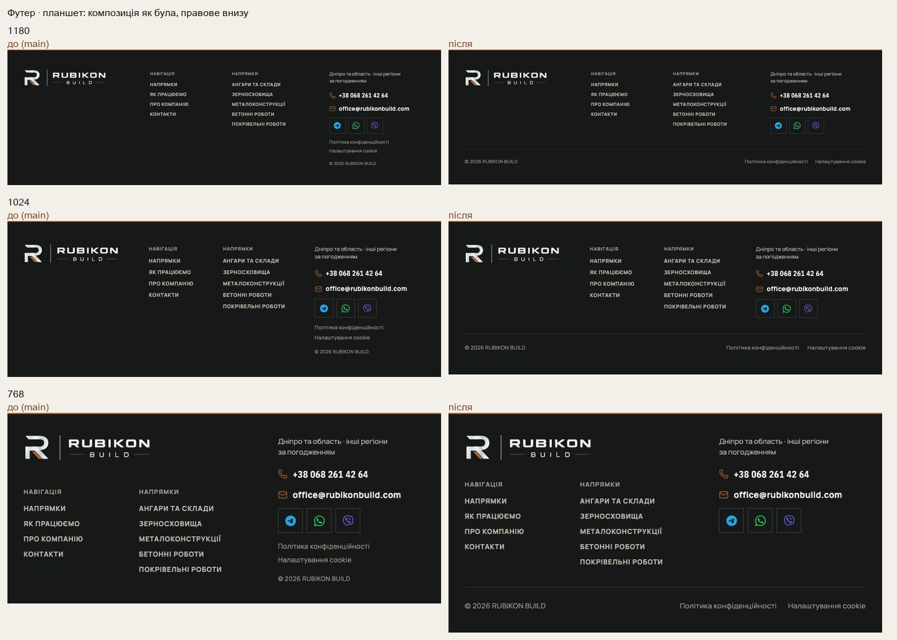
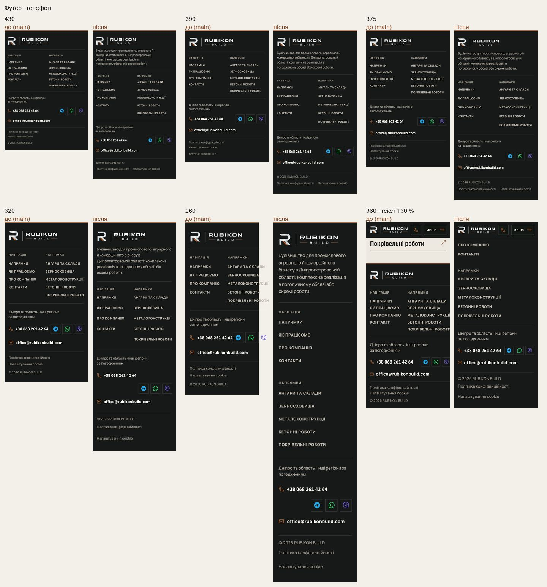

# Handoff · Футер: опис компанії, правове окремим рядком, телефон без бічної прокрутки (W2-13: PDO-46, PDO-38)

| | |
|---|---|
| Дата | 2026-10-21 |
| Виконавець | Claude Code |
| Підстава | Рішення власника 21.10: OD-PX-30 (a) — на desktop опис під логотипом і правове окремим рядком; на планшетах лишити композицію, яку власник назвав більш збалансованою; на телефоні — як рекомендовано (посилання 40 px, перенос колонок). Wave 02A, крок W2-13 |
| PR | Draft. **Merge, production deploy і нові еталони — лише з окремого OK Дмитра** (DEC-30, DEC-18) |
| Гілка / base | `design/footer-composition` від `main` `25f3903` |
| Коміти | **`fbf96df`** — код і тести · цей handoff |
| Змінено | `app/components/SiteChrome.tsx` (`SiteFooter`: блок `.footer-brand` з описом, рядок `.footer-bottom`), `app/globals.css` (футер на трьох ярусах; логотип шапки `min-width` 150 → 112 px на ≤760). Новий тест `tests/e2e/footer-composition.spec.ts` |
| Не змінено | Тексти (опис — затверджений `company.description`, нових фактів немає; реквізити юрособи не додавались, OD-B1 відкритий), посилання, порядок груп, месенджери в оригінальних кольорах (рішення 21.10; реєстр пропонував сірі), контактний блок сторінок, шапка поза вузькими екранами |

## Що зроблено

- **Desktop (≥1181 px).** Під логотипом — опис компанії, 14 px, до 4 рядків. Колонка логотипа займає вільну ширину. © і «Політика конфіденційності · Налаштування cookie» — окремим нижнім рядком на всю ширину, під лінією. Висота на 1440: 371 → 362 px.
- **Планшет (761–1180 px).** Композиція як була: логотип без опису, групи посилань і контакти на своїх місцях. Правове — у нижній рядок.
- **Телефон (≤760 px).** Опис під логотипом. Групи посилань стоять поруч, поки вміщаються, і переносяться одна під одну за більшого системного тексту чи на 260–312 px, замість розширювати сторінку. Посилання 40 px (були 24 px із зазором 6 px). Номер і месенджери переносяться, а не налягають. Висота на 390: 616 → 762 px.
- **Ширина сторінки.** На 260–280 px документ був 296 px, з текстом Android 130 % на 360 px — 364 px, 150 % на 390 px — 410 px. Тепер ширина дорівнює екрану. Логотип шапки на ≤760 px стискається до 112 px (було 150), що діє лише вужче ≈270 px.

## До / після

Локальний production build `main` `25f3903` і гілки, Chromium (емуляція). Фізичний телефон не перевірявся.

## Перевірка

| Що | Результат |
|---|---|
| `footer-composition` (новий) + `company-email`, `smoke`, `pr-critical`, `header-hierarchy` — desktop-chromium + mobile-chromium | 199 passed, 27 skipped |
| `grain-page`, `phase3-shorter-pages` (бюджети висоти), `consent`, `typography` | бюджети висоти пройдено. `typography › late fonts` на mobile-chromium падає однаково на `main` `25f3903` (CLS 0,0578 на macOS) — це не зміна цього PR; у CI на Linux проходить |
| `tsc`, `eslint` | чисто |
| CI | у коментарі PR |

Skipped — тести, прив’язані до проєкту (`test.skip` за `isMobile`).

Що перевіряє `footer-composition.spec.ts`:

- 1280, 1440, 1920: опис дослівно `company.description`, під логотипом, ≤4 рядки, ліворуч від навігації. Нижній рядок: © і обидва правові елементи, під усіма колонками, від лівого краю до правого. Правового серед контактів немає.
- «Налаштування cookie» в нижньому рядку відкриває панель налаштувань.
- 1180, 1024, 961, 960, 768, 761: опису немає; від 961 px — один ряд, як було; на ≤960 — логотип над групами, контакти поруч. Без бічної прокрутки.
- 390: опис, правове останнім, усі 11 посилань футера ≥40 px.
- 260, 280, 312, 320, а також 360 з текстом 130 % і 390 з текстом 150 % (`text-size-adjust`, модель шрифту Android): сторінка не ширша за екран, номер і месенджери не налягають.

## Еталони (DEC-18)

Не оновлювались. Можуть змінитися:

- `footer-logo-mobile-390`: лінія під логотипом тепер під описом;
- `footer-logo-desktop-1440`: колонка ширша;
- `header-logo-mobile-390`.

Рендери CI покажу до оновлення.

## Відкат

`git revert fbf96df`.
