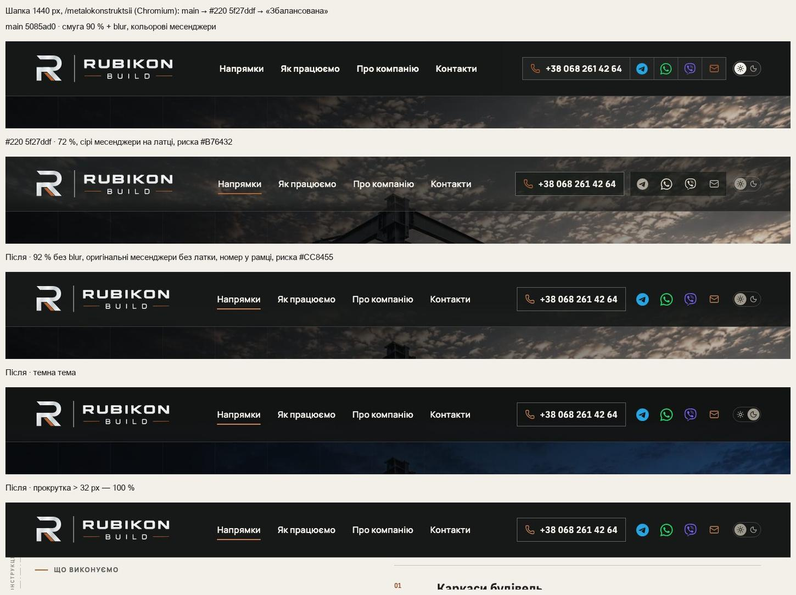
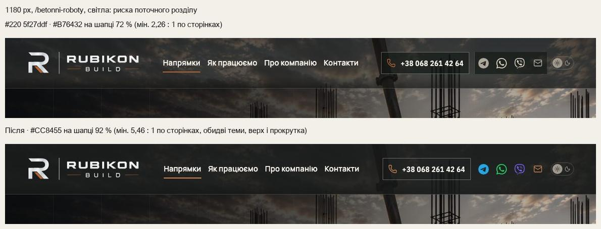
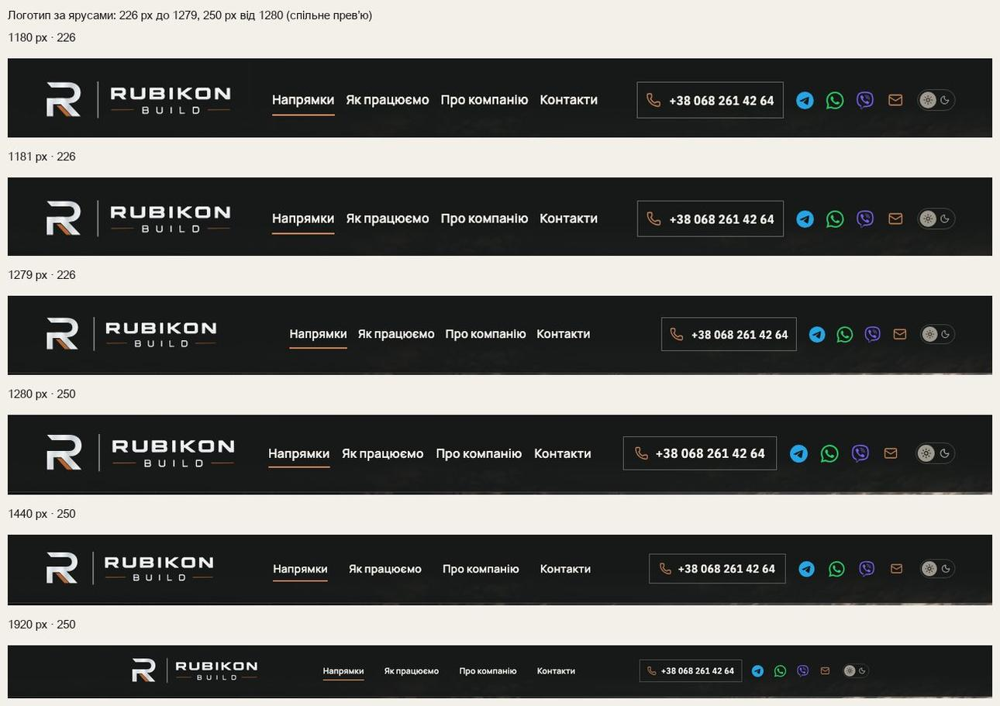
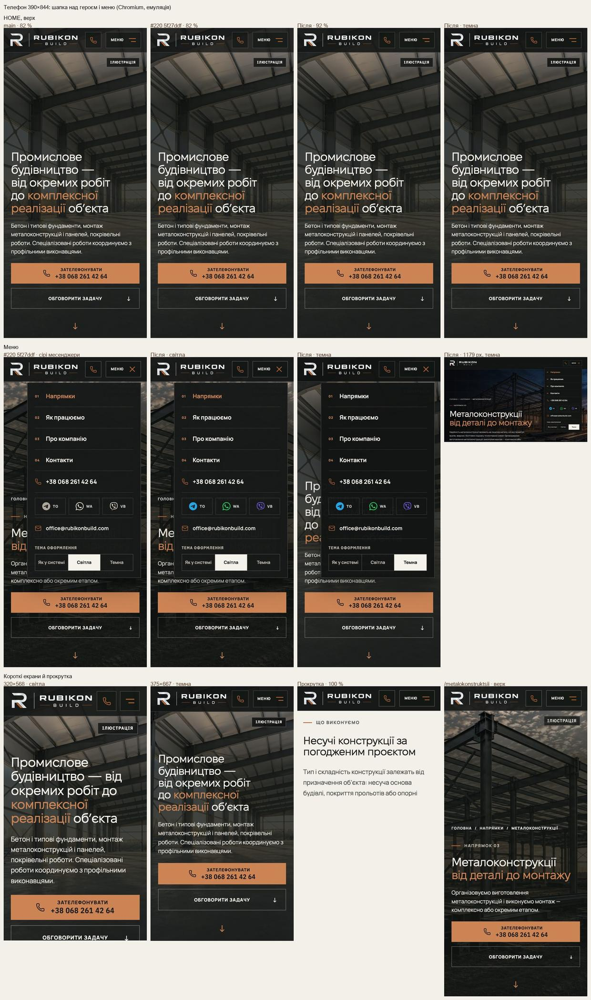
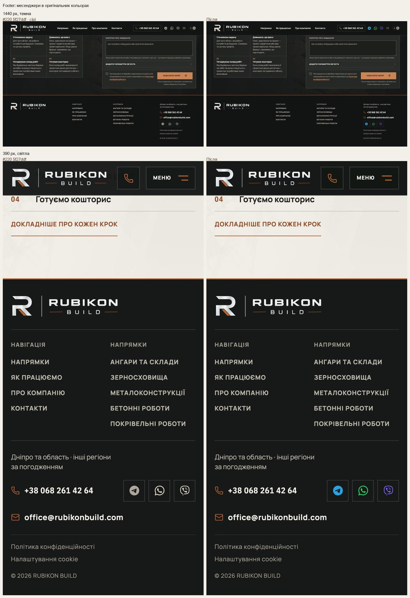
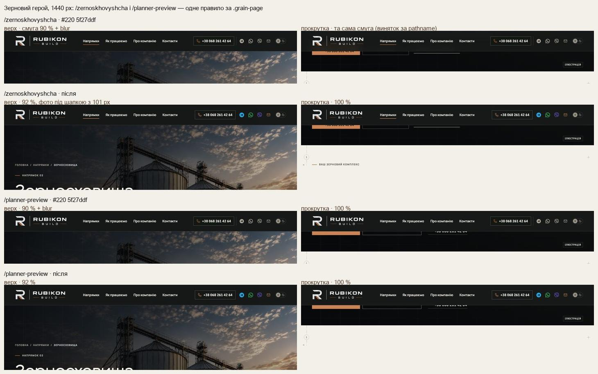
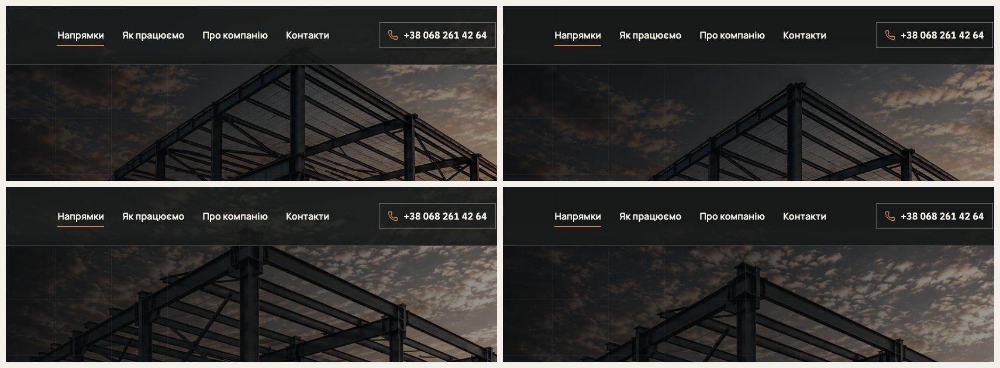
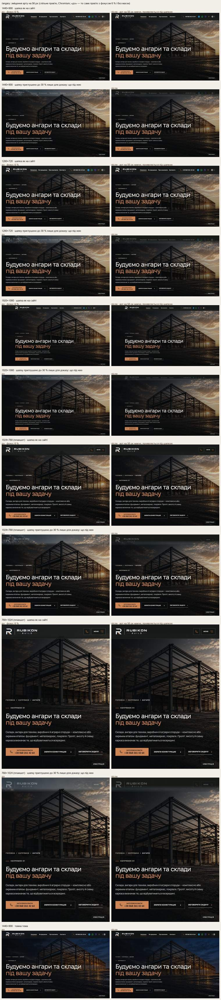
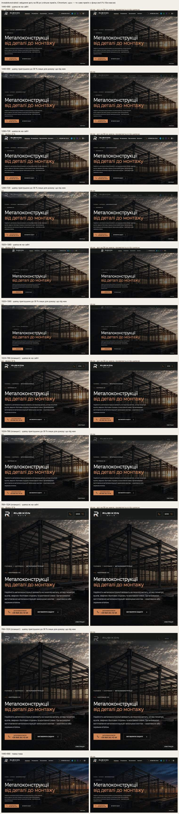
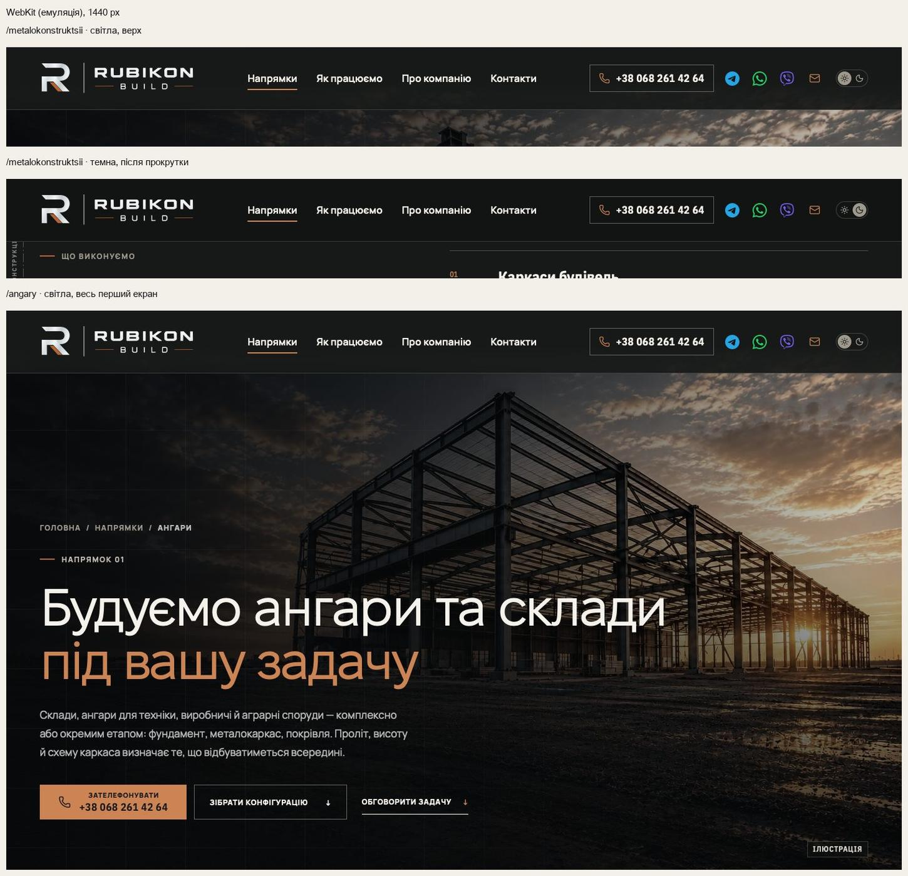

# Handoff · Шапка 01 «Збалансована» і оригінальні месенджери (власник 21.10)

| | |
|---|---|
| Дата | 2026-10-21 |
| Виконавець | Claude Code |
| Підстава | Рішення власника 21.10 після незалежного Visual/UX review. Шапка — 01 «Збалансована»: телефон в окремій рамці, кольорові месенджери, спокійні email і перемикач теми, без окремої латки під іконками, графіт #171918 92 % над героєм без blur і 100 % після прокрутки. Месенджери — 01 «Оригінальний колір» у шапці, мобільному меню й footer. Плюс знахідки review #220: контраст риски, кадрування /angary і /metalokonstruktsii, явне правило для /planner-preview |
| Рев'ю | Власник — за спільним прев’ю й кадрами нижче. Незалежне — ChatGPT через GitHub |
| PR | #220. **Merge, production deploy і нові еталони не виконувались. Вони — лише з окремого OK Дмитра** (DEC-30, DEC-18). Гілка — прототип `design/*` без `visual-freeze`, тож візуальні набори в PR Gate відкладені |
| Гілка / base | `design/header-first-screen` від `main` `5085ad0` |
| Коміти | W1-09 (20.10): `7e51bd1` PDO-19 · `6b19846` PDO-57 · `c625a11` PDO-18 · `71e4e5d` PDO-17 · `f0b4729` handoff · `5f27ddf` Sonar S4666. **21.10: `6e693a2` «Збалансована» · `98eb0e9` логотип за ярусами · `b5a63a2` арт героя без смуги · `05d4cb5` без лінії між номером і месенджерами, мідна пошта** · цей handoff |
| Спільне прев’ю | `preview/wave01e-b-header` = main `5085ad0` + #219 + ця гілка: https://preview-wave01e-b-header-rubikon-build.leusd100.workers.dev/ (Workers Builds, не production) |
| Змінено 21.10 | `app/globals.css`, `app/home-v2.css`, `app/pro-nas/about.css`, `app/components/HeroHeaderState.tsx`, `app/components/DirectionHeroImage.tsx`, `app/data/directionHeroImageManifest.ts`. Тести: `header-hierarchy.spec.ts`, `header-first-screen.spec.ts`, `header-current-section.spec.ts` |
| Збережено з W1-09 | PDO-57: `aria-current`, «Напрямки» як розділ на сторінках напрямів. PDO-18: одна модель шапки, фото з y 0. PDO-17: світла мідь головних дій і X-Ray на графіті. Компактна шапка до 1179 px. Навігація Manrope 600. Номер — Plex Condensed 600 |
| Не змінено | Висота шапки: 101 px на desktop і планшеті, 67 px на телефоні — від неї залежать якорі, відступи героїв і банер cookie (PDO-09). Порядок елементів. Меню і його пункти. Банер cookie. Сторінки без героя — 94 %. Контактний блок наприкінці сторінок (месенджери там і далі сірі, DEC-46 PROPOSED — див. питання 2). CSP, аналітика, SEO, workflows, пороги. Еталони |

## Що зроблено

### Шапка «Збалансована»

- **Порядок:** логотип → навігація → телефон → месенджери → email → перемикач теми (без змін).
- **Тло над героєм — 92 % `--color-dark` без blur** на кожній ширині й сторінці з героєм: HOME, `/pro-nas`, внутрішні герої від 1100 px, телефони й планшети. Раніше: 72 % (≥761 px) і 82 % (телефони). **Після 32 px прокрутки — 100 %** на всіх ширинах (на телефонах раніше 97 %). Меню відкрите — 97 %. У світлій темі `--color-dark` = #171918, у темній — токен теми #121413.
- **Номер** — у рамці rgba(245,242,235,.34), світлий текст (Plex Condensed 600, 17 px; 15 px на 1180–1279), мідна піктограма #CC8455. **Без мідної заливки** і в спокої, і на hover / фокусі: тоді мідною стає лише рамка. Заповнена мідь лишається за дзвінком героя.
- **Месенджери** — оригінальні SVG Telegram / WhatsApp / Viber **без grayscale, saturate і opacity**: у шапці, меню й footer. Іконки 23 px у шапці (21 px на 1180–1279), цілі 44 × 44 (36 / 40 px на вужчих ярусах, як було). `aria-label`, `href` і поведінка Viber не змінені. **Латку під каналами прибрано**: тло для них — сама шапка 92 %.
- **Між номером і Telegram лінії немає** (власник 21.10, `05d4cb5`), лишився проміжок 8 px.
- **Email** — мідна іконка, як до PDO-19 (власник 21.10). Відтінок той самий, що в іконки номера (#CC8455), на hover / фокусі — #DDA27A. **Перемикач теми** — тихий трек, сірий кноб (як у W1-09).
- **Риска поточного розділу** — світла мідь **#CC8455** (`--color-accent-on-dark`) замість #B76432. `aria-current` не змінено.
- **Логотип:** 226 px до 1279 px, **250 px від 1280 px**. На 1181 px 250 px лишали 36 px до навігації й 32 px від неї до номера проти 46 і 43 px при 226, тож поблизу 1180 логотип лишився 226.
- **Телефон** (≤1179 px): угорі логотип, дзвінок і «Меню». Месенджери з підписами TG / WA / VB — у меню, тепер кольорові.

### Зерновий герой: одне правило

**Правило:** шапка однакова на кожній сторінці й ширині: 92 % над героєм і 100 % після 32 px. Виняток зернового героя — лише кадрування. На `main.grain-page` від 1100 px фото починається під шапкою (y 101), до перекадрування W2-12 / PDO-48. Ключ винятку — клас `.grain-page`, не pathname. Тому `/zernoskhovyshcha` і `/planner-preview` (вона рендерить ту саму сторінку) поводяться однаково.

**Як було в 5f27ddf:** `HeroHeaderState` за pathname знімав стан лише на `/zernoskhovyshcha` (смуга 90 % + blur і після прокрутки), а `/planner-preview` після прокрутки ставала суцільною. Review визнав суцільну шапку після прокрутки прийнятною. Тепер так на обох сторінках, а виняток за pathname прибрано.

### /angary і /metalokonstruktsii: кадрування під шапкою

- **Доказ.** У 5f27ddf фото героя починалося з y 0. Вершина ангара й верхній вузол каркаса стояли на y ≈ 55–100, тобто під шапкою 101 px, на кожній перевіреній ширині: 768, 1024, 1099, 1180, 1280, 1440, 1920. Під 92 % їх майже не видно.
- **Зміна.** Лише для цих двох героїв від 761 px фокус `56% 6%` / `55% 6%` → `56% 56px` / `55% 56px` (`ART_TOP` у маніфесті): верхній край арту опущено на 56 px. Вершина тепер на ≥ 116 px. Решта героїв і телефонні фокуси не змінені.
- **Без смуги.** Над опущеним артом лишається 56 px графіту героя, і крізь шапку 92 % він на 4 рівні темніший за небо поруч, тобто видна межа. Тому верхні 44 px арту проявляються з прозорого (`mask-image`, лише якщо задано `artTop`). Уся зміна — під шапкою; сходинка ≤ 1 рівень. Знизу обрізано на 56 px більше темного переднього плану. Текст героя, дії й мітка «Ілюстрація» на місці.

## До / після

Кадри — Playwright на macOS. Chromium; WebKit — Playwright WebKit (емуляція, **не фізичний Safari**). «До» — прев’ю гілок до 21.10 (main = production 5085ad0; #220 = 5f27ddf). «Після» — спільне прев’ю.

## Виміри

**Риска поточного розділу проти пікселів шапки на 2 px під нею, 1180 px.** Найгірший піксель по ширині риски. `/napryamky` — два зчитування з інтервалом 2,5 с (слайди).

| Сторінка | 5f27ddf, світла: верх / прокрутка | Після, світла: верх / прокрутка | Після, темна: верх / прокрутка |
|---|---|---|---|
| `/betonni-roboty` | 3,02 / 4,11 | **5,46 / 5,89** | 5,89 / 6,17 |
| `/metalokonstruktsii` | **2,26** / 4,11 | 5,65 / 5,89 | 6,11 / 6,17 |
| `/pokrivelni-roboty` | 3,21 / 4,11 | 5,52 / 5,89 | 5,95 / 6,17 |
| `/angary` | 2,92 / 4,11 | 5,66 / 5,89 | 5,96 / 6,17 |
| `/zernoskhovyshcha` | 4,15 / 4,15 | 5,95 / 5,89 | 6,20 / 6,17 |
| `/napryamky` | 2,95 / 4,11 | 5,46 / 5,89 | 6,06 / 6,17 |
| `/yak-pratsyuiemo` | 4,09 / 4,11 | 5,89 / 5,89 | 6,15 / 6,17 |
| `/pro-nas` | 3,60 / 4,11 | 5,70 / 5,89 | 6,04 / 6,17 |

Аналітична межа: #CC8455 проти 92 % #171918 над чистим білим ≈ 4,72 : 1. Тож будь-який кадр під шапкою дає щонайменше 4,72 : 1.

**Групи шапки** (`/metalokonstruktsii`; логотип → навігація · найбільший крок · навігація → контакти, px):

| | 1180 | 1181 | 1279 | 1280 | 1366 | 1440 | 1920 |
|---|---|---|---|---|---|---|---|
| main | 50 · 11 · 50 (226) | 12 · 18 · 12 (256) | 57 · 18 · 57 | 22 · 22 · 22 | 62 · 22 · 62 | 83 · 31 · 83 | 123 · 40 · 123 |
| після | 43 · 14 · 43 (226) | 44 · 14 · 44 (226) | 89 · 14 · 89 | 37 · 16 · 37 (250) | 77 · 16 · 77 | 81 · 31 · 81 | 121 · 40 · 121 |

## Перевірка

| Що | Де | Результат |
|---|---|---|
| `header-hierarchy`, `header-first-screen`, `header-current-section`, `action-on-graphite`, `company-email`, `first-contact`, `brand-logo-visual` | локальний build `6e693a2`, desktop-chromium + mobile-chromium | 95 passed, 17 skipped |
| `header-hierarchy` після `98eb0e9` (яруси логотипа) | локальний build, desktop-chromium | 4 / 4 |
| `header-hierarchy`, `company-email` після `05d4cb5` | локальний build, desktop-chromium + mobile-chromium | 29 passed, 7 skipped |
| `header-current-section` після `2309584` (чекає наступний слайд і суцільну шапку замість фіксованого часу, SonarCloud S2925) | локальний build, desktop-chromium | 3 / 3 |
| B + шапка разом: `home-phone-directions`, `home-directions-sheets`, `header-*`, `theme` | локальний build спільного дерева | 57 passed, 29 skipped |
| Unit (`vitest run`) | гілка | 1436 / 1436 |
| `tsc`, `eslint .`, `git diff --check` | гілка | чисто |
| Смуга під шапкою після `b5a63a2` | піксельний вимір рядків y 4–98, 5 розмірів × 2 сторінки + темна | сходинка ≤ 1 рівень |
| CI (PR Gate, Main Regression) | актуальний head | у описі PR |

Skipped — тести, обмежені проєктом (`test.skip` за `isMobile`), і `brand-logo-visual`, що йде лише у візуальному проєкті.

**Тести, оновлені під погоджений дизайн** (функціональні перевірки не послаблено):

- **`header-hierarchy`.** Замість «сірі в спокої, колір на hover» — месенджери кольорові в спокої: >10 % насичених пікселів. Перевіряється й ланцюжок предків: без `filter` і `opacity` < 1, у шапці (HOME і `/metalokonstruktsii`) і у footer. Латки немає (тло прозоре). Іконки 23 px. Новий тест на меню: кольорові іконки й підписи TG / WA / VB. Номер без заливки в спокої й на hover, рамка мідна на hover. Іконка пошти мідна (#CC8455), лінії перед месенджерами немає. Групи й логотип перевіряються на 1180 / 1181 / 1279 / 1280 / 1440 / 1920.
- **`header-first-screen`.** 72 → 92 %. Тест зернового героя тепер покриває `/zernoskhovyshcha` і `/planner-preview`: стан «top», 92 %, без blur, фото з y 101; після прокрутки — «scrolled» і 100 %.
- **`header-current-section`.** Новий тест: колір риски `rgb(204, 132, 85)` і ≥ 4,5 : 1 до пікселів шапки під нею. Вісім сторінок × світла / темна × верх / прокрутка, `/napryamky` двічі.

Фізичний Safari і справжній Chrome на телефоні **не перевірялись** (L4 — за власником).

## Еталони (DEC-18)

Не оновлювались. Main visual на `530dc89` (run 39594091298) впав лише на двох цілях. Решта знімків, де в кадрі шапка або месенджери, — у межах допуску. Рендери однакові байт-у-байт у трьох спробах; expected збігається з файлом у репозиторії.

- `header-logo-desktop-1181`: логотип 256 → 226 px (яруси, `98eb0e9`).
- `header-logo-desktop-1440`: 256 → 250 px, під логотипом тло шапки 92 %.

Результат на фінальному head (після `05d4cb5`) — у коментарі PR. PNG — лише після OK.

## Відкат

- `git revert b5a63a2` — без маски, з видимою межею.
- `git revert 98eb0e9` — логотип 250 px від 1181.
- `git revert 05d4cb5` — повертає лінію й сіру іконку пошти.
- `git revert 6e693a2` — повертає W1-09: 72 %, сірі месенджери, #B76432, виняток за pathname. Тести W1-09 повертаються тим самим revert.

## Залишкові питання

1. **Висота desktop-шапки — 101 px** (у макеті ≈100). Чинна висота лишилась, бо від неї залежать якорі й відступи героїв. На телефоні 67 px, як у макеті.
2. **Контактний блок наприкінці сторінок** (conversation.css): месенджери там і далі сірі за DEC-46 (PROPOSED). Рішення 21.10 назвало шапку, меню й footer. Чи переводити й цей блок на оригінальні кольори?
3. OK на нові візуальні еталони після перегляду рендерів CI.
