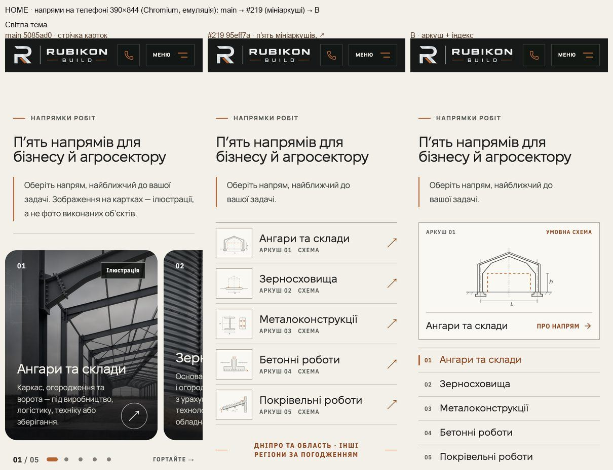
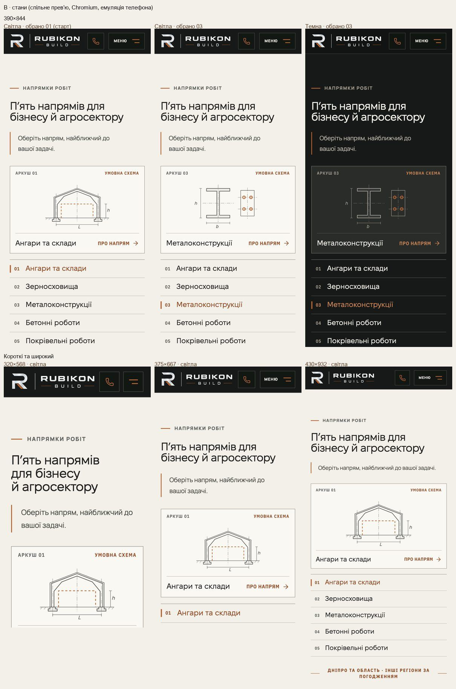
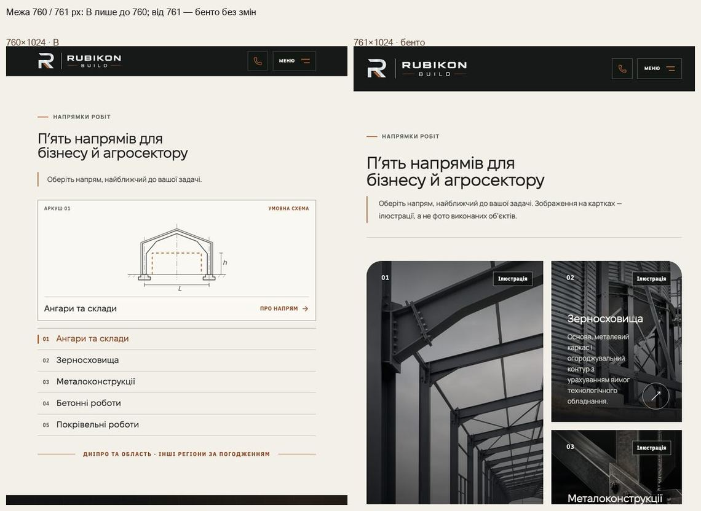
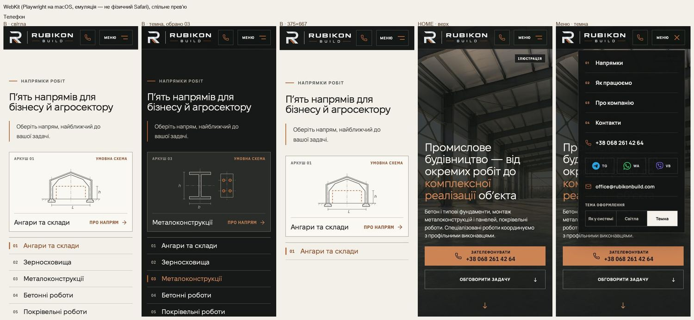

# Handoff · HOME на телефоні: напрями — B «Один аркуш + індекс», одна дія на рядок

| | |
|---|---|
| Дата | 2026-10-21 |
| Виконавець | Claude Code |
| Підстава | Рішення власника 21.10 після незалежного Visual/UX review: «HOME mobile — B „Один аркуш + індекс“. Одна дія на рядок: натискання рядка обирає напрям і змінює креслення. Великий аркуш із „Про напрям“ відкриває сторінку. Окремі стрілки-переходи у рядках прибираємо». Замінює варіант (a) PDO-42 від 20.10 (п’ять мініаркушів-посилань) |
| Рев'ю | Власник — за спільним прев’ю й кадрами нижче. Незалежне — ChatGPT через GitHub |
| PR | #219. **Merge, production deploy і нові еталони не виконувались. Вони — лише з окремого OK Дмитра** (DEC-30, DEC-18). Мітку `visual-freeze` 21.10 знято: еталон із 20.10 описує попередній варіант, тож візуальні набори знову відкладені до перегляду нових рендерів |
| Гілка / base | `design/home-phone-directions` від `main` `5085ad0` (main не змінювався з 20.10) |
| Коміти | `4b1e9d3` — варіант (a), 20.10 · `2ea144a` — його handoff · `95eff7a` — еталон `homepage-directions-mobile-375-linux` з CI після OK власника 20.10 · **`5c31416` — B (код і тести)** · цей handoff |
| Спільне прев’ю | `preview/wave01e-b-header` = main `5085ad0` + ця гілка + #220. Адреса: https://preview-wave01e-b-header-rubikon-build.leusd100.workers.dev/ (Workers Builds, не production) |
| Змінено в `5c31416` | `app/components/home-v2/DirectionsIndex.tsx` (новий, клієнтський), `app/components/home-v2/DirectionsSheets.tsx` (`DirectionsSheetIndex` замість `DirectionsSheetList`), `app/components/home-v2/directions-sheets.css` (стилі ≤760 px), `app/page.tsx`. Тести: `tests/e2e/home-phone-directions.spec.ts` (переписано під B), `pr-critical.spec.ts`, `theme.spec.ts`, коментар у `home-directions-sheets.spec.ts` |
| Не змінено | Від 761 px — бенто карток, мітки «Ілюстрація», мініаркуші в заголовку від 1200 px; тексти заголовка й підзаголовка (речення про ілюстрації на телефоні, як і в (a), не показується, слова в розмітці); `catalog-drawing.css`; CSP, аналітика, SEO, workflows, пороги, retries; еталони |

## Що зроблено

**Телефон (≤760 px).** Замість п’яти рядків-посилань — один великий аркуш над індексом п’яти напрямів (`DirectionsIndex`).

- **Аркуш** — одне посилання (`<a class="dxi-sheet">`) на обраний напрям, без вкладених елементів, що натискаються. Зверху смужка «Аркуш NN» · «Умовна схема» (мідь), посередині схема напряму (`CatalogDrawing`, та сама, що в мініаркушах і каталозі), знизу повна назва й «Про напрям» зі стрілкою. Стрілка — SVG `ArrowRight` (lucide) у `currentColor`, не символ: голий ↗ у #219 на iPhone власника став синім emoji. Доступна назва аркуша — «Про напрям: <назва>». Ціль «Про напрям» — 44 px заввишки; весь аркуш — одна ціль.
- **Індекс** — `<ul role="list">` із п’яти кнопок `type="button"`: номер і повна назва (Fixel Display 19 px), 48 px заввишки на всю ширину. Кнопка лише **обирає**: аркуш показує схему, номер і назву цього напряму. Стан — `aria-pressed`. Обраний рядок має мідну риску 3×20 px біля номера (форма) і мідні слова (колір), тож колір — не єдина ознака. Доступна назва кнопки — лише назва напряму (номер `aria-hidden`).
- **Оголошення.** Прихований абзац `aria-live="polite"` після вибору читає «Показано схему: <назва>». При завантаженні він порожній.
- **Без руху сторінки.** Вибір не прокручує сторінку й не переносить фокус. П’ять схем і п’ять назв стоять в одній клітинці сітки, видима лише обрана (`visibility`). Тому аркуш завжди заввишки з найвищий стан, і нічого під ним не зсувається. Без `transition` на цих властивостях: інакше глобальне правило reduced-motion давало б двом назвам один кадр разом. Нова схема з’являється за 200 мс (opacity), без руху з reduced motion. Автоперемикання й каруселі немає.
- **Стартовий вибір — перший напрям**, з першого кадру (SSR). Без JavaScript аркуш веде до «Ангари та склади», а всі п’ять назв є на сторінці.
- **Короткі екрани.** Текст не стискається. На 320×568 і 375×667 до індексу треба звичайно прокрутити сторінку. На 320–374 px «Про напрям» стає під назвою (рішення однакове для всіх п’яти назв: клітинка назв широка, як найширша). Від 375 px назва й «Про напрям» — в одному рядку.
- **Швидкодія.** Нових растрових файлів, відео чи шрифтів немає. Схеми малює сервер (`DirectionsSheetIndex`) і передає клієнтському компоненту як children, тож геометрія схем у клієнтський чанк не потрапляє: клієнт лише позначає обране. LCP не вимірювався, і покращень не заявлено.

**Нові слова.** «Умовна схема» і «Про напрям» — з доручення власника 21.10. «Показано схему: …» — лише для екранних читачів. Інших текстів не додано.

## До / після

Усі кадри — Playwright на macOS. Chromium — емуляція телефона. WebKit — Playwright WebKit (емуляція, **не фізичний Safari**). «Після» знято зі спільного прев’ю, де B працює разом зі шапкою #220.

## Перевірка

| Що | Де | Результат |
|---|---|---|
| `home-phone-directions` (переписано), `home-directions-sheets`, `theme`, `pr-critical` | локальний production build гілки, desktop-chromium + mobile-chromium | 163 passed, 23 skipped |
| `home-phone-directions`, `home-directions-sheets`, `header-*`, `theme` | локальний build **спільного дерева** (main + #219 + #220) | 57 passed, 29 skipped |
| Unit (`vitest run`) | гілка | 1435 / 1435 |
| `tsc --noEmit`, `eslint .`, `git diff --check` | гілка | чисто |
| CI (PR Gate, Main Regression) | актуальний head | у описі PR |

Skipped — тести, обмежені проєктом (`test.skip` за `isMobile`): телефонні тести не йдуть у desktop-проєкті, а desktop-тести — у mobile.

Що перевіряє новий `home-phone-directions.spec.ts`:

- **320×568, 375×667, 390×844, 430×932:** одне посилання-аркуш і п’ять кнопок; повні назви; `aria-pressed` лише на першій; «Аркуш 01 · Умовна схема»; стрілка — один `svg`, у тексті немає ↗ / →; в аркуші немає вкладених елементів, що натискаються; немає карток, зображень і бічної прокрутки; цілі ≥ 44 px.
- **390×844 і 320×568:** кожен із п’яти виборів (порядок 3, 5, 2, 4, 1). Перевіряються: href, назва, смужка, видима схема, оголошення, `aria-pressed`, мідна риска (`::before`) лише в обраного. `scrollY`, а також позиція й розмір аркуша та індексу не змінюються. Фокус лишається на кнопці.
- **Клавіатура 390:** Tab — аркуш, потім п’ять рядків, кожен із видимим кільцем фокуса, далі вихід із розділу. Enter і Space обирають. Enter на аркуші відкриває обрану сторінку.
- **320:** «Металоконструкції» одним словом в одному рядку — і в індексі, і на аркуші; назви не налягають на номер чи «Про напрям».
- **761 / 768 / 1024 / 1440:** бенто як було, аркуша й індексу немає.

Фізичний iPhone / Safari нових кадрів **не перевірявся**.

## Еталони (DEC-18)

- `homepage-directions-mobile-375-linux.png` у цій гілці **оновлено комітом `95eff7a`** (20.10, рендер CI після OK власника на варіант (a)). B робить його застарілим.
- Нові еталони **не комітились**. Рендер CI для цієї цілі й інших змінених покажемо окремо. PNG — лише після OK власника, тоді ж повертається мітка `visual-freeze`.

## Відкат

`git revert 5c31416` повертає варіант (a) разом з еталоном `95eff7a`. Revert усієї гілки повертає стрічку main.

## Залишкові питання

1. OK на нові візуальні еталони після перегляду рендерів CI.
2. Фізичний iPhone (Safari): перевірка B і стрілки — за власником (L4).
