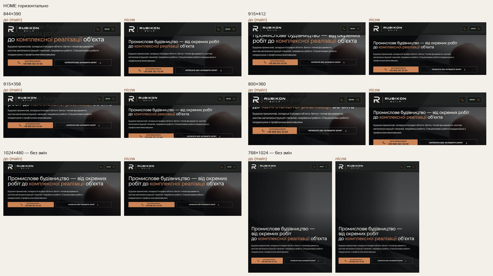

# Handoff · HOME у горизонтальній орієнтації: заголовок під шапкою, дзвінок у першому екрані (W2-16: PDO-45)

| | |
|---|---|
| Дата | 2026-10-21 |
| Виконавець | Claude Code |
| Підстава | Рішення власника 21.10: OD-PX-45 — V2 (H1 30 px). Умова — висота до 460 px, не 480, як у реєстрі: 1024×480 і без того в порядку і не змінюється. Wave 02A, крок W2-16 |
| PR | Draft. **Merge і production deploy — лише з окремого OK Дмитра** (DEC-30) |
| Гілка / base | `design/home-landscape` від `main` `25f3903` |
| Коміти | **`9d6b3f3`** — код і тести · цей handoff |
| Змінено | `app/home-v2.css` — один блок `@media (min-width: 761px) and (max-width: 1099px) and (max-height: 460px)`. Новий тест `tests/e2e/home-landscape.spec.ts` |
| Не змінено | Герой HOME на телефоні (≤760), на планшеті вертикально (768×1024) і на desktop; внутрішні сторінки (вони в порядку); тексти; відео |

## Що зроблено

Android-телефон, повернутий горизонтально, або iPad split view: 761–1099 px завширшки і до 460 px заввишки. Тут герой тримав висоту вікна, і заголовок 44 px заходив під фіксовану шапку. Тепер герой росте за вмістом і починається під шапкою, H1 — 30 px.

| Вікно | Під шапкою було | Тепер: верх H1 · низ дзвінка |
|---|---|---|
| 844×390 | 90 px | 124 px · 370 px — у першому екрані |
| 915×412 | 23 px | 146 px · 392 px — у першому екрані |
| 915×356 | 79 px | H1 повністю під шапкою; дзвінок — після короткої прокрутки |
| 800×360 | 120 px | 121 px · 367 px — на 7 px нижче краю |
| 1024×480, 768×1024, 1280×720, 1440×900 | — | без змін |

## До / після

Локальний production build `main` `25f3903` і гілки, Chromium (емуляція).

## Перевірка

| Що | Результат |
|---|---|
| `home-landscape` (новий) + `hero-video`, `heading-scale`, `consent-pending-hero`, `page-hero-rhythm` — desktop-chromium + mobile-chromium | 181 passed, 71 skipped |
| `tsc`, `eslint` | чисто |
| CI | у коментарі PR |

Що перевіряє `home-landscape.spec.ts`:

- 844×390, 915×412, 915×356, 800×360: H1 30 px, його верх щонайменше на 8 px нижче шапки. На 844×390 і 915×412 дзвінок у першому екрані. Кнопка паузи відео не лягає на дії.
- 1024×480, 1024×768, 1280×720, 1440×900: H1 як був (> 40 px), під шапкою.

## Еталони

Умова не зачіпає `homepage-hero-tablet-768` і `homepage-hero-desktop-1440`. Нових PNG немає.

## Відкат

`git revert 9d6b3f3`.
