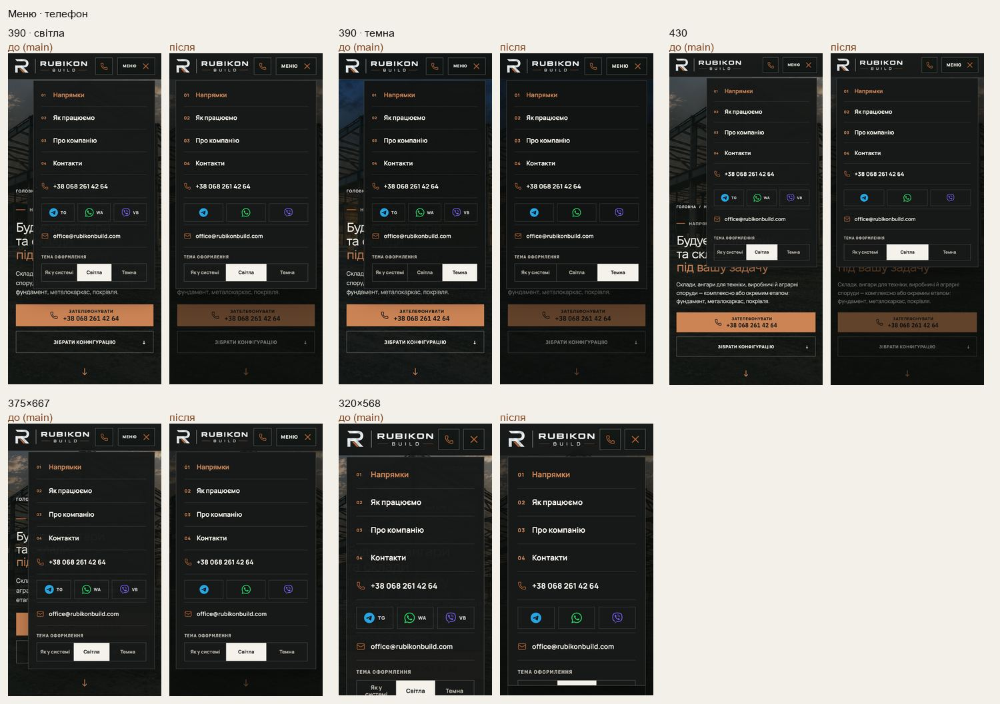
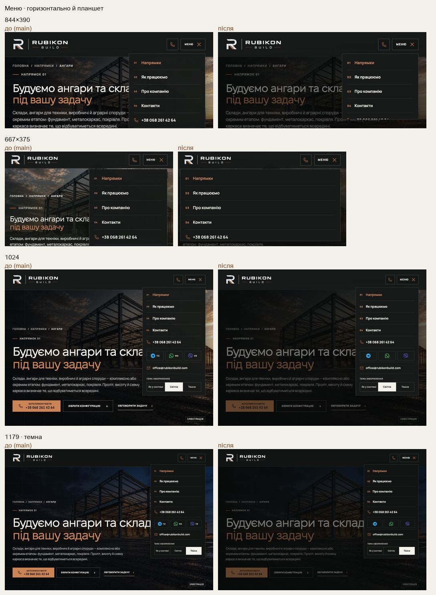

# Handoff · Мобільне меню: суцільна панель на всю колонку, затемнення, прокрутка (W2-14: PDO-47, PDO-25)

| | |
|---|---|
| Дата | 2026-10-21 |
| Виконавець | Claude Code |
| Підстава | Рішення власника 21.10: OD-PX-31 (a1) — месенджери лише іконками, номери 01–04 лишити. Wave 02A, крок W2-14 (після W2-13) |
| PR | Draft. **Merge і production deploy — лише з окремого OK Дмитра** (DEC-30). Перевірку на iPhone на preview до merge рекомендую (OD-PX-05): у fixed-панелі з прокруткою емуляція не показує «гумову» прокрутку iOS |
| Гілка / base | `design/mobile-menu-panel` від `main` `25f3903`. Футер (W2-13) — окремий PR; ці два не перетинаються в рядках |
| Коміти | **`5ad91fb`** — код і тести · цей handoff |
| Змінено | `app/globals.css` (панель, затемнення, розміри). Тести: новий `tests/e2e/mobile-menu-panel.spec.ts`; у `theme.spec.ts` помічник переходу спершу закриває відкрите меню |
| Не змінено | Пункти меню і їх порядок, номери 01–04, телефон, email, вибір теми, поведінка клавіатури (Escape, вихід Tab, дотик поза панеллю), шапка, `MobileMenu.tsx` |

## Що зроблено

- **Суцільний фон.** Було 98 %, крізь який проступав заголовок героя.
- **Затемнення сторінки** під відкритим меню, без анімації. Дотик по затемненню — це дотик поза меню, тож він його закриває.
- **Ширина.** На ≤760 px панель на ширину колонки (`100vw − 32 px`); була 310 px у колонці 358, і збоку видно героя. На 761–1179 px — 310 px, як було.
- **Висота.** Панель не вища за вікно, а на низьких екранах прокручується, і прокрутка не переходить на сторінку. На 844×390 і 667×375 сім із дванадцяти керувань раніше були за екраном, на 320×568 — три.
- **Текст.** Номери 01–04 — 11 px (були 9). Месенджери показано іконками, назва лишається в `aria-label`. «Меню» — 12 px (було 10). Найменший текст у панелі: 9 → 11 px.

**Наслідок для тестів.** Тема, обрана в меню, лишає меню відкритим (вибір — radio, не посилання). Тепер дотик по сторінці спершу закриває меню, а не натискає елемент під ним. Тому в `theme.spec.ts` помічник переходу натискає Escape перед переходом, як і відвідувач. Перевірки самої теми ті самі.

## До / після

Локальний production build `main` `25f3903` і гілки, Chromium (емуляція).

## Перевірка

| Що | Результат |
|---|---|
| `mobile-menu-panel` (новий) + `theme` | 29 passed, 9 skipped |
| `hero-video`, `header-current-section`, `responsive-a11y-phase1`, `header-hierarchy` | 171 passed (у першому прогоні; тоді `theme.spec` падав без зміни помічника, після неї — зелений) |
| Решта специфікацій, що відкривають меню: `angary-interactive`, `company-email`, `direction-static-hero`, `first-contact`, `directions-hero-sequence` | 174 passed, 32 skipped |
| `tsc`, `eslint` | чисто |
| CI | у коментарі PR |

Що перевіряє `mobile-menu-panel.spec.ts`:

- 390: панель від 16 до 374 px, фон без прозорості, затемнення rgba(10, 11, 10, .55). Чотири номери, жодного тексту меншого за 11 px. Месенджери видно за іконками, назви — у доступному імені. «Меню» 12 px. Без бічної прокрутки.
- 390: дотик по затемненню закриває меню; Escape закриває і повертає фокус на «Меню».
- 844×390, 667×375, 320×568, 390×664 з текстом 150 %: панель закінчується у вікні. Кожне з ≥12 керувань, прокручене в зону панелі, видно в панелі й у вікні. Колесо в кінці панелі не прокручує сторінку.
- 1024, 1179: панель 310 px, затемнення, у межах вікна.

**Межа поза цим кроком.** З текстом Android 200 % на 390 px вже сама шапка не вміщується і розширює сторінку до 523 px — так само на `main`. Це обмеження шапки, не меню.

## Еталони

Відкрите меню еталонів не має. Нових PNG немає.

## Відкат

`git revert 5ad91fb`.
