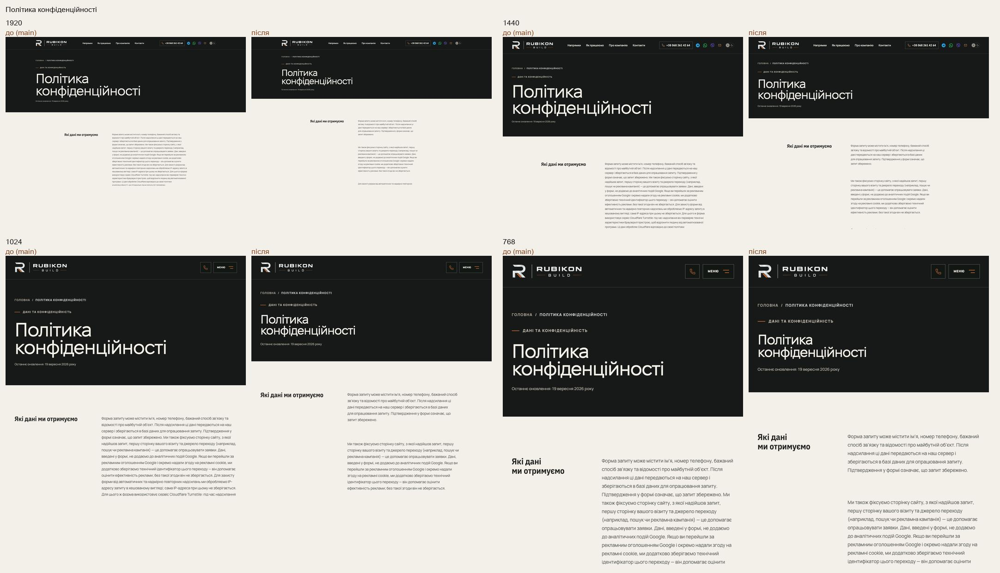
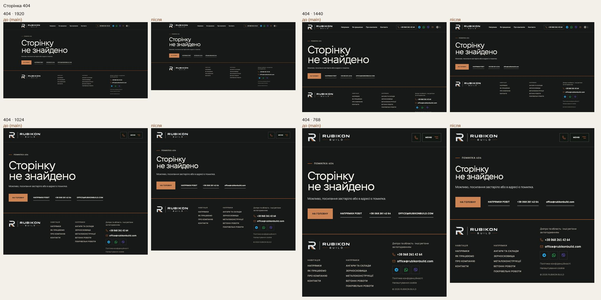
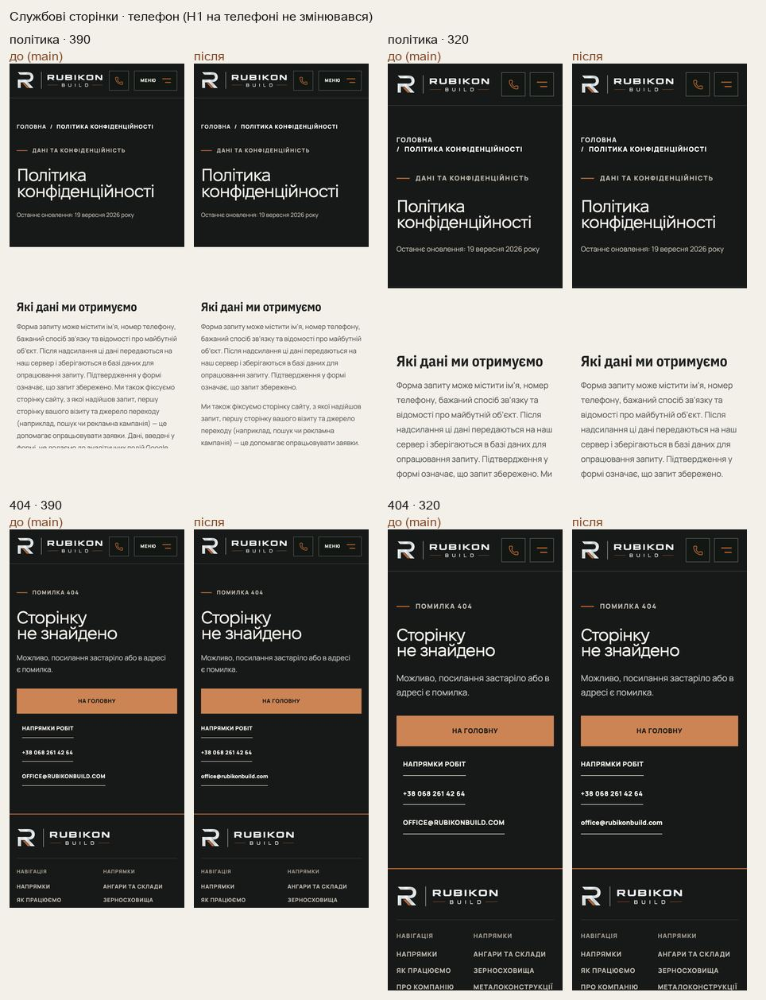

# Handoff · Службові сторінки: H1 72 px, політика в одній колонці, email звичайними літерами (W2-15: PDO-10)

| | |
|---|---|
| Дата | 2026-10-21 |
| Виконавець | Claude Code |
| Підстава | Рішення власника 21.10: OD-PX-32 (a) — H1 72 px, privacyVersion без змін (зміна вигляду, не змісту). Wave 02A, крок W2-15 |
| PR | Draft. **Merge і production deploy — лише з окремого OK Дмитра** (DEC-30) |
| Гілка / base | `design/service-pages` від `main` `25f3903` |
| Коміти | **`b026122`** — код і тести · цей handoff |
| Змінено | `app/globals.css` (заголовок і відступи службових сторінок, колонка тексту політики, email на 404, вирівнювання на телефоні), `app/polityka-konfidentsiinosti/page.tsx` (перший абзац — три `
`), `app/error.tsx` (`id="inquiry"`). Новий тест `tests/e2e/service-pages.spec.ts` |
| Не змінено | Слова політики (жодне не змінено), `privacyVersion` (`2026-09-19`), `global-error.tsx`, H1 на телефоні, тексти 404 і сторінки помилки |

## Що зроблено

- **H1** політики, 404 і сторінки помилки — щонайбільше 72 px (`clamp(44px, 5vw, 72px)`). Був 106 px, тоді як напрями мають 83,5, а HOME 74,9. Відступи блоку на ≥761 px: 180 / 80 → 150 / 64. Текст політики на 1440 починається з 603 px замість 712.
- **Політика.** Усі абзаци в колонці тексту; другий абзац раніше потрапляв під заголовок. Рядок ≤ 68 знаків (було до 84). Перший абзац, 1208 знаків, розбито на три між реченнями, жодного слова не змінено:
  1. дані форми;
  2. джерело переходу й реклама;
  3. захист від автоматичних надсилань.
- **404.** Email звичайними літерами. На телефоні номер і email на одній лінії з кнопкою (були на 12 px далі).
- **Сторінка помилки.** `id="inquiry"` на ряді дій: «Контакти» в шапці тепер ведуть до нього, як на 404. Раніше вони не робили нічого.

## До / після

Локальний production build `main` `25f3903` і гілки, Chromium (емуляція).

## Перевірка

| Що | Результат |
|---|---|
| `service-pages` (новий) + `not-found`, `words-whole`, `company-email`, `action-on-graphite`, `header-first-screen` — desktop-chromium + mobile-chromium | 51 passed, 25 skipped |
| `tsc`, `eslint` | чисто |
| CI | у коментарі PR |

Що перевіряє `service-pages.spec.ts`:

- 1280, 1440, 1920: H1 політики й 404 ≤72 px і не більший за H1 сторінки напряму; текст політики на 1440 починається вище 640 px.
- 768, 1440, 1920: жодного абзацу в колонці заголовка; ≤68 знаків у рядку (за символами, методом Range). Перший абзац — три `
` з тими самими початками й кінцями речень.
- Email на 404 без великих літер.
- 390: ряд дій 404 вирівняно по одній лінії; політика в одну колонку; без бічної прокрутки.

**Сторінка помилки** перевірена за кодом: той самий клас і `id="inquiry"`, що на 404. На production помилку не викликали, автоматичного тесту для неї немає.

## Еталони

Візуальних еталонів службових сторінок немає. Нових PNG немає.

## Відкат

`git revert b026122`.
