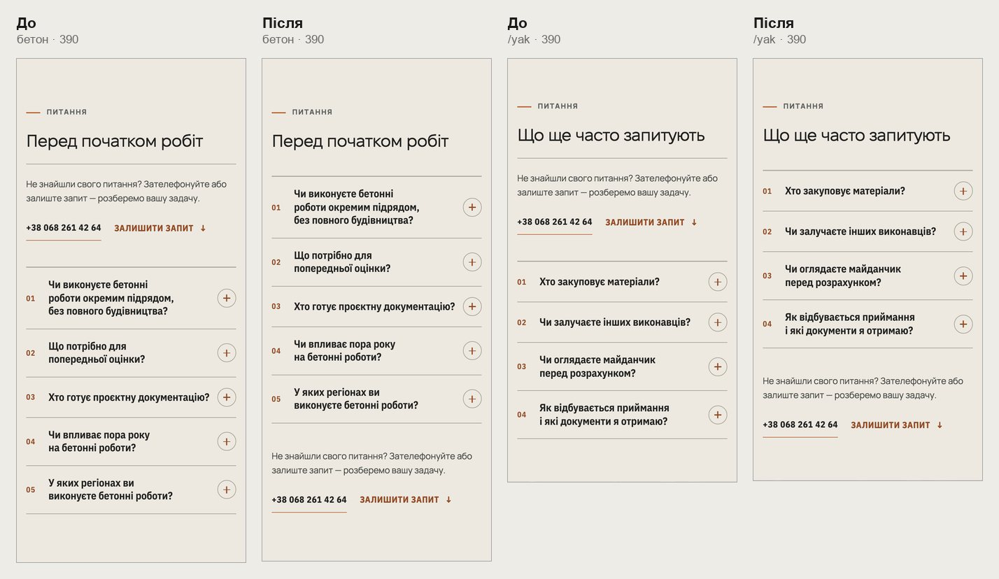
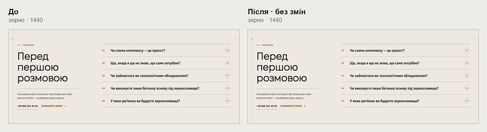
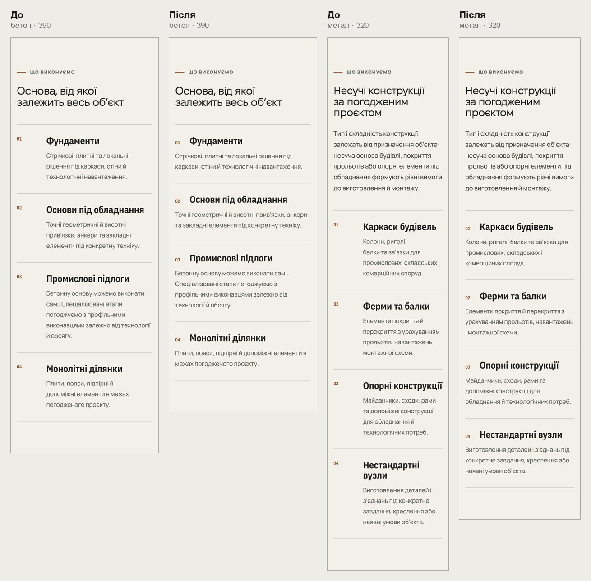
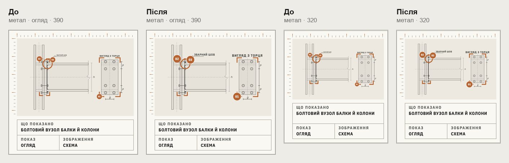
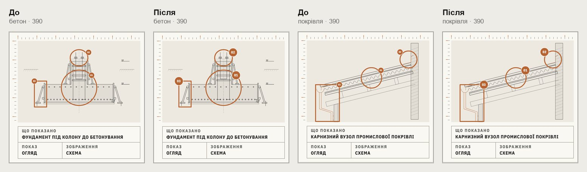
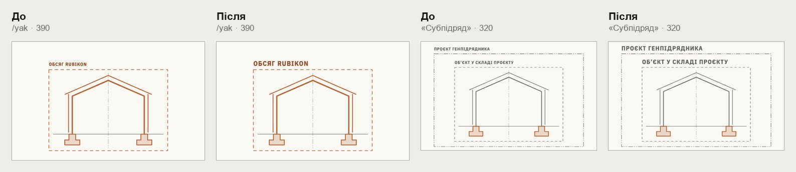

# Handoff · Шаблон напряму на телефоні: FAQ, «Що виконуємо», підписи креслень (W2-02: PDO-14, PDO-51, PDO-20)

| | |
|---|---|
| Дата | 2026-10-22 |
| Виконавець | Claude Code |
| Підстава | Рішення власника 22.10, OD-PX-45: PDO-14 A, PDO-51 V2, PDO-20 C′ і підписи /yak 16 одиниць. Wave 02B, крок W2-02. Бриф з варіантами: Рішення Wave 02B (artifact) |
| PR | Draft. **Merge, production deploy і нові еталони — лише з окремого OK Дмитра** (DEC-30, DEC-18) |
| Гілка / base | `design/direction-phone-template` від `main` `ffdac9a` |
| Коміти | **`cf30265`** — код і тести · цей handoff |
| Змінено | `app/components/DirectionDetail.tsx` (`FaqAsk`: блок «Не знайшли?» у двох місцях), `app/components/faq.css`, `app/globals.css` («Що виконуємо» ≤760 px), `app/components/directions/direction-node.css` (огляд вузла ≤760 px), `app/components/directions/formats-scope.css` (/yak ≤760 px). Тести: новий `tests/e2e/direction-phone-template.spec.ts`; у `configurator-phase4-inquiry` і `inquiry-brief-handoff` «Залишити запит» береться видимий |
| Не змінено | Усі ширини від 761 px, тексти, кроки туру вузла, креслення, планшетна розкладка вузла (це W2-03) |

## Що зроблено

- **PDO-14 · FAQ.** На телефоні «Не знайшли свого питання?» з номером і «Залишити запит» стоїть після останнього питання. Раніше він був між заголовком і списком. Так на шести сторінках: метал, бетон, покрівля, зерно, /angary, /yak-pratsyuiemo.
  - Від 768 px блок, як і раніше, під заголовком у лівій колонці. На /angary і зерні ця колонка лишається липкою.
  - Як зроблено: блок рендериться двічі (`faq-ask-side` під заголовком, `faq-ask-end` після списку), і на кожній ширині показано лише один. Прихований — `display: none`, тож він не потрапляє в порядок Tab і в дерево доступності. Клавіатура на телефоні проходить спершу питання, потім номер і форму.
  - Чому не `order`: `order` лишив би блок першим у порядку Tab. А окремий рядок сітки не дав би лівій колонці бути липкою на десктопі.
- **PDO-51 · «Що виконуємо».** На ≤760 px — як «Вартість» на тих самих сторінках: номер 26 px, відступ 12 px, номер і назва в рядок, опис на всю ширину.
  - Опис: 280 → 358 px на 390, 210 → 288 px на 320.
  - Блок: бетон 390 — 1096 → 988 px, метал 320 — 1406 → 1271 px.
  - Блок є лише на металі й бетоні.
- **PDO-20 · креслення.**
  - Вузол на телефоні, лише в огляді: «Зварний шов» 4 → 8 px, «Вигляд з торця» 6 → 9 px на 390 (на 320 ≈ 6,5 і 7,6 px). Бейджі 01–03(04) 15 → 23 px.
  - На кроках туру слова як були. Камера показує їх там на 9–15 px, а збільшені виходили за край кадру — це перевірено на прототипі, кадри в брифі.
  - На бетоні, покрівлі й зерні слів на кресленні немає: там змінюються лише бейджі.
  - /yak, «Межі робіт»: назви рамок 11 → 16 одиниць креслення на ≤760 px, тобто 7,7 → 11 px на 390. У всіх трьох форматах на 320 і 390 назви не накладаються і не виходять за креслення.

## До / після

Локальний production build `main` `ffdac9a` і гілки, Chromium (емуляція). Фізичний телефон не перевірявся.

## Перевірка

| Що | Результат |
|---|---|
| `direction-phone-template` (новий) — desktop-chromium + mobile-chromium | 7 passed, 7 skipped |
| 21 специфікація сторінок напрямів, /angary, /yak, форми, бюджетів висоти й words-whole (`angary-*`, `configurator-*-inquiry`, `direction-*`, `editorial-focus`, `first-contact`, `grain-page`, `heading-scale`, `inquiry-brief-handoff`, `phase3-shorter-pages`, `pr-critical`, `responsive-a11y-phase1`, `smoke`, `words-whole`, `yak-format*`, `company-email`) | 564 passed, 141 skipped; 1 failed під навантаженням 4 воркерів (`angary-interactive:1074`, анімація воріт конфігуратора) — окремо 3 з 3 passed |
| `tsc`, `eslint`, `vitest` | чисто; `vitest` 1437 passed (`grain-complex` раз перевищив 5 с під навантаженням, окремо 9 з 9) |
| CI | у коментарі PR |

Skipped — тести, прив’язані до проєкту (`test.skip` за `isMobile`): кожен тест сам задає ширину вікна.

Що перевіряє `direction-phone-template.spec.ts`:

- 320 і 390 на шести сторінках з FAQ: видно один блок «Не знайшли?», він нижче за список, усі питання раніше за посилання в порядку клавіатури, без бічної прокрутки.
- 768 і 1440: видно лише блок під заголовком. На /angary і зерні на 1440 заголовок `position: sticky`.
- Метал і бетон на 320 і 390: опис кожної картки «Що виконуємо» на всю ширину картки, назва на 38 px від краю, номер поруч із назвою. На 1024 колонка номера, як і була, 54 px.
- Метал 390: в огляді `.nd-note` 44 і `.nd-title` 52 одиниці, бейдж ≥22 px; на кроці 3 — 22 і 34, як було. Бетон і покрівля — бейджі ≥22 px. На 1024 усе як було.
- /yak на 320 і 390, три формати: назви рамок 16 одиниць, у межах креслення, без накладання. На 1440 — 11, як було.

## Еталони (DEC-18)

Не оновлювались. Зміняться:

- `direction-faq-mobile-375` (FAQ з /angary): блок «Не знайшли?» тепер після списку.
- `process-scope-mobile-375` (/yak): назви рамок більші.

Linux-рендери з CI покажу до оновлення.

## Відкат

`git revert cf30265`.
