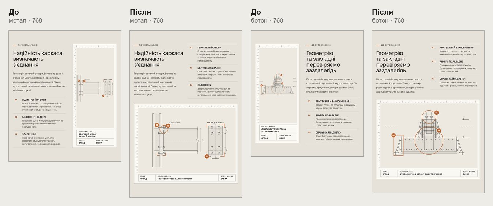
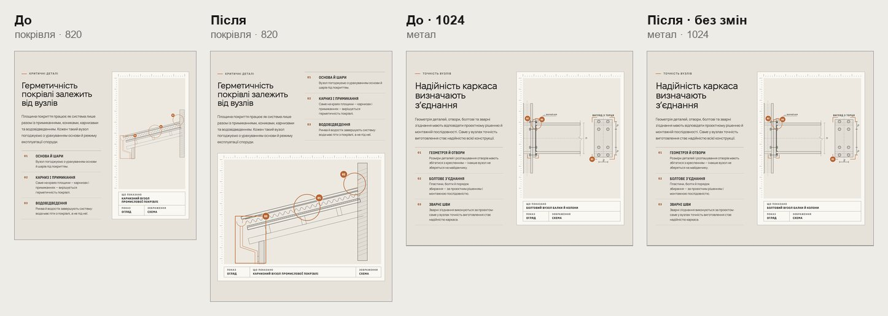
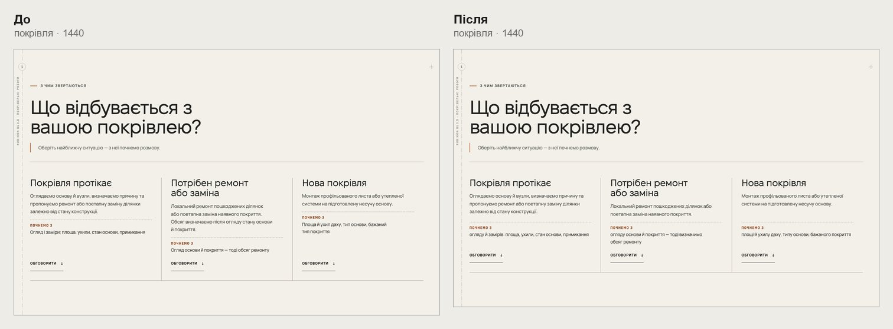
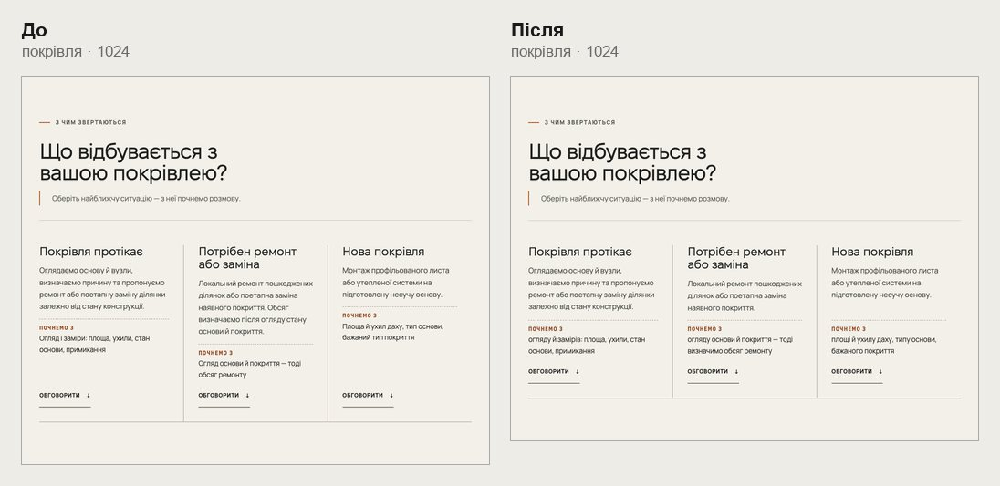
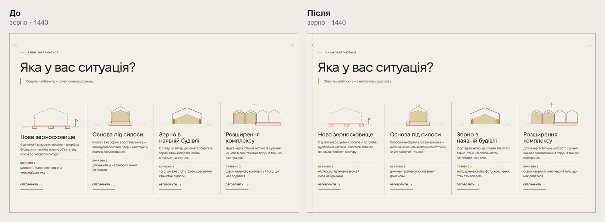

# Handoff · Шаблон напряму на планшеті й десктопі: вузол на портретному планшеті, картки ситуацій (W2-03: PDO-43, PDO-50)

| | |
|---|---|
| Дата | 2026-10-22 |
| Виконавець | Claude Code |
| Підстава | Рішення власника 22.10: OD-PX-45 — PDO-43 S2 з межею 900 px; OD-PX-39 і OD-PX-45 — PDO-50 (a). Wave 02B, крок W2-03. Бриф з варіантами: Рішення Wave 02B (artifact) |
| PR | Draft. **Merge і production deploy — лише з окремого OK Дмитра** (DEC-30) |
| Гілка / base | `design/direction-tablet-template` від `main` `ffdac9a`. Незалежна від W2-02 (#226): обидві змінюють `direction-node.css`, але в різних блоках (≤760 і 761–900 px) |
| Коміти | **`a33128e`** — код і тести · цей handoff |
| Змінено | `app/components/directions/direction-node.css` (761–900 px), `app/components/directions/direction-template.css` (картки ≥901 px), `app/components/directions/DirectionEntry.tsx` і `app/components/zernoskhovyshcha/GrainSituations.tsx` (назва й текст картки в одному блоці `.direction-entry-copy`), `app/zernoskhovyshcha/grain-editorial.css` (ширина креслень карток), `app/data/directionPages.ts` (три рядки «Почнемо з» і одне речення на покрівлі). Новий тест `tests/e2e/direction-tablet-template.spec.ts` |
| Не змінено | Вузол до 760 px і від 901 px, вузол зерна, картки до 900 px, решта текстів. Еталон `direction-cost-tablet-768` змінюється на 1 px через округлення — див. «Еталони» |

## Що зроблено

- **PDO-43 · вузол на портретному планшеті (761–900 px).** Текст і три кроки стоять поруч, під ними аркуш на всю ширину в кадрі 3 : 2.
  - Раніше аркуш займав колонку 258 px завширшки і тягнувся на висоту тексту. Креслення займало третину аркуша.
  - Кадр: 258 × 548 → 664 × 443 на 768, 303 × 548 → 713 × 475 на 820.
  - Блок: метал 898 → 1145, бетон 865 → 1113, покрівля 854 → 1102 px.
  - Тур проходить кроки в новому кадрі.
  - Правило кадру 3 : 2 обов’язкове: без нього `.sheet-image` (flex: 1, min-height: 0) схлопується, щойно аркуш перестає брати висоту тексту.
  - Від 901 px аркуш поруч із текстом, як було (на 1024 — 441 × 547).
  - Зерно не змінюється: його аркуш із легендою (`.dn-media`) на планшеті вже стоїть стопкою. Правило обмежене `:has(> .dn-sheet)`.
- **PDO-50 · картки ситуацій.** Від 901 px кожна картка бере три рядки списку як свої (subgrid): назву з текстом, «Почнемо з» і посилання.
  - «Почнемо з» і посилання в усіх картках на одній лінії. Розкид на покрівлі 88 → 0 px на 1440, 82 → 0 px на 1024.
  - Браузер без subgrid лишає картки, як були.
  - До 900 px картки одна під одною, як було.
- **Покрівля, тексти (OD-PX-39).** «Почнемо з» + родовий відмінок, як на зерні:
  - «огляду й замірів: площа, ухили, стан основи, примикання»;
  - «огляду основи й покриття — тоді визначимо обсяг ремонту»;
  - «площі й ухилу даху, типу основи, бажаного покриття».
  - З ситуації 2 прибрано друге речення «Обсяг визначаємо після огляду стану основи й покриття.» — воно повторювало її «Почнемо з».
  - Нових фактів немає.
- **Зерно.** Креслення картки без лівого відступу (перша в ряду) було на 26 px ширшим, а отже вищим. Тепер усі однакові. Заголовки 13 → 0 px розкиду, «Почнемо з» 30 → 0 px на 1440. На 761–1050 px — у кожному з двох рядів.

## До / після

Локальний production build `main` `ffdac9a` і гілки, Chromium (емуляція).

## Перевірка

| Що | Результат |
|---|---|
| `direction-tablet-template` (новий) — desktop-chromium + mobile-chromium | 6 passed, 6 skipped |
| 18 специфікацій: `direction-node`, `direction-editorial-rhythm`, `direction-route-cards`, `direction-static-hero`, `editorial-focus`, `grain-page` і `phase3-shorter-pages` (бюджети висоти), `pr-critical`, `smoke`, `words-whole`, `heading-scale`, `responsive-a11y-phase1`, `first-contact`, `company-email`, `grain-planner*`, `inquiry-brief-handoff`, `smooth-scroll` | 449 passed, 85 skipped |
| `tsc`, `eslint`, `vitest` | чисто; 1437 passed |
| CI | у коментарі PR |

Skipped — тести, прив’язані до проєкту (`test.skip` за `isMobile`).

Що перевіряє `direction-tablet-template.spec.ts`:

- Метал, бетон, покрівля на 768, 820, 900: кроки праворуч від тексту на тій самій висоті, аркуш під обома на всю ширину сітки, кадр 3 : 2, без бічної прокрутки.
- 768: тур проходить кроки 1–3, кадр вищий за 400 px.
- 901 і 1024: аркуш праворуч від тексту, як було. Зерно на 820 — без нової розкладки.
- Покрівля на 901, 1024, 1280, 1440, 1920: «Почнемо з» і посилання трьох карток — розкид ≤1 px. На 900 — картки одна під одною.
- Покрівля: текст трьох рядків «Почнемо з» дослівно; у ситуації 2 одне речення.
- Зерно на 1280, 1440, 1920: заголовки й «Почнемо з» чотирьох карток — розкид ≤1 px. На 820 і 1024 — заголовки в кожному ряду.

## Еталони (DEC-18)

Вузол і картки ситуацій еталонів не мають. Але в Main Regression на `bad0eb9` змінився `direction-cost-tablet-768` (вартість на бетоні, 768): 712 × 799 → 712 × 798 px.

- Сам блок вартості не змінився. Вище на сторінці вузол тепер має кадр 664 × 442,67 px, тож блок вартості починається з іншої частки пікселя, і знімок елемента округлює висоту на піксель менше.
- Рендер CI збігається з еталоном рядок у рядок: середня різниця ≈1 з 255, 0,6 % пікселів відрізняються згладжуванням, нижній рядок зник.
- «Expected» у CI — той самий файл, що в репозиторії (`d8af24…`). Рендер однаковий в усіх спробах (`fcebc7…`).

Оновлю лише з OK власника.

## Відкат

`git revert a33128e`.
