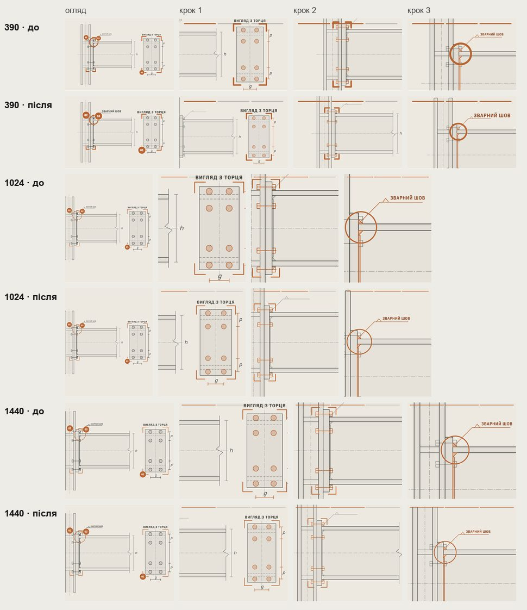
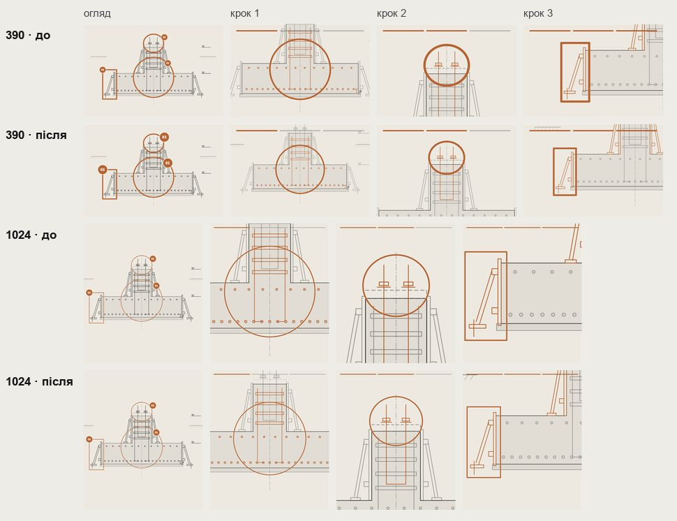
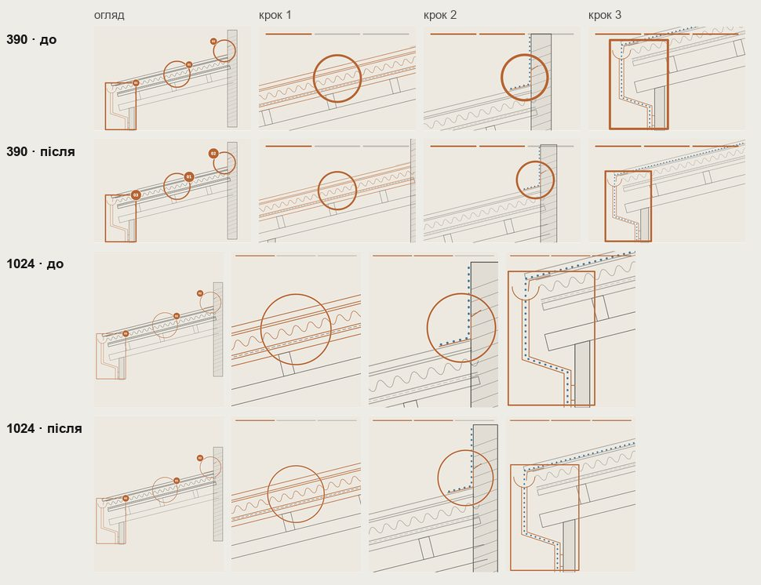
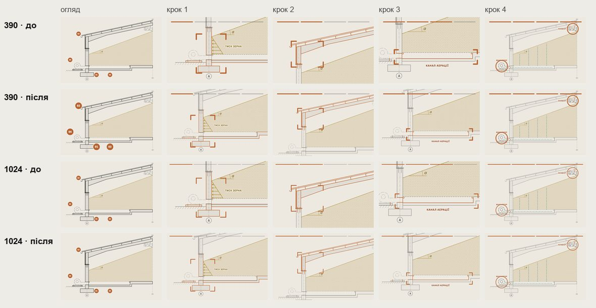
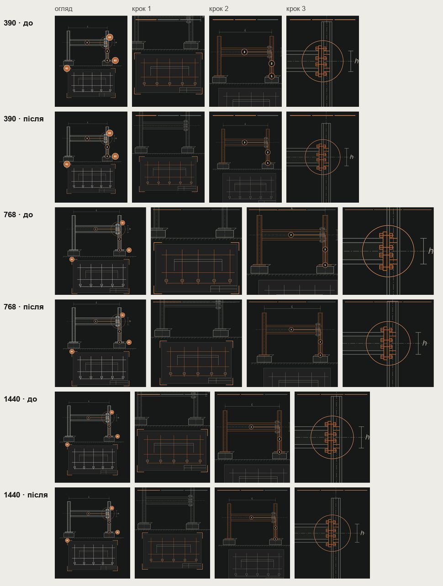

# Handoff · Тури креслень: менше наближення, повітря навколо кроку, нічого під смугами

| | |
|---|---|
| Дата | 2026-10-22 |
| Виконавець | Claude Code |
| Підстава | Прохання власника 22.10 зі знімком кроку 1 на металі: «маштаб проситься зменшити щоб краще влазило і переглянь всі схожі блоки і їх анімації щоб було все красиво» |
| PR | Draft, **поверх #226** (base `design/direction-phone-template`): змінює правило C′ з #226. Після merge #226 — перебазую на `main`. **Merge і production deploy — лише з окремого OK Дмитра** (DEC-30) |
| Гілка | `design/node-tour-framing` |
| Коміти | **`dbeabb6`** — код і тести · цей handoff |
| Змінено | Камера: `app/lib/drawingCamera.ts`, `app/components/useDrawingCamera.ts`. Вузли: `DirectionNode.tsx`, `NodeDrawing.tsx`, `direction-node.css`. Наближення кроків: `app/data/directionPages.ts`, `app/data/grainPage.ts`, `app/pro-nas/page.tsx`. Практика /pro-nas: `PracticeSteps.tsx`, `PracticeDrawing.tsx`, `app/pro-nas/about.css`. Тести: новий `tests/e2e/drawing-tour-framing.spec.ts`, `tests/unit/drawing-camera.test.ts`, `tests/e2e/direction-phone-template.spec.ts` |
| Не змінено | Огляди турів (overview) на десктопі, кроки й тексти, тривалості анімацій, тур каркаса на /angary |

## Що було

Перевірено кожен стан кожного туру (огляд і всі кроки) на 320, 390, 768, 1024, 1440. На `main` `ffdac9a`:

- **Метал, крок 1.** «Вигляд з торця» під смугами прогресу на всіх ширинах. На 390 «зварний шов» обрізаний.
- **Позначки кроків** (кола, кутники, прямокутники) упиралися в край кадру або заходили під смуги: бетон на 390 (кроки 1–2), покрівля (крок 3), зерно (кроки 2–3). У вузлів напрямів не було запасу під смуги (`stepTop`), а запас від краю — лише 8 px.
- **Наближення кроків** 1,5–2,4 × cover: на десктопі крок показував фрагмент без контексту.
- **/pro-nas, практика.** На кроці 2 «L» під смугами, на кроці 1 «h» на краю — 6 обрізаних підписів на чотирьох ширинах.
- **/angary, тур каркаса** (у конфігураторі, власна камера) — без проблем.

## Що зроблено

- **Повітря й смуги.** Камера отримала відступ для кроків. Вузли напрямів беруть 16 px повітря і тримають крок нижче за смуги прогресу (`stepTop` 19, як уже було на /pro-nas). Практика /pro-nas теж бере 16 px.
- **Менше наближення.** Кроки вузлів приблизно на 20 % менше (метал 1,7/1,9/2,4 → 1,35/1,5/1,9; бетон, покрівля, зерно так само), /pro-nas — на 15 %.
- **Слова свого виду.** Крок тримає в кадрі слова свого виду (`data-view`): на металі — «Вигляд з торця» і літери `g`, `p` для кроку 1; на /pro-nas — «L» для кроку 2 і «h» для кроку 3. Чужі слова на кроці не показуються: відсунута камера заводила їх у край кадру.
- **Слова на телефоні.** Подвоєні слова креслення з #226 (C′) тепер і на кроках, не лише в огляді. Якби вони лишалися тільки в огляді, то з меншим наближенням на кроці 1 зменшувалися б, коли камера наближає: «Вигляд з торця» на 390 — 13 → 10 px (виміряно). Тепер 13 → 16,9 px, плавно (за кадр щонайбільше 1,4 %).
- **Повторний замір.** Розміри слів камера заміряє знову, коли кадр змінює розмір: телефон, повернутий з альбомної в портретну, отримує подвоєні слова.

## Анімації

Камера записана покадрово (rAF) через увесь автопоказ на чотирьох сторінках на 390 і 1024, порівняно з нинішньою камерою:

- **Стрибків немає.** Найбільший крок за кадр менший, ніж був: покрівля 1024 — 55 → 37 px зсуву, 5,1 → 4,3 % масштабу; метал 1024 — 29 → 20 px.
- **Слова.** Чужі слова зникають за 0,3 с разом зі зміною кроку.

## До / після

«До» — `main` `ffdac9a`. «Після» — разом із #226 і #227, як буде після merge усіх трьох. Локальний production build, Chromium, reduced motion (камера стає одразу).

## Перевірка

| Що | Результат |
|---|---|
| `drawing-tour-framing` (новий) — desktop-chromium + mobile-chromium | 6 passed, 6 skipped |
| Аудит усіх станів разом із #226 і #227 (320, 390, 768, 820, 1024, 1440) | 102 стани: жодного обрізаного слова, нічого під смугами (на `main`: 4 з 68) |
| `direction-node`, `pro-nas-practice`, `pro-nas-capability`, `direction-phone-template`, `direction-editorial-rhythm`, `editorial-focus`, `grain-page`, `phase3-shorter-pages`, `words-whole`, `pr-critical`, `smoke`, `responsive-a11y-phase1`, `heading-scale` | 309 passed, 67 skipped |
| `vitest` | 1439 passed (нові: відступ кроку, смуги) |
| `tsc`, `eslint` | чисто |
| CI | у коментарі PR |

Що перевіряє `drawing-tour-framing.spec.ts`:

- Чотири вузли й практика /pro-nas на 320, 390, 768, 1024, 1440. У кожному огляді й на кожному кроці всі видимі слова креслення цілі в кадрі, а на кроці — не під смугами.
- Телефон, повернутий з 844 × 390 на 390 × 844: на кроці 1 «Вигляд з торця» 52 одиниці, цілий і не під смугами.

`drawing-camera.test.ts`: крок із відступом 16 px тримає потрібне на 16 px від краю і не наближає більше, ніж без відступу. З `stepTop` 19 потрібне лишається нижче смуг. Тест «третій крок зерна» тепер явно бере колишнє наближення 1,7: з новим 1,35 власна камера туру вже не обрізає позначку.

## Еталони

Тури креслень еталонів не мають (`homepage-*`, `direction-*`, `process-*` їх не знімають). Нових PNG немає.

## Відкат

`git revert dbeabb6`.
