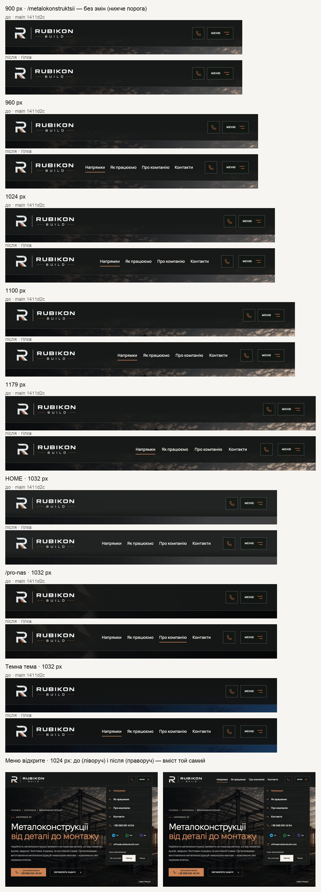

# Handoff · Шапка на планшеті: чотири розділи в один ряд від 960 px

| | |
|---|---|
| Дата | 2026-10-22 |
| Виконавець | Claude Code |
| Підстава | Рішення власника 22.10. Причина: на планшеті в шапці багато місця, а все сховано за «Меню». Варіант 2×2 відхилено. Обрано один ряд, бо так «набагато краще». Поріг 960 px, а не 900, як у прототипі: на 900 посилання підходять до логотипа на ≈12 px |
| PR | Draft. **Merge і production deploy — лише з окремого OK Дмитра** (DEC-30) |
| Гілка / base | `design/tablet-nav-row` від `main` `1411d2c` |
| Коміти | **`ccd396b`** — код і тести · цей handoff |
| Змінено | `app/globals.css` — один блок `@media (min-width: 960px) and (max-width: 1179px)`. Тести: у `header-hierarchy.spec.ts` тест компактної шапки чекає ряд від 960 px; новий `tests/e2e/header-tablet-nav.spec.ts`. Знімки: `docs/handoffs/media/tablet-nav-row/` |
| Не змінено | Шапка до 959 px і від 1180 px; «Меню» і його вміст (контакти й тема лишаються там); дзвінок; логотип (226 px); висота шапки (101 px); розмітка `SiteChrome.tsx` |

## Що зроблено

На 960–1179 px «Напрямки», «Як працюємо», «Про компанію», «Контакти» стоять в один ряд між логотипом і дзвінком / «Меню». Це те саме `.desktop-nav`, що й на desktop: 600, 15 px, з тими самими 44 px цілями й мідною лінією поточного розділу. Телефон, месенджери, email і тема на цій ширині лишаються в меню, як і були.

Відстань від ряду до сусідів (`/metalokonstruktsii`, Chromium, macOS):

| Ширина | Логотип → ряд | Крок між пунктами | Ряд → дзвінок | Висота шапки |
|---|---|---|---|---|
| 960 | 42 px | 20 px | 45 px | 101 px |
| 1024 | 96 px | 22 px | 47 px | 101 px |
| 1100 | 159 px | 23 px | 49 px | 101 px |
| 1179 | 225 px | 25 px | 51 px | 101 px |

Від логотипа ряд стоїть щонайменше на подвійний крок між пунктами — те саме правило груп, що й у desktop-шапці (PDO-19).

## До / після

Локальний production build `main` `1411d2c` і гілки, Chromium (емуляція), DPR 2.

## Перевірка

| Що | Результат |
|---|---|
| `header-tablet-nav` (новий) + `header-hierarchy` — desktop-chromium + mobile-chromium | 8 passed, 8 skipped |
| Шапка, меню, тема й макет: `header-current-section`, `header-first-screen`, `responsive-a11y-phase1`, `brand-logo-visual`, `smoke`, `words-whole`, `company-email`, `theme`, `hero-video`, `pr-critical`, `first-contact`, `angary-interactive`, `direction-static-hero` | 475 passed, 95 skipped |
| `tsc`, `eslint` | чисто |
| CI | у коментарі PR |

Skipped — тести, прив’язані до проєкту (`test.skip` за `isMobile`): кожен тест сам задає ширину вікна.

Що перевіряє `header-tablet-nav.spec.ts`:

- `/`, `/metalokonstruktsii`, `/pro-nas` на 960, 1024, 1100, 1179: чотири пункти в одному ряду, кожен ≥44 px заввишки, 15 px. Від логотипа ≥32 px, до дзвінка ≥16 px. Дзвінок і «Меню» видно, блок контактів desktop — ні. Шапка ≤101 px, без бічної прокрутки.
- 768, 820, 900, 959: ряду немає; дзвінок і «Меню».
- 1024: поточний розділ (`/metalokonstruktsii`, `/pro-nas`, `/yak-pratsyuiemo`) має мідну лінію на всю ширину пункту, інші — без лінії.
- 1024: «Контакти» в ряду ведуть до `#inquiry`; меню відкривається, і пункти в ньому є.

## Еталони

`header-logo-desktop-edge-1001` знімає лише логотип, а він не змінився: 226 px, на тому ж місці. Інших еталонів на 960–1179 px немає. Нових PNG немає.

## Відкат

`git revert ccd396b`.
