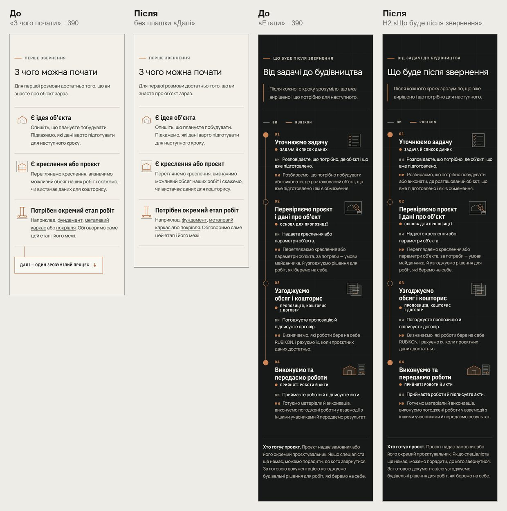
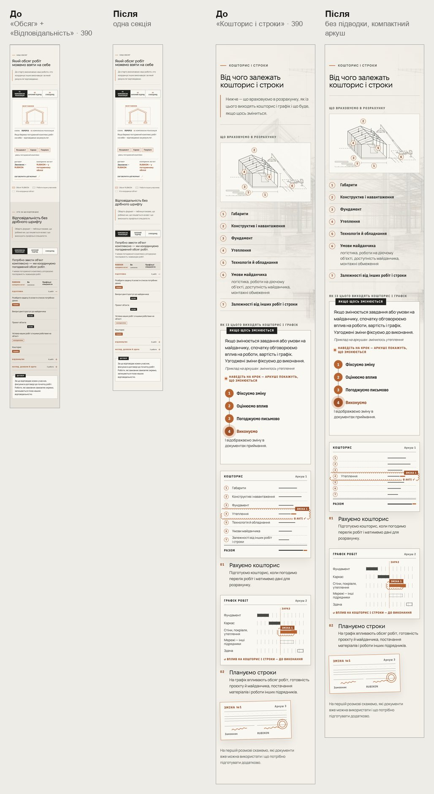
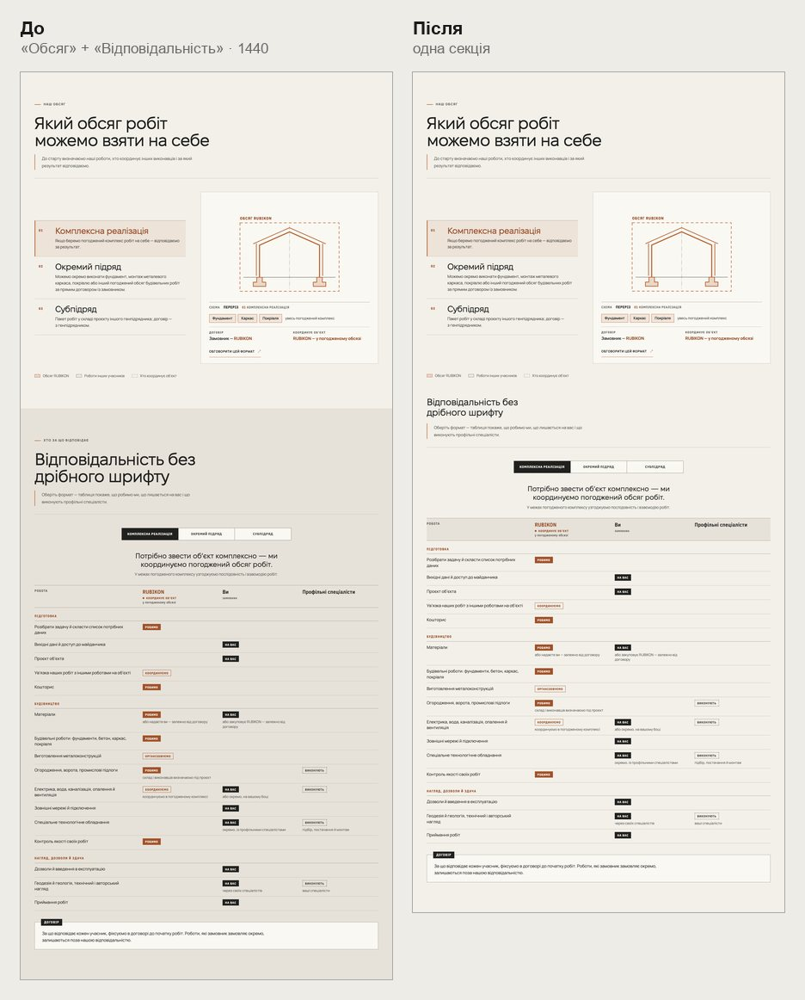
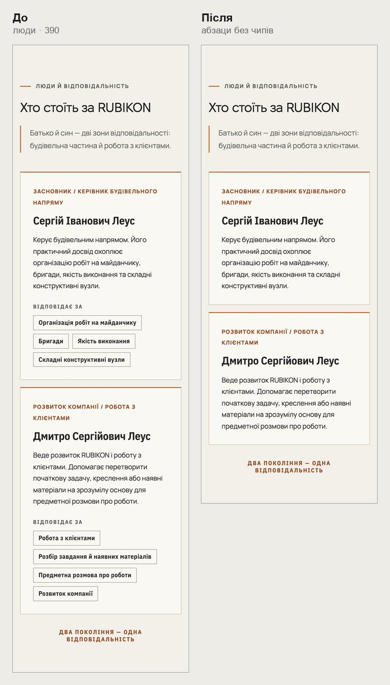
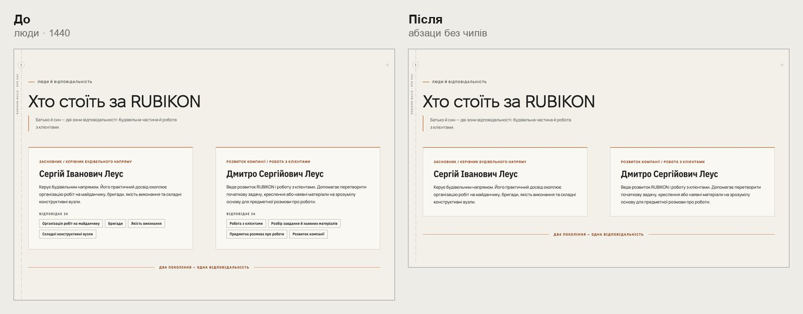

# Handoff · /yak і /pro-nas: кожна думка — один раз (W2-05: PDO-101, PDO-78)

| | |
|---|---|
| Дата | 2026-10-23 |
| Виконавець | Claude Code |
| Підстава | Рішення власника 23.10, OD-PX-24: /yak — як рекомендовано (b) разом із PDO-78; /pro-nas — ABT-05 B, принципи лишаються як зараз; /napryamky — без змін. Wave 02C, крок W2-05. Бриф з варіантами: Рішення Wave 02C (artifact) |
| PR | Draft. **Merge, production deploy і нові еталони — лише з окремого OK Дмитра** (DEC-30, DEC-18) |
| Гілка / base | `design/shorter-pro-nas-yak` від `main` `54f2d59` |
| Коміти | **`08c826b`** — код і тести · цей handoff |
| Змінено | `app/yak-pratsyuiemo/page.tsx`, `app/yak-pratsyuiemo/delivery.css`, `app/components/process/change-sheets.css`, `app/components/SiteChrome.tsx` (`SectionHeader`: `supporting` і `eyebrow` необов’язкові, `level` 2 або 3; біографії /pro-nas без `focus`). Тести: новий `tests/e2e/shorter-pro-nas-yak.spec.ts`, `phase3-shorter-pages.spec.ts`, `pr-critical.spec.ts` |
| Не змінено | Нових слів немає. Принципи /pro-nas (усі три зі знаками), підсумок практики /pro-nas, /napryamky, HOME, аркуш «Зміна №1» на телефоні, порядок аркушів змін (це W2-06) |

## Що зроблено

Лише наявними словами — прибрано повтори.

- **/yak, «З чого можна почати».** На телефоні немає плашки «Далі — один зрозумілий процес ↓»: вона лише прокручувала до наступного блоку (−93 px). На десктопі лишається як остання ланка схеми.
- **/yak, «Етапи» (PDO-78).** H2 «Що буде після звернення», мітка над ним — «Від задачі до будівництва». Раніше було навпаки, і H2 майже повторював H1.
- **/yak, «Наш обсяг» + «Відповідальність» — одна секція.**
  - Спільний фон, без шва (було 144 px між секціями).
  - «Відповідальність без дрібного шрифту» — підзаголовок h3 без мітки; `aria-labelledby` вказує на нього.
  - Підказка «Оберіть формат — таблиця покаже…» лишається: легенда перемикача видна лише скринрідеру. Якір `#vidpovidalnist` теж лишається (на нього веде /napryamky).
  - У темній темі обидві частини на одному фоні, без лінії між ними.
- **/yak, «Кошторис і строки».** Без підводки «Нижче — що враховуємо в розрахунку…». На телефоні аркуш «Кошторис» компактний: рядки 24 px, назва лише в зміненому рядку «Утеплення». Аркуш — картинка (`aria-hidden`), а список над ним називає всі сім чинників.
- **/pro-nas, люди (ABT-05 B).** Абзаци як були, без «Відповідає за» і чипів, які їх переказували (у Сергія Івановича — чотири з чотирьох дослівно). HOME не змінюється: там чипів і не було.

| Сторінка | Було | Стало |
|---|---|---|
| /yak, 390 | 11 218 px · 13,29 екрана | 10 804 px · 12,80 |
| /yak, 1440 | 9 985 px · 11,09 | 9 645 px · 10,72 |
| /pro-nas, 390 | 9 101 px · 10,78 | 8 727 px · 10,34 |
| /pro-nas, 1440 | 6 655 px · 7,39 | 6 529 px · 7,25 |

## До / після

Локальний production build `main` `54f2d59` і гілки, Chromium (емуляція).

## Перевірка

| Що | Результат |
|---|---|
| `shorter-pro-nas-yak` (новий) — desktop-chromium + mobile-chromium | 5 passed, 5 skipped |
| 25 специфікацій, що відкривають /yak або /pro-nas (`pr-critical`, `phase3-shorter-pages`, `yak-format*`, `pro-nas-*`, `theme`, `smoke`, `words-whole`, `heading-scale`, `responsive-a11y-phase1`, `ux-conversion-phase2` та інші) | 498 passed, 139 skipped, 1 failed — `ux-conversion-phase2:134`, нестабільний (падав і на попередніх гілках); окремо 2 з 2 passed |
| `tsc`, `eslint`, `vitest` | чисто; `vitest` 1439 passed (два тести зерна раз перевищили таймаут під навантаженням e2e, окремо 35 з 35) |
| CI | у коментарі PR |

Що перевіряє `shorter-pro-nas-yak.spec.ts`:

- «Етапи»: H2 і мітка помінялися місцями.
- Плашки «Далі» немає на 390 і є на 1440. У «Кошторисі» немає підводки.
- «Обсяг» і «Відповідальність» на 390 і 1440: однаковий фон, у «Обсягу» нижній відступ 0, між секціями 0 px, `aria-labelledby` — на h3. Немає H2 чи мітки, підказка на місці.
- На 390 рядки аркуша «Кошторис» нижчі за 26 px, видно лише назву зміненого рядка, а список над аркушем — повний.
- /pro-nas: без чипів, абзац Сергія Івановича повний, принципів три.

## Еталони (DEC-18)

Не оновлювались. Можуть змінитися:

- `process-route-*`: H2 і мітка «Етапів»;
- `process-responsibility-*`: заголовок без мітки, h3;
- `process-terms-*`: без підводки, на телефоні компактний аркуш;
- `process-scope-*`: імовірно ні, бо знімається лише `.shell`.

Linux-рендери з CI покажу до оновлення.

## Відкат

`git revert 08c826b`.
