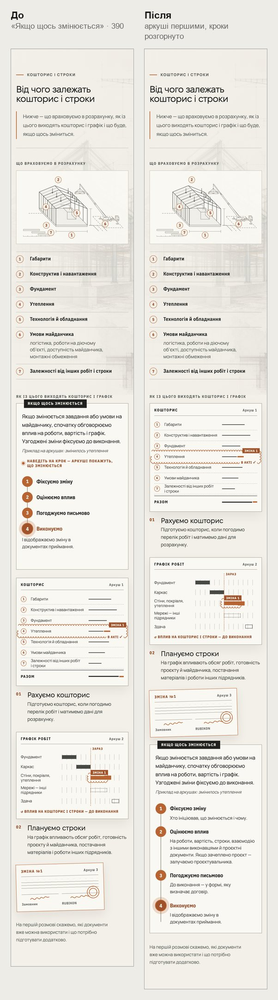
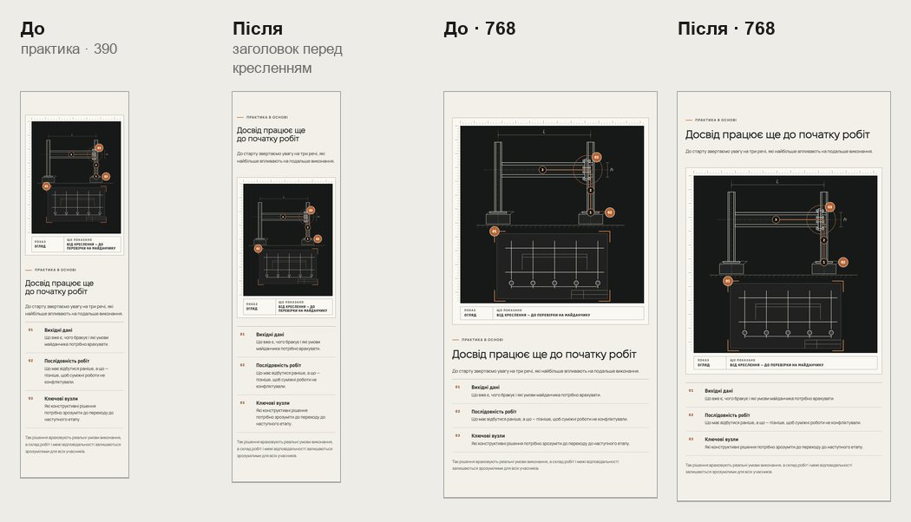
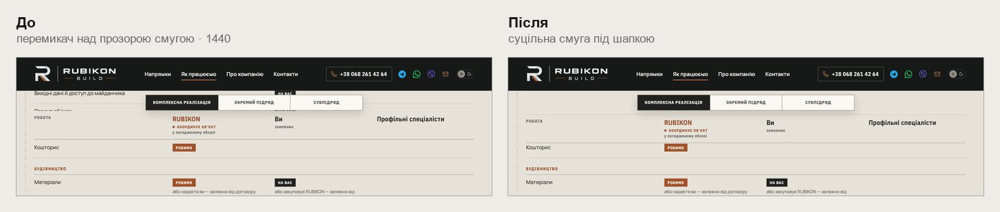
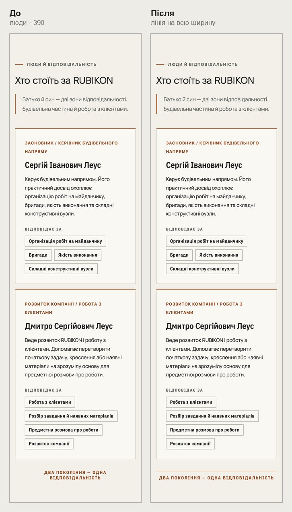
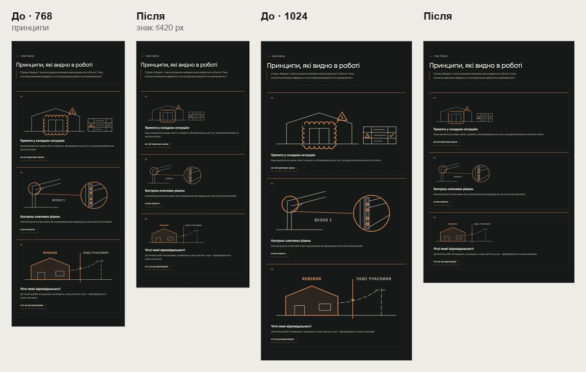

# Handoff · /yak і /pro-nas на телефоні й планшеті: аркуші змін першими, заголовок практики перед кресленням, суцільна смуга перемикача (W2-06: PDO-100, PDO-52, PDO-53, PDO-54)

| | |
|---|---|
| Дата | 2026-10-23 |
| Виконавець | Claude Code |
| Підстава | Рішення власника 23.10: OD-PX-23 (a) з /pro-nas A; PDO-52 — варіант 1; PDO-53 і PDO-54 — як у реєстрі. Wave 02C, крок W2-06. Бриф з варіантами: Рішення Wave 02C (artifact) |
| PR | Draft. **Merge, production deploy і нові еталони — лише з окремого OK Дмитра** (DEC-30, DEC-18) |
| Гілка / base | `design/yak-pro-nas-touch` від `main` `54f2d59`. Незалежна від W2-05 (#230): ті самі файли, але інші правила. Еталон `process-terms-mobile-375` змінюють обидва, тож його оновлю після merge #230 |
| Коміти | **`366db47`** — код і тести · цей handoff |
| Змінено | `app/components/process/change-sheets.css` і `ChangeSheets.tsx` (телефон), `app/yak-pratsyuiemo/delivery.css` і `app/components/process/resp-matrix.css` (перемикач ≥1051 px), `app/pro-nas/about.css` (практика ≤1050, лінія команди ≤760, знаки ≤1050). Тести: новий `tests/e2e/yak-pro-nas-touch.spec.ts`; `pr-critical.spec.ts` — тест перемикача на широкому екрані |
| Не змінено | Тексти; аркуші змін від 761 px (ефект і тур як були); практика на десктопі (дві колонки); принципи на телефоні й десктопі |

## Що зроблено

- **/yak, «Якщо щось змінюється» на телефоні (PDO-100).**
  - Спершу аркуші «Кошторис» і «Графік робіт» у фінальному стані: зміну внесено, хмаринки й «в акті ✓» на місці. Під ними — процедура, і текст кожного кроку розгорнуто.
  - Підказки «Торкніться кроку — аркуші покажуть» немає, тур на телефоні не запускається. Раніше дотик до кроку змінював аркуші, що стояли на 800–960 px нижче, поза екраном.
  - Від 761 px процедура поруч з аркушами, тур і підказка як були.
  - Блок на 390: 2915 → 2986 px (+71).
- **/pro-nas, практика (PDO-100 A).**
  - До 1050 px мітка, H2 і лід стоять перед кресленням, кроки — під ним. Зроблено лише через CSS order. Раніше креслення йшло першим без заголовка, а дотик до кроку змінював креслення, вже вище екрана.
  - Порядок у розмітці не змінено (у варіанті B змінився б): кнопка показу в аркуші, потім кроки, тож Tab іде так само, як на екрані.
  - На десктопі дві колонки, як було.
- **/yak, перемикач матриці на широкому екрані (PDO-52, варіант 1).**
  - Від 1051 px перемикач стоїть на суцільній смузі одразу під шапкою (101–173 px), шапка таблиці — під нею (173). Між шапкою сайту й шапкою таблиці більше не просвічують рядки.
  - Смуга бере фон секції через `inherit`. Тому вона збігатиметься й після злиття секцій у #230, і в темній темі.
- **/pro-nas, «Два покоління — одна відповідальність» (PDO-53).** На телефоні — мідна лінія на всю ширину над словами. Раніше дві лінії обабіч слів мали ширину 0 px на 320–390.
- **/pro-nas, знаки принципів (PDO-54).** До 1050 px — щонайбільше 420 px завширшки. Секція принципів: 768 — 1937 → 1675 px, 1024 — 2167 → 1639 px.

## До / після

Локальний production build `main` `54f2d59` і гілки, Chromium (емуляція).

## Перевірка

| Що | Результат |
|---|---|
| `yak-pro-nas-touch` (новий) — desktop-chromium + mobile-chromium | 6 passed, 6 skipped |
| 25 специфікацій, що відкривають /yak або /pro-nas | 496 passed, 139 skipped, 3 failed під навантаженням 4 воркерів: `pro-nas-capability:69`, `ux-conversion-phase2:46` і `:134` (таймаути) — окремо 6 з 6 passed |
| `tsc`, `eslint` | чисто |
| CI | у коментарі PR |

Що перевіряє `yak-pro-nas-touch.spec.ts`:

- **/yak, 390, з увімкненим рухом.** Аркуші вище за процедуру. Підказки й тексту під кроками немає, усі чотири описи кроків видно. Через 2,5 с у полі зору стан лишається «1 2 3 4», тур не запускався.
- **/yak, 1440.** Тур запускається, підказку видно.
- **/yak, 1051 і 1440.** Посеред таблиці смуга перемикача починається від низу шапки, кольору секції, шапка таблиці — впритул під нею.
- **/pro-nas, 390, 768, 1024.** H2 практики вище за креслення, креслення вище за кроки. На 1440 креслення ліворуч від тексту.
- **/pro-nas, 320 і 390.** Лінія на всю ширину рядка «Два покоління…».
- **/pro-nas, 768 і 1024.** Три знаки принципів, кожен ≤420 px.

## Еталони (DEC-18)

Не оновлювались. Зміниться `process-terms-mobile-375` (аркуші першими). Його ж змінює W2-05 (#230), тому рендер для перегляду покажу після merge #230, щоб не оновлювати еталон двічі. Може змінитися `process-responsibility-desktop-1440`, якщо на знімку видно перемикач.

## Відкат

`git revert 366db47`.
