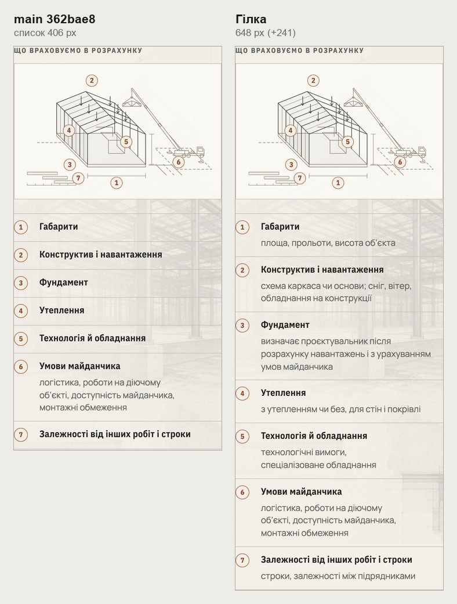
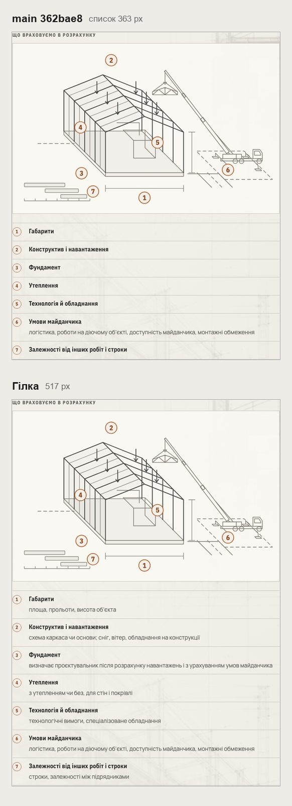
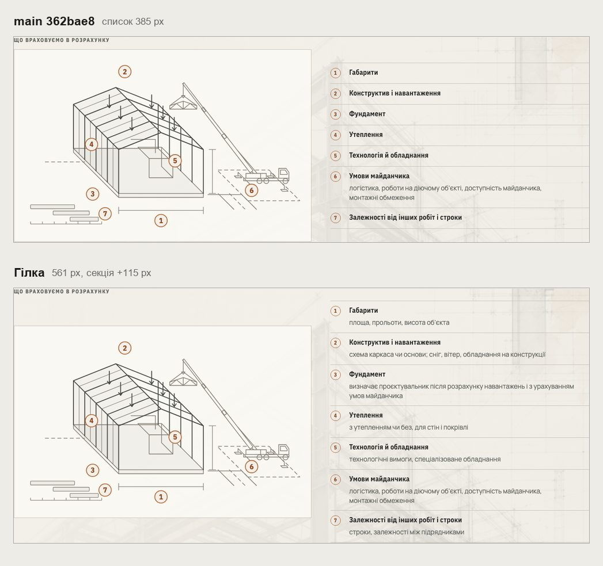
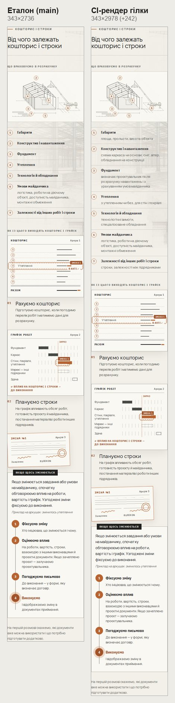
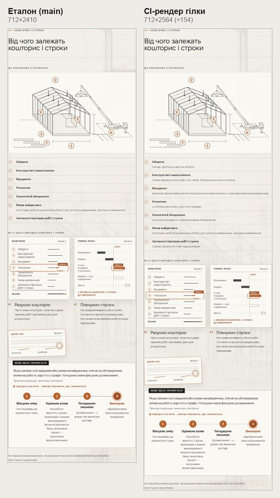
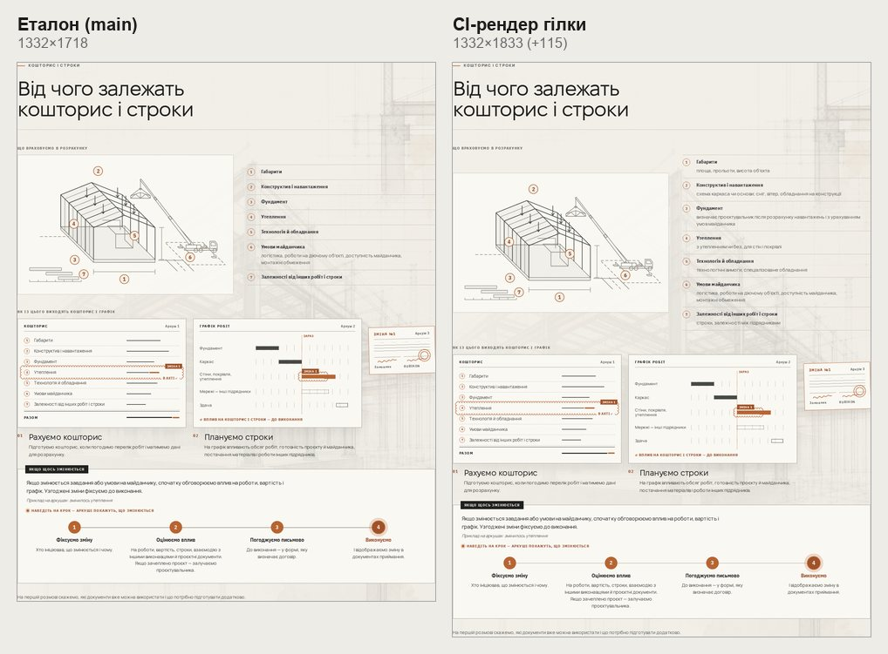

# Handoff · Рядок під кожним чинником вартості: /angary і /yak (W2-01: PDO-12 A)

| | |
|---|---|
| Дата | 2026-10-24 |
| Виконавець | Claude Code |
| Підстава | Рішення власника 24.10: PDO-12 A, «merge рядків чинників — після погляду Сергія». Того ж дня — /yak: «додай загальні рядки для /yak у #235 (через costFactors(), /angary зі своїми рядками)». Крок W2-01 дорожньої карти. Бриф з варіантами: Рішення W2-01 (artifact) |
| PR | Draft. **Merge — лише після технічного погляду Сергія Івановича на рядки (OD-PX-43, п. 6) і окремого OK Дмитра** (DEC-30) |
| Гілка / base | `design/angary-cost-lines` від `main` `362bae8`. Незалежна від PR маршруту (#234, PDO-11): інші файли |
| Коміти | **`f40b5e8`** — рядки /angary і тест · **`1696bbb`** — тест нотаток · **`7b88fbb`** — загальні рядки (/yak) · цей handoff |
| Змінено | `app/lib/deliveryModelPresentation.ts` — `costFactors()` має загальні рядки; `app/angary/page.tsx` — рядки для ангара. Тести: новий `tests/e2e/angary-cost-lines.spec.ts`; `angary-configurator-data.spec.ts` — тест нотаток дивиться на самі нотатки; `tests/unit/delivery-page-presentation.test.ts` — рядок у кожного чинника |
| Не змінено | Назви й порядок чинників; креслення чинників; нотатки конфігурації; аркуші «Кошторис» і «Графік робіт» на /yak (беруть лише назви) |

## Що зроблено

- **Рядки.** Кожен із семи чинників тепер має рядок про те, що він охоплює. Раніше шість чинників стояли самими назвами, і один довгий рядок серед коротких виглядав як помилка верстки.
- **Два набори.** Спільний `costFactors()` дає загальні рядки, придатні для всіх напрямів: їх показує /yak. /angary замінює п’ять із них рядками для ангара. «Умови майданчика» і «Залежності» на обох сторінках називають свої чинники з Delivery Model.

**/angary** — словами, які сторінка вже каже:

| Чинник | Рядок | Де ці слова вже є на /angary |
|---|---|---|
| Габарити | довжина, ширина, висота стін і в конику | Конфігуратор, крок «Габарити»: Ширина, Довжина, Висота стін, Висота в конику |
| Конструктив і навантаження | проліт без колон чи з рядом колон, сніг, вітер, кран-балка | Конфігуратор, «Каркас»: «Так, без колон», «Ряд колон посередині ділить ширину на два прольоти», «Буде кран-балка або тельфер?». Сніг і вітер — тур каркаса конфігуратора |
| Фундамент | визначає проєктувальник після розрахунку навантажень і з урахуванням умов майданчика | Примітка конфігуратора: «Конструкцію й фундамент визначає проєктувальник після розрахунку навантажень з урахуванням умов майданчика» |
| Утеплення | профнастил чи сендвіч-панель для стін і покрівлі | Конфігуратор, «Стіни й ворота»: «Без утеплення — профнастил», «Утеплений — сендвіч-панель», окремо стіни й покрівля |
| Технологія й обладнання | ворота, двері, спеціалізоване обладнання | Конфігуратор: «Ворота й двері». «Спеціалізоване обладнання» — назва чинника в Delivery Model |
| Умови майданчика | логістика, роботи на діючому об’єкті, доступність майданчика, монтажні обмеження | Спільний рядок: назви чинників у Delivery Model |
| Залежності від інших робіт і строки | строки, залежності між підрядниками | Спільний рядок: назви чинників у Delivery Model |

**/yak-pratsyuiemo** — загальні, бо сторінка описує всі роботи (метал, бетон, покрівлю, зерносховища, ангари):

| Чинник | Рядок | Звідки |
|---|---|---|
| Габарити | площа, прольоти, висота об’єкта | Новий загальний текст |
| Конструктив і навантаження | схема каркаса чи основи; сніг, вітер, обладнання на конструкції | Новий загальний текст |
| Фундамент | визначає проєктувальник після розрахунку навантажень і з урахуванням умов майданчика | Те саме правило, що в примітці конфігуратора |
| Утеплення | з утепленням чи без, для стін і покрівлі | Новий загальний текст |
| Технологія й обладнання | технологічні вимоги, спеціалізоване обладнання | Delivery Model: «Технологічні вимоги» (вихідні дані) і «Спеціалізоване обладнання» (чинник) |
| Умови майданчика | логістика, роботи на діючому об’єкті, доступність майданчика, монтажні обмеження | Як був |
| Залежності від інших робіт і строки | строки, залежності між підрядниками | Назви чинників у Delivery Model |

- **Висота /angary.** 390: список 406 → 648 px (+242), рядки 74–117 px. 1440: секція +41 px, список став завдовжки з креслення поруч.
- **Висота /yak.** 390: список 406 → 648 px (+241), сторінка 12,89 → 13,17 екрана. 320: +307 px. 768: +154 px, усі рядки по 74 px. 1440: секція +115 px. На 1440 малюнок /yak (без штампа) нижчий за список, тож стоїть посередині з повітрям згори й знизу.
- **Нотатки (/angary).** Коли відвідувач щось вибрав у конфігураторі, нотатка «У вашій конфігурації: …» стоїть під рядком. Рядок каже, що враховується, нотатка — значення відвідувача.
- **Старі пояснення** з `directionPages.ts` (із застарілим «холодний контур») не використано.

## Для технічного погляду

- **/angary.** П’ять рядків для ангара (Габарити, Конструктив, Фундамент, Утеплення, Технологія) — у першій таблиці.
- **/yak.** Рядки 1, 2 і 4 другої таблиці — новий загальний текст.
- **Що підтвердити.** Кожен пункт справді впливає на вартість, і в рядку немає зайвого чи хибного. Якщо рядок треба змінити, правка — один рядок коду в цьому PR.

## До / після

Локальний production build `main` `362bae8` і гілки, Chromium.

## Перевірка

| Що | Результат |
|---|---|
| `angary-cost-lines` (новий) — desktop-chromium + mobile-chromium | 3 passed, 3 skipped |
| `delivery-page-presentation` (vitest) | 27 passed; новий тест: рядок у кожного з семи чинників, «Умови майданчика» і «Залежності» називають свої чинники з моделі |
| 15 специфікацій: `angary-cost-lines`, `angary-editorial`, `angary-configurator-data`, `cost-factors`, `action-on-graphite`, `words-whole`, `yak-format-switch`, `yak-formats-scope`, `yak-pro-nas-touch`, `shorter-pro-nas-yak`, `phase3-shorter-pages`, `heading-scale`, `responsive-a11y-phase1`, `pr-critical`, `smoke` | 334 passed, 112 skipped |
| До /yak: `configurator-phase4-inquiry`, `inquiry-brief-handoff`, `configurator-inquiry-handoff`, `angary-interactive` | 113 passed, 49 skipped |
| `tsc`, `eslint` | чисто |
| CI | у коментарі PR |

Що перевіряє `angary-cost-lines.spec.ts`:

- **/angary, 390 і 1440.** Сім чинників, у кожного свій рядок для ангара, і він видимий.
- **/angary, 1440.** Після ширини 12 м у конфігураторі нотатка «У вашій конфігурації: 12 × 60 × 8 м, коник…» стоїть під рядком «Габарити».
- **/yak-pratsyuiemo, 390 і 1440.** Сім чинників, у кожного свій загальний рядок.

**Правка `angary-configurator-data:130`.** Тест «нотатки кажуть лише про те, що відвідувач вибрав» перевіряв, що в усьому списку вартості немає «профнастил», поки утеплення ніхто не вибирав. Тепер це слово стоїть у рядку «Утеплення» за будь-якого вибору. Тест дивиться на самі нотатки (`.cf-note`), пробіли нормалізовано, як у `toContainText`. Перевірка не послаблена: нотатка про невибране утеплення, ворота чи «Ви вказали» так само його провалить. На `main` тест теж проходить.

## Еталони (DEC-18)

Оновлено 24.10 з OK Дмитра: п’ять Linux-рендерів з CI `40074060231` (`process-terms-*` ×3, `direction-faq-mobile-375`, `direction-faq-tablet-768`), мітка `visual-freeze`.

- **/yak, `process-terms-mobile-375`, `process-terms-tablet-768`, `process-terms-desktop-1440`** (`#koshtorys`). Змінюються по суті: у списку чинників з’являються рядки.
  - **Рендери.** Main Regression `40074060231` (`36b95de`), Main visual (2/2). 375: 343 × 2736 → 2978 (+242). 768: 712 × 2410 → 2564 (+154). 1440: 1332 × 1718 → 1833 (+115).
  - **Стабільність.** Однакові в трьох спробах. Очікувані PNG збігаються з файлами в репозиторії.
  - **Що поза списком.** До списку чинників на 375 кадр той самий до пікселя. Нижче аркуші й процедура ті самі, зсунуті на 241,5 px. Через пів пікселя змінилося згладжування літер. На 768 і 1440 фото-тло секції масштабується разом із її висотою.

- **FAQ /angary, `direction-faq-mobile-375` і `direction-faq-tablet-768`.** Main Regression `40072448187` (до /yak), Main visual (2/2): 6533 і 8165 px (3 %), однаково в усіх спробах. У `40074060231` рендери ті самі (ті самі sha256).
  - **Зміст той самий.** Секція вартості стоїть над FAQ і стає вищою на дробову кількість пікселів. Вміст FAQ лягає на інший субпіксель: на 375 приблизно на пів пікселя нижче, на 768 вище. Різниця — лише згладжування ліній і літер.
  - **Інші дані.** Розмір кадрів той самий. Очікувані PNG збігаються з файлами в репозиторії. Рендери стабільні (sha256 `6be01fb31cd5…`, `393428316efb…`).
  - **Разом із #234.** #234 змінює `direction-faq-mobile-375` з тієї самої причини, тож після merge першого з двох PR рендер для другого треба зняти заново.

## Відкат

`git revert 7b88fbb 1696bbb f40b5e8`.
