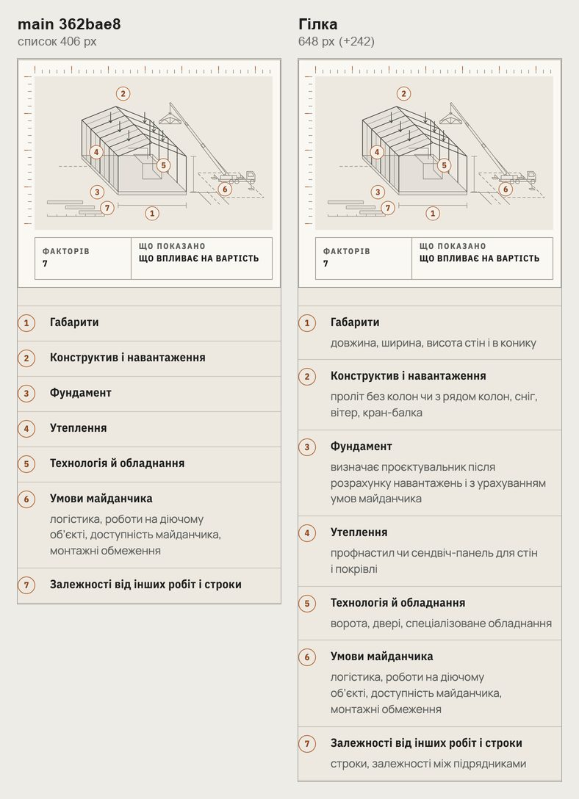
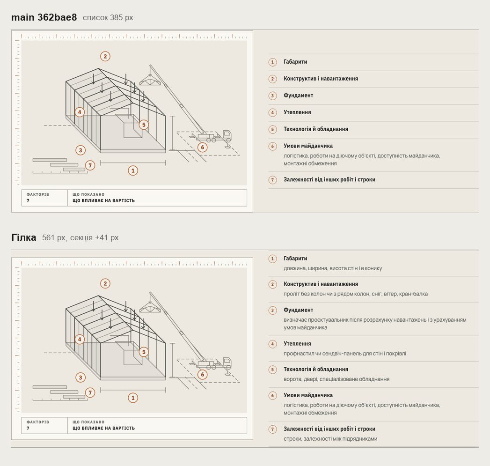
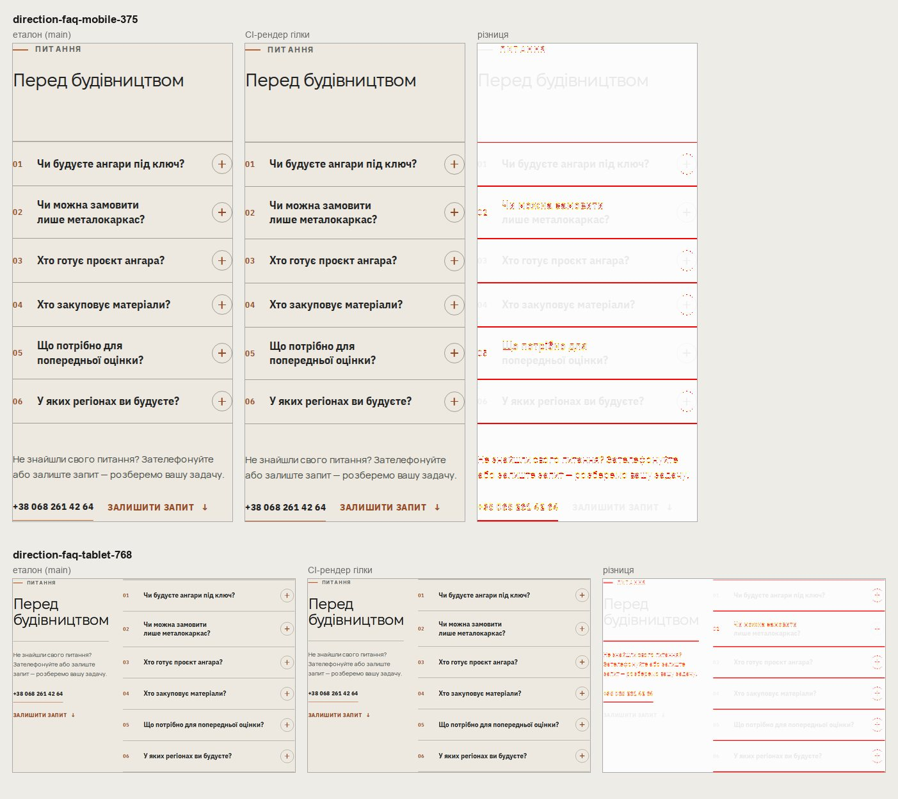

# Handoff · /angary: рядок під кожним чинником вартості (W2-01: PDO-12 A)

| | |
|---|---|
| Дата | 2026-10-24 |
| Виконавець | Claude Code |
| Підстава | Рішення власника 24.10: PDO-12 A, «merge рядків чинників — після погляду Сергія». Крок W2-01 дорожньої карти. Бриф з варіантами: Рішення W2-01 (artifact) |
| PR | Draft. **Merge — лише після технічного погляду Сергія Івановича на шість рядків (OD-PX-43, п. 6) і окремого OK Дмитра** (DEC-30) |
| Гілка / base | `design/angary-cost-lines` від `main` `362bae8`. Незалежна від PR маршруту (PDO-11): інший файл |
| Коміти | **`f40b5e8`** — код і тест · **`1696bbb`** — тест нотаток · цей handoff |
| Змінено | `app/angary/page.tsx` — мапа рядків лише для /angary. Тести: новий `tests/e2e/angary-cost-lines.spec.ts`; `angary-configurator-data.spec.ts` — тест нотаток дивиться на самі нотатки |
| Не змінено | `costFactors()` і список вартості на /yak; креслення чинників; нотатки конфігурації |

## Що зроблено

- **Рядки.** Кожен із семи чинників тепер має рядок про те, що він охоплює. Шість рядків нові, «Умови майданчика» — як був. Раніше шість чинників стояли самими назвами, і один довгий рядок серед коротких виглядав як помилка верстки.
- **Слова.** Нових фактів немає: усі слова вже є на /angary, у конфігураторі або в Delivery Model.

| Чинник | Рядок | Де ці слова вже є на /angary |
|---|---|---|
| Габарити | довжина, ширина, висота стін і в конику | Конфігуратор, крок «Габарити»: Ширина, Довжина, Висота стін, Висота в конику |
| Конструктив і навантаження | проліт без колон чи з рядом колон, сніг, вітер, кран-балка | Конфігуратор, «Каркас»: «Так, без колон», «Ряд колон посередині ділить ширину на два прольоти», «Буде кран-балка або тельфер?». Сніг і вітер — тур каркаса конфігуратора |
| Фундамент | визначає проєктувальник після розрахунку навантажень і з урахуванням умов майданчика | Примітка конфігуратора: «Конструкцію й фундамент визначає проєктувальник після розрахунку навантажень з урахуванням умов майданчика» |
| Утеплення | профнастил чи сендвіч-панель для стін і покрівлі | Конфігуратор, «Стіни й ворота»: «Без утеплення — профнастил», «Утеплений — сендвіч-панель», окремо стіни й покрівля |
| Технологія й обладнання | ворота, двері, спеціалізоване обладнання | Конфігуратор: «Ворота й двері». «Спеціалізоване обладнання» — назва чинника в Delivery Model |
| Умови майданчика | логістика, роботи на діючому об’єкті, доступність майданчика, монтажні обмеження | Без змін (спільне правило `costFactors()`) |
| Залежності від інших робіт і строки | строки, залежності між підрядниками | Назви чинників у Delivery Model |

- **Де.** Мапа в `app/angary/page.tsx`. Спільний `costFactors()` не змінено, тому на /yak список як був. Старі пояснення з `directionPages.ts` (із застарілим «холодний контур») не використано.
- **Висота.** 390: список 406 → 648 px (+242), рядки 74–117 px. 1440: секція +41 px, список став завдовжки з креслення поруч.
- **Нотатки.** Коли відвідувач щось вибрав у конфігураторі, нотатка «У вашій конфігурації: …» стоїть під рядком. Рядок каже, що враховується, нотатка — значення відвідувача.

## Для технічного погляду

Шість нових рядків — у таблиці вище. Що підтвердити: кожен пункт справді впливає на вартість ангара, і в рядку немає зайвого чи хибного. Якщо рядок треба змінити, правка займе один рядок мапи в цьому PR.

## До / після

Локальний production build `main` `362bae8` і гілки, Chromium.

## Перевірка

| Що | Результат |
|---|---|
| `angary-cost-lines` (новий) — desktop-chromium + mobile-chromium | 3 passed, 3 skipped. На `main` два тести з трьох падають: рядків немає |
| 10 специфікацій: `angary-cost-lines`, `angary-editorial`, `angary-configurator-data`, `cost-factors`, `action-on-graphite`, `words-whole`, `yak-format-switch`, `yak-formats-scope`, `pr-critical`, `smoke` | 261 passed, 70 skipped, 1 failed — `angary-configurator-data:130` (нижче); після правки 10 з 10 passed |
| `configurator-phase4-inquiry`, `inquiry-brief-handoff`, `configurator-inquiry-handoff`, `angary-interactive` | 113 passed, 49 skipped |
| `tsc`, `eslint` | чисто |
| CI | у коментарі PR |

Що перевіряє `angary-cost-lines.spec.ts`:

- **/angary, 390 і 1440.** Сім чинників, у кожного свій рядок, і він видимий.
- **/angary, 1440.** Після ширини 12 м у конфігураторі нотатка «У вашій конфігурації: 12 × 60 × 8 м, коник…» стоїть під рядком «Габарити».
- **/yak-pratsyuiemo.** Спільний список як був: рядок лише під «Умови майданчика».

**Правка `angary-configurator-data:130`.** Тест «нотатки кажуть лише про те, що відвідувач вибрав» перевіряв, що в усьому списку вартості немає «профнастил», поки утеплення ніхто не вибирав. Тепер це слово стоїть у рядку «Утеплення» за будь-якого вибору. Тест дивиться на самі нотатки (`.cf-note`), пробіли нормалізовано, як у `toContainText`. Перевірка не послаблена: нотатка про невибране утеплення, ворота чи «Ви вказали» так само його провалить. На `main` тест теж проходить.

## Еталони (DEC-18)

Зміняться два, обидва — FAQ /angary: `direction-faq-mobile-375` і `direction-faq-tablet-768`. Main Regression `40072448187`, Main visual (2/2): 6533 і 8165 px (3 %), однаково в усіх спробах.

- **Зміст той самий.** Секція вартості стоїть над FAQ і стає вищою на дробову кількість пікселів. Вміст FAQ лягає на інший субпіксель: на 375 приблизно на пів пікселя нижче, на 768 вище. Різниця — лише згладжування ліній і літер.
- **Інші дані.** Розмір кадрів той самий. Очікувані PNG збігаються з файлами в репозиторії. Рендери стабільні (sha256 `6be01fb31cd5…`, `393428316efb…`).
- **Еталони не оновлено.** Оновлю їх Linux-рендерами з CI лише з OK Дмитра.
- **Разом із #234.** #234 змінює `direction-faq-mobile-375` з тієї самої причини, тож після merge першого з двох PR рендер для другого треба зняти заново.

/yak не змінено.

## Відкат

`git revert f40b5e8`.
