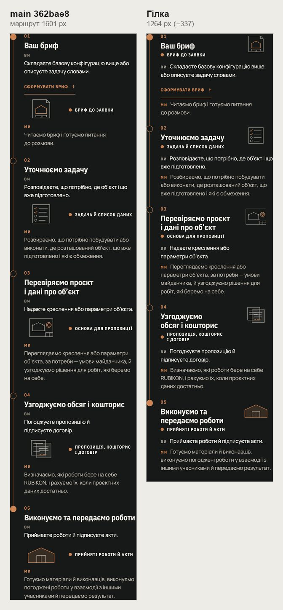
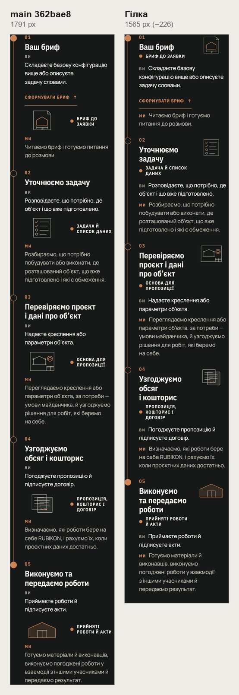
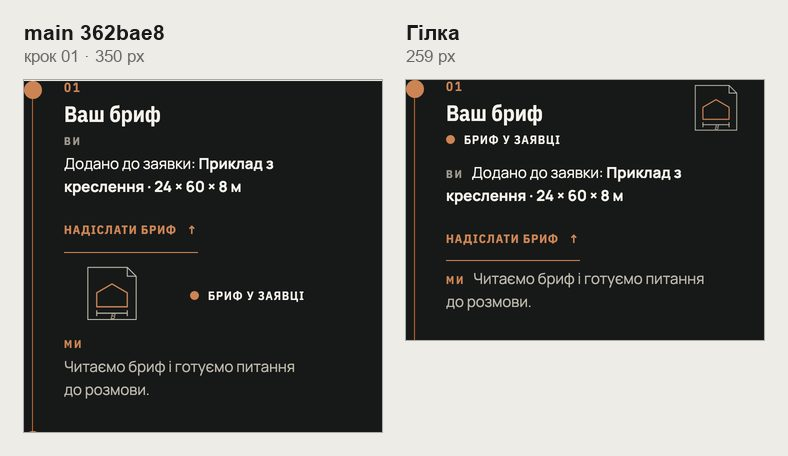

# Handoff · /angary: маршрут «Ви · Ми» на телефоні — як на інших напрямах (W2-01: PDO-11 A)

| | |
|---|---|
| Дата | 2026-10-24 |
| Виконавець | Claude Code |
| Підстава | Рішення власника 24.10: PDO-11 A. Крок W2-01 дорожньої карти. Бриф з варіантами: Рішення W2-01 (artifact) |
| PR | Draft. **Merge і production deploy — лише з окремого OK Дмитра** (DEC-30) |
| Гілка / base | `design/angary-route-phone` від `main` `362bae8`. Незалежна від PR рядків чинників вартості (PDO-12): інший файл, мержиться окремо |
| Коміти | **`7743ef4`** — код і тест · цей handoff |
| Змінено | `app/components/directions/process-split.css` — вісім правил телефонної розкладки. Тест: новий `tests/e2e/angary-route-phone.spec.ts` |
| Не змінено | Тексти й креслення маршруту; /angary від 761 px; «Ви · Ми» на металі, бетоні, покрівлі, зерні й /yak |

## Що зроблено

- **Розкладка.** До 760 px маршрут /angary має ту саму розкладку, що й інші напрями з #181: креслення кроку 96 × 60 поруч із назвою й результатом, «Ви» і «Ми» на початку своїх рядків. Раніше /angary виключали `:not(.angary-route)` у восьми правилах.
- **Крок 01.** «Сформувати бриф ↑» лишається під реченням «Ви», 145 × 44 px. З прикріпленим брифом «Надіслати бриф ↑» — 134 × 44. Ні дія, ні слова кроку не заходять на креслення.
- **Висота маршруту.** 390: 1601 → 1264 px (−337). 320: 1791 → 1565 (−226). Секція «Від брифу до об’єкта» на 390: 2591 → 2255. Сторінка на 390: 12,95 → 12,56 екрана.
- **Селектор.** Замість `:not(.angary-route)` — подвоєний клас `.process-split.process-split` з тією самою вагою. Без нього правило `li:last-child` з блоку ≤1050 px забрало б в останнього кроку 26 px знизу на всіх сторінках.

## До / після

Локальний production build `main` `362bae8` і гілки, Chromium, reduced motion.

## Перевірка

| Що | Результат |
|---|---|
| `angary-route-phone` (новий) — desktop-chromium + mobile-chromium | 3 passed, 3 skipped. На CSS з `main` перший тест падає: креслення стоїть окремим рядком |
| Обчислені стилі й рамки кожного елемента «Ви · Ми», `main` проти гілки: метал, бетон, покрівля, зерно, /yak на 320, 390, 760, 761, 1024, 1440 | 0 відмінностей. /angary від 761 px — теж 0 |
| 12 специфікацій: `angary-route-phone`, `angary-editorial`, `angary-interactive`, `configurator-phase4-inquiry`, `configurator-inquiry-handoff`, `inquiry-brief-handoff`, `phase3-shorter-pages`, `direction-phone-template`, `words-whole`, `responsive-a11y-phase1`, `pr-critical`, `smoke` | 374 passed, 130 skipped |
| `tsc`, `eslint` | чисто |
| CI | у коментарі PR |

Що перевіряє `angary-route-phone.spec.ts`:

- **320 і 390.** П’ять кроків. У кожному креслення праворуч від назви, на її висоті; «Ви» і «Ми» в рядку (inline); усі тексти видно; креслення в межах колонки; горизонтальної прокрутки немає.
- **390, крок 01.** Дія щонайменше 44 px заввишки, у межах «Ви», і разом зі словами кроку не заходить на креслення. До і після «Обговорити цю конфігурацію»: бриф прикріплено, нічого не надсилається.
- **761 і 768.** Креслення окремим рядком під «Ви», «Ви» і «Ми» над своїми рядками.

## Еталони (DEC-18)

Не змінюються. На /angary visual.spec знімає лише FAQ, а інші сторінки не зрушили (замір вище).

## Відкат

`git revert 7743ef4`.
