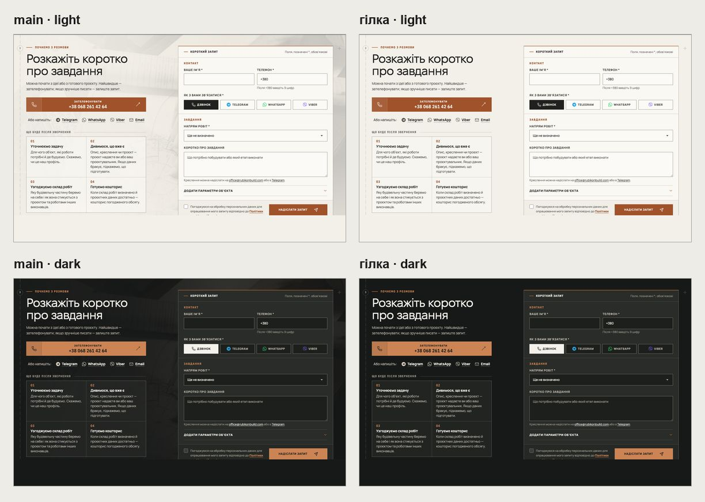
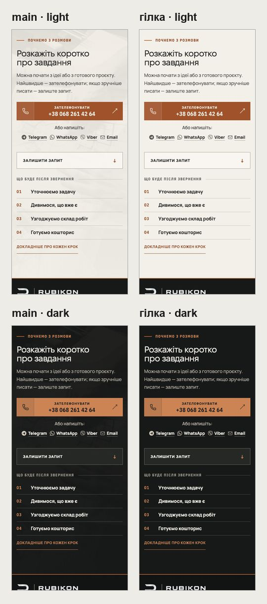
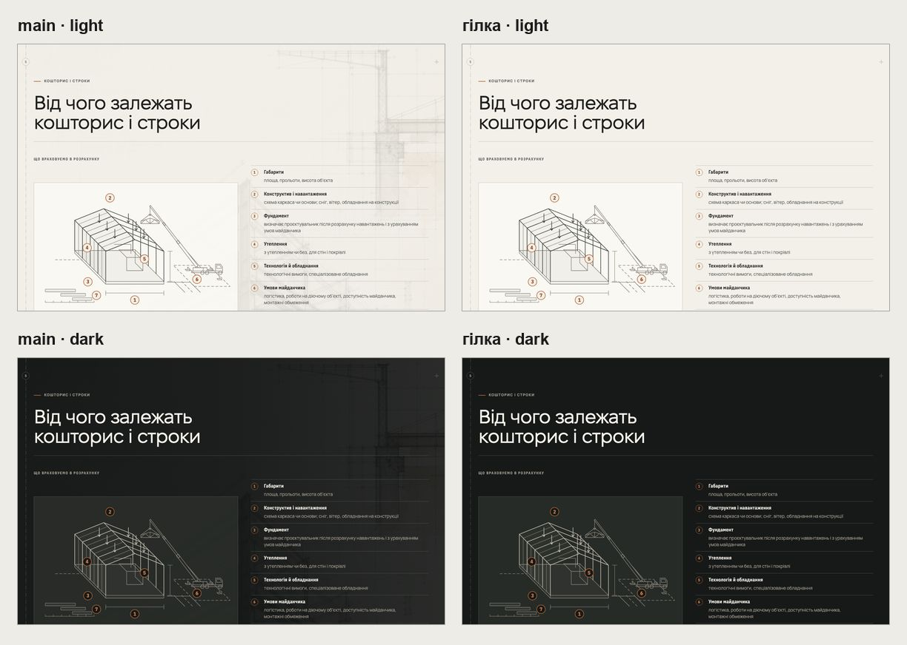
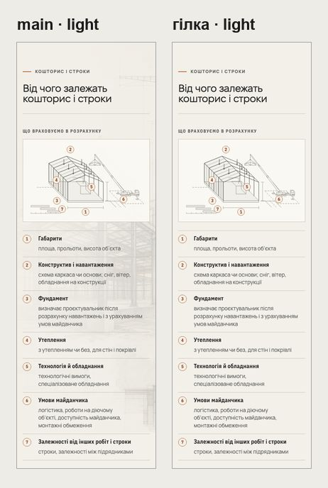

# Handoff · Без фонових зображень під формою й за «Кошторисом» (W2-17: PDO-92 B)

| | |
|---|---|
| Дата | 2026-10-24 |
| Виконавець | Claude Code |
| Підстава | Рішення власника 24.10: «W2-17 за варіантом B (OD-PX-29 b без сітки): прибрати фон форми й „Кошторису“, невживані conversation-bg-* видалити». Бриф з варіантами: Рішення W2-17 (artifact) |
| PR | Draft. **Merge і production deploy — лише з окремого OK Дмитра** (DEC-30) |
| Гілка / base | `design/decor-backgrounds` від `main` `84a2fcc` |
| Коміти | **`7e0ad2b`** — код, тест, видалені файли · цей handoff |
| Змінено | `app/components/ConversationSection.tsx`, `app/conversation.css` (фон форми), `app/yak-pratsyuiemo/page.tsx`, `app/yak-pratsyuiemo/delivery.css` («Кошторис»), `scripts/generate-home-v2-crops.py`. Видалено `public/media/home-v2/conversation-bg-{960w,1600w,portrait-720w}.webp`. Тест: новий `tests/e2e/decor-backgrounds.spec.ts` |
| Не змінено | Зміст і креслення секцій; поля аркуша (`sheet-field.css`); `about-industrial-concept.jpg` (OG для /yak і /pro-nas) |

## Що зроблено

- **Форма (усі сторінки з формою).** Під «Розкажіть коротко про завдання» більше немає кадру стокового кліпу (руки на кресленні). Секція тепер на тлі сторінки: папір у світлій темі, графіт у темній.
- **«Кошторис і строки» на /yak.** За блоком більше немає AI-акварелі. Вона змагалася з власним кресленням блоку.
- **Чому так.** Так записано в правилі сайту (`sheet-field.css`): декор лише на полях аркуша, ніколи під змістом. Ці два фони були останніми винятками.
- **Вага.** На кожній сторінці з формою −51 КБ на телефоні й −111 КБ на десктопі. На /yak ще −241 КБ.
- **Файли.** Три `conversation-bg-*` (разом 212 КБ) видалено. Їх прибрано й з генератора кропів, щоб вони не повернулися. `about-industrial-concept.webp` і його адаптивні варіанти лишилися: їх веде генерований маніфест, а прибирання невживаних медіа — окремий крок (W5-04).
- **Контраст.** Мідна мітка «Почнемо з розмови» на телефоні раніше стояла на темніших сірих тонах фото. Тепер вона на рівному тлі, тож контраст лише вищий.

## До / після

Локальний production build `main` `84a2fcc` і гілки, Chromium.

## Перевірка

| Що | Результат |
|---|---|
| `decor-backgrounds` (новий) — desktop-chromium + mobile-chromium | 3 passed, 3 skipped |
| 14 специфікацій: `decor-backgrounds`, `smoke`, `pr-critical`, `form`, `first-contact`, `consent`, `ux-conversion-phase2`, `shorter-pro-nas-yak`, `yak-format-switch`, `yak-formats-scope`, `yak-pro-nas-touch`, `responsive-a11y-phase1`, `heading-scale`, `words-whole` | 375 passed, 77 skipped, 2 failed — обидва падають і на `main` після #243 (нижче) |
| `tsc`, `eslint`, перевірка Google-маршрутів у spec | чисто |
| CI | у коментарі PR |

Що перевіряє `decor-backgrounds.spec.ts`: на `/` (форма) і на `/yak-pratsyuiemo` (форма й «Кошторис»), на 390 і 1440:

- у секції немає елементів фону;
- тло секції дорівнює тлу сторінки;
- жодного запиту до `conversation-bg-*` чи `about-industrial-concept.webp`, навіть коли секція в полі зору.

**Падіння, що не належать цьому PR.** На `main` `84a2fcc` (після #243 «єдиний підхід до hero») Main Regression червоний на трьох перевірках, і вони так само впадуть тут:

- `responsive-a11y-phase1:281` — колір крихт над телефонним героєм `/napryamky`;
- `smoke:124` — «/napryamky renders its critical shell» (статична послідовність героя);
- еталон `homepage-hero-mobile-375`.

Цей PR героя не чіпає.

## Еталони (DEC-18)

Не оновлено. Зміняться `homepage-inquiry-*` (3) і `process-terms-*` (3). Linux-рендери з CI — власнику до оновлення.

## Відкат

`git revert 7e0ad2b`.
