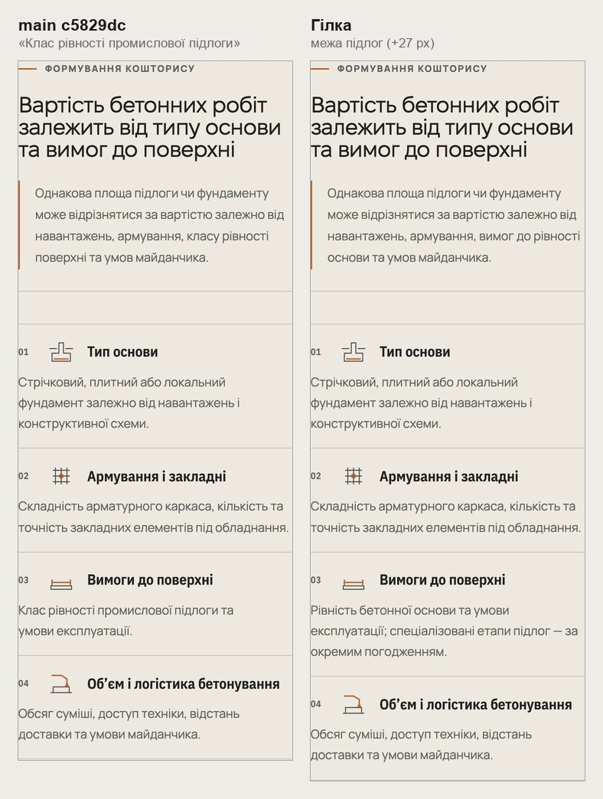
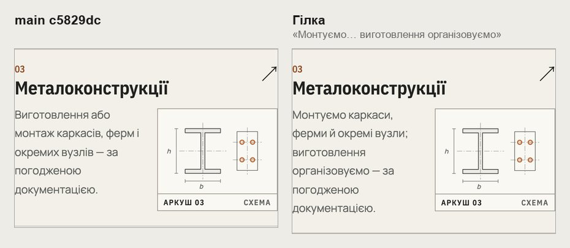
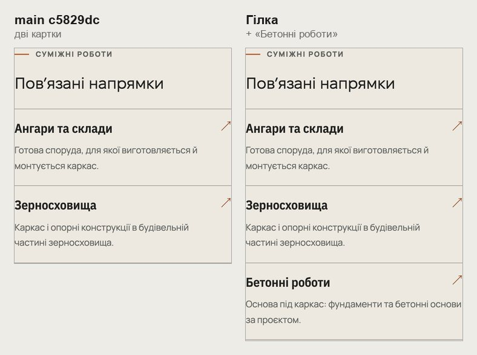
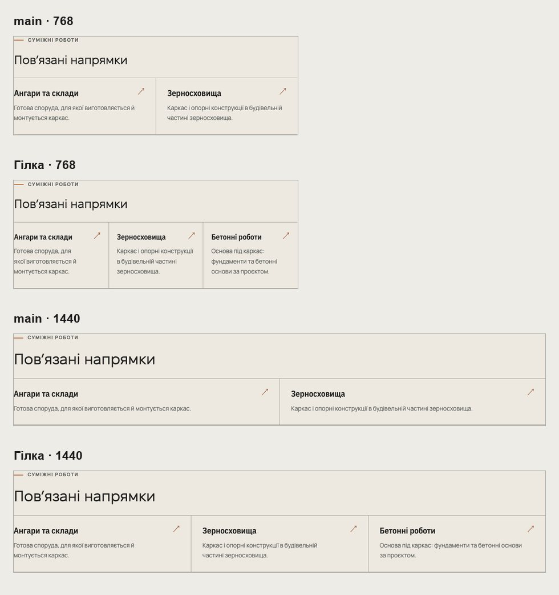
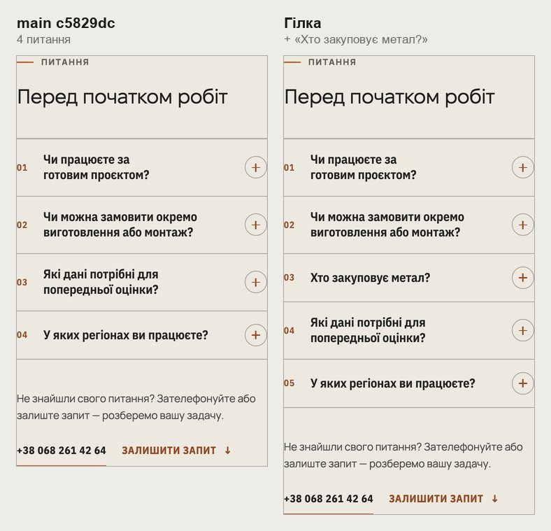
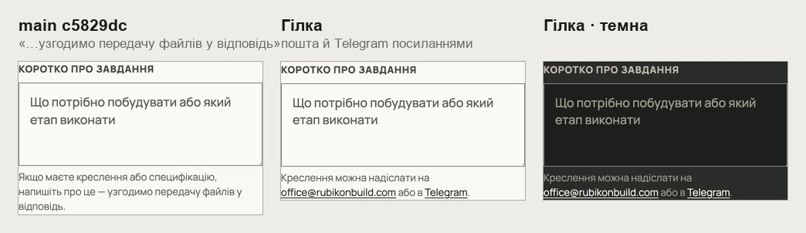

# Handoff · Тексти напрямів і підказка форми (W2-04: PDO-33, PDO-66, PDO-67, PDO-31)

| | |
|---|---|
| Дата | 2026-10-24 |
| Виконавець | Claude Code |
| Підстава | Рішення власника 24.10 (OD-PX-39): «давай як ти і запропонував» — PDO-33 A, PDO-66, PDO-67 (картка й питання), PDO-31 A′. Бриф з варіантами: Рішення W2-04 (artifact) |
| PR | Draft. **Merge і production deploy — лише з окремого OK Дмитра** (DEC-30). Два рядки (межа підлог у бетоні, відповідь «Хто закуповує метал?») реєстр ставив на технічний погляд Сергія Івановича (OD-PX-43, п. 3 і 7): обидва — вже погоджені й опубліковані слова |
| Гілка / base | `design/direction-texts` від `main` `c5829dc` |
| Коміти | **`83b0bb6`** — тексти, підказка й тести · **`d7ee3eb`** — локатори способу відповіді в `form.spec` і `visual.spec` · цей handoff |
| Змінено | `app/data/directionPages.ts` (вартість бетону, FAQ металу), `app/data/directions.ts` (рядок металу на хабі), `app/data/relatedDirections.ts` (бетон у «Пов’язаних» металу), `app/components/ProjectInquiryForm.tsx` (підказка поля), `app/globals.css` (посилання в підказці). Тести: новий `tests/e2e/direction-texts.spec.ts`; `tests/unit/public-service-claims.test.ts` — межа підлог; `form.spec.ts`, `visual.spec.ts` — локатори |
| Не змінено | Форма й надсилання; HOME; картка металу на HOME; покрівля в «Пов’язаних»; політика конфіденційності |

## Що зроблено

Нових фактів немає: кожен рядок — це слова, які вже є на сайті.

| Де | Було | Стало | Звідки слова |
|---|---|---|---|
| /betonni-roboty, вартість, пункт 03 | Клас рівності промислової підлоги та умови експлуатації. | Рівність бетонної основи та умови експлуатації; спеціалізовані етапи підлог — за окремим погодженням. | Рядок бетону на хабі (погоджено 15.10) |
| /betonni-roboty, вартість, підзаголовок | …армування, класу рівності поверхні та умов майданчика. | …армування, вимог до рівності основи та умов майданчика. | Те саме |
| /napryamky, рядок металу | Виготовлення або монтаж каркасів, ферм і окремих вузлів — за погодженою документацією. | Монтуємо каркаси, ферми й окремі вузли; виготовлення організовуємо — за погодженою документацією. | HOME і /metalokonstruktsii: «організовуємо виготовлення й монтуємо» |
| /metalokonstruktsii, «Пов’язані напрямки» | Ангари, Зерносховища | + Бетонні роботи: «Основа під каркас: фундаменти та бетонні основи за проєктом.» | Той самий рядок на /angary |
| /metalokonstruktsii, FAQ, третій пункт | — | Хто закуповує метал? — Матеріали закуповує RUBIKON або надає замовник — залежно від договору. | Delivery Model, `statements.materials` (на /angary — «Хто закуповує матеріали?») |
| Поле «Коротко про завдання», підказка (усі форми) | Якщо маєте креслення або специфікацію, напишіть про це — узгодимо передачу файлів у відповідь. | Креслення можна надіслати на office@rubikonbuild.com або в Telegram. | Контакти компанії |

- **Посилання в підказці.** Пошта — `mailto:`, Telegram — те саме посилання, що в шапці, у новій вкладці. Обидва мають `data-contact-method` (`email`, `telegram`), тож дають `contact_click`. Значення `email` в аналітиці нове: пошта в шапці його не має. Колір тексту, підкреслення, мідь при наведенні.
- **Межа підлог у тестах.** `public-service-claims.test.ts` тепер блокує «клас рівності» в публічних текстах.
- **Висота на телефоні (390).** Метал 10,54 → 10,77 екрана (картка +127 px, питання +69 px). Бетон +27 px. Хаб +8 px. Підказка на 19 px коротша, ніж була.

## До / після

Локальний production build `main` `c5829dc` і гілки, Chromium.

## Перевірка

| Що | Результат |
|---|---|
| `direction-texts` (новий) — desktop-chromium + mobile-chromium | 5 passed, 5 skipped |
| 20 специфікацій: `direction-texts`, `consent`, `direction-editorial-rhythm`, `direction-node`, `direction-phone-template`, `direction-route-cards`, `direction-tablet-template`, `editorial-focus`, `first-contact`, `form`, `heading-scale`, `inquiry-brief-handoff`, `napryamky-key-plan`, `napryamky-row-sheets`, `phase3-shorter-pages`, `pr-critical`, `public-service-claims`, `responsive-a11y-phase1`, `smoke`, `words-whole` | 404 passed, 81 skipped, 31 failed — усі в `form.spec` (локатор, нижче); після виправлення `form.spec` 52 з 52 passed |
| `vitest` | 1442 passed (з межею підлог і перевіркою Google-маршрутів у новому spec) |
| `tsc`, `eslint` | чисто |
| CI | у коментарі PR |

**Локатори `form.spec` і `visual.spec`.** Обидва вибирали спосіб відповіді через `form.getByText('Telegram')`. Тепер слово «Telegram» є й у посиланні підказки, тож пошук обмежено групою «Контакт», де стоять перемикачі. Перевірка не послаблена: далі перевіряється, що вибрано саме перемикач «Telegram».

Що перевіряє `direction-texts.spec.ts`:

- **/betonni-roboty.** У вартості є межа підлог і «вимог до рівності основи», «клас рівності» немає.
- **/napryamky.** Рядок металу.
- **/metalokonstruktsii, 390, 768 і 1440.** Три картки, третя — «Бетонні роботи» з рядком. Від 761 px картки в одному ряду.
- **/metalokonstruktsii, FAQ.** Третє питання «Хто закуповує метал?», відповідь Delivery Model. Питання є й у FAQ-розмітці для пошуку (JSON-LD).
- **Підказка, 1440.** Текст, `mailto:` і `t.me` у новій вкладці. Клік по пошті й Telegram дає `contact_click` з `email` і `telegram`: аналітика дозволена, але кожен Google-запит отримує порожню відповідь, тож тег не завантажується, а переходи за посиланнями заблоковані.

## Еталони (DEC-18)

Не оновлено. Зміниться `direction-cost-*` (375, 768, 1440): visual.spec знімає саме цей блок бетону. Можуть змінитися `directions-hub-*` і `homepage-inquiry-*`. Linux-рендери з CI — власнику до оновлення.

## Відкат

`git revert d7ee3eb 83b0bb6`.
