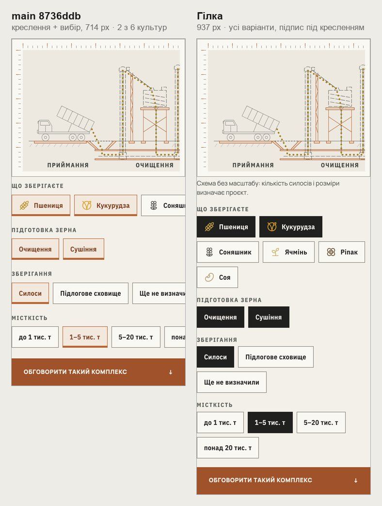
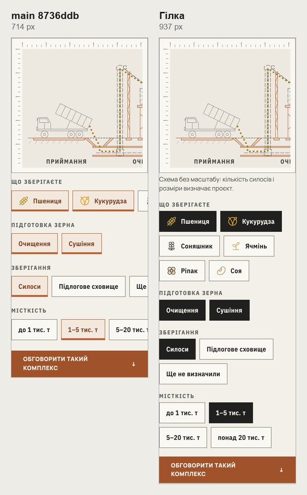
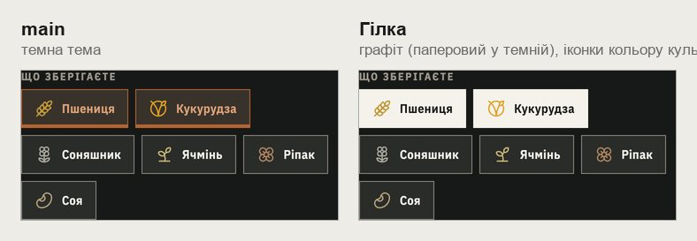
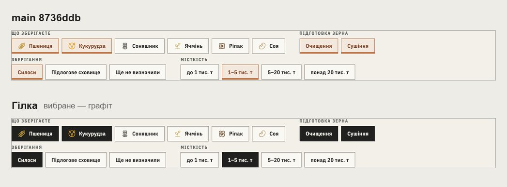
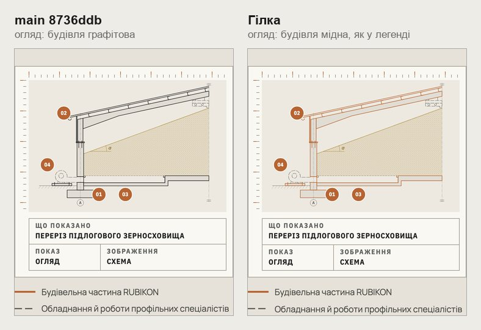
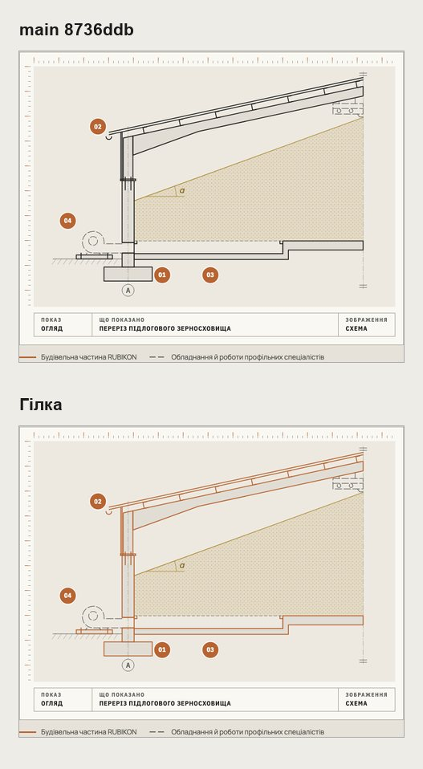
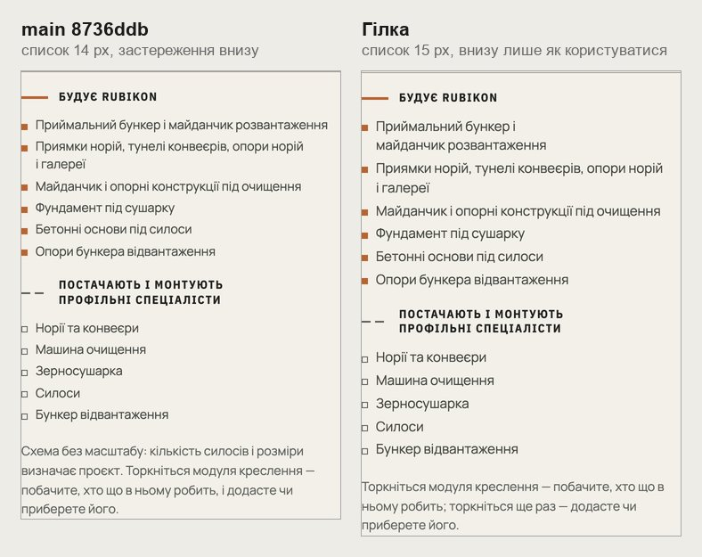
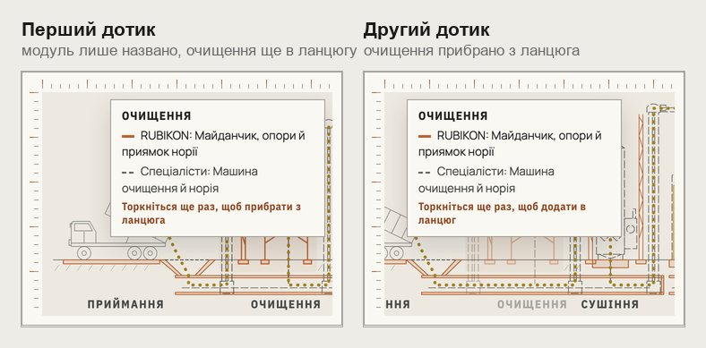

# Handoff · Зерно: конструктор комплексу на телефоні (W2-07: PDO-13, PDO-49, PDO-82, PDO-100)

| | |
|---|---|
| Дата | 2026-10-24 |
| Виконавець | Claude Code |
| Підстава | Рішення власника 24.10 (OD-PX-28): «по всіх пропозиціях — як ти радиш», крім вибраного чипа: A′ — графіт, іконки кольору культури. Дозвіл на висоту сторінки в межах 12,6. Дотик по модулю — рішення 23.10 (OD-PX-23 (a)). Бриф з варіантами: Рішення W2-07 (artifact) |
| PR | Draft. **Перевірка на iPhone 12 до merge (OD-PX-05 (a)); merge і production deploy — лише з окремого OK Дмитра** (DEC-30) |
| Гілка / base | `design/grain-builder-phone` від `main` `8736ddb` |
| Коміти | **`d55bee4`** — код і тести · цей handoff |
| Змінено | `app/components/zernoskhovyshcha/grain-complex.css`, `GrainComplexBuilder.tsx`, `app/lib/grainComplex.ts` (тексти дотику), `app/zernoskhovyshcha/grain-editorial.css` (легенда). Тести: новий `tests/e2e/grain-builder-phone.spec.ts`; `grain-page.spec.ts` — запис про дозвіл на висоту; `tests/unit/grain-complex.test.ts` — тексти дотику |
| Не змінено | Склад комплексу, ланцюг і текст заявки; `GRAIN_SCOPE_KEY`, `GRAIN_HERO_BOUNDARY`; /planner-preview; поведінка миші; кроки туру блоку 04 |

## Що зроблено

- **Чипи на телефоні (PDO-13 A).** До 760 px групи вибору переносяться в рядки. Раніше кожна група гортала вбік, і на 390 було видно 2 з 6 культур, 2 з 3 варіантів зберігання, 3 з 4 місткостей. Тепер видно всі 15 варіантів. Разом із рядами зникли уривки чипів біля краю й фокус під липким кресленням (вікно 700 × 900, Shift+Tab до «Соя»).
- **Вибраний чип (PDO-49 A′).** Графітова заливка, паперовий підпис — як у конфігураторі /angary і у формі. Мідь лишилася для дії «Обговорити такий комплекс» і для частини RUBIKON на кресленнях. Іконка культури зберігає свій колір, той самий, що й силос на кресленні.
  - **Контраст іконок.** На графіті соняшник 2,45:1, ріпак 2,15:1, решта 6,2–8,1:1. У темній темі заливка паперова, іконки 1,8–3,0:1.
  - **Чому це прийнятно.** Іконки декоративні (`aria-hidden`): культуру називає підпис, а контраст підпису ≈15:1. Невибрані чипи й раніше мали іконки нижче 3:1 (пшениця 2,48:1, ячмінь 1,88:1). Вибір власника зроблено, знаючи ці цифри.
- **Легенда блоку 04 (PDO-49 A).** В огляді частини будівлі мідні, як каже легенда «мідна лінія — Будівельна частина RUBIKON». Раніше в огляді вони були графітові, а мідними ставали лише на кроках туру; при reduced motion тур не йде. Кроки туру не змінилися.
- **Застереження й список (PDO-82).** На телефоні «Схема без масштабу: кількість силосів і розміри визначає проєкт» стоїть одразу під кресленням (13 px). Штамп, що каже «умовно», на телефоні схований. Унизу блоку лишилася тільки інструкція дотику. На ширшому екрані речення внизу, як було. Пункти «Будує RUBIKON» на телефоні тепер 15 px замість 14.
- **Дотик по модулю (PDO-100, OD-PX-23 (a)).**
  - **Два дотики.** Перший дотик лише називає модуль: хто що в ньому робить. Другий дотик по тому самому модулю додає, прибирає або міняє його. Раніше перший дотик одразу прибирав модуль із ланцюга й тексту заявки, а підказка зникала за 2,6 с.
  - **Підказка.** Тримається 6 с, закривається дотиком поза модулем або прокруткою сторінки. Шрифт 13 px, ширина 240 px. Дія в підказці: «Торкніться ще раз, щоб прибрати з ланцюга» / «…додати в ланцюг» / «Торкніться ще раз — підлогове сховище».
  - **Нижній рядок.** «Торкніться модуля креслення — побачите, хто що в ньому робить; торкніться ще раз — додасте чи приберете його».
  - **Подвійний дотик.** `.gc-hit { touch-action: manipulation }`: другий дотик не масштабує сторінку в iOS.
  - **Миша** — як була: наведення показує підказку, натискання змінює.
- **Висота.** На 390 сторінка 12,09 → 12,38 екрана при межі 12,6 (дозвіл власника, записано в `grain-page.spec.ts`). На 1440 без змін, 9,08.

## До / після

Локальний production build `main` `8736ddb` і гілки, Chromium, reduced motion.

## Перевірка

| Що | Результат |
|---|---|
| `grain-builder-phone` (новий) — desktop-chromium + mobile-chromium | 6 passed, 6 skipped |
| 17 специфікацій: `grain-builder-phone`, `grain-page`, `grain-planner`, `grain-planner-handoff`, `grain-planner-mobile`, `grain-planner-stabilization`, `direction-node`, `direction-phone-template`, `direction-tablet-template`, `drawing-tour-framing`, `editorial-focus`, `heading-scale`, `phase3-shorter-pages`, `pr-critical`, `responsive-a11y-phase1`, `smoke`, `words-whole` | 361 passed, 103 skipped |
| `vitest` | 1440 passed (новий: дія підказки для дотику) |
| `tsc`, `eslint` | чисто |
| `grain-planner-visual` (/planner-preview) | у CI; планувальник не змінено |
| CI | у коментарі PR |

Що перевіряє `grain-builder-phone.spec.ts`:

- **320 і 390.** Усі 15 чипів у межах екрана, горизонтальної прокрутки немає.
- **700 × 900.** Shift+Tab від «Очищення» до «Соя»: чип нижче за липке креслення.
- **390 і 1440.** Вибраний чип графітовий, іконка пшениці кольору пшениці; невибраний — не графітовий.
- **390.** Підпис під кресленням щонайбільше за 60 px, речення внизу сховане, список 15 px. На 1440 — навпаки.
- **390 і 1440, огляд блоку 04.** Усі частини будівлі мідні.
- **Дотик, 390.** Перший дотик по «Очищення» показує підказку й не змінює вибір. Другий прибирає очищення. Дотик поза модулем закриває підказку. Прокрутка закриває підказку іншого модуля.

## Для перевірки на iPhone 12 (OD-PX-05 (a))

Branch preview: `https://design-grain-builder-phone-rubikon-build.leusd100.workers.dev/zernoskhovyshcha#kompleks`. Перевірити:

- усі чипи видно, вибір графітовий;
- перший дотик по модулю лише показує підказку, другий змінює;
- подвійний дотик не масштабує сторінку;
- липке креслення не перекриває вибраний чип.

## Еталони (DEC-18)

Немає: зерно не має сторінкових еталонів. `grain-planner-*` знімають /planner-preview, який не змінено.

## Відкат

`git revert d55bee4`.
