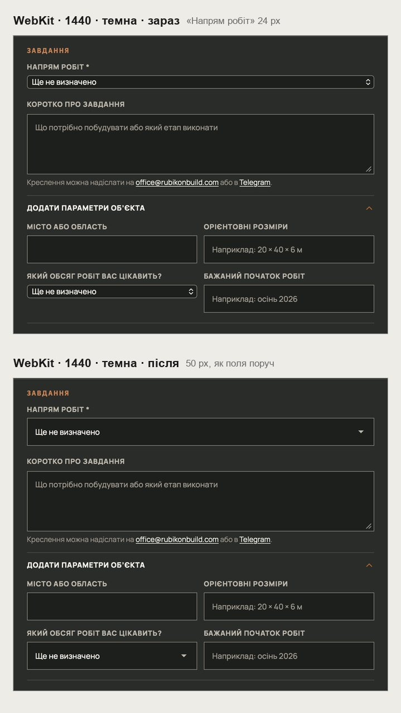
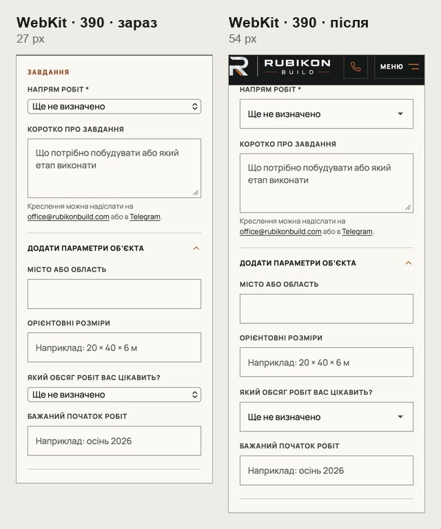
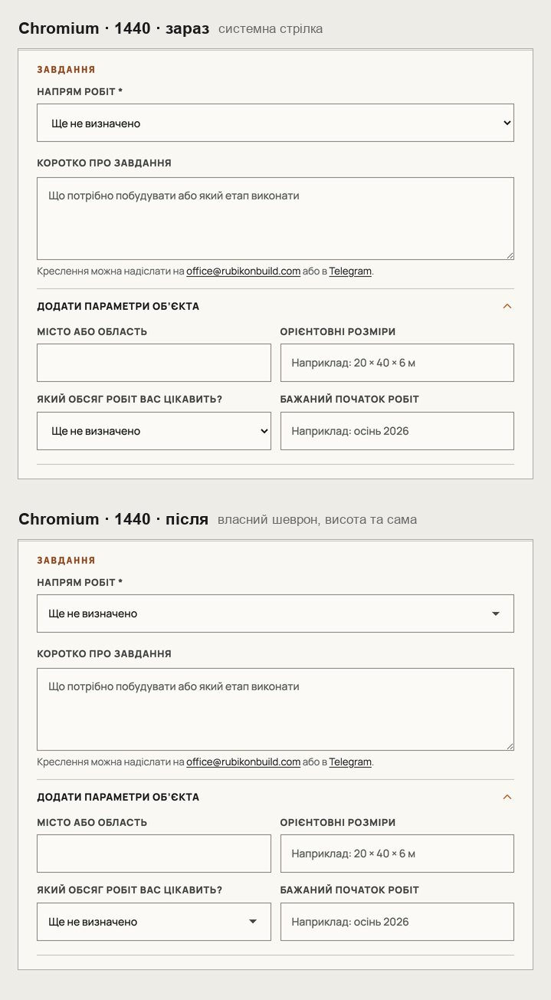

# Handoff · Поля вибору у формі заявки — висота як у сусідніх полів (PDO-24, частина W3-07)

| | |
|---|---|
| Дата | 2026-10-24 |
| Виконавець | Claude Code |
| Підстава | Власник 24.10, зі знімком із Safari, темна тема: «поправ висоту блока заявки „Ще не визначено“, бо зараз висота виглядає не дуже». Це PDO-24 реєстру (W3-07) |
| PR | Draft. **Merge і production deploy — лише з окремого OK Дмитра** (DEC-30) |
| Гілка / base | `fix/inquiry-select-webkit` від `main` `0949cca` |
| Коміти | **`1189aa5`** — CSS і тест · цей handoff |
| Змінено | `app/globals.css` — `.inquiry-form select`. Тест: новий `tests/e2e/inquiry-select.spec.ts` |
| Не змінено | Варіанти вибору, обов’язковість і перевірка поля; select конфігуратора /angary; решта полів форми |

## Що було

У Safari («Напрям робіт» і «Який обсяг робіт вас цікавить?») select малювався системним меню. Safari ігнорує для нього `min-height: 54px`, тож поле стискалося поруч із полями 50–54 px. Заміри в Playwright WebKit: 24 px на 1440, 27 px на 390. Поле мало ще й заокруглені кути та системну подвійну стрілку. У Chromium висота була правильна, 50/54 px.

## Що зроблено

- **Як сусідні поля.** Обидва select форми тепер без системного вигляду (`appearance: none`): ті самі рамка, фон і квадратні кути, що в полів поруч.
- **Висота.** Тепер 50 px на 1440 і 54 px на 390 у WebKit, як в input поруч. У Chromium висота не змінилась.
- **Шеврон.** Власний ▾ кольору підпису, тож працює в обох темах. Лишається й при фокусі: правило фокусу раніше скидало фон.
- **Примусові кольори.** У режимі примусових кольорів (forced colors) повертається системне меню, бо фонового шеврона там не видно.
- **Що не змінилося.** Вибір лишається нативним: список варіантів і клавіатура працюють як були.

## До / після

Playwright WebKit і Chromium, локальний production build `main` `0949cca` і гілки.

## Перевірка

| Що | Результат |
|---|---|
| Заміри WebKit (1440 і 390, світла й темна): «Напрям робіт» і «Обсяг робіт» | 24 → 50 px і 27 → 54 px, дорівнюють input поруч |
| Заміри Chromium | 50 / 54 px, як і були |
| `inquiry-select` (новий) — desktop-chromium + mobile-chromium | 2 passed, 2 skipped; на CSS з `main` обидва падають |
| 9 специфікацій: `inquiry-select`, `form`, `first-contact`, `consent`, `inquiry-brief-handoff`, `configurator-phase4-inquiry`, `smoke`, `pr-critical`, `responsive-a11y-phase1` | 318 passed, 49 skipped, 1 failed — `form.spec:770` під навантаженням 4 воркерів; окремо ×3 — 3 passed |
| `tsc`, `eslint` | чисто |
| CI | у коментарі PR |

Що перевіряє `inquiry-select.spec.ts`: на 1440 і 390 обидва select без системного вигляду, з шевроном і заввишки як поле «Ім’я». Шеврон лишається при фокусі. WebKit-проєкт у Playwright запускається лише для перевірок клавіатури, тож саму висоту в WebKit заміряно окремо, кадри вище.

**Локальний WebKit.** На http://127.0.0.1 директива CSP `upgrade-insecure-requests` змушує WebKit тягнути ресурси по https, і сторінка не збирається. Для замірів її знято з локальної відповіді, сайт не змінено.

## Еталони (DEC-18)

Не оновлено. Зміниться `homepage-inquiry-*` там, де форма відкрита (768, 1440): шеврон замість системної стрілки. Еталон `homepage-inquiry-desktop-1440` уже відрізняється після #238 (підказка в один рядок). Linux-рендери з CI — власнику до оновлення.

**Для власника:** перевірити в Safari на Mac та iPhone, як виглядає поле і як відкривається список.

## Відкат

`git revert 1189aa5`.
