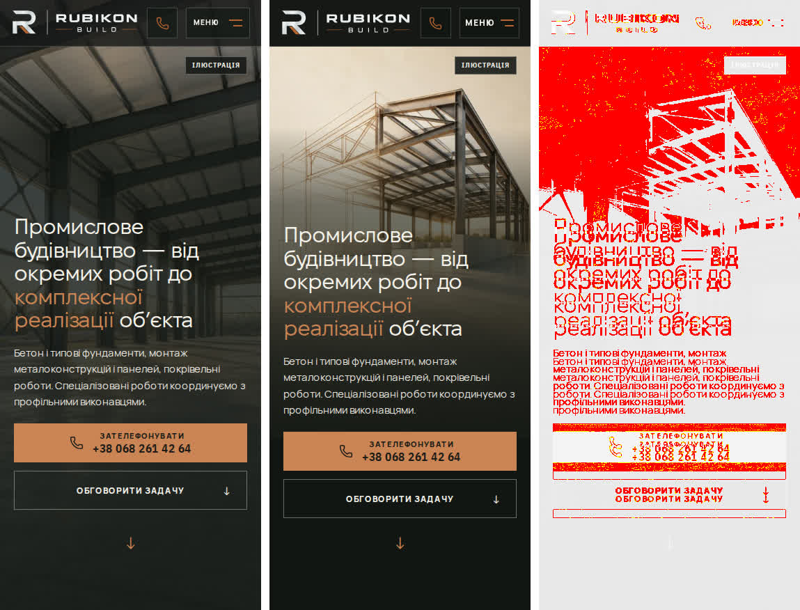

# Handoff · main червоний після #243: два застарілі тести й один еталон

| | |
|---|---|
| Дата | 2026-10-24 |
| Виконавець | Claude Code |
| Підстава | Main Regression [40101480447](https://github.com/leusd100/rubikon-build/actions/runs/40101480447) на `84a2fcc` (#243 «єдиний підхід до hero та обрані ілюстрації C») — три падіння |
| PR | Draft. **Merge — лише з окремого OK Дмитра** |
| Гілка / base | `fix/main-red-after-243` від `main` `84a2fcc` |
| Коміти | **`dede882`** — тести · цей handoff |
| Змінено | `tests/e2e/responsive-a11y-phase1.spec.ts`, `tests/e2e/smoke.spec.ts` |
| Не змінено | Сайт (код, CSS, медіа), еталони DEC-18 |

## Висновок

Жодне з трьох падінь не є регресією сайту. #243 свідомо змінив телефонний hero (handoff-и `2026-10-24-unified-mobile-heroes.md`, `2026-10-24-selected-c-mobile-heroes.md`, `2026-10-24-mobile-media-review.md`). Тести й еталон лишилися на старих правилах. Два тести оновлено так, щоб вони описували нові правила. Еталон чекає OK власника (DEC-18).

#243 не запускав Main Regression, а «Changed-area visual regression» на ньому мав статус SKIPPED. Тому PR був зеленим, а main став червоним одразу після merge.

## 1. `responsive-a11y-phase1.spec.ts:281` — крихти над телефонним hero

**Було в тесті:** посилання — `rgba(255, 255, 255, 0.86)`, поточна сторінка — `#fff`.
**Тепер на сторінці:** посилання — `rgb(245, 242, 235)`, поточна сторінка — `rgb(255, 255, 255)`. Від 761 px — `rgb(158, 152, 141)` і `rgba(255, 255, 255, 0.72)`, як і раніше.

**Причина — навмисна зміна.** `app/mobile-media-review.css` (≤760 px): `main.inner-page > .phone-hero :is(.eyebrow.light, .breadcrumb, .breadcrumb a) { color: var(--color-dark-text) }`. Це пункт «світлі дрібні написи» зі спільного підходу. В уточненні About так і записано: «Дрібні breadcrumb/eyebrow світліші». `--color-dark-text` (#F5F2EB) — текстовий токен графітової смуги. Він непрозорий і світліший за 86 % білого над темним затемненням. Правило тесту «над телефонним hero крихти світлі» лишилося, змінилося лише точне значення.

**Що змінено в тесті:**
- на 390 px кожне слово крихт — `#F5F2EB` або `#fff`;
- на 1250 px жодного з цих двох кольорів немає. Раніше перевірявся лише старий колір посилання, тож перевірку не послаблено, а посилено.

## 2. `smoke.spec.ts:124` (mobile-chromium) — `/napryamky` і його сцени

**Було в тесті:** перший кадр — `/media-responsive/directions-sequence-…`.
**Тепер на сторінці (Pixel 7):** `/media-responsive/mobile-directions-daylight-angary-960w.c8cc5940.avif`, завантажений (`complete`, `naturalWidth > 0`). На 1440 px — `directions-sequence-daylight-angary-1881w…webp`, як і раніше.

**Причина — навмисна зміна.** `DirectionsHeroImageSequence.tsx` віддає до 760 px окремі 3:2 вікна (`mobile-directions-*`, 480/960 AVIF + WebP). Ці вікна #243 вирізав з чинних панорам: «`/napryamky` показує всі п'ять конструкцій у мобільному полі 3:2». `directions-hero-sequence.spec.ts` і `direction-static-hero.spec.ts` #243 уже оновив. У smoke ця гілка лишилася старою.

**Що змінено в тесті:** до 760 px очікується `/media-responsive/mobile-directions-`, від 761 px — `/media-responsive/directions-sequence-`. На телефоні перевірка тепер точніша: вона вимагає саме мобільне вікно, а не будь-який файл послідовності.

## 3. Візуальний еталон `homepage-hero-mobile-375` — потрібен OK власника

Зліва — чинний `tests/e2e/visual.spec.ts-snapshots/homepage-hero-mobile-375-linux.png`, посередині — рендер Main Regression на `84a2fcc`, справа — diff Playwright.

- Expected із CI (`main-visual-blob-2`) побайтово дорівнює файлу в репозиторії: SHA-256 `bf84cc6a…946f2e1c`.
- Actual однаковий у всіх трьох спробах: SHA-256 `1a8d391b…65540cda`, 375×876. Різниця — 98 643 px (31 %) при межі 2 %.
- Що змінилося на рендері — усе навмисне з #243: обрана ілюстрація C замість H1; м'яке затемнення під текстом; текстовий блок на 12 px нижче, бо відступ CTA → стрілка тепер 12 px замість 24 px. Стрілка на тому самому місці.
- Шапка на рендері відрізняється від еталона, але не через #243. Еталон зроблено ще в #206. Геометрія шапки на 375×812 виміряна локально на `b826f8d` (до #243) і на `84a2fcc`. Вона однакова: логотип 188×40.3, дзвінок 44×44 на x 218, «Меню» 85×44 на x 274, Manrope 800 12 px. Різниця з еталоном накопичилася раніше й не виходила за межі допуску (`maxDiffPixelRatio 0.02`, `threshold 0.25`).

**Рішення власника:** чи погоджуєте цей рендер як новий `homepage-hero-mobile-375-linux.png`? За OK окремим комітом у цей PR покладу саме actual із CI (SHA-256 `1a8d391b…`). До цього «Main visual (2/2)» лишається червоним.

## Перевірка

| Що | Результат |
|---|---|
| Відтворення до змін: обидва тести на локальному build `84a2fcc` | падають так само, як у CI |
| `responsive-a11y-phase1.spec.ts` + `smoke.spec.ts`, desktop-chromium + mobile-chromium, без retries | 62 passed, 26 skipped (тести, що свідомо пропускають один із проєктів), 0 failed |
| Мутація: тимчасово прибрано правило крихт і мобільні `<source>` хаба, перезібрано | обидва оновлені тести падають; зміни повернуто, build перезібрано |
| `eslint` двох spec-файлів, `tsc --noEmit` | чисто |
| `tests/unit/e2e-google-intercept.test.ts` | 12 passed |
| Main Regression на гілці | запущено; результат — у PR |

## Поза цим PR

- PR Gate не запускав візуальну перевірку для #243, хоча PR змінив hero HOME (CSS + медіа). Варто окремо перевірити класифікатор змінених областей.
- Draft #244 (W2-17) успадковує ці ж три падіння від main. Після merge цього PR і оновлення еталона його треба синхронізувати з main.

## Відкат

`git revert dede882`.
