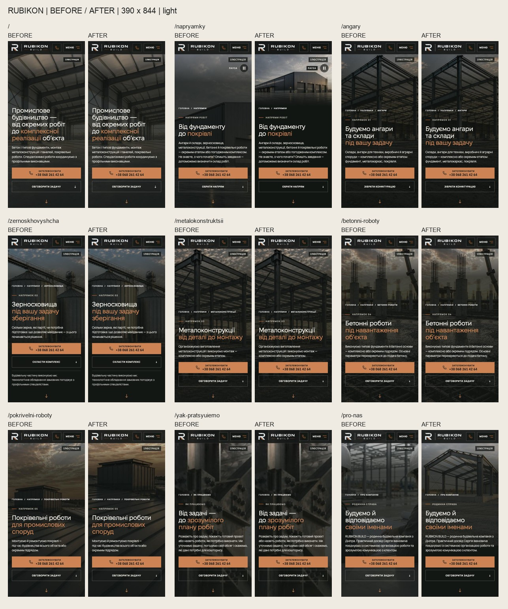
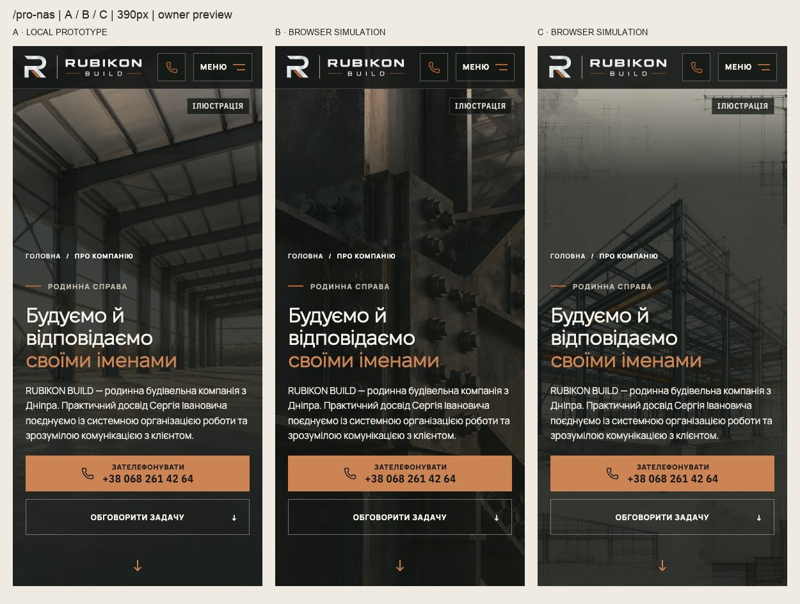
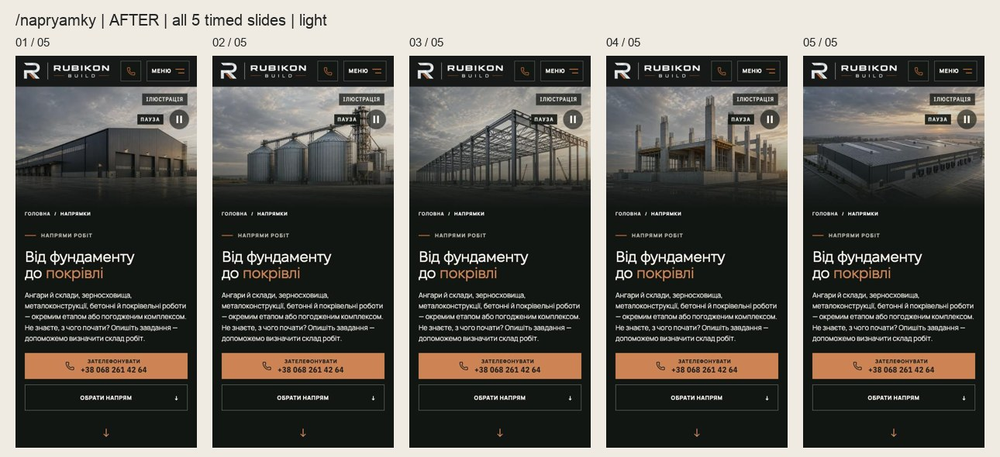

# Mobile Hero Media — prototype for owner review (24.10.2026)

> HOME/About цього раунду відхилено власником. Актуальний [творчий раунд3](2026-10-24-creative-hero-options.md); напрямки й покрівля лишаються окремими рішеннями.

> **Оновлення за зауваженням власника:** повтор HOME на About відхилено. Новий окремий рендер — About A у галереї другого раунду. Далі наведено історичний огляд першого раунду; його рекомендація H1 для About вже не актуальна. Нові HOME/About та зум хаба ще чекають вибору.

Три зміни: `/pro-nas` отримує people-free H1 на телефоні; `/napryamky` показує всі п’ять конструкцій у мобільному полі 3:2; `/pokrivelni-roboty` має окремий crop з меншим небом. Вихідні ілюстрації вже наявні в сайті. Зміна візуальних рішень потребує owner preview перед merge. Desktop, tablet >760 px, тексти, шапка та CTA geometry збережені. Еталони DEC-18 не оновлено.

[Усі маршрути dark](media/mobile-media-review/before-after-all-routes-dark.jpg) · [Напрямки](media/mobile-media-review/compare-napryamky.jpg) · [Покрівля](media/mobile-media-review/compare-pokrivelni-roboty.jpg) · [Про компанію](media/mobile-media-review/compare-pro-nas.jpg)

## Про компанію — A / B / C

A реалізовано; B/C — браузерні симуляції для рішення власника. Всі ілюстрації позначені «Ілюстрація»; жодна не є фото команди чи доказом завершеного об’єкта.

## Усі сцени Напрямків

[Усі п’ять dark](media/mobile-media-review/after-napryamky-sequence-dark.jpg)

## Чому виникла проблема

Оригінальні два iPhone-скриншоти відкрито з вкладень попереднього чату. `/napryamky` — **не відео**: п’ять `<picture>` зі зміною кожні 6 секунд і 2-секундним crossfade. Початкові панорами 1881×836 вже обрізані до 627×836, після чого `object-fit: cover` ще раз обрізає їх до високого phone hero. У кадр потрапляє вузька частина фасаду, а небо займає значну верхню площу. Одне `object-position` не повертає втрачені боки будівлі.

HOME використовує статичний H1 до 760 px; `/pro-nas` — статичний P5 до 600 px. Вище цих меж залишаються існуючі процесні відео. П’ять сторінок послуг і `/yak-pratsyuiemo` мають статичні зображення. Усі матеріали hero є ілюстративними; вони не підтверджують виконаних об’єктів RUBIKON.

## Рішення по маршрутах

| Маршрут | Висновок базового огляду | Джерело та рекомендований мобільний фокус | Результат / компроміс |
|---|---|---|---|
| HOME | Інтер’єр читається; балки й перспектива виразні | Чинний `hero-h1-{480,768,1024}w.webp`; **48% 38%** | Без змін. Збережено ілюстрацію, overlay і адаптивний poster/preload |
| `/napryamky` | На всіх 5 слайдах вузький повторний crop; особливо багато неба на ангарі, силосах і покрівлі | Чинні `directions-sequence-concepts/{daylight,blue-hour}`; вікно оригіналу **x627…1881, y0…836**, тобто праві 2/3; у полі **50% 50%**, 3:2 | Нові 480/960 AVIF + WebP, поле під шапкою до 760 px. Цілісніші фасад, силоси, каркас, колони й дах. Зображення менше за площею, зате його предмет зрозумілий; текст нижче на спокійному графіті |
| `/angary` | Дах і кут каркаса впізнавані | Чинні portrait AVIF/WebP 784×1024; **58% center** | Без змін. Повну споруду тут не обіцяємо: це виразний конструктивний ракурс |
| `/zernoskhovyshcha` | Силоси й транспортер читаються | Чинні portrait AVIF/WebP; **62% center** | Без змін, обидві теми перевірено |
| `/metalokonstruktsii` | Колона й верхній вузол — чіткий предмет | Чинні portrait AVIF/WebP; **58% center** | Без змін; desktop-зсув art +56 px від PR#220 збережено |
| `/betonni-roboty` | Колони, арматура й основа впізнавані | Чинні portrait AVIF/WebP; **55% center** | Без змін; контраст темної версії достатній у виміряних текстових зонах |
| `/pokrivelni-roboty` | Надбудова мала й нижче великого неба | Чинні `direction-hero-photo-variant` / `direction-hero-blue-hour`; crop **(429,180)–(1213,1024)** →784×844; **45% center** | До440 px прибрано180 px неба; надбудова, примикання і шви видно раніше. Компроміс — ближчий кадр і менше навколишнього даху. Від441 px джерела незмінні |
| `/yak-pratsyuiemo` | Вузол читається; крупний план доречний до процесу | Чинний `process-hero-yak-pratsyuiemo-*`; **78% 30%** | Без змін. Друга композиція з72% показана лише як кандидат B для About |
| `/pro-nas` | Згенеровані люди поряд із «своїми іменами» можуть виглядати як команда | **A: чинний HOME H1**, **48% 38%**, лише до 600 px | Людей прибрано; підпис «Ілюстрація» збережено. Повтор HOME і трохи більший перший download — свідомі компроміси для вашого рішення |

Позиції — CSS-відсотки вільного простору після `cover`, а не координати пікселя об’єкта. Для нових кропів наведено точне вікно в оригіналі, тому їх можна відтворити.

Ключові блоки нижче hero також перевірено: реальне фото попереднього досвіду Сергія на HOME лишається зі своїм підписом; мобільні напрямки HOME і каталог хаба вже мають схеми; практика About та вузли послуг — SVG. Підстав для додаткової заміни фотографій там не виявлено. Декоративний фон контактів лишається під існуючим сильним overlay.

## «Про компанію»: вибір A / B / C

| Варіант | Джерело / статус використання | Фокус | За / компроміс |
|---|---|---|---|
| **A — рекомендовано, реалізовано в прототипі** | `/media/home-v2/concepts/hero-h1-*`; вже схвалена власником ілюстрація H1, описана в `docs/design/2026-10-16-mobile-first-impression.md` як ImageGen. Повторне використання чинного файлу; не фото завершеного об’єкта | 48% 38%; 1024×1536 | Людей немає; виразна просторова структура; готові responsive-файли й спільний кеш з HOME. Повтор тієї самої сцени |
| **B — браузерна симуляція** | `/media-responsive/process-hero-yak-pratsyuiemo-*`; уже публічна концептуальна ілюстрація вузла. Окремий ліцензійний документ/інструмент створення в матеріалах огляду не знайдено; новий stock не залучено | 72% center; 1672×941 | Технічна предметність, немає людей. Крупний план замість цілого приміщення; для прийняття потрібне окреме оптимізоване phone-джерело |
| **C — браузерна симуляція** | `/media/about-industrial-concept.webp`, responsive480/768/1151; чинна архітектурна ілюстрація, внесена власником у commit528f1f5, використовується в OG. Окремий запис про інструмент/ліцензію не знайдено | 56% 30%; 1151×1800 | Чесна мова креслення без людей; більше абстракції й порожнього світлого поля. Не позиціонувати як фотографію |

У всіх варіантах потрібне «Ілюстрація». Реальне фото попереднього досвіду Сергія не переносимо з HOME: чинне рішення `/pro-nas` залишає його там з атрибуцією. Приватні матеріали Primorske/steel L0 не використовувалися. Нічого нового не генерувалося, не купувалося й не підмінялося stock-фотографіями.

A/B/C 320 px (локальна повна галерея) · 390 px (локальна повна галерея) · 430 px (локальна повна галерея).

## Рух і альтернативи

Для `/napryamky` перевірено всі 5 стабільних слайдів у двох темах, переходи, паузу й reduced motion. При reduced motion лишається перший кадр; приховані наступні джерела від’єднуються. Порядок, 6 секунд і fade 2 секунди не змінені. У світлій темі виявлено низький контраст напису «Пауза» на небі — додано локальну темну підкладку без затемнення всієї сцени.

Напрямки A/B, 390 light (локальна повна галерея): A — повніша споруда у полі 3:2; B — існуючі вертикальні картинки послуг на всю висоту. A краще утримує силует усіх5 споруд. Покрівля A/B (локальна повна галерея): A — реалізований ближчий crop; B — браузерна симуляція компактного повного пейзажного кадру.

На768 px відеомонтажі HOME та About не змінювалися. Переглянуто по 6 часових точок кожного, включно з переходами; це **вибірка, а не покадрова перевірка всього відео**. На цільовому iPhone 12 ці відео не завантажуються.

## Дані й швидкість

Фактичні encoded bytes у Chromium з емуляцією iPhone 12/DPR 3, холодний перехід; це медіатрафік, не загальна вага сторінки й не Lighthouse LCP.

| Початкові hero-запити | До | Після | Зміна |
|---|---:|---:|---:|
| Напрямки, light | 164112 B | 86859 B | −47% |
| Напрямки, dark | 284522 B | 146637 B | −48,5% |
| Покрівля, light | 101800 B | 53206 B | −47,7% |
| Покрівля, dark | 227857 B | 104745 B | −54% |
| About A | 73792 B | 140186 B | +66394 B; той самий H1 кешується після HOME |

Для DPR 1 About:27820→41502 B. Повний цикл хаба DPR 3: light251356 B; dark316946 B, включно з успадкованим початковим light-кадром35363 B. Наявна SSR/hydration-зміна light→dark все ще дає один зайвий світлий перший файл на dark-вході; її не приховуємо й не називаємо усуненою. Нових важких відео немає. Телефон не запитує старі панорами хаба. High-priority/eager і відповідність preload та hydrated-джерела About збережено, перевірено наDPR 1/2.

Додано приблизно2,2 MB оптимізованих AVIF/WebP у репозиторій; це обидві теми, два fallback-формати й responsive-розміри, а не один download. Генератори детерміновані. Наявні залежності та кеш браузерів повторно використано, нові пакети/відео не встановлювалися.

## Перевірки та межі

- Базова й фінальна Chromium-матриця:9 маршрутів × 320×568,375×667,390×844,430×932,768×1024 ×2 теми. Окремо DPR 3 iPhone 12 emulation, перший візит, всі 5 слайдів і проміжні crossfade-стани.
- WebKit:54 випадки — 320/390/430 ×9 маршрутів ×2 теми. Це Safari/WebKit емуляція, **не фізичний iPhone**.
- 27 перевірок тексту 200%: заголовок реально збільшується до 58 px; горизонтального обрізання тексту не виявлено. На короткому екрані hero природно вищий за viewport, CTA доступні прокруткою.
- 6 reduced-motion випадків: HOME/хаб/About на 390 і768; відеозапитів немає, хаб лишається статичним.
- Геометрія hero та H1 у порівнянні з базою не змінилася; горизонтального overflow немає. Максимальний початковий CLS у Chromium-матриці ≈0,000014. Layout shift від навмисного перемикання тексту 200% не трактувався як loading CLS; WebKit не надає повноцінного еквівалента Chromium Layout Instability API.
- Production build, TypeScript, цільовий ESLint, 93 unit-файли / 1446 тестів та 24 функціональні Chromium-тести пройшли. Візуальні еталони не оновлювалися. Початкові локальні readiness-timeout за одночасного навантаження повторно перевірено послідовним запуском без зміни timeout/retries.
- Фінальний контраст напису «Пауза»: 10,89:1 light та 12,33:1 dark; у вибірці hero-тексту порушень не залишилося. Контраст перевірявся вибіркою пікселів під текстовими рядками; це цільова перевірка hero, не повний WCAG-аудит і не польовий замір LCP/INP.

## Інтеграція

Поточний main перевірено через GitHub повторно перед підготовкою PR: `b826f8d`; відкритих PR до цього прототипу не було. №219/220 вже merged, як і №212 (маркування About), №225 (tablet-шапка), №230/231 (тексти/практика About), №238–242. Відступ art для desktop й нова шапка92%/100% збережені. Застарілий локальний checkout з незавершеними analytics-змінами не чіпали.

Цільові файли: `AboutHeroVideo.tsx`, `DirectionHeroImage.tsx`, `DirectionsHeroImageSequence.tsx`; два hero-manifest; `mobile-directions-media.css`, `mobile-media-review.css` і їхні імпорти в `layout.tsx`; пояснювальний коментар `/pro-nas/page.tsx`; два детерміновані генератори та 44 похідні AVIF/WebP. Функціональні очікування в hero/static/sequence/smoke-тестах приведено до нових джерел і геометрії; snapshot-файлів не торкалися.

Гілка `design/*` залишається прототипом без `visual-freeze`. Перед merge потрібен ваш вибір A/B/C і перегляд змінених hero на **реальному iPhone 12** у світлій і темній темі. На `/napryamky` дочекайтеся повного 30-секундного циклу, перевірте «Пауза», перший візит і збільшений текст. Для безпечного preview оберіть «Лише необхідні» й не надсилайте тестові заявки: чинний preview використовує спільні серверні прив’язки.
