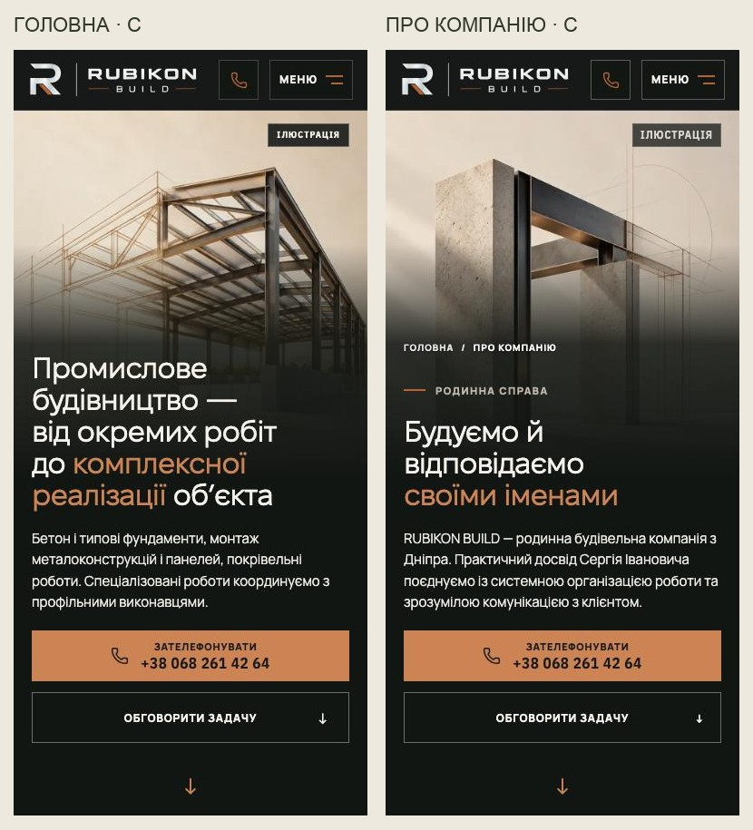

# RUBIKON — обраний напрямок C у живому preview

Власник: «Я би рухався в напрямку C». Це вибір творчого напрямку; кінцевий мобільний результат ще очікує перегляду на фізичному iPhone12.

[Головна](https://design-mobile-media-review-rubikon-build.leusd100.workers.dev/) · [Про компанію](https://design-mobile-media-review-rubikon-build.leusd100.workers.dev/pro-nas) · [Галерея ідей](https://design-mobile-media-review-rubikon-build.leusd100.workers.dev/media/reviews/creative-hero-options/) · [Draft PR №243](https://github.com/leusd100/rubikon-build/pull/243).

Два різні зображення, спільна мова тонкої мідної лінії, теплого паперу й матеріальної конструкції. Мобільна головна≤760px; About≤600px. Desktop/tablet footage, шапка, тексти, CTA і бізнес-твердження збережені. Усе чесно позначено «Ілюстрація»: це творчі концепти, не фото виконаних проєктів або команди.

| Сторінка | Новий файл |480w|768w|1024w|
|---|---|---:|---:|---:|
| HOME |`hero-line-concept-v3-*`|32 034B|71 458B|118 094B|
| About |`about-line-concept-v3-*`|18 344B|46 180B|78 656B|

Холодна Chromium-емуляція iPhone12/DPR3, фактичний viewport390×664: один hero-файл118 094B дляHOME та78 656B дляAbout, однакові дляобох тем, жодного phone-video/старогоposter, measuredCLS0. Це вимір медіазапитів, не загальна вага сторінки й не Lighthouse LCP. НаDPR3 HOME −15,8% проти початковогоH1; About +4 864B проти початковогоP5 з людьми, але −43,9% проти тимчасового повторуHOME. НаDPR1 HOME −22,8%, About −34,1%.

Перевірено: матриця320×568/375×667/390×844/430×932/768×1024 у двох темах; WebKit320/390/430;200%текст;reduced motion;перший візит ізcookie-панеллю. У фінальних записах помилокJS/горизонтального overflow немає. Зони заголовка/lead/CTA на320/390/430 в обох темах проходять виміряні контрастні пороги; це не повнийWCAG-аудит. Пройшли17цільових browser tests (5нерелевантних комбінацій пропущено), TypeScript/ESLint/production build. SSR/hydration зберігає одинposter і його кадрування. ЕталониDEC-18 не змінено.

Галереї перевірено окремо:48зображень нового творчого раунду, інертність ін’єкції та безпечний fallback неправильногоroute. ДляURL використовуються закриті списки статичних медіафайлів. АктуальнийCodeQL перевіряється вPR; попередні зауваження не приховано й не виключено з правил.

[Точні prompts і джерела](2026-10-24-creative-hero-prompts.md). Нові рендери створені вбудованимimage_gen; додатковийstock/відео не залучено. Старі невикористаніD-варіантиAbout прибрано з основного набору медіа. Тимчасові review-галереї передmerge треба прибрати або окремо погодити. Production/main не змінено, merge не виконано.
