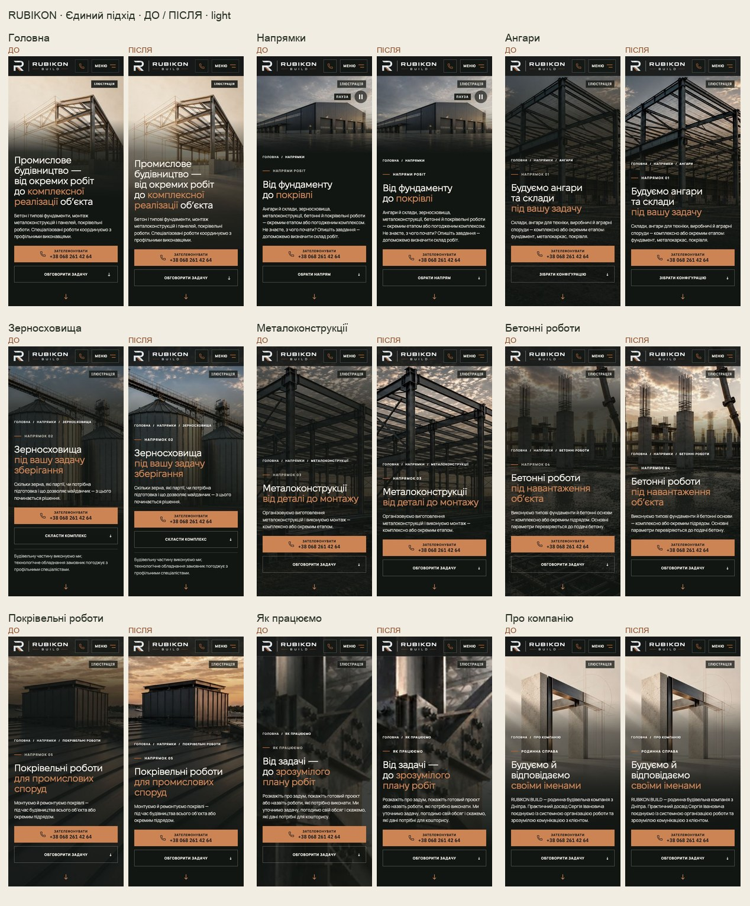

# Єдиний підхід до мобільних головних блоків RUBIKON BUILD

Власник погодив м’якший About і попросив поширити принцип по сайту. Результат: більше видимої конструкції, поступове затемнення під текстом, світлі дрібні написи, відступ перед стрілкою12px зі збереженою зоною44×44px. Один підхід, з локальною силою затемнення під конкретний кадр.

[Галерея всіх9сторінок: до / після](https://design-mobile-media-review-rubikon-build.leusd100.workers.dev/media/reviews/unified-mobile-heroes/) · [Draft PR243](https://github.com/leusd100/rubikon-build/pull/243)

| Маршрут | Мобільна зміна |
|---|---|
| HOME | Обрана C-ілюстрація відкрита довше; спільний м’який перехід .58 у середній зоні, на першому візиті .66 для піднятого тексту. |
| /napryamky | Збережені всі5сцен і поле3:2, без нового зуму. Відступ стрілки12px; раннє затемнення для короткого екрана й першого візиту. |
| /angary | Відкритий каркас, середня зона затемнення .62. |
| /zernoskhovyshcha | Силоси видиміші; .64 і перехід на5.25rem раніше через довший текст. Чинна маска вигаданих креслярських розмірів збережена. |
| /metalokonstruktsii | Відкриті балки й вузли, середня зона .62. |
| /betonni-roboty | Відкриті опори й арматура, середня зона .62 захищає мідний заголовок. |
| /pokrivelni-roboty | Краще видно площини покрівлі; .62, попередній погоджений мобільний crop збережений. |
| /yak-pratsyuiemo | Видиміші деталі конструкції; .66 під написами для контрасту. |
| /pro-nas | Погоджений варіант збережено; тепер використовує спільне правило .58. |

Спільна композиція діє до760px; About-ілюстрація, як і раніше, до600px. About601–760px зберігає попередні відео й затемнення, отримує спільний відступ стрілки та світлі підписи. Above760px ці зміни не діють. Шапка, тексти/claims, CTA-призначення, форми, SEO, crops і джерела інших hero збережені. Позначення «Ілюстрація» залишається.

## Перевірки

- Chromium:320×568,375×667,390×844,430×932,768×1024, обидві теми —90знімків.
- Safari WebKit-емуляція:320/390/430, обидві теми —54знімки. Це не фізичний iPhone.
- 200%текст:390 і320px, обидві теми; сцени ростуть і не обрізають доступ до змісту.
- Перший візит ізcookie-панеллю:9маршрутів×2теми на390px. ЗафіксованоCLS0; на звичайній матриці максимум~0.00017. Штучне збільшення шрифту після завантаження не є cold-loadCLS.
- Контраст: консервативні заміри видимих текстових рядків на320/390/430 у двох темах, з поправками для яскравих кадрів. Окремо перевірено перший візит320/390. Приховані screen-reader labels та області підcookie-панеллю не враховуються. Це не повнийWCAG-аудит.
- Усі5сцен хаба й4crossfade-переходи зняті в обох темах —18кадрів. Розміри сцен, пауза та швидкість не змінені.
- ПомилокJS і горизонтального overflow у звичайній матриці та WebKit немає. При200%тексті самі hero також не переповнюються. На320px знайдено окреме переповнення нижче hero: /angary у конфігураторі/FAQ (до372px), /metalokonstruktsii у наступній editorial-секції (до341px); ці секції тут не змінювалися. 15focused browser checks пройшли, включно зreduced motion; ESLint і production build пройшли. Геометричні перевірки зберігають44px cue й новий12pxвідступ; visual snapshotsDEC-18 не змінено.

## Вага й цільові файли

Нових медіафайлів для реальних hero немає: ті самі responsive AVIF/WebP, srcset, preload і відео-breakpoints. Нових відео, дублів тем і запитів для головних зображень не додано. Review-галерея завантажується окремо, фото lazy-loaded; на самих сторінках її немає.

Продуктові зміни: `app/mobile-media-review.css`, `app/mobile-directions-media.css`; уточнено існуючі геометричні очікування у `tests/e2e/hero-video.spec.ts`. Оновлено C-знімки творчої галереї та додано тимчасову `public/media/reviews/unified-mobile-heroes/` безJavaScript, зnoindex/nofollow і поза навігацією/сайткартою. Передmerge прибрати або окремо погодити review-артефакти.

Потрібен перегляд власником на фізичному iPhone12. Лише чинний автоматичний branch preview workflow; main/production не змінено, merge не виконано.
