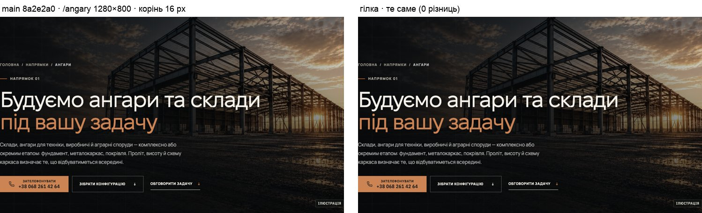
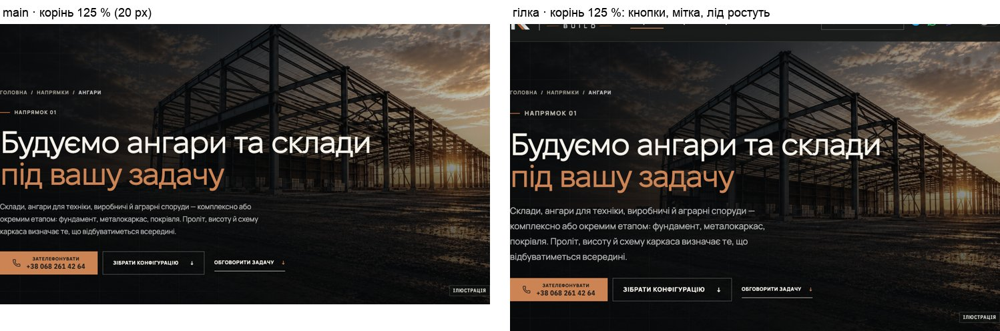
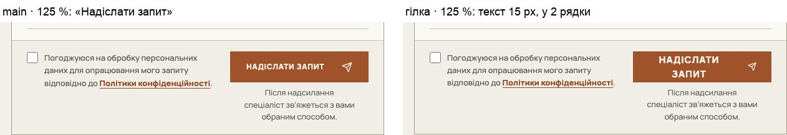

# Handoff · Токени дизайн-системи без видимих змін (W3-01)

| | |
|---|---|
| Дата | 2026-10-25 |
| Виконавець | Claude Code |
| Підстава | Рішення Wave 03, погоджене власником 25.10: W3-01 — PDO-60 (T1), PDO-62, PDO-63 і PDO-64 (частина токенів), PDO-87, PDO-98 (лише `--header-h`) |
| PR | Ще не відкрито (відкриває оркестратор). **Merge і production deploy — лише з окремого OK Дмитра** (DEC-30) |
| Гілка / base | `refactor/w301-design-tokens` від `main` `8a2e2a0`. Гілка не `design/*` навмисно: PR Gate запустить візуальні набори змінених ділянок, і вони мають пройти без оновлення PNG |
| Коміти | **`21f6237`** — CSS, тести, розділ 9 у `docs/ui-system-v1.md` · цей handoff |
| Змінено | `app/globals.css`, `app/theme.css`, `app/home-v2.css`, `app/conversation.css`, `app/angary/angary-editorial.css`, `app/pro-nas/about.css`, `app/yak-pratsyuiemo/delivery.css`, `app/zernoskhovyshcha/grain-editorial.css`, `app/zernoskhovyshcha/grain-planner.css`, `app/configurator-preview/configurator.css`, `app/components/` (`about/region.css`, `angary/frame-tour.css`, `configurator/configurator-sheet.css`, `directions/direction-node.css`, `directions/direction-template.css`, `directions/formats-scope.css`, `drawing-sheet.css`, `home-v2/directions-sheets.css`, `home-v2/proof-details.css`, `process/change-sheets.css`). Тести: новий `tests/unit/design-tokens.test.ts`, оновлений `tests/unit/fixel-display-font.test.ts` |
| Не змінено | Жодне обчислене значення на 100 % шрифту браузера; локальні `--m-*` сторінок; `--hv2-copper-fill`; похідні відступи шапки (116–128 px) |

## Що було

У `globals.css` було сім токенів розкладки й кілька типографічних, решта — числа. `--text-xs/sm/md/lg` і `--title-page` не використовувалися ніде: ні в CSS, ні в TS/TSX, ні у зібраному CSS (Tailwind їх не бере). `101px`, висота шапки, повторювалася в 12 рядках CSS. Синій снігу й бірюзовий вітру були літералами у трьох файлах, а палітра `--hv2-*` повторювала значення токенів теми літералами. `.related-directions-title` був визначений двічі: Plex 600 у `globals.css` і Fixel у `direction-template.css`. Діяло лише друге правило, бо в нього вища специфічність.

## Що зроблено

- **Ролі оголошено з поточними значеннями.** Наступні кроки змінюють значення в одному місці: W3-02 — шкалу й мітки, W3-03 — ритм, W3-06 — кнопки. Правило бере токен лише там, де обчислене значення лишається тим самим. Решта літералів переходить на токени тоді, коли їхній файл і так змінюється у видимому кроці.
- **Шкала в `rem`.** При корені 16 px це ті самі px, а збільшений шрифт браузера тепер доходить до ролей (див. «Збільшений шрифт браузера»). `--title-section` → `--type-h2`, `--hero-title` → `--type-h1`, `--hero-title-home` → `--type-display-home`. Значення ті самі.
- **Мітки — три ролі по три токени.** Кожна роль має вагу, кегль і трекінг (`-weight`, `-size`, `-track`). `letter-spacing` не входить у `font`, а `--font-manrope` задано на `<body>`, тож токен у `:root` не може назвати гарнітуру. Кожне правило лишає свою гарнітуру й інтерліньяж.
- **`--header-h: 101px`** замінив `101px` у всіх 12 рядках, де це висота шапки: `--hero-pad-top`, маски героїв (`calc(var(--header-h) - 24px)` = 77 px), `--compact-hero-header-edge` і запасні значення від нього (меню, герой HOME на низькому планшеті), `.service-subhero-media`, липкі елементи конфігуратора й /yak, `scroll-margin-top` конфігуратора. Похідні 116–128 px лишилися числами: це наступний крок PDO-98.
- **Колір.** У `theme.css` додано `--color-load: #5AA8FF` і `--color-wind: #4FD8C8`. Вони однакові в обох темах, тож обидва темні блоки не змінено. Ці токени використовують `--hv2-load`/`--hv2-wind`, `.ft` тура рами, `.hc-frame.ft` конфігуратора й запасні значення `var(--hv2-load, …)`. `--hv2-text`, `-2`, `-3`, `--hv2-copper` і `--hv2-copper-text` тепер аліаси `--color-dark-text*`, `--color-accent` і `--color-accent-on-dark`: у темній темі ці токени не перевизначаються. `--hv2-copper-fill` лишився літералом, бо `--color-action` у темній темі стає #CC8455 (рішення за W1-09 / PDO-17).
- **Рух оголошено.** Перелік токенів — у таблиці нижче. Значення на них переведено лише там, де вони дорівнюють токену: лінії вузлів, плотер аркушів, карта регіону, наплив постера, кросфейд героя /napryamky, «відблиск» HOME, `cubic-bezier(.2,.7,.1,1)` у `formats-scope.css`. Локальні `--m-reveal` і `--m-draw` не змінено: перехід на токени змінить темп (W3-10).
- **Прибрано** `--text-xs/sm/md/lg`, `--title-page` і програшне правило `.related-directions-title` у `globals.css`.
- **Тест** `design-tokens.test.ts` перевіряє:
  - наявність усіх токенів;
  - шкалу кроків простору;
  - ролі шрифту лише в `rem`;
  - що кожен `var(--type-*|--rhythm-*|--space-*|--card-*|--button-*|--motion-*|--ease-*|--header-h)` у CSS оголошено (у токена без запасного значення помилка в назві тихо скинула б правило);
  - що поза токеном немає `101px`;
  - що мертвих токенів і програшного правила немає;
  - що пара навантажень одна для обох тем.
- **Документ.** `docs/ui-system-v1.md` має новий розділ 9 «Role tokens» (PDO-62). Опис руху в §6 переписує W3-10 («Motion v1»).

## Таблиця токенів

Телефон — блок `@media (max-width: 760px) :root`. «1440» — значення на ширині 1440 px.

| Токен | Значення зараз | Де діє | Значення, яке планує крок |
|---|---|---|---|
| `--type-display-home` | `clamp(2.75rem, min(5.2vw, 9.4svh), 4.875rem)` = 44–78 px | H1 HOME (від 761 px) | W3-02: без змін (T4 — після рендера) |
| `--type-h1` | `clamp(2.75rem, min(5.8vw, 10.2svh), 5.375rem)`; телефон `clamp(2.375rem, 10.6vw, 2.875rem)` | H1 героїв, `.proc-hero h1` | W3-02: без змін |
| `--type-h2` | `clamp(2.375rem, 4.5vw, 4.5rem)` = 64,8 на 1440; телефон `clamp(1.75rem, 7.4vw, 2rem)` | H2 секцій, `.copy-column`/`.page-heading`/`.faq-grid`, /angary, HOME signature, телефонні H2 розмови, редакційних блоків, /pro-nas, зерна, конфігуратора; відступ аркушів HOME | W3-02: 64,8 на 1440, телефон PDO-05, планшет ≥38 |
| `--type-h2-compact` | `clamp(2.75rem, 3.6vw, 3.25rem)` = 51,84 на 1440 | `.conversation h2` на ноутбуці (≥1181 px, ≤900 px заввишки) | W3-02: `clamp(2.25rem, 3.6vw, 3.25rem)` (нижня межа 36) |
| `--type-h2-minor` | `clamp(1.75rem, 2.5vw, 2.375rem)` = 36 на 1440; телефон `clamp(1.625rem, 7.4vw, 1.875rem)` | `.angary-real-facts h2` | W3-02: 36 на 1440 |
| `--type-h3` | `clamp(1.5rem, 2vw, 1.75rem)`; телефон `1.5rem` | H3 входів зерна | W3-02: Fixel 28 / 24 |
| `--hero-lead` | `1.0625rem` (17); телефон `1rem` | лід героїв внутрішніх сторінок, /yak | — |
| `--type-label-ui-weight / -size / -track` | 800 / `.75rem` / `.13em` | `.eyebrow` | W3-02: 800 / 12 / `.10em`; сюди ж kicker-и розмови й форми (зараз Plex 700 12 / `.14em`, літерали) |
| `--type-action-weight / -size / -track` | 800 / `.75rem` / `.06em` | `.button`, `.section-link` | W3-02: 800 / 13 / `.06em` |
| `--type-label-tech-weight / -size / -track` | 700 / `.75rem` / `.14em` | `.cs-head b` (аркуші /yak), `.angary-stamp-title` | W3-02: 700 / 12 / `.08em` |
| `--rhythm-label` | `var(--space-6)` = 24 | `.eyebrow` margin-bottom | W3-03: 20 / 16 |
| `--rhythm-lead` | 28; телефон 22 | лід `.direction-editorial-copy`, `.angary-section-heading` | W3-03: 24 / 20 |
| `--rhythm-cta` | 34 | `.section-link` margin-top | W3-03: 32 / 24 |
| `--section-space`, `--section-space-compact` | як були | секції | W3-03: телефон 72 / 56 |
| `--space-1 … --space-10` | 4, 8, 12, 16, 20, 24, 32, 40, 48, 64 | `--rhythm-label` | W3-03 і далі файл за файлом |
| `--card-pad` | 28; телефон 20 | рядок «Пов’язані напрямки» | — (28 / 20 за реєстром) |
| `--card-gap` | 24; телефон 12 | телефонний ряд карток входів зерна (на десктопі споживача ще немає) | — (24 / 12 за реєстром) |
| `--button-h-l` | 56 px | `.button` | W3-06: 56 |
| `--button-h-m` | 48 px | `.planner-button-outline` | W3-06: 48 (+ `.gc-cta`, `.hc-summary-action`, бриф HOME) |
| `--header-h` | 101 px | 12 місць, перелічених вище | наступний крок PDO-98: 80 на коротких вікнах і планшетах |
| `--motion-micro` | 200ms | `--duration-fast` (116 використань) | W3-10 |
| `--motion-reveal` | 420ms | — (локальні `--m-reveal` 360/420 лишилися) | W3-10 |
| `--motion-draw` | 900ms | лінії вузлів (`dn-draw`, `ps-draw`) | W3-10 |
| `--motion-draw-long` | 1400ms | крок 2 тура рами, траса героя /yak | W3-10 |
| `--motion-media-fade` | 800ms | наплив постера героя | W3-10 |
| `--ease-premium` | `cubic-bezier(.2, .7, .1, 1)` | як було + поява `dfmt` і карта регіону | W3-10 |
| `--ease-plot` | `cubic-bezier(.55, 0, .25, 1)` | плотер аркушів, карта регіону, лінії вузлів | W3-10 |
| `--ease-standard` | `cubic-bezier(.4, 0, .2, 1)` | постер і відео героя, кросфейд /napryamky, «відблиск» HOME | W3-10 |
| `--color-load`, `--color-wind` | #5AA8FF, #4FD8C8 (обидві теми) | креслення навантажень HOME і конфігуратора | — |

## До / після

Видимих змін немає. Доказ — дампи обчислених стилів (таблиця нижче), тому кадр «до / після» тут один, на 100 %:

## Збільшений шрифт браузера (корінь 125 % = 20 px, 1280×800, 9 сторінок)

Ролі в `rem` тепер реагують на налаштування розміру шрифту в браузері (не на масштаб сторінки). Це доступність, на яку розраховував реєстр. Що показав замір, main проти гілки при тому самому корені 125 %:

- **Шапка десктопа без змін.** Вона в px: 101 px на всіх 9 сторінках, рядок не переповнюється (`scrollWidth − clientWidth` = 0), елементи не накладаються й не виходять за вікно. Горизонтального прокручування сторінки немає.
- **Що росте.** `.button` і `.section-link` 12 → 15 px; `.eyebrow` 12 → 15 px; лід героїв 17 → 21,25 px; H2 розмови на ноутбуці 46,08 → 55 px (спрацьовує нижня межа 2,75rem); H3 зерна 25,6 → 30 px; H2 реального об’єкта /angary 32 → 35 px; мітки аркушів /yak і штамп /angary 12 → 15 px. H1 героїв на 1280×800 не змінюється: його кегль задає `5.8vw`, а не нижня межа.
- **Висота сторінок** +5…+90 px: HOME +5, /napryamky +23, метал +90, бетон +19, покрівля +28, /angary +62, зерно +62, /yak +22, /pro-nas +18.
- **Нові переноси (1 → 2 рядки):** кнопка «Надіслати запит» у формі на всіх 9 сторінках (колонка кнопки 222 px) і мітка «Реалізований об’єкт до створення RUBIKON» на /angary. Жоден елемент не вилазить за свою рамку. Кнопку форми варто переглянути у W3-06 (кнопки 56 / 48).

## Перевірка

Локальні production-збірки: `main` `8a2e2a0` і гілка; Chromium (Playwright). Гілку зібрано заново після останньої правки. Остання правка — коментар, тож усі 21 CSS-файл збірки побайтово збігаються зі збіркою, на якій ішли заміри (md5).

| Що | Результат |
|---|---|
| Дамп обчислених стилів (`style-dump` + `style-diff`): 9 сторінок + політика, `/configurator-preview`, `/planner-preview` × 390 / 768 / 1440 × світла й темна, 42 властивості | **0 з 72 станів сторінок**, 0 з 62 428 рядків елементів. Перший прогін паралельно з vitest/eslint дав 1 рядок шуму (поля `.angary-real-grid`, 0 → 16 px); той самий крок, повторений тричі на 390 і 768 на main і гілці, — 0 px скрізь, повний повторний прогін — 0 |
| Дамп руху й масок (`style-dump` заморожує анімації й не бере `mask-image`): рух увімкнено, стани `data-motion-state`/`data-draw` увімкнено, `data-step` 1–4; transition-*, animation-*, mask-image, top, scroll-margin-top, min-height | **0 з 144 станів**, 32 736 рядків |
| Правила CSS, розв’язані браузером (кожне правило кожного аркуша з активним `@media`, 3 ширини, 12 сторінок) | 53 029 порівнянь, 5 відмінностей, усі очікувані: прибране `.related-directions-title`; 4 базові правила на 390 px беруть телефонне значення токена (22 / 20 / 22 / 26–30 px), яке там і так задає телефонне правило. Каскад на 390 той самий: дамп вище — 0 |
| Розгортання токенів у тексті diff (кожен змінений рядок із підставленими значеннями проти рядка `main`) | 70 рядків збігаються; решта — оголошення токенів, коментарі, прибране правило |
| `dec18` — 42 цілі visual, brand-logo, configurator, grain-planner, порівняння Playwright із допуском специфікацій | **0 змінено з 42** |
| `vitest run` | 94 файли, 1452 тести — passed (разом із `theme-tokens`, `fixel-display-font`, `plex-condensed-font`, новим `design-tokens`) |
| `eslint .`, `tsc --noEmit` | чисто |
| e2e: `heading-scale`, `typography`, `words-whole`, `direction-editorial-rhythm`, `header-first-screen`, `page-hero-rhythm`, `grain-page`, `phase3-shorter-pages`, `header-hierarchy` — desktop + mobile chromium | 142 passed, 52 skipped, 4 failed: `typography` late fonts на mobile ×3 (CLS 0,0578 — так само на main, відома локальна різниця macOS) і `grain-page:64` (тайм-аут під навантаженням; окремо ×3 — passed і на гілці, і на main) |
| Корінь 125 % на 1280×800 | розділ вище |

## Еталони (DEC-18)

Не оновлено й не мають змінитися: 0 з 42. Якщо PR Gate покаже різницю у візуальних наборах, це сигнал помилки в цьому PR, а не привід оновлювати PNG.

## Для наступних кроків

- **W3-02.** Kicker-и розмови, форми й HOME (`.conversation-kicker`, `.inquiry-form-section-title`, `.hv2-kicker`) лишилися літералами Plex 700 12 / `.14em`. За реєстром їхня роль — `label-ui` у Manrope, а значення сьогодні збігається з `label-tech`, тож вони не на жодному токені, щоб `.08em` для `label-tech` їх не зачепило. Лід HOME (`.hero-lead`, 17 px) поки не на `--hero-lead`, тому при 125 % лід HOME не росте, а ліди інших сторінок ростуть.
- **PDO-98.** Похідні відступи від шапки (близько 25 місць: 116 / 117 / 118 / 124 / 126 / 128 px) лишилися числами: частина з них — відступи телефонних героїв від шапки 77 px.
- **PDO-87.** Креслярські відтінки міді HOME (#F0B48A, #E39A68, #D39A6F) не стали токенами: це рішення власника.

## Відкат

`git revert 21f6237`.
