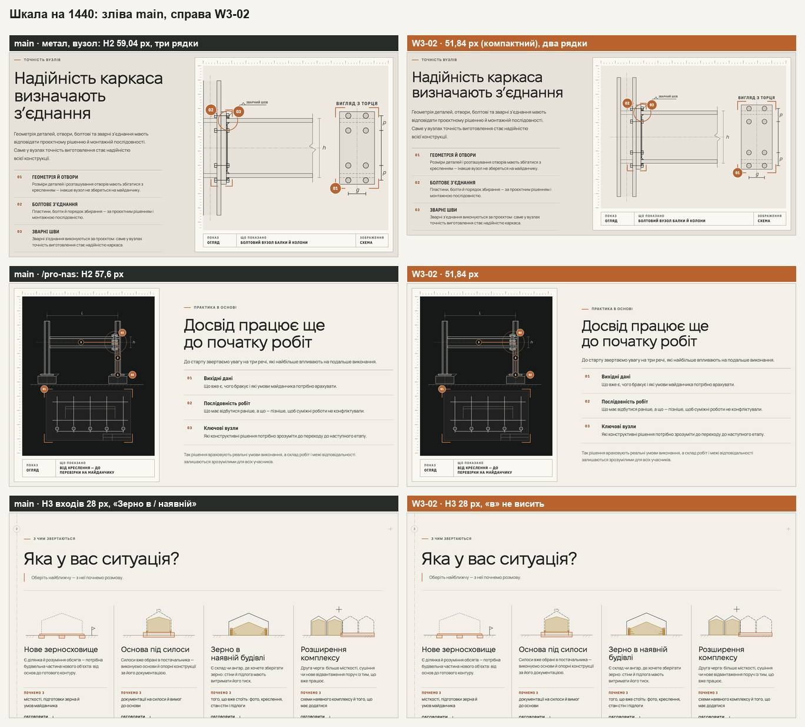
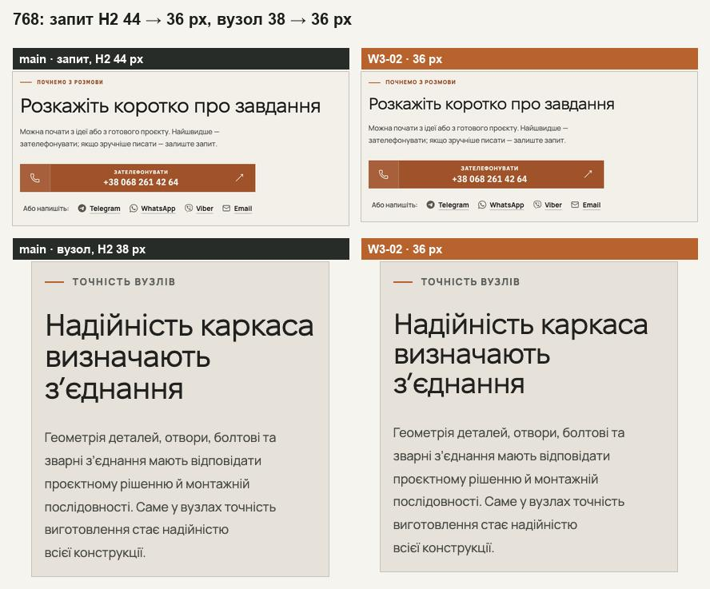
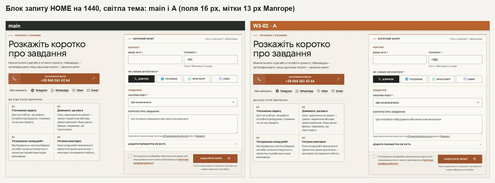
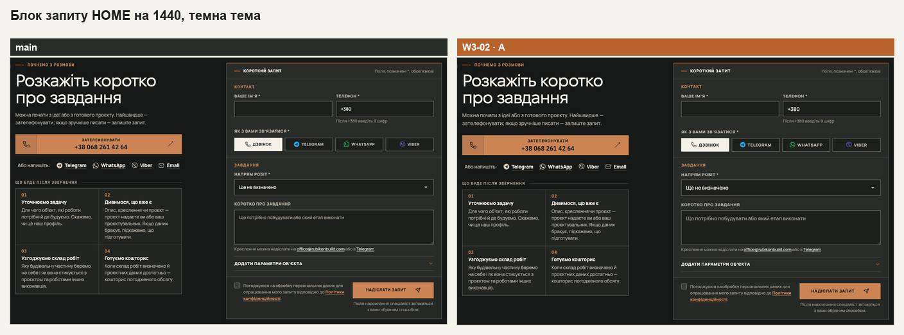
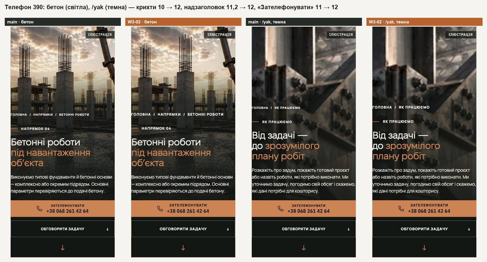
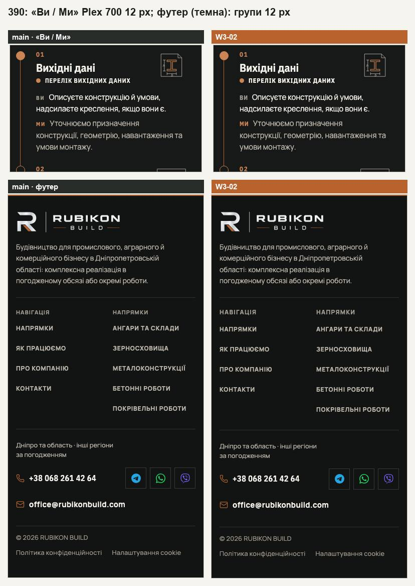
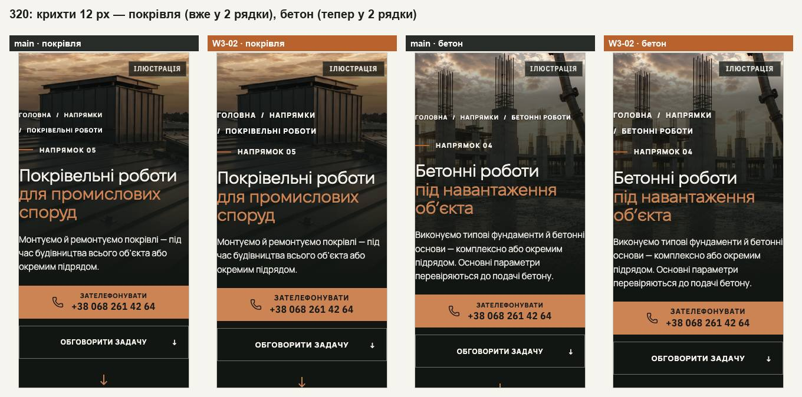
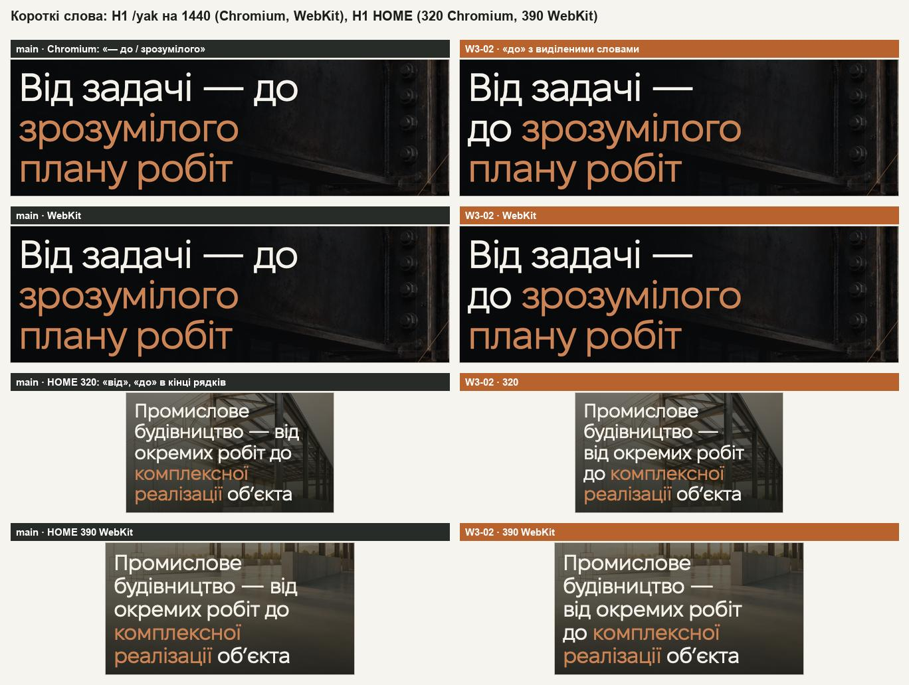

# Handoff · Шкала і підписи — видимий прохід (W3-02)

| | |
|---|---|
| Дата | 2026-10-25 |
| Виконавець | Claude Code |
| Підстава | Рішення Wave 03, погоджене власником 25.10, варіант A: PDO-60 (T4), PDO-16, PDO-63, PDO-44 п. 2; OD-PX-16 (a), OD-PX-15 (b), OD-PX-46 |
| PR | Ще не відкрито (відкриває оркестратор). **Merge і production deploy — лише з окремого OK Дмитра** (DEC-30). До merge — перевірка на iPhone 12 (OD-PX-05 a) |
| Гілка / base | `design/w302-type-scale`; base — main `6aa2da6` (W3-01 #248 і W3-07 #247 влито merge-комітом `80c3ebc`; до того гілка стояла стеком на `refactor/w301-design-tokens`, `51cb61a`) |
| Коміти | `545fa96` шкала · `463873d` підлога й мітки · `e2396e1` форма · `1d63f0f` короткі слова · `23405db` handoff · `80c3ebc` merge main `6aa2da6` · `027492a` перевірка підлоги після merge (знак «!» W3-07) · `99934c3` правки рев’ю: заголовок конфігуратора на короткому ноутбуці, роль людини · `101ea20` handoff після рев’ю. Правки незалежного рев’ю: `b70a205` ряд дій героя /angary і зерна · `bcb9196` «Надіслати запит» і «Обговорити цю конфігурацію» в один рядок · `7114553` виноска перерізу й лінія розмірів 3D на аркуші /angary · `293c581` перевірка підлоги бачить 10,5 px · `067f246` короткі слова в лідах вузла · `8e88257` заголовок конфігуратора — в одному файлі · цей коміт — handoff |
| Змінено | CSS: `app/globals.css`, `conversation.css`, `home-v2.css`, `phone-hero.css`, `pro-nas/about.css`, `yak-pratsyuiemo/delivery.css`, `zernoskhovyshcha/grain-editorial.css`, `napryamky/directions.css`, `angary/angary-editorial.css`, `configurator-preview/configurator.css` і в `app/components/`: `directions/` (`direction-template`, `formats-scope`, `process-split`), `process/` (`change-sheets`, `cost-factors`, `resp-matrix`), `configurator/` (`configurator-sheet`, `configurator-controls`), `home-v2/directions-sheets`, `about/capability`, `zernoskhovyshcha/grain-complex`. TS/TSX: `app/lib/typography.ts` і місця рендеру заголовків (19 файлів). Тести: `design-tokens.test.ts`, `typography.test.ts`, `pr-critical.spec.ts`, `grain-page.spec.ts`, `heading-scale.spec.ts`. Документ: розділ 9 `docs/ui-system-v1.md` |
| Не змінено | H1 і `--type-display-home`, `--type-h2` (64,8 на 1440); мобільне меню (PDO-47); смуга cookie (розміри — рішення власника 08.10); штампи креслень (`.sheet-cell`). Аркуш конфігуратора на сторінці (`.hc-preview-sheet`) **змінено** (до правок рев’ю тут помилково стояло «не змінено»): виноска перерізу 10 → 11 px, лінія розмірів 3D — назви 10 → 11 px, номер вузла ферми 10,5 → 11 px (деталі — «Правки незалежного рев’ю»). Еталони configurator-3d цього аркуша не знімають: вони відкривають /configurator-preview, де `.hc-preview-sheet` немає |

## Що було

На 1440 дев’ять сторінок мали 8 розмірів H2 (64,8 · 59,04 · 57,6 · 54 · 51,84 · 46,08 · 37,44 · 36 px), на 768 — 6 (44–28). H3 у Fixel — 5 розмірів (27–36 px). Тексту, дрібнішого за 12 px поза кресленнями, — 4,3 % видимих знаків на 390 і 2,5 % на 1440: крихти 10 px і надзаголовок 11,2 px на телефонних героях, «ЗАТЕЛЕФОНУВАТИ» 11 px, «ВИ / МИ» і ключ процесу 11 px, заголовки груп футера 11 px. Кнопки 12 px, мітки полів 12,5 px, текст у полях від 761 px — 14 px. Стилів міток великими — у середньому 23,3 на сторінку на 390 і 22,1 на 1440. Рядок H1–H3 закінчувався коротким словом 26 / 19 / 14 / 11 / 12 разів у Chromium (320 / 390 / 768 / 1280 / 1440) і 30 / 22 / 14 / 12 / 13 у WebKit.

## Що зроблено

- **Шкала T4.** Ролі з W3-01 отримали значення: `--type-h2-compact` `clamp(2.25rem, 3.6vw, 3.25rem)` (51,84 на 1440, 36 на 768; на телефоні дорівнює розміру секції), `--type-h2-minor` `clamp(1.75rem, 2.5vw, 2.25rem)` (36 на 1440; телефон `clamp(1.625rem, 7vw, 1.75rem)`), `--type-h3` Fixel `clamp(1.5rem, 1.95vw, 1.75rem)` (28 / 24). Компактний рівень: H2 вузла напряму (59,04 → 51,84), смуги зерна (46,08), історії /pro-nas (57,6; обидва визначення), конфігуратора /angary (54) і блоку запиту (на 768: 44 → 36). Малий: «Пов’язані напрямки» (37,44 → 36) і реальний об’єкт /angary. На короткому ноутбуці (від 1024 px завширшки, до 760 px заввишки) заголовок конфігуратора /angary сходить на малий рівень: 32 / 34,15 / 36 px на 1280 / 1366 / 1536 (було 34 px — четвертий розмір H2 на сторінці, а на 1536 нижчий за малий). Він лишається в один рядок поруч із лідом, тож смуга не вища, ніж на main, і крок має те саме місце; компактний рівень переносив заголовок у 2 рядки й опускав кроки на 13 / 19 / 25 px. H3 у Fixel: доказ HOME (33,12), входи напрямів (31,68 / зерно 28), формати /napryamky (27), перемикач форматів /yak від 1051 px. H3 відповідальності /yak (36 на 1440) лишив своє правило.
- **Підлога (PDO-16).** Поза кресленнями нічого менше 12 px, дії й мітки полів — 13 px, у кресленнях з HTML-підписами — 11 px. Крихти й надзаголовок телефонних героїв → 12 px (і на /pro-nas), «Зателефонувати» над номером → 12 px (герой, розмова, кнопка), «Ви / Ми» й ключ процесу → Plex 700 12 / .08em, заголовки груп футера → 12 / 800, кнопки → 13, мітки полів → 13, штамп «Ілюстрація» HOME → як `.hero-provenance`. Матриця /yak на 375–860: позначки 12, «Координує об’єкт» 11 (вужче 375 — 10,5 / 10: у 12 px «Координуємо» на 320–346 px заходить на позначку сусідньої колонки, див. «Правки незалежного рев’ю»). Аркуш вузла X-Ray: назва 14, термін 13, примітка й дії 12, під `pointer: coarse` цілі 44 px для дій і ‹ ›. Конфігуратор /angary: повноекранний вигляд — розміри 12 / 14, «Закрити» 13; на аркуші сторінки — назви лінії розмірів 3D 11 (розміри 13), номер вузла ферми 11, виноска перерізу 11 (на телефоні колонка назв 56 px, підпис .10em). У кресленнях: смужки аркушів HOME 9,5 → 11, аркуш змін /yak (номери, «Зміна», «зараз», підписи) 10–10,5 → 11, виноска перерізу конфігуратора 10 → 11; номери перемикача форматів 11 → 12, теги «попередньо» штампа конфігуратора 11 → 12, «↑ на схемі» HOME 11 / 10 → 12, мітка відео героя 11,5 → 12.
- **Три мітки (PDO-63).** UI — Manrope 800 12 / .10em: надзаголовки, крихти, kicker-и розмови, форми, HOME і конфігуратора, назви груп форми (мідні), заголовки груп футера, «Зателефонувати», групи матриці /yak, назви колонок і груп будівника зерна, заголовок факторів /yak, роль людини над ім’ям (`.person-info > span`; на телефоні була .09em, переносів не змінює). Дія — Manrope 800 13 / .06em: `.button`, `.text-link`, `.section-link`, кнопка форми, мітки й легенди полів (не текст згоди), вибір способу зв’язку, «Додати параметри об’єкта», посилання входів і принципів, «Обговорити» в аркуші HOME, «Далі — один процес» на /yak. Технічна — Plex 700 12 / .08em: «Ілюстрація», «Ви / Ми», ключ процесу, результат кроку, підписи під кресленнями, кнопки шарів і туру в штампі HOME, клітинки обсягу, назви штампа конфігуратора, «Договір», «Почнемо з». Штамп «Ілюстрація» має `min-width: 8.75em`: Plex 700 ширший за свій метричний запасний шрифт, і без цього пізня заміна шрифту зсувала штамп (CLS на Pixel 7 0,0578 → 0,0596; тепер 0,0578, як на main).
- **Форма A.** Текст полів 16 px на всіх ширинах (від 761 px було 14). Лід розмови на ноутбуці 15 → 16 px. Лід героя HOME — на `--hero-lead` (17 / 16 px, ті самі значення).
- **Короткі слова.** `keepHeadingWords` поруч із `keepShortWords` в `app/lib/typography.ts`: у H1–H3 набір (b) «і, й, у, в, з, а, о, та, до, на, за, по, від, під, не, що, як, із, зі, для», у лідах — набір (a). Лише у видимому тексті, в місці рендеру: `SectionHeader`, `DirectionDetail`, `DirectionEntry`, `DirectionNode`, каталог /napryamky, розмова, герої та сторінки, /angary, зерно, /pro-nas, конфігуратор. `<title>`, meta/OG, JSON-LD і aria-label лишаються з простими пробілами. «до» перед виділеними словами H1 /yak — одна пара `.keep-pair` (як `.hv2-keep` на HOME): нерозривний пробіл перед inline-block виділення не тримався ні в Chromium, ні у WebKit. У парах H1 HOME — нерозривний пробіл, тож на телефоні «від» і «до» теж не висять.

## До / після

Локальні production-збірки: main `8a2e2a0` (:4370) і гілка (:4373), Playwright Chromium; кадри H1 — ще й WebKit.

## Перевірка

Інструменти `wave03-tools` (`baseline-measure` + `probes.js`, `dec18`, свої варіанти `rows` і перевірки кореня 125 %) на main і гілці; 9 сторінок. Перша таблиця — прохід до merge, проти main `8a2e2a0`; після merge main `6aa2da6` (W3-01 + W3-07) і правок рев’ю перевірку повторено на свіжій збірці — таблиця «Повторна перевірка» нижче.

| Що | main | гілка |
|---|---|---|
| Розміри H2 на 1440 | 8 | **3**: 64,8 / 51,84 / 36 |
| Розміри H2 на 768 | 6 | **3**: 38 / 36 / 28 |
| Розміри H2 на 1280×800 | 8 | 3: 57,6 / 46,08 / 32 |
| H3 у Fixel на 1440 | 5 | 2: 28 і 36 (H3 відповідальності /yak) |
| Текст менше 12 px, частка знаків (390 / 768 / 1440) | 4,30 / 3,19 / 2,50 % | **1,48 / 1,41 / 0,98 %**; решта — штампи креслень 11 px і мобільне меню (PDO-47) |
| Короткі слова в кінці рядка H1–H3, Chromium (320 / 390 / 768 / 1280 / 1440) | 26 / 19 / 14 / 11 / 12 | **0 / 0 / 0 / 0 / 0** |
| Те саме, WebKit | 30 / 22 / 14 / 12 / 13 | **0 / 0 / 0 / 0 / 0** |
| Комбінацій міток на сторінку (`typo.labelCombos`, Chromium; 1440 / 390) | 22,1 / 23,3 у середньому | 9,9 / 12,4 у середньому: 7–13 на 1440, 10–14 на 390 (по сторінках — у розділі «Комбінації міток»). Ціль PDO-63 «≤ 8 комбінацій на 390 і 1440 поза SVG» досягнута лише на /napryamky на 1440 (7) |
| Висота сторінок, 390 | — | від 0 до +27 px (HOME +12, напрями +18, метал +24, бетон +4, покрівля +27, /angary +24, зерно 0, /yak +5, /pro-nas +3) |
| Висота, 768 | — | від −54 до +11 px |
| Висота, 1440 | — | від −81 до +16 px (метал −70, бетон −80, покрівля −81) |
| Висота, 320 | — | від −2 до +78 px (крихти бетону й зерна — у 2 рядки) |
| Бюджет зерна 1440×900 (межа 9,15) | 9,08 | **9,09** (8176 → 8184 px) |
| Бюджет зерна 390×844 (межа 12,6) | 12,38 | 12,38 |
| Блок запиту HOME на 1440 (`.conversation-grid`) | 804 px | 806 px (+2) |
| Крихти на 320 (висота) | бетон / зерно 44, метал / покрівля 52 | 55 / 55 / 55 / 55 — бетон і зерно у 2 рядки (прийнято власником) |
| Ряд дій героя на 1100 / 1180 / 1280 | рядів 1–2 | ті самі на всіх 9 сторінках |
| Горизонтальне прокручування на 320 і 390 | 0 | 0 на всіх 9 сторінках; жоден H1–H3 не ширший за свою рамку (крім «Задача» конфігуратора — так само на main) |
| CLS пізніх шрифтів, Pixel 7 (`typography.spec` late fonts, ×3) | 0,0578 | 0,0578 на HOME, /angary, металі (відома локальна різниця macOS) |
| `dec18` — 42 цілі | — | **17 змінено**; бриф передбачав 18 — той самий перелік, але `process-terms-tablet-768` не змінився |
| `vitest run` | | 94 файли, 1461 тест — passed (+5 у `design-tokens`, +4 у `typography`) |
| `eslint .`, `tsc --noEmit` | | чисто |
| e2e, desktop + mobile chromium: `heading-scale`, `typography`, `words-whole`, `direction-editorial-rhythm`, `header-first-screen`, `page-hero-rhythm`, `grain-page`, `phase3-shorter-pages` | | 137 passed, 48 skipped, 5 failed: late fonts на mobile ×3 (0,0578, як на main) і `grain-page:64` ×2 — сервер віддає «на кресленні» з U+00A0; тест нормалізує, повторно passed |
| e2e: `form`, `inquiry-select`, `first-contact`, `smoke`, `pr-critical`, `responsive-a11y-phase1`, `grain-page` | | 303 passed, 37 skipped, 18 failed — усі `pr-critical` через U+00A0 у серверному тексті; після нормалізації в `serverText` — `pr-critical` 117 passed, 3 skipped |
| e2e: `home-*` (4), `direction-*` (7), `yak-*` (3), `shorter-pro-nas-yak`, `service-pages`, `header-hierarchy`, `pro-nas-*`, `napryamky-*`, `footer-composition`, `ux-conversion-phase2`, `public-service-claims`, `cost-factors` | | 311 passed, 105 skipped |
| Увесь e2e, desktop + mobile chromium (4 воркери) | | 1498 passed, 461 skipped, 5 failed: late fonts на mobile ×3 (0,0578, як на main) і два тести, чутливі до навантаження, — `home-proof-contour:2896` (тур закінчився на 28,5 с замість ≈21,8) і `ux-conversion-phase2:134` (тайм-аут 30 с); окремо по 2 рази — 4 passed |

**Корінь 125 % (1280×800 і 390×844, 9 сторінок, main → гілка).** Горизонтального прокручування немає, жоден елемент не виходить за вікно, текст не вилазить за свою рамку. Нові переноси через дію 13 px × 1,25: на 1280 «Надіслати запит» 1 → 2 рядки на всіх 9 сторінках (W3-01 уже фіксував цей перенос при 125 %), «Обговорити цю конфігурацію» на /angary 2 → 3; на 390 посилання «Як погоджуємо обсяг…» (метал) і «Як готуємо кошторис…» (бетон) 1 → 2, на /angary три кнопки +1 рядок, на зерні «Обговорити такий комплекс» 1 → 2. Кнопки форми варто переглянути у W3-06 (висоти 56 / 48). Після правок незалежного рев’ю (gap 16 і 8 px, нижче) на 1280 при 125 % «Надіслати запит» — 2 рядки, «Обговорити цю конфігурацію» — 3, так само, як на main `6aa2da6`.

### Повторна перевірка (після merge main `6aa2da6` і правок рев’ю)

Свіжа збірка гілки (`99934c3`) на :4373, main `6aa2da6` на :4370; Playwright Chromium.

| Що | main `6aa2da6` | гілка |
|---|---|---|
| e2e, desktop + mobile chromium, 4 воркери: `inquiry-error-focus` (W3-07), `form`, `inquiry-select`, `pr-critical`, `smoke`, `heading-scale`, `typography`, `words-whole`, `grain-page` | | 310 passed, 65 skipped, 3 failed — лише late fonts на mobile: HOME і /angary 0,0578, метал 0,0589 під навантаженням 4 воркерів. Окремо, 1 воркер: 0,0578 на всіх трьох, як на main (на main ті самі 3 failed, 0,0578) |
| з них `inquiry-error-focus`: знак «!» і рамка 2 px з W3-07 при полях 16 px і мітках 13 px | | 10 passed (desktop; mobile-проєкт специфікація пропускає), ще раз окремо — 10 passed |
| з них новий тест `heading-scale`: /angary на 1280×720, 1366×650, 1536×730 | | passed (desktop) |
| `configurator-sheet` — аркуш у вікні на 1366×657, 1536×730, 1280×600, 1280×720, 1440×900, 1100×700, 1024×768 | | 28 passed, 26 skipped |
| `vitest run` | | 94 файли, 1461 тест — passed. До `027492a` 1 failed: перевірка підлоги з W3-02 ловила знак «!» 10 px, який приніс W3-07 |
| `eslint .`, `tsc --noEmit` | | чисто |
| `dec18`, 42 цілі | — | **17 змінено**, той самий перелік, що до merge; правки рев’ю нових цілей не додали |
| Бюджет зерна 1440×900 (межа 9,15) | 9,08 (8176 px) | **9,09** (8184 px) |
| Бюджет зерна 390×844 (межа 12,6) | 12,39 (10456 px) | **12,39** (10456 px) |
| Розміри H2 на 9 сторінках, 1280×720 | 8: 57,6 / 52,48 / 51,2 / 46,08 / 40,96 / 34 / 33,28 / 32 | **3**: 57,6 / 46,08 / 32 |
| те саме, 1366×650 | 8: 61,47 / 56,01 / 54,64 / 49,18 / 43,71 / 35,52 / 34,15 / 34 | **3**: 61,47 / 49,18 / 34,15 |
| те саме, 1536×730 | 8: 69,12 / 62 / 60 / 52 / 48 / 39,94 / 38 / 34 | **3**: 69,12 / 52 / 36 |
| те саме, 1440×900 | 8: 64,8 / 59,04 / 57,6 / 54 / 51,84 / 46,08 / 37,44 / 36 | **3**: 64,8 / 51,84 / 36 |
| Заголовок конфігуратора на 1280×720 / 1366×650 / 1536×730 | 34 / 34 / 34 px (до правки рев’ю — так само на гілці: четвертий розмір H2) | 32 / 34,15 / 36 px — малий рівень, один рядок; компактний (46,08 / 49,18 / 52) ≥ малого |
| Перехід до `#configurator` на 1280×720 (px від верху вікна) | вкладки 269–350, панель кроку до 731, аркуш до 794 | вкладки 269–350, панель до 731, аркуш до 795 (+1 px — W3-02 і до правки); на 1366×650 і 1536×730 — так само, як на main |
| Комбінацій міток на сторінку, 1440 / 390 | — | HOME 11 / 14, /napryamky 7 / 10, метал 10 / 12, бетон 10 / 12, покрівля 9 / 12, /angary 11 / 14, зерно 9 / 12, /yak 13 / 14, /pro-nas 9 / 12 (розбір — нижче) |

## Правки незалежного рев’ю (25.10, вечір)

Незалежне рев’ю гілки `101ea20` знайшло 4 «варто виправити» і 7 дрібниць. Кожну знахідку перевірено вимірюванням (свіжі production-збірки: main `6aa2da6` на :4370, гілка на :4373; Playwright Chromium; ширини — крок 1 px, якщо не сказано інше), тоді виправлено.

| № | Знахідка рев’ю | Що показала перевірка | Що зроблено |
|---|---|---|---|
| 1 | Новий перенос ряду дій героя на iPad: /angary 761–771, зерно 791–821 px (1 → 2 ряди); перенесене «Обговорити задачу» з відступом 12 px | Підтверджено. Запропонованої правки (лише без `margin-left`) не досить: лишалося /angary 761–763 і зерно 786–808 px — зерну треба 747,9 px у рамці 727–747 | У рядах `.angary-hero-actions` і `.grain-hero-actions`: посилання без власного відступу (його відділяє gap ряду 12 px), стрілка посилання за 10 px від слів (як `.angary-text-link`), стрілка контурної кнопки — за 14 px (як значок дзвінка поруч). На 761–1600 px (висота 900 і 720) рядів не більше, ніж на main; на телефоні ці правила не діють (правило `.phone-hero` сильніше). На 1440 посилання стоїть на 12 px ближче до кнопки, стрілки ближче до слів — героїв /angary і зерна немає серед еталонів DEC-18 |
| 2 | «Надіслати запит» у 2 рядки на 1280–1319 px на всіх 9 сторінках (на main — лише 1181–1279) | Підтверджено: гілка 1181–1315, main 1181–1261 | Gap кнопки форми 28 → 16 px (`.inquiry-submit`). Тепер 2 рядки лише на 1181–1253 px на всіх 9 сторінках — вужче, ніж на main; від 1254 px — один рядок |
| 3 | Виноска перерізу на аркуші /angary змінилася (підпис 10 → 11, на телефоні назви 10 → 11), хоч рядок «Не змінено» каже інакше; на 320 підпис у 2 тісні рядки, виноска 144 → 156 px; «Покрівля» виходить за колонку 52 px на 3 px | Підтверджено: «Покрівля» 55,2 px у 52 на 320–760 | На телефоні колонка назв 56 px і підпис .10em (.14em на ширших): на 320 підпис в один рядок, виноска 145 px (main 144); на 360–760 — 113 px (main 112), ширина 251 (247); «Покрівля» 55,2 у 56 px. Рядок «Не змінено» виправлено |
| 4 | Лінія розмірів 3D на аркуші /angary лишилась 10 px «через еталони configurator-3d», а ті знімають /configurator-preview | Підтверджено: на /configurator-preview `.hc-preview-sheet` немає (0 елементів), лінія є лише на /angary | Назви 11 px (розміри 13), виняток `hc-preview-sheet \.hc-three-overlay dt` з тесту знято, коментар виправлено. Нічого не виходить за картинку на 761–1600 px. Другий рядок лінія бере на 807–857 і 1024–1102 px (у 10 px — 807–826 і 1024–1069): на 827–857 і 1070–1102 px вона на 17 px вища, і камера кадрує ангар над нею, як і на тих ширинах, де два рядки були на main. На телефоні лінії на аркуші немає (з 10.10) |
| 5 | Ліди `DirectionNode` і `DirectionEditorial` без `keepShortWords` («й / монтажній», «з / урахуванням», «з / документацією») | Підтверджено | `keepShortWords` (набір a) в обох. Кінців рядка на коротке слово в лідах металу, бетону, покрівлі, зерна й /angary на 320 / 390 / 768 / 1280 / 1440: main 14, гілка 0 |
| 6 | Креслення вузла металу на 1440 менше на ≈11 % | Підтверджено, див. нижче | Лише розкрито |
| 7 | Регулярний вираз перевірки підлоги не бачить 10,5 px | Підтверджено; ще й виняток `text\b` збігався з кожним `text-transform` | Перевірка бере розмір із `font` / `font-size` (до 10,99 px) і звіряє винятки з селектором. Знайшлося: `.hc-frame-node-number` (номер вузла ферми в кроці «Каркас») 10,5 → 11 px; `.rm-mark::before` 10,5 і `.rm-coordinator` 10 px вужче 375 px — названий виняток (п. 8), тест перевіряє, що від 375 px вони 12 і 11 |
| 8 | Матриця /yak на 320–374: рев’ю ввело 12 / 11 px — 7 позначок, видимих спочатку, не виходять, висота та сама | Перевірено всі три формати з усіма групами розгорнутими: у 12 px «Координуємо» (комплексний формат, група, згорнута спочатку) на 320–346 px заходить на позначку сусідньої колонки (на 320 — на 9 px), на 347–359 px лишає 0–4 px (на 375 — 9). На 360 висота матриці 1134 → 1149 px: «Координує об’єкт» в 11 px — у 2 рядки | Не застосовано: виняток вужче 375 px лишився, причину записано в CSS і тесті |
| 9 | Заголовок конфігуратора на короткому ноутбуці залежить від порядку файлів (обидва правила 0,2,1) | Підтверджено | Компактне правило перенесено з `configurator.css` у `configurator-sheet.css` перед блоком короткого ноутбука; тест перевіряє порядок і те, що `configurator.css` розміру заголовка смуги не задає. Вигляд той самий |
| 10 | У відкаті немає `99934c3`, `027492a` | Підтверджено | «Відкат» переписано з усіма комітами |
| 11 | Інші переноси дій 13 px при звичайному розмірі | Підтверджено й доповнено (нижче) | Виправлено те, що виправляє gap: «Обговорити цю конфігурацію» |

**Переноси дій 13 px при звичайному розмірі тексту (п. 11).** Сканування 9 сторінок, 320–760 px і 761–1600 px з кроком 10 px, потім точні межі з кроком 1 px; «рядки» — рядки тексту дії без стрілки.

| Сторінка · дія | Ширини | main → гілка | Стан |
|---|---|---|---|
| /angary · «Обговорити цю конфігурацію» (штамп конфігуратора) | 372–390, 922–971, 1181–1298 | 1 → 2 рядки | **Виправлено**: стрілка й так у кінці рядка (`space-between`), gap 28 → 8 px — зайвих переносів на 320–1600 немає |
| /angary · «Обговорити вартість вашого ангара» | 390–413 | 1 → 2 рядки, висота та сама (56) | Лишилось: gap не рятує (треба −21 px ширини, це вже поля кнопки) — W3-06 |
| /angary · «Обговорити з керівником будівельного напряму» (штамп) | 320–330; 338–353; 510–540 | 3 → 4 (+21 px); 2 → 3 (+21); 1 → 2 (+5) | Лишилось: на телефоні `space-between`, тож gap не рятує (на 320 бракує 10 px — поля кнопки) — W3-06 |
| HOME · «Стінові панелі ↑ на схемі — показати на схемі вище» | 387–408 | 3 → 4 (+14 px) | Лишилось |
| метал · «Як погоджуємо обсяг і відповідальність ↗» | 373–399 | 1 → 2 (+20 px) | Лишилось: посилання зі стрілкою зводить W3-06 |
| бетон · «Як готуємо кошторис і план робіт ↗» | 320–341 | 1 → 2 (+20 px) | Лишилось: W3-06 |
| зерно · «Обговорити такий комплекс» | 333–351 | 1 → 2, висота та сама (56) | Лишилось |
| /yak · кнопка групи матриці «Нагляд, дозволи й здача» | 320–326 | 1 → 2 рядки в межах своїх 48 px | Лишилось |
| 761–1600 px, усі 9 сторінок | — | рядів дій героя і рядків дій не більше, ніж на main | — (картки каталогу /napryamky — посилання з H3 — +1 рядок і +1–2 px на 1051–1391, від шкали H3, як і до правок) |

**Герой на 320×568 (п. 11, третій пункт рев’ю).** Друга дія героя за краєм екрана і на main. З відповіддю на cookie нижній край другої кнопки (main → гілка, вікно 568 px): метал 586 → 590, бетон 601 → 613, покрівля 586 → 590, /angary 601 → 603, зерно 578 → 590; перша кнопка лишається на екрані (до 545 px). Для нового відвідувача смуга cookie починається з 447 px, а перша кнопка закінчується на 434 px (main 422 — бетон і зерно, 430 — метал і покрівля, /angary 422 → 424). Отже, крихти у два рядки (бетон і зерно 44 → 55 px; метал і покрівля 52 → 55; /angary 44 — без змін) нічого нового за край не виносять, але видима частина другої кнопки на бетоні й зерні менша на 12 px. Не виправлялось: крихти у два рядки на 320 прийняв власник.

**Креслення вузла на 1440 (п. 6).** H2 вузла 59,04 → 51,84 px (компактний рівень) скорочує колонку тексту (метал 370 → 294 px), і креслення, що тримається її висоти, стає меншим: метал 852×568 → 755×503 px (−11 %), найменший підпис 10,4 → 9,2 px; покрівля 767×511 → 722×481 (−6 %); бетон 811×540 → 792×528 (−2 %); зерно без змін (727×485). Не виправлялось — рішення про розмір креслення вузла за власником.

### Перевірка після правок незалежного рев’ю

Збірка гілки `8e88257` на :4373, main `6aa2da6` на :4370.

| Що | main `6aa2da6` | гілка |
|---|---|---|
| `vitest run` | | 94 файли, 1461 тест — passed |
| `eslint .`, `tsc --noEmit` | | чисто |
| e2e, desktop + mobile chromium, 4 воркери: `heading-scale`, `typography`, `words-whole`, `grain-page`, `phase3-shorter-pages`, `configurator-sheet`, `configurator-polish`, `inquiry-error-focus`, `form`, `pr-critical`, `smoke`, `yak-format-switch`, `yak-formats-scope`, `yak-pro-nas-touch` | | 415 passed, 112 skipped, 7 failed: late fonts на mobile ×3 (HOME, /angary, метал — 0,0578, як на main) і 4 під навантаженням 4 воркерів — `configurator-polish:262` (тайм-аут 30 с), `configurator-sheet:79` ×2 (фокус після «Закрити» в межах тайм-ауту), `grain-page:141` (підказка зникла до перевірки). Окремо, 1 воркер: ці 4 — passed; late fonts — 0,0578 |
| `dec18`, 42 цілі | — | **17 змінено**, той самий перелік, що й до правок |
| Бюджет зерна 1440×900 (межа 9,15) | 9,08 (8176 px) | **9,09** (8184 px) |
| Бюджет зерна 390×844 (межа 12,6) | 12,39 (10456 px) | **12,39** (10456 px) |
| Ряд дій героя /angary і зерна, 761–1600 px, крок 1 px, висота 900 і 720 | | рядів не більше, ніж на main (до правки: /angary 761–771, зерно 786–821) |
| Ряди й рядки дій, 9 сторінок, 761–1600 px, крок 10 px | | не більше, ніж на main (крім карток каталогу /napryamky, див. вище) |
| «Надіслати запит» у 2 рядки, 9 сторінок, 320–1600 px | 1181–1261 | 1181–1253 |
| Лінія розмірів 3D /angary, другий рядок (761–1600) | 807–826, 1024–1069 | 807–857, 1024–1102; виходів за картинку немає |
| Виноска перерізу, 320 / 390 | 144 / 112 px | 145 / 113 px; «Покрівля» 55,2 px у колонці 56 |
| Короткі слова в кінці рядка лідів (5 сторінок × 5 ширин) | 14 | 0 |

## Комбінації міток (PDO-63)

Ціль реєстру PDO-63 — «≤ 8 комбінацій на 390 і 1440 поза SVG»: різних поєднань гарнітури, накреслення, кегля й трекінгу в тексті великими (`typo.labelCombos` з `probes.js`, Chromium, світла тема, 9 сторінок). Мітки креслень на сайті — HTML, а не SVG, тож вони входять у це число. Бриф казав: «До ≤8 стилів міток на сторінку прототип не доходить (лишається 15–17): решта — локальні мітки HOME і креслень, їх переведу в PR». Локальні мітки HOME переведено, мітки креслень — ні (рішення рев’ю W3-02), тому ціль досягнута лише на /napryamky на 1440.

Свіжа збірка гілки після merge main `6aa2da6`. Кожну комбінацію віднесено до першої групи, куди вона підходить: «решта» — якщо хоч один її текст поза кресленнями, меню й гліфами; далі «креслення», «меню», «гліфи». У дужках — скільки з «решти» є трьома ролями.

| Сторінка | 1440: усього | креслення | гліфи | решта (ролі) | 390: усього | креслення | меню | гліфи | решта (ролі) |
|---|---|---|---|---|---|---|---|---|---|
| HOME | **11** | 2 | 3 | 6 (3) | **14** | 3 | 2 | 3 | 6 (3) |
| /napryamky | **7** | 1 | 1 | 5 (3) | **10** | 1 | 2 | 2 | 5 (3) |
| метал | **10** | 3 | 1 | 6 (3) | **12** | 2 | 2 | 2 | 6 (3) |
| бетон | **10** | 3 | 1 | 6 (3) | **12** | 2 | 2 | 2 | 6 (3) |
| покрівля | **9** | 2 | 1 | 6 (3) | **12** | 2 | 2 | 2 | 6 (3) |
| /angary | **11** | 4 | 1 | 6 (3) | **14** | 4 | 2 | 2 | 6 (3) |
| зерно | **9** | 2 | 1 | 6 (3) | **12** | 2 | 2 | 2 | 6 (3) |
| /yak | **13** | 5 | 2 | 6 (3) | **14** | 5 | 1 | 2 | 6 (3) |
| /pro-nas | **9** | 4 | 1 | 4 (2) | **12** | 3 | 2 | 2 | 5 (3) |

Чому більше за 8:

- **Креслення, 1–5 на сторінку.** Штамп аркуша `.sheet-cell` (`b` Plex 700 13 / .06 на 1440 і 12 / .06 на телефоні, `small` 11 / .14), смужки аркушів HOME і /napryamky (`.dsh-strip`, `.dxi-strip`, `.dcat-strip`: 11–12 px / .10), штамп контуру HOME (11 / .12), назви фігур `figcaption b` (Plex 900 14 / .04), виноска перерізу й розміри конфігуратора (11 / .14 і 11 / .08), штамп /angary (`dt` 11 / .10), аркуш змін /yak (голова «Якщо щось змінюється» і «Разом» 12 / .12; «Зміна», «в акті ✓», «зараз» — 11), «Координує об’єкт» у матриці /yak (11). У цьому кроці не змінюються.
- **Мобільне меню, 2 на 390.** «Меню» (Manrope 800 12 / .09) і легенда теми (Plex 700 11 / .08) — PDO-47.
- **Гліфи, 1–3.** Стрілки «↓ ↗ →» 16–18 px у кнопках і посиланнях — не мітки; рахуються лише тому, що успадковують `text-transform: uppercase`.
- **Решта поза ролями, 1–3 на сторінку.** Посилання футера (Manrope 750 12 / .07, усі сторінки): у ролі UI дві колонки на 320 ставали одна під одною, +224 px. Посилання зі стрілкою — «Залишити запит ↓» у FAQ (Plex 700 15 / .04, 6 сторінок), «Як ми працюємо» на HOME (13 / .10), «Як формуємо кошторис» на /angary (12 / .07): їх зводить W3-06. Рядок-зв’язка між мідними лініями (Plex 700 13 / .14: HOME, /napryamky, /pro-nas) — фраза, а не мітка. Назви кроків туру вузла (`.dn-step b`, Plex 600 16 / 15 px; метал, бетон, покрівля, зерно) — заголовок кроку. Сегментовані перемикачі /yak (Plex 700 13 / .06 на 1440, 12 / .04 на телефоні).
- **Що пробував долучити до ролей.** Перемикачі /yak у ролі дії (Manrope 800 13 / .06): на 320 «Комплексна реалізація» 2 → 3 рядки (+16 px), на 390 «Окремий підряд» 1 → 2. Це видима регресія, тож лишено як є. Долучено одну мітку: роль людини над ім’ям (`.person-info > span`) на телефоні мала .09em, тепер це UI-мітка на всіх ширинах; переносів і висоти не змінює на 320–1440. Загальне число на /pro-nas 390 від цього не падає: «Меню» має той самий стиль 800 12 / .09. Але «решта» там 6 → 5.

## Що лишилося локальним і чому

- **Мітки креслень** (штамп аркуша, аркуш змін /yak, позначки матриці, смужки аркушів HOME і /napryamky, виноска перерізу й розміри конфігуратора, штамп /angary, підписи фігур) — бриф обіцяв перевести їх у цьому PR разом із локальними мітками HOME («решта — локальні мітки HOME і креслень, їх переведу в PR»). Мітки HOME переведено; мітки креслень за рішенням рев’ю W3-02 у цьому кроці не змінюються, лише отримали підлогу 11 px. Через них ціль PDO-63 «≤ 8 комбінацій на 390 і 1440 поза SVG» не досягнута (див. «Комбінації міток»). Переведення — окремий крок, на рішення власника.
- **Посилання зі стрілкою** (`.faq-ask-write`, `.angary-text-link`, «Як ми працюємо» HOME) — крок W3-06 робить спільне посилання на токені дії 13 px.
- **Посилання футера** (Manrope 750 12 / .07em): у ролі UI (800 / .10em) дві колонки посилань на 320 переставали вміщатися поруч і ставали одна під одною — +224 px на кожній сторінці. Повернено.
- **Рядок-зв’язка** («Два покоління — одна відповідальність», «Основний регіон», бонд HOME) — це фраза між мідними лініями, а не мітка.
- **Назви кроків туру вузла** (`.dn-step b`, Plex 600 16 px) — заголовок кроку, а не мітка.
- **Сегментовані перемикачі /yak** (формати й відповідальність, Plex 13 / .06em; телефон 12 / .04em) — трекінг підібраний під три сегменти в рядку; у цьому кроці не перераховувались.
- **Мобільне меню** (легенда теми 11 px, «Меню» 12 / .09em) — PDO-47. **Смуга cookie** з мишею (кнопки 11 px) — рішення власника 08.10.

## Відхилення від прототипу

- `.dfmt-title` — H3 у Fixel лише від 1051 px. Прототип з `!important` збільшував і мітку перемикача на 761–1050 px до 24 px (кадр перевірено); там лишилася мітка 13 px.
- Заголовок конфігуратора на короткому ноутбуці (≥1024 × ≤760) — малий рівень H2, а не компактний, як у прототипі: правило `configurator-sheet.css` «заголовок віддає місце кроку» лишилося, змінилося лише значення (34 px → `--type-h2-minor`). Компактний рівень переносив заголовок у 2 рядки й опускав кроки на 13–25 px.
- Технічна мітка — Plex **700** і для «Ілюстрація» (PDO-16 називав 600, як `.hero-provenance`): один стиль на всі штампи; ширину штампа зарезервовано (див. вище).
- «Зателефонувати» над номером — UI-мітка 12 / .10em (у прототипі .08em), щоб не додавати ще одну комбінацію.
- Мітки переведено ширше за прототип (HOME, напрями, /yak, /pro-nas, зерно, конфігуратор) — так у середньому 9,9 комбінації на 1440 замість 14,7 у прототипі.

## Еталони (DEC-18)

Не оновлено. `dec18` показує 17 з 42 (повторено на свіжій збірці після merge і правок рев’ю, а тоді ще раз після правок незалежного рев’ю, проти кадрів main `6aa2da6`, — щоразу той самий перелік): `homepage-directions-mobile-375`; `homepage-real-object-*` і `homepage-inquiry-*` (по 3); `directions-hub-*` (3); `process-route-*` (3); `process-scope-tablet-768`, `-desktop-1440`; `process-responsibility-mobile-375`; `process-terms-mobile-375`. Не змінюються: `homepage-hero-*`, `direction-cost-*`, `direction-faq-*`, логотипи, `configurator-*`, `grain-planner-*`, `process-terms-tablet-768`, `-desktop-1440`. Linux-рендери з CI — власнику до оновлення PNG.

**Для власника:** iPhone 12 до merge — підписи 12–13 px, H2 28–32 px, H1 HOME на 320 і 390 (тепер «будівництво — / від окремих робіт / до комплексної…»), крихти на 320.

## Відкат

Увесь крок, від нових до старих: `git revert --no-edit 8e88257 067f246 293c581 7114553 bcb9196 b70a205 99934c3 027492a 1d63f0f e2396e1 463873d 545fa96` (merge-коміт `80c3ebc` — це main, його не відкочують; коміти handoff — лише документ). Перевірено на коді `8e88257`: `git revert --no-commit` з цим переліком проходить без конфліктів, і `app/` та `tests/` після нього збігаються з main `6aa2da6` (порожній diff).

По частинах:
- правки незалежного рев’ю — `8e88257` (заголовок конфігуратора в одному файлі, вигляд не змінює), `067f246` (короткі слова в лідах), `293c581` (перевірка підлоги, номер вузла ферми), `7114553` (виноска перерізу й лінія 3D), `bcb9196` (gap кнопки форми й «Обговорити цю конфігурацію»), `b70a205` (ряд дій героя /angary і зерна);
- правки першого рев’ю — `99934c3` (заголовок конфігуратора на короткому ноутбуці, роль людини), `027492a` (перевірка підлоги пропускає знак «!» W3-07; лише разом із `463873d`);
- основне — `1d63f0f` (короткі слова), `e2396e1` (форма), `463873d` (підлога й мітки), `545fa96` (шкала). `8e88257` і `99934c3` спираються на `545fa96`, `293c581` і `7114553` — на `463873d`: відкочуйте їх раніше.
