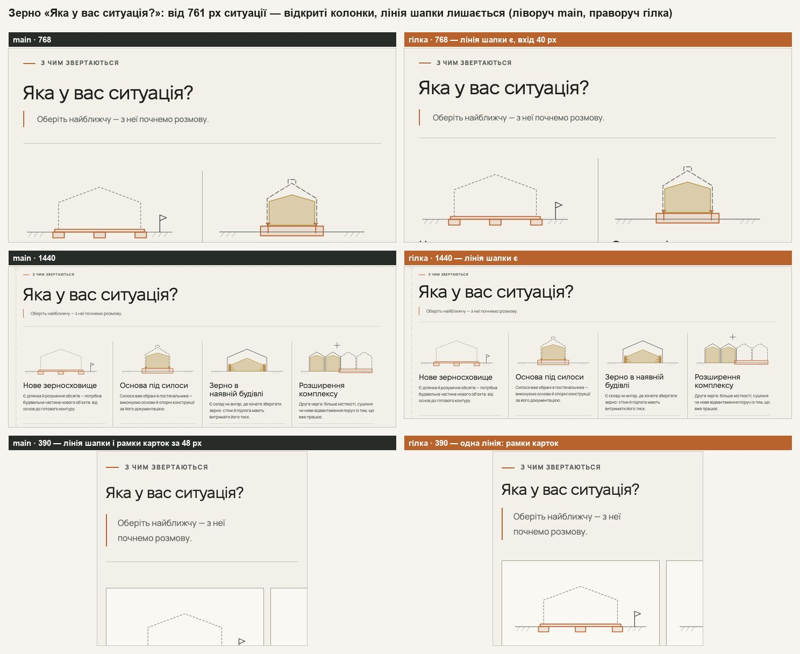
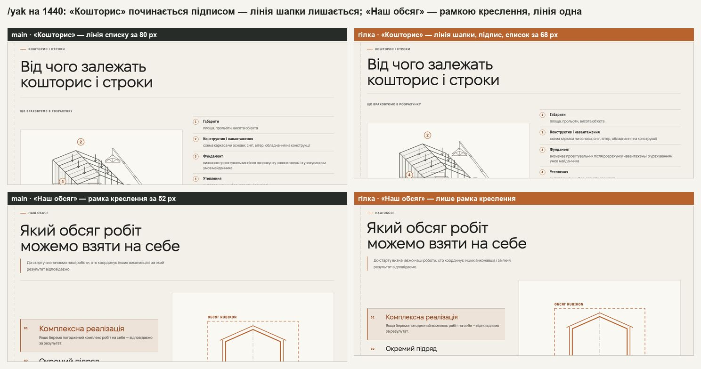

# Handoff · Ритм секцій і хвіст сторінок напрямів (W3-03 · PDO-21, PDO-22 A, PDO-15, PDO-62)

| | |
|---|---|
| Дата | 2026-10-25 |
| Виконавець | Claude Code |
| Підстава | Рішення власника 25.10 щодо брифу Wave 03, OD-PX-17: (1) так — одна лінія під шапкою секції, коли зміст має свою верхню лінію, і щільніший вхід; (2) **A** — одна телефонна шкала 72 / 56, смуги зерна на телефоні лишаються 72; (3) «Пов’язані напрямки» після форми і компактні шви між сусідніми секціями одного тону (PDO-21, PDO-22, PDO-15, PDO-62 — міграція ритму) |
| PR | Ще не відкрито (відкриває оркестратор). **Merge і production deploy — лише з окремого OK Дмитра** (DEC-30) |
| Гілка / base | `design/w303-section-rhythm` стеком на `design/w302-type-scale` — фінальний W3-02 `a4dfec9` (Draft PR #249), злитий merge-комітом `4fa9fb7`. Висоти й еталони нижче — проти `main` `6aa2da6`, тобто разом із W3-02; внесок самого W3-03 — окремим стовпцем, проти збірки `a4dfec9` |
| Коміти | `972d4ba` вхід у секцію · `21b42ef` телефонна шкала · `575e26c` хвіст напрямів · `82fab33` тести · `47aca34` handoff · merge W3-02 (`8273fda`, `dec4a6e`, `4fa9fb7`) · правки рев’ю: `e139d5a` лінія шапки за шириною · `8053514` смуги зерна 72 на телефоні · `1565bd3` HOME без `:has()` · `ecbc41e` тести · `7697aed` ui-system · цей handoff |
| Змінено | CSS: `app/globals.css`, `app/home-v2.css`, `app/components/home-v2/directions-sheets.css`, `app/zernoskhovyshcha/grain-editorial.css`, `app/yak-pratsyuiemo/delivery.css`, `app/angary/angary-editorial.css`. Дані й типи: `app/data/directionPages.ts` (`related.placement`), `app/types/directionPage.ts`, коментар у `app/components/DirectionDetail.tsx`. Тести: `tests/unit/design-tokens.test.ts` (+4), `tests/unit/angary-real-object.test.ts`, новий `tests/e2e/section-rhythm.spec.ts`. Документ: розділ 9 `docs/ui-system-v1.md` |
| Не змінено | Тексти; відступи героїв; планшетні значення /angary (761–1023 px, 72 / 56); стиснені смуги зерна від 761 px (бюджет висоти); інші мітки над H2 (герої, FAQ, липкі й редакційні заголовки — 24 px); `--rhythm-cta` (34 px); режим розмови на ноутбуці (16 / 16); відступи конфігуратора /angary на телефоні (48 / 82 px — названий виняток у §9 `ui-system-v1.md`) і нижній відступ команди /pro-nas (64 px) |

## Що було

Заміри — локальна production-збірка `main` `6aa2da6`, Chromium, 9 сторінок.

- **Дві лінії поспіль.** Під шапкою секції стоїть її лінія, а за 42 px (телефон) або 54 px (768, 1440) — верхня лінія самого змісту: «Вартість» на металі, бетоні, покрівлі й зерні, #kompleks і входи зерна, два блоки /pro-nas, три на /yak (формати, перемикач відповідальності, «Кошторис»). Таких пар ближче 80 px — **11 на 390, 11 на 768, 10 на 1440**.
- **Довгий вхід.** Від верху «Вартості» металу до першого рядка — **424 px на 390 і 465 на 1440**. Мітка → H2: 22 / 30 px (телефон / 1440), H2 → лід 26 / 22, шапка → зміст 42 / 52–54 (у /napryamky 34 / 48, у команди /pro-nas 42 / 60).
- **Різні відступи секцій на телефоні.** Верхні відступи: 82 px на HOME, /napryamky, металі, бетоні, покрівлі й /pro-nas; 72 на /yak, /angary і зерні; 52 у «Пов’язаних» /angary; 48 у конфігуратора /angary і відповідальності /yak — набір **{48, 52, 72, 82}**. Причина — перевизначення `--section-space` у `delivery.css` і `angary-editorial.css`.
- **Хвіст напряму.** «Вартість» → FAQ → «Пов’язані напрямки» → форма: три секції одного тону, від останньої лінії вартості до мітки «Питання» — **164 px на 390 і 230 на 1440**. «Пов’язані» відводять зі сторінки саме перед контактом (на /angary вони вже після форми).

## Що зроблено

**1. Одна лінія і щільніший вхід (PDO-21, PDO-62).**

- Коли зміст під шапкою починається власною верхньою межею, лінія шапки і відступ над нею зникають: `.section-header:has(+ :is(.cost-list, .gc, .about-cap, .about-principles-grid, .dfmt-grid, .proc-resp-switch, .dxi, .direction-grid))`.
- Два блоки мають таку межу лише до певної ширини, тож для них — окремі правила `:has()` з шириною: **ситуації зерна** (`.gs-list`) — до 760 px (рамки карток; від 761 px це відкриті колонки без верхньої лінії, на main до першої лінії 337 / 361 px на 768 / 1440), **чинники кошторису /yak** (`.proc-factors`) — до 1050 px (рамка креслення під його підписом; від 1051 px колонки відкриваються підписом «Що враховуємо в розрахунку» і списком, рамки зверху немає). Там, де межі немає, лінія шапки лишається.
- Браузер без `:has()` (Firefox < 121, Safari < 15.4) лишає лінію шапки, як зараз. Виняток — телефонна шапка «Напрямів» HOME: список аркушів завжди йде одразу під нею і відкривається сильною лінією, тож для таких браузерів є запасне правило лише для телефона, `@supports not selector(:has(*))` у `home-v2.css` — шапка без лінії, як до W3-03.
- Вхід через токени ритму з W3-01 (значення в `:root` і в телефонному `:root`): `--rhythm-label` 20 / 16 px (мітка → H2 у шапці секції), `--rhythm-lead` 24 / 20 (H2 → лід, він же відступ над лінією шапки; так само ліди вузла напряму й секцій /angary — були 28 / 22), новий `--rhythm-header` 40 / 32 (шапка → зміст, `.section-header` і `.page-heading`, яка була 54 / 42).
- Прибрано перевизначення, що перебивали спільне правило з тим самим наміром: телефонні значення `.section-header` і `.page-heading` у `globals.css`, `.directions-index .page-heading` (48 / 34), `.team-heading` (60; на телефоні 42), телефонна шапка «Напрямів» HOME (`home-v2.css`, лінія тепер іде спільним правилом, 30 → 32 px; без `:has()` — запасне правило вище) і телефонна шапка смуги процесу зерна (`grain-editorial.css`, 28 / 22 → 32 / 20).
- Базова `.eyebrow` (герої, FAQ, липкі й редакційні заголовки) лишила 24 px: тепер це `var(--space-6)`, а `--rhythm-label` бере лише мітка шапки секції, як у прототипі.
- П’ять аркушів у шапці «Напрямів» HOME (від 1200 px) стоять на верхівці великих літер заголовка: їхній верхній відступ рахувався від мітки 30 px, тепер — `calc(18.6px + var(--rhythm-label) + .15 * var(--type-h2))`, тож іде за токеном.

**2. Одна телефонна шкала 72 / 56 (PDO-22 A).**

- Телефонний `:root`: `--section-space` 82 → **72 px**, `--section-space-compact` → **56 px**. Прибрано `.process-page { --section-space: 72px }` (/yak) і телефонні 72 / 52 /angary: «Пов’язані» /angary, що закривають сторінку, — 52 → 56 через токен. Звичайна секція ніде не менша за 72 (KEEP 38).
- Стиснені смуги зерна загорнуто в `@media (min-width: 761px)` (п’ять правил): на ноутбуці й планшеті це задокументований виняток для бюджету висоти, на телефоні смуги мають 72 з обох боків кожного шва, як у брифі («смуги зерна лишаються 72»).

**3. Хвіст сторінок напрямів (PDO-15).**

- Метал, бетон і покрівля: `related: { placement: 'after-inquiry' }` у `directionPages.ts`, як /angary. FAQ веде прямо до форми, «Пов’язані напрямки» закривають сторінку після неї з компактним відступом (`.is-closing`). Заголовок «Пов’язані напрямки» і картки ті самі.
- Сусіди одного тону «Вартість» → FAQ на металі, бетоні й покрівлі сходяться компактним відступом з обох боків (`globals.css`, `:has(+ …)` і `+`): 164 → 112 px на 390. Без `:has()` верхня секція лишає свій відступ, нижня бере компактний.
- Пари комплекс → ситуації і FAQ → «Пов’язані» є лише на зерні: від 761 px там компактні всі смуги, на телефоні бриф лишає їм 72. Тому в спільному правилі їх немає — шви зерна на 390 такі самі, як на main (72 + 72).

## Відхилення від прототипу і брифу

- **/napryamky не входить у правило.** Бриф пропонував додати список /napryamky (768, 1440). Але рядки списку розділені лініями лише між собою, верхньої лінії в нього немає: замір ловив рамку аркуша першого рядка. Без лінії шапки перший рядок лишався без межі, а на 1440 над цією лінією стоїть план-ключ. Лінію лишив; вхід усе одно щільніший (48 → 40 px). Через це в замірі лишається одна «пара» на 768 і 1440 (64 і 66 px до рамки аркуша; на 600–760 px — 52, на main 54).
- **HOME входить у правило.** На телефоні лінію вже прибирало локальне правило (тепер спільне, із запасним для браузерів без `:has()`), від 761 px верхній край карток з фото сам задає межу.
- **/yak «Кошторис» — лише до 1050 px.** На 390 і 768 підпис «Що враховуємо в розрахунку» стоїть одразу над рамкою креслення, рамка — перша лінія змісту (на main 70 / 80 px під лінією шапки). На 1440 зміст починається підписом, а не лінією: лінія списку чинників стоїть за 80 px під лінією шапки на main і за 68 px на гілці (щільніший вхід), з підписом між ними, тож лінія шапки лишається. Інструмент `doubleRules` бачить тут рамку креслення (138 → 126 px), бо бере перший елемент з лінією в порядку DOM.
- **/yak «Наш обсяг» (`.dfmt-grid`) на 1440 перевірено — лишається в правилі.** Зміст відкривається рамкою креслення в правій половині: на main вона стояла за 52 px під лінією шапки (друга лінія над половиною ширини; `doubleRules` її пропускав, бо першим у DOM іде список, 163 px). На гілці лишилася тільки рамка; власна лінія списку форматів ліворуч — нижче, як і на main (163 → 160 px).
- **Пара «ситуації → огляд» (`direction-entry → direction-overview`) не додана:** такої пари немає на жодній сторінці (у покрівлі за ситуаціями йде вузол іншого тону), а селектор прототипу `.direction-overview` не відповідав жодному класу.
- **Ліди вузла напряму й /angary** — 28 / 22 → 24 / 20 через `--rhythm-lead` (прототип їх не чіпав): −4 / −2 px на лід.
- **Команда /pro-nas** — шапка → історії 60 / 42 → 40 / 32, як у прототипі (там це робив `!important`); у коді прибрано локальні 60 px.

## До / після

Локальні production-збірки `main` `6aa2da6` (ліворуч) і гілки (праворуч, мідний підпис), Chromium, reduced motion.

## Перевірка

Інструменти `wave03-tools` (`baseline-measure` + `probes.js`: `doubleRules`, `entries`, `tail`, `sections`, `height`; `dec18`) на `main` (:4370), на базі W3-02 (`a4dfec9`, зібрана окремо) і на гілці (:4374); 9 сторінок, світла тема.

| Що | main | гілка | бриф (A) |
|---|---|---|---|
| Дві лінії ближче 80 px (390 / 768 / 1440) | 11 / 11 / 10 | **0 / 1 / 1** (лишився /napryamky, див. вище) | 1 / — / 2 |
| Те саме на 320, 600, 760, 761, 1024, 1050, 1051, 1280 | — | 0 на 320; на решті лише /napryamky (52–66 px; на main 54) | — |
| Те саме, WebKit (390 / 1440) | — | 0 / 1 | — |
| Лінія шапки над ситуаціями зерна (390 / 768 / 1440) | є / є / є | **ні (рамки карток) / є / є** | — |
| Лінія шапки над чинниками /yak «Кошторис» (390 / 768 / 1440) | є / є / є | **ні / ні / є** (від 1051 px) | — |
| HOME 390, шапка «Напрямів» у браузері без `:has()` (імітація: правила `:has()` відкинуто) | без лінії, до списку 30 px | **без лінії, 32 px** (до правки рев’ю — лінія 1 px і 20 px над нею) | — |
| Вхід у «Вартість» металу, верх секції → перший рядок (390 / 768 / 1440) | 424 / 381 / 465 px | **363 / 332 / 410** | 363 / — / 410 |
| Мітка → H2, H2 → лід, шапка → зміст у «Вартості» (390) | 22, 26, 42 + 28 + лінія | **16, 20, 32** | 16, 20, 32 |
| Те саме (1440) | 30, 22, 54 + 32 + лінія | **20, 24, 40** | 20, 24, 40 |
| Остання лінія вартості → мітка «Питання» (390 / 768 / 1440) | 164 / 184 / 230 px | **112 / 144 / 173** | 112 / — / 173 |
| Порядок хвоста металу, бетону, покрівлі | вартість, FAQ, «Пов’язані», форма | вартість, FAQ, **форма, «Пов’язані»** | те саме |
| Шви зерна на 390: комплекс → ситуації, FAQ → «Пов’язані» | 72 + 72 | **72 + 72** | 72 + 72 |
| Верхні відступи секцій на 390 (без героїв) | {48, 52, 72, 82} | **{48, 56, 72}** (і 0 у прилеглого «Реального об’єкта» /angary) | {48, 56, 72} |
| Нижні відступи на 390 | {52, 64, 72, 82} | {56, 64, 72, 82} — 82 у конфігуратора /angary (названий виняток, §9 `ui-system-v1.md`), 64 у команди /pro-nas | — |
| Бюджет зерна 1440×900 (межа 9,15), `grain-page.spec` | 9,08 | **8,91** (W3-02: 9,09) | 8,88 |
| Бюджет зерна 390×844 (межа 12,6), `grain-page.spec` | 12,38 | **12,17** (W3-02: 12,38) | — |
| `#inquiry` з героя («Обговорити») і з FAQ («Залишити запит ↓»): метал, бетон, покрівля, 390 / 1440 | верх форми на 88 / 116 px | **88 / 116 px** (так само; тепер `section-rhythm` перевіряє обидві ширини); під формою ще «Пов’язані», тож місця для прокрутки більше | — |

**Висота сторінок, px** (світла тема; «разом» — проти `main`, тобто з W3-02; «W3-03» — проти бази W3-02 `a4dfec9`):

| Сторінка | 390 разом | 390 W3-03 | 768 разом | 768 W3-03 | 1440 разом | 1440 W3-03 |
|---|---|---|---|---|---|---|
| HOME | −58 | −70 | −57 | −47 | −57 | −53 |
| /napryamky | −104 | −122 | −52 | −14 | −23 | −39 |
| /metalokonstruktsii | −263 | −287 | −161 | −153 | −273 | −203 |
| /betonni-roboty | −283 | −287 | −165 | −157 | −284 | −204 |
| /pokrivelni-roboty | −290 | −317 | −194 | −181 | −314 | −233 |
| /angary | +30 | +6 | +7 | −4 | −6 | −4 |
| /zernoskhovyshcha | −183 | −183 | −144 | −146 | −160 | −168 |
| /yak-pratsyuiemo | −166 | −171 | −158 | −161 | −147 | −153 |
| /pro-nas | −211 | −214 | −170 | −116 | −130 | −133 |

Бриф (A, без W3-02) на 390: метал −285, бетон −285, покрівля −315, зерно −183, /yak −150, /pro-nas −214, HOME −72, /napryamky −120, /angary +8; стеком із W3-02 метал −261 (390) і −269 (1440). Зерно на 390 тепер збігається з брифом (−183). Різниця /yak — пара «Кошторис» на 390 (−21 px: відступ 20 і лінія), HOME на 1440 — пара «Напрямів» (−26 px). Лінія шапки, що лишилася над ситуаціями зерна (від 761 px) і чинниками /yak (від 1051 px), — це +25 px до висоти проти першої версії кроку (зерно 768 / 1440, /yak 1440).

| Перевірка | Результат |
|---|---|
| `vitest run` | 94 файли, 1465 тестів — passed (+4 у `design-tokens`: токени входу, одна телефонна шкала, правило однієї лінії — з шириною для `.gs-list` і `.proc-factors` і запасним правилом HOME без `:has()`, шов «Вартість» → FAQ без пар зерна) |
| `eslint .`, `tsc --noEmit` | чисто |
| `section-rhythm`, desktop + mobile chromium | на гілці 6 passed, 6 skipped (тест сам задає ширини 1440 і 390); на `main` — 6 з 6 failed. Нове після рев’ю: лінія шапки над ситуаціями зерна й чинниками /yak за шириною, смуги зерна 72 на 390, `#inquiry` з FAQ на 390 |
| Після правок рев’ю: `section-rhythm`, `home-directions-sheets`, `direction-*` (7 специфікацій), `grain-page`, `phase3-shorter-pages`, `pr-critical`, `smoke`, desktop + mobile chromium, 3 workers | 292 passed, 44 skipped, 6 failed — усі шість тайм-аути 30 с під навантаженням машини (load average ≈ 87 від інших процесів): `direction-node:43` ×2, `grain-page:284`, `grain-page:294`, `smoke:606`, `direction-static-hero:51` (tablet). Ці тести окремо, 1 worker: **16 passed, 0 failed** |
| До правок рев’ю (на `82fab33`): увесь e2e, desktop + mobile chromium, 4 workers (31,6 хв) | 1492 passed, 467 skipped, 17 failed. Регресія одна: `home-directions-sheets` (1200 і 1440) — аркуші HOME стояли на 48,6 px «мітки над заголовком», а мітка стала на 10 px ближче; виправлено в `directions-sheets.css`. Решта — навантаження й мережа (тайм-аути, `typography` late fonts на mobile, відома локальна різниця macOS) і пройшли окремо |

## Еталони (DEC-18)

Не оновлено. `dec18.cjs` проти `main` (гілка разом із W3-02): **29 з 42** — усі цілі `visual.spec`, крім `homepage-hero-*` і `direction-faq-*` (27), і `grain-planner-desktop-initial`, `grain-planner-mobile-390-initial`. Бриф передбачав для стеку W3-02 + W3-03 ті самі 29. `footer-logo-desktop-1440` (у самого W3-03 за брифом 56 → 55 px) у стеку не змінюється. Не змінюються: `homepage-hero-*`, `direction-faq-*`, логотипи шапки й футера, `configurator-*`.

Список: `homepage-directions-*`, `homepage-real-object-*`, `homepage-inquiry-*`, `directions-hub-*`, `direction-cost-*`, `process-route-*`, `process-scope-*`, `process-responsibility-*`, `process-terms-*` (по 3: mobile-375, tablet-768, desktop-1440), `grain-planner-desktop-initial`, `grain-planner-mobile-390-initial`.

Окремо по кроках (той самий `dec18`, база W3-02 зібрана з `a4dfec9`): база проти `main` — **17**, як у handoff W3-02. Гілка проти бази, тобто сам W3-03, — **24**: `homepage-directions-*`, `directions-hub-*`, `direction-cost-*`, `process-route-*`, `process-scope-*`, `process-responsibility-*`, `process-terms-*` (по 3), обидва `grain-planner-*-initial` і `homepage-inquiry-desktop-1440` (806 → 805 px: субпіксельне округлення після коротшої секції вище; у брифі цю роль грав `footer-logo-desktop-1440`). `process-terms-desktop-1440` змінюється й тепер, коли лінія шапки над чинниками лишилася: щільніший вхід (мітка 20, лід 24, шапка → зміст 40). `homepage-real-object-*` і решта `homepage-inquiry-*` змінюються лише через W3-02. `homepage-directions-mobile-375` вищий за main на 19 px через W3-02 (H2 у три рядки на 375), W3-03 у ньому −10 px.

Linux-рендери з CI — власнику до оновлення PNG.

**Для власника:** перегляд металу і /yak на телефоні (так у дорожній карті), хвіст напряму на iPhone 12 разом із W3-02.

## Поза цим кроком

- **Інші мітки над H2** (герої, FAQ, липкі заголовки огляду, редакційні заголовки, «Пов’язані») — 24 px. Перевести їх на `--rhythm-label` — наступний прохід PDO-62: зачепить `direction-faq-*` і героїв.
- **`--rhythm-cta`** (контент → посилання, реєстр: 32 / 24) лишився 34 px — разом із посиланнями зі стрілкою W3-06.
- **Нижні відступи** конфігуратора /angary (48 / 82 px на телефоні; під ним прилеглий «Реальний об’єкт» без верхнього відступу з власною лінією) і команди /pro-nas (`.team.section` 64 px плюс 64 px усередині історій) — складені стики, а не відступ секції; названі винятком у §9 `ui-system-v1.md`, не змінював.
- **Мертві правила** варіанта команди для HOME (`.team-home …`): компонент у цьому варіанті не рендериться ніде.

## Відкат

Після squash-merge — `git revert` коміту PR. На гілці — по одному у зворотному порядку: правки рев’ю `7697aed`, `ecbc41e`, `1565bd3`, `8053514`, `e139d5a`, далі `82fab33` (тести), `575e26c` (хвіст), `21b42ef` (шкала), `972d4ba` (вхід); merge-коміти W3-02 не чіпати. Частково: лише «Пов’язані» на старе місце — прибрати `related: { placement: 'after-inquiry' }` у трьох конфігах `directionPages.ts` (і рядок тесту); лише межі ширини для ситуацій зерна й чинників /yak — `git revert e139d5a`.
