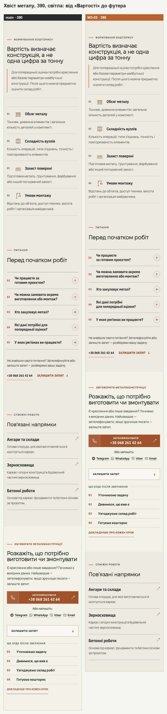
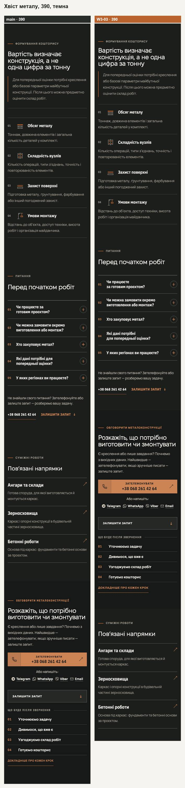
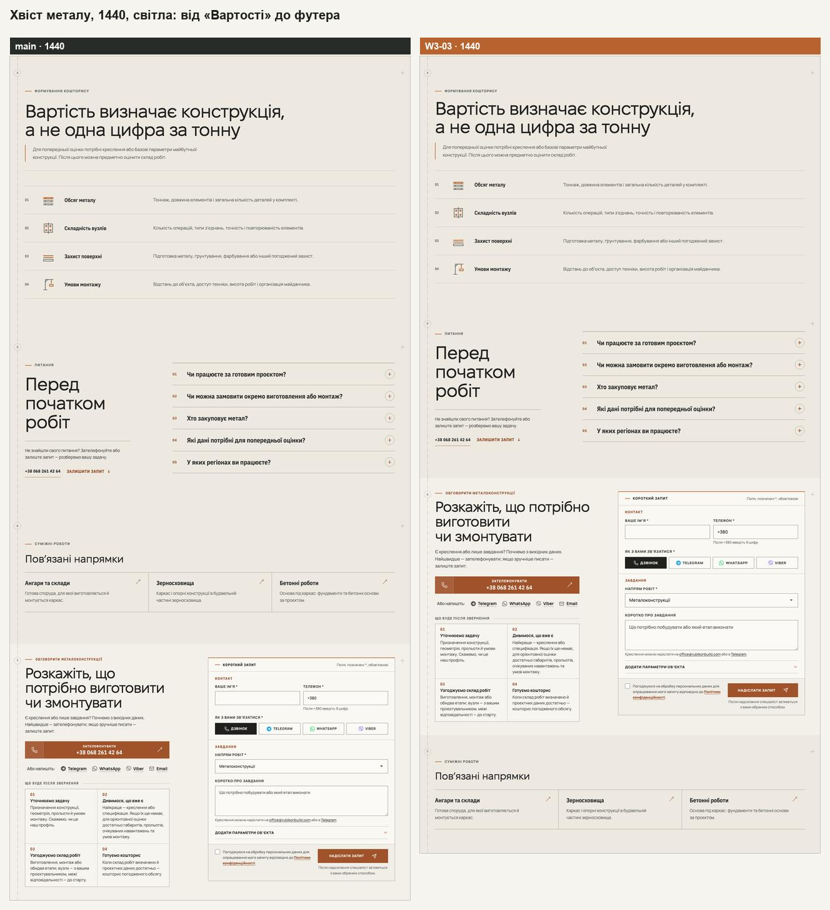
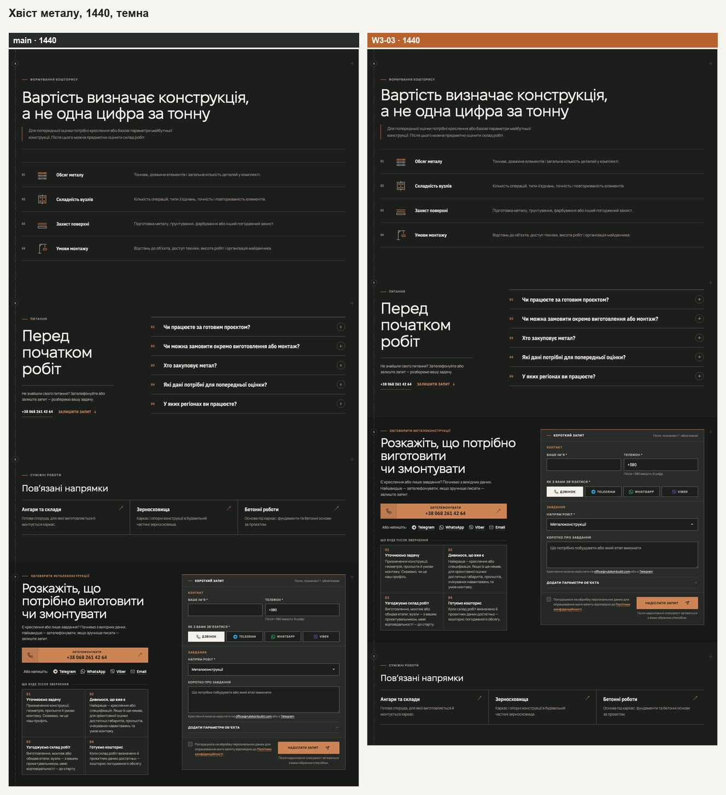
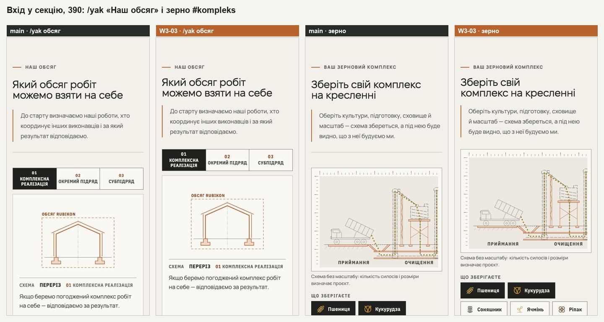
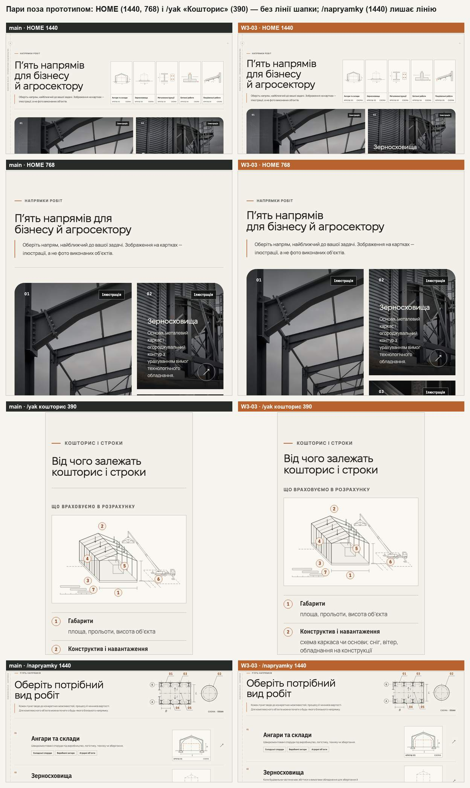

# Handoff · Ритм секцій і хвіст сторінок напрямів (W3-03 · PDO-21, PDO-22 A, PDO-15, PDO-62)

| | |
|---|---|
| Дата | 2026-10-25 |
| Виконавець | Claude Code |
| Підстава | Рішення власника 25.10 щодо брифу Wave 03, OD-PX-17: (1) так — одна лінія під шапкою секції і щільніший вхід; (2) **A** — одна телефонна шкала 72 / 56; (3) «Пов’язані напрямки» після форми і компактні відступи між сусідніми секціями одного тону (PDO-21, PDO-22, PDO-15, PDO-62 — міграція ритму) |
| PR | Ще не відкрито (відкриває оркестратор). **Merge і production deploy — лише з окремого OK Дмитра** (DEC-30) |
| Гілка / base | `design/w303-section-rhythm` стеком на `design/w302-type-scale` (`23405db`, W3-02). Висоти й еталони нижче — проти `main` `6aa2da6`, тобто разом із W3-02; внесок самого W3-03 — окремим стовпцем |
| Коміти | `972d4ba` вхід у секцію · `21b42ef` телефонна шкала · `575e26c` хвіст напрямів · `82fab33` тести · цей handoff |
| Змінено | CSS: `app/globals.css`, `app/home-v2.css`, `app/components/home-v2/directions-sheets.css`, `app/zernoskhovyshcha/grain-editorial.css`, `app/yak-pratsyuiemo/delivery.css`, `app/angary/angary-editorial.css`. Дані й типи: `app/data/directionPages.ts` (`related.placement`), `app/types/directionPage.ts`, коментар у `app/components/DirectionDetail.tsx`. Тести: `tests/unit/design-tokens.test.ts` (+4), `tests/unit/angary-real-object.test.ts`, новий `tests/e2e/section-rhythm.spec.ts`. Документ: розділ 9 `docs/ui-system-v1.md` |
| Не змінено | Тексти; відступи героїв; планшетні значення /angary (761–1023 px, 72 / 56); стиснені смуги зерна від 761 px (бюджет висоти); інші мітки над H2 (герої, FAQ, липкі й редакційні заголовки — 24 px); `--rhythm-cta` (34 px); режим розмови на ноутбуці (16 / 16); нижній відступ конфігуратора /angary на телефоні (82 px) і команди /pro-nas (64 px) |

## Що було

Заміри — локальна production-збірка `main` `6aa2da6`, Chromium, 9 сторінок.

- **Дві лінії поспіль.** Під шапкою секції стоїть її лінія, а за 42 px (телефон) або 54 px (768, 1440) — верхня лінія самого змісту: «Вартість» на металі, бетоні, покрівлі й зерні, #kompleks і входи зерна, два блоки /pro-nas, три на /yak (формати, перемикач відповідальності, «Кошторис»). Таких пар ближче 80 px — **11 на 390, 11 на 768, 10 на 1440**.
- **Довгий вхід.** Від верху «Вартості» металу до першого рядка — **424 px на 390 і 465 на 1440**. Мітка → H2: 22 / 30 px (телефон / 1440), H2 → лід 26 / 22, шапка → зміст 42 / 52–54 (у /napryamky 34 / 48, у команди /pro-nas 42 / 60).
- **Різні відступи секцій на телефоні.** Верхні відступи: 82 px на HOME, /napryamky, металі, бетоні, покрівлі й /pro-nas; 72 на /yak, /angary і зерні; 52 у «Пов’язаних» /angary; 48 у конфігуратора /angary і відповідальності /yak — набір **{48, 52, 72, 82}**. Причина — перевизначення `--section-space` у `delivery.css` і `angary-editorial.css`.
- **Хвіст напряму.** «Вартість» → FAQ → «Пов’язані напрямки» → форма: три секції одного тону, від останньої лінії вартості до мітки «Питання» — **164 px на 390 і 230 на 1440**. «Пов’язані» відводять зі сторінки саме перед контактом (на /angary вони вже після форми).

## Що зроблено

**1. Одна лінія і щільніший вхід (PDO-21, PDO-62).**

- Коли зміст під шапкою починається власною верхньою межею, лінія шапки і відступ над нею зникають: `.section-header:has(+ :is(.cost-list, .gc, .gs-list, .about-cap, .about-principles-grid, .dfmt-grid, .proc-resp-switch, .proc-factors, .dxi, .direction-grid))`. Браузер без `:has()` лишає лінію шапки, як зараз.
- Вхід через токени ритму з W3-01 (значення в `:root` і в телефонному `:root`): `--rhythm-label` 20 / 16 px (мітка → H2 у шапці секції), `--rhythm-lead` 24 / 20 (H2 → лід, він же відступ над лінією шапки; так само ліди вузла напряму й секцій /angary — були 28 / 22), новий `--rhythm-header` 40 / 32 (шапка → зміст, `.section-header` і `.page-heading`, яка була 54 / 42).
- Прибрано перевизначення, що перебивали спільне правило з тим самим наміром: телефонні значення `.section-header` і `.page-heading` у `globals.css`, `.directions-index .page-heading` (48 / 34), `.team-heading` (60; на телефоні 42), телефонна шапка «Напрямів» HOME (`home-v2.css`, лінія тепер іде спільним правилом, 30 → 32 px) і телефонна шапка смуги процесу зерна (`grain-editorial.css`, 28 / 22 → 32 / 20).
- Базова `.eyebrow` (герої, FAQ, липкі й редакційні заголовки) лишила 24 px: тепер це `var(--space-6)`, а `--rhythm-label` бере лише мітка шапки секції, як у прототипі.
- П’ять аркушів у шапці «Напрямів» HOME (від 1200 px) стоять на верхівці великих літер заголовка: їхній верхній відступ рахувався від мітки 30 px, тепер — `calc(18.6px + var(--rhythm-label) + .15 * var(--type-h2))`, тож іде за токеном.

**2. Одна телефонна шкала 72 / 56 (PDO-22 A).**

- Телефонний `:root`: `--section-space` 82 → **72 px**, `--section-space-compact` → **56 px**. Прибрано `.process-page { --section-space: 72px }` (/yak) і телефонні 72 / 52 /angary: «Пов’язані» /angary, що закривають сторінку, — 52 → 56 через токен. Звичайна секція ніде не менша за 72 (KEEP 38).
- Стиснені смуги зерна загорнуто в `@media (min-width: 761px)` (п’ять правил): на ноутбуці це задокументований виняток для бюджету висоти, на телефоні смуги мають 72, як усюди.

**3. Хвіст сторінок напрямів (PDO-15).**

- Метал, бетон і покрівля: `related: { placement: 'after-inquiry' }` у `directionPages.ts`, як /angary. FAQ веде прямо до форми, «Пов’язані напрямки» закривають сторінку після неї з компактним відступом (`.is-closing`). Заголовок «Пов’язані напрямки» і картки ті самі.
- Сусіди одного тону сходяться компактним відступом з обох боків: «Вартість» → FAQ, FAQ → «Пов’язані» (зерно), комплекс зерна → його ситуації (`globals.css`, `:has(+ …)` і `+`). Без `:has()` верхня секція лишає свій відступ, нижня бере компактний.

## Відхилення від прототипу і брифу

- **/napryamky не входить у правило.** Бриф пропонував додати список /napryamky (768, 1440). Але рядки списку розділені лініями лише між собою, верхньої лінії в нього немає: замір ловив рамку аркуша першого рядка. Без лінії шапки перший рядок лишався без межі, а на 1440 над цією лінією стоїть план-ключ (кадр нижче). Лінію лишив; вхід усе одно щільніший (48 → 40 px). Через це в замірі лишається одна «пара» на 768 і 1440 (64 і 66 px до рамки аркуша).
- **HOME і /yak «Кошторис» входять.** HOME: на телефоні лінію вже прибирало локальне правило (тепер спільне), від 761 px верхній край карток з фото сам задає межу (кадр нижче). /yak «Кошторис»: на 1440 верхня лінія списку факторів стояла за 40 px під лінією шапки, на 390 і 768 — рамка креслення.
- **Пара «ситуації → огляд» (`direction-entry → direction-overview`) не додана:** такої пари немає на жодній сторінці (у покрівлі за ситуаціями йде вузол іншого тону), а селектор прототипу `.direction-overview` не відповідав жодному класу.
- **Зерно на телефоні.** У прототипі правило `!important` для телефонних смуг зерна через свою специфічність перебивало й компактні шви, тож зерно на 390 там було −183 px. Тут шви одного тону працюють і на зерні, як того хоче PDO-15 (комплекс → ситуації, FAQ → «Пов’язані»: 144 → 112 px): зерно −247 px на 390. Якщо це зайве, одне правило в `grain-editorial.css` поверне 72.
- **Ліди вузла напряму й /angary** — 28 / 22 → 24 / 20 через `--rhythm-lead` (прототип їх не чіпав): −4 / −2 px на лід.
- **Команда /pro-nas** — шапка → історії 60 / 42 → 40 / 32, як у прототипі (там це робив `!important`); у коді прибрано локальні 60 px.

## До / після

Локальні production-збірки `main` `6aa2da6` (ліворуч) і гілки (праворуч, мідний підпис), Chromium, reduced motion.

## Перевірка

Інструменти `wave03-tools` (`baseline-measure` + `probes.js`: `doubleRules`, `entries`, `tail`, `sections`, `height`; `dec18`) на `main` (:4370), на базі W3-02 (`23405db`, зібрана окремо) і на гілці (:4374); 9 сторінок, світла тема.

| Що | main | гілка | бриф (A) |
|---|---|---|---|
| Дві лінії ближче 80 px (390 / 768 / 1440) | 11 / 11 / 10 | **0 / 1 / 1** (лишився /napryamky, див. вище) | 1 / — / 2 |
| Те саме, WebKit (390 / 1440) | — | 0 / 1 | — |
| Вхід у «Вартість» металу, верх секції → перший рядок (390 / 768 / 1440) | 424 / 381 / 465 px | **363 / 332 / 410** | 363 / — / 410 |
| Мітка → H2, H2 → лід, шапка → зміст у «Вартості» (390) | 22, 26, 42 + 28 + лінія | **16, 20, 32** | 16, 20, 32 |
| Те саме (1440) | 30, 22, 54 + 32 + лінія | **20, 24, 40** | 20, 24, 40 |
| Остання лінія вартості → мітка «Питання» (390 / 768 / 1440) | 164 / 184 / 230 px | **112 / 144 / 173** | 112 / — / 173 |
| Порядок хвоста металу, бетону, покрівлі | вартість, FAQ, «Пов’язані», форма | вартість, FAQ, **форма, «Пов’язані»** | те саме |
| Верхні відступи секцій на 390 (без героїв) | {48, 52, 72, 82} | **{48, 56, 72}** (і 0 у прилеглого «Реального об’єкта» /angary) | {48, 56, 72} |
| Нижні відступи на 390 | {52, 64, 72, 82} | {56, 64, 72, 82} — 82 у конфігуратора /angary, 64 у команди /pro-nas (див. «Поза цим кроком») | — |
| Бюджет зерна 1440×900 (межа 9,15) | 9,08 | **8,88** (W3-02: 9,09) | 8,88 |
| Бюджет зерна 390×844 (межа 12,6) | 12,38 | **12,08** | — |
| `#inquiry` з героя («Обговорити») і з FAQ («Залишити запит ↓»): метал, бетон, покрівля, 390 / 1440 | верх форми на 88 / 116 px | **88 / 116 px** (так само); під формою тепер ще «Пов’язані», тож місця для прокрутки більше | — |

**Висота сторінок, px** (світла тема; «разом» — проти `main`, тобто з W3-02; «W3-03» — проти бази W3-02):

| Сторінка | 390 разом | 390 W3-03 | 768 разом | 768 W3-03 | 1440 разом | 1440 W3-03 |
|---|---|---|---|---|---|---|
| HOME | −58 | −70 | −57 | −47 | −57 | −53 |
| /napryamky | −104 | −122 | −52 | −14 | −23 | −39 |
| /metalokonstruktsii | −263 | −287 | −161 | −153 | −273 | −203 |
| /betonni-roboty | −283 | −287 | −165 | −157 | −284 | −204 |
| /pokrivelni-roboty | −290 | −317 | −194 | −181 | −314 | −233 |
| /angary | +30 | +6 | +7 | −4 | −6 | −4 |
| /zernoskhovyshcha | −247 | −247 | −169 | −171 | −185 | −193 |
| /yak-pratsyuiemo | −166 | −171 | −158 | −161 | −172 | −178 |
| /pro-nas | −211 | −214 | −170 | −116 | −130 | −133 |

Бриф (A, без W3-02) на 390: метал −285, бетон −285, покрівля −315, зерно −183, /yak −150, /pro-nas −214, HOME −72, /napryamky −120, /angary +8; стеком із W3-02 метал −261 (390) і −269 (1440). Різниця зерна — шви одного тону (−64 px), /yak — пара «Кошторис» на 390 (−21 px: відступ 20 і лінія), HOME на 1440 — пара «Напрямів» (−26 px).

| Перевірка | Результат |
|---|---|
| `vitest run` | 94 файли, 1465 тестів — passed (+4 у `design-tokens`: токени входу, одна телефонна шкала, правило однієї лінії, компактні шви) |
| `eslint .`, `tsc --noEmit` | чисто |
| `section-rhythm` (новий), desktop + mobile chromium | на гілці 6 passed, 6 skipped (тест сам задає ширини 1440 і 390); на `main` — 6 з 6 failed (порядок хвоста, лінія над вартістю, вхід і шов, телефонні відступи) |
| Увесь e2e, desktop + mobile chromium, 4 workers (31,6 хв) | 1492 passed, 467 skipped, 17 failed. Регресія одна: `home-directions-sheets` (1200 і 1440) — аркуші HOME стояли на 48,6 px «мітки над заголовком», а мітка стала на 10 px ближче; виправлено в `directions-sheets.css` (`calc(18.6px + var(--rhythm-label) + …)`). Решта — навантаження й мережа: `typography` late fonts на mobile ×3 (CLS 0,0578, як на main, відома локальна різниця macOS), тайм-аути `form:822`, `grain-page:141`, `home-proof-contour` ×4, `ux-conversion-phase2:134`, `grain-planner-mobile:79`, `grain-planner:86`, `public-service-claims` ×2 (`goto` до networkidle) і `analytics-consent:125` (справжній gtag.js) |
| Ці специфікації окремо (2 workers) після виправлення: `home-directions-sheets`, `grain-page`, `public-service-claims` цілком, названі тести `form`, `home-proof-contour`, `ux-conversion-phase2`, `grain-planner*`, `analytics-consent`, а також `section-rhythm` і `napryamky-key-plan` | 81 passed, 22 skipped, 0 failed |
| Фінальна збірка: `section-rhythm`, `home-directions-sheets`, `phase3-shorter-pages`, `grain-page`, `direction-editorial-rhythm`, `smoke`, `pr-critical`, `angary-editorial`, `direction-texts` | 284 passed, 62 skipped, 0 failed |

## Еталони (DEC-18)

Не оновлено. `dec18.cjs` проти `main` (гілка разом із W3-02): **29 з 42** — усі цілі `visual.spec`, крім `homepage-hero-*` і `direction-faq-*` (27), і `grain-planner-desktop-initial`, `grain-planner-mobile-390-initial`. Бриф передбачав для стеку W3-02 + W3-03 ті самі 29. `footer-logo-desktop-1440` (у самого W3-03 за брифом 56 → 55 px) у стеку не змінюється. Не змінюються: `homepage-hero-*`, `direction-faq-*`, логотипи шапки й футера, `configurator-*`.

Список: `homepage-directions-*`, `homepage-real-object-*`, `homepage-inquiry-*`, `directions-hub-*`, `direction-cost-*`, `process-route-*`, `process-scope-*`, `process-responsibility-*`, `process-terms-*` (по 3: mobile-375, tablet-768, desktop-1440), `grain-planner-desktop-initial`, `grain-planner-mobile-390-initial`.

Окремо по кроках (той самий `dec18`, база W3-02 зібрана з `23405db`): база проти `main` — **17**, як у handoff W3-02. Гілка проти бази, тобто сам W3-03, — **24**: `homepage-directions-*`, `directions-hub-*`, `direction-cost-*`, `process-route-*`, `process-scope-*`, `process-responsibility-*`, `process-terms-*` (по 3), обидва `grain-planner-*-initial` і `homepage-inquiry-desktop-1440` (806 → 805 px: субпіксельне округлення після коротшої секції вище; у брифі цю роль грав `footer-logo-desktop-1440`). `homepage-real-object-*` і решта `homepage-inquiry-*` змінюються лише через W3-02. `homepage-directions-mobile-375` вищий за main на 19 px через W3-02 (H2 у три рядки на 375), W3-03 у ньому −10 px.

Linux-рендери з CI — власнику до оновлення PNG.

**Для власника:** перегляд металу і /yak на телефоні (так у дорожній карті), хвіст напряму на iPhone 12 разом із W3-02.

## Поза цим кроком

- **Інші мітки над H2** (герої, FAQ, липкі заголовки огляду, редакційні заголовки, «Пов’язані») — 24 px. Перевести їх на `--rhythm-label` — наступний прохід PDO-62: зачепить `direction-faq-*` і героїв.
- **`--rhythm-cta`** (контент → посилання, реєстр: 32 / 24) лишився 34 px — разом із посиланнями зі стрілкою W3-06.
- **Нижні відступи** конфігуратора /angary (82 px на телефоні; під ним прилеглий «Реальний об’єкт» з власною лінією) і команди /pro-nas (`.team.section` 64 px плюс 64 px усередині історій) — це складені стики, а не відступ секції; не змінював.
- **Мертві правила** варіанта команди для HOME (`.team-home …`): компонент у цьому варіанті не рендериться ніде.

## Відкат

На гілці — `git revert 972d4ba^..82fab33` (або по одному у зворотному порядку: тести `82fab33`, хвіст `575e26c`, шкала `21b42ef`, вхід `972d4ba`). Після squash-merge — `git revert` коміту PR. Лише «Пов’язані» на старе місце — прибрати `related: { placement: 'after-inquiry' }` у трьох конфігах `directionPages.ts` (і рядок тесту).
