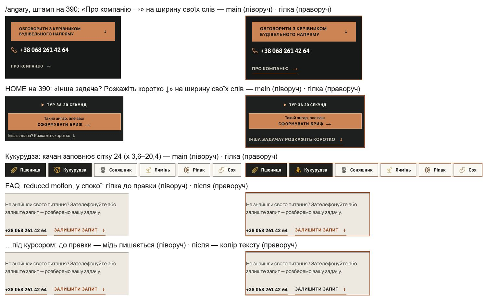
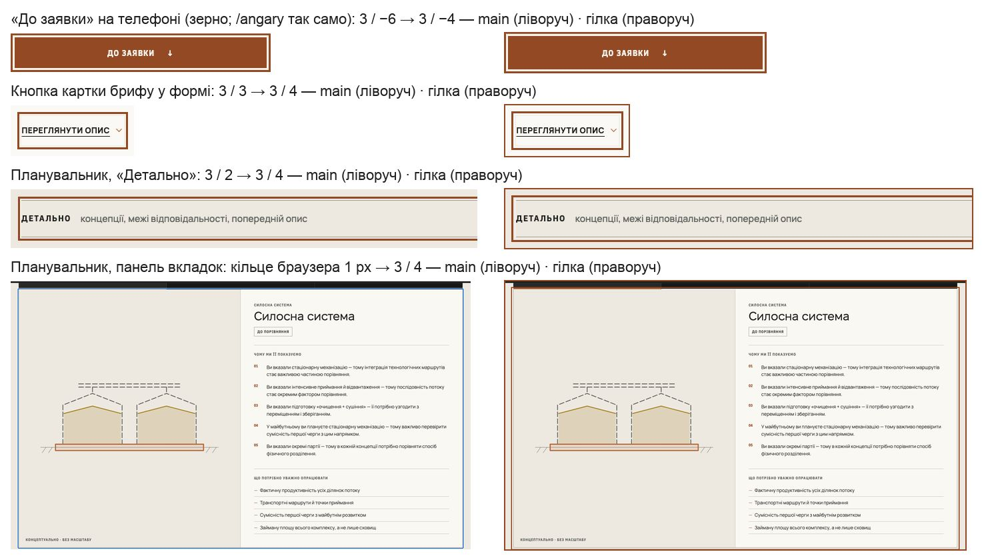
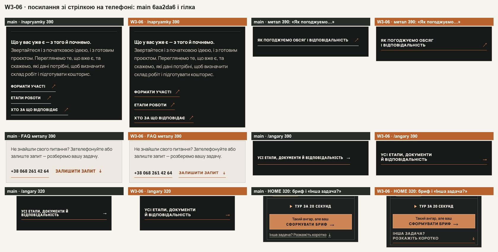
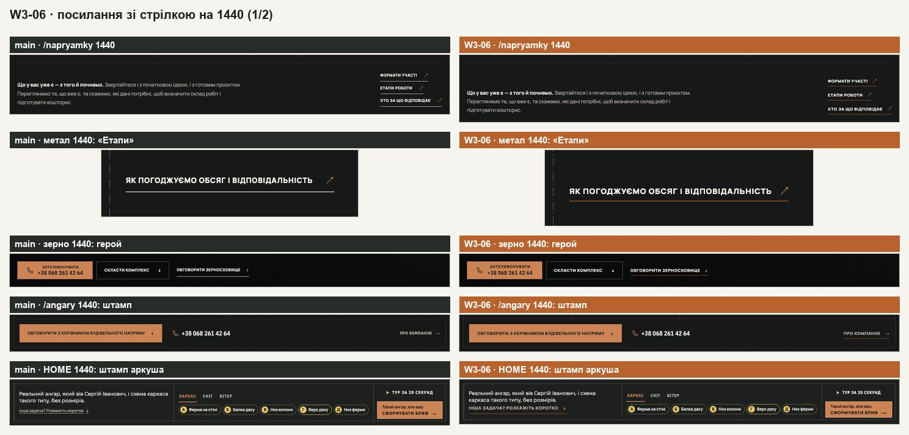
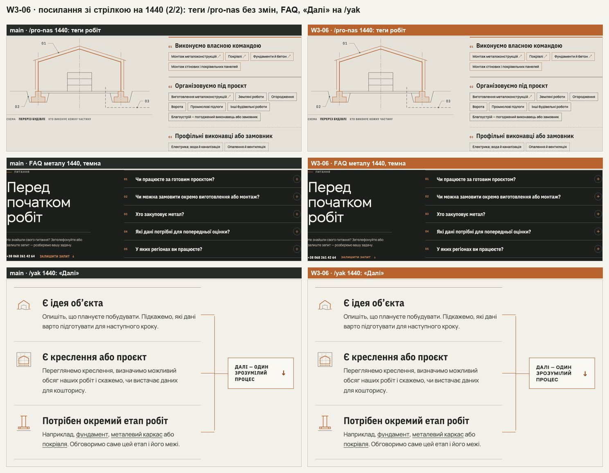
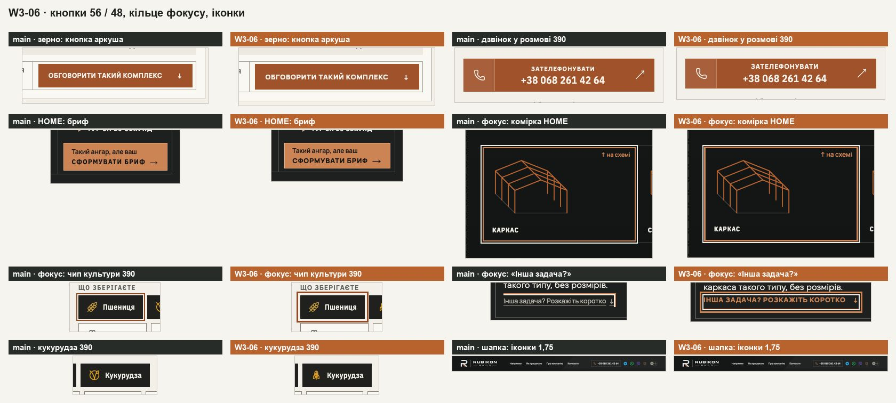

# Handoff · Посилання зі стрілкою, кнопки 56 / 48, два кільця фокусу, один штрих іконок (W3-06 · PDO-56, PDO-99, PDO-88, PDO-89)

| | |
|---|---|
| Дата | 2026-10-25 |
| Виконавець | Claude Code |
| Підстава | Рішення власника 25.10 щодо брифу Wave 03: W3-06, варіант **A** (OD-PX-46: одне посилання зі стрілкою в Manrope 800) — PDO-56, PDO-99, PDO-88, PDO-89 |
| PR | Ще не відкрито (відкриває оркестратор). **Merge і production deploy — лише з окремого OK Дмитра** (DEC-30) |
| Гілка / base | `design/w306-links-buttons-focus` від `101ea20` = W3-02 (`design/w302-type-scale`, Draft PR #249) + main `6aa2da6` (W3-01, W3-07). Після рев’ю W3-02 влито merge-ем (не rebase) двічі: `713bd9a` (W3-02 `a4dfec9`) і `ef9fe72` (W3-02 `e98d21c`). Перед merge — перевести на main після W3-02 |
| Коміти | `b5a48bf` спільні правила (без видимих змін) · `f0ec52c` кнопки 56 / 48 · `29b84a4` посилання зі стрілкою · `67b3315` два кільця фокусу · `333d85a` один штрих іконок, качан · `82aaa29` тест · `671c8d7` «Інша задача?» на HOME і запас аркуша · `dd333b1` `docs/ui-system-v1.md` · `a294c85` тест цілі · `708b861` «Згорнути» мініаркуша · `268db26` handoff · **після рев’ю:** `713bd9a` merge W3-02 `a4dfec9` · `4dbccbc` картку ситуації зерна знову натискають цілою · `5239db7` колір hover і фокусу під reduced motion · `f48e2a8` кільця брифу у формі, «До заявки», планувальника · `e1b6a8a` один селектор `<b>` примітки (Sonar S4666) · `7581988` посилання на телефоні на ширину своїх слів · `e10c5e5` качан заповнює сітку · `45f9dee` тести · `7aff128` `docs/ui-system-v1.md` · `ef9fe72` merge W3-02 `e98d21c` · цей коміт — handoff |
| Змінено | CSS: `app/globals.css`, `home-v2.css`, `conversation.css`, `angary/angary-editorial.css`, `napryamky/directions.css`, `pro-nas/about.css`, `yak-pratsyuiemo/delivery.css`, `zernoskhovyshcha/grain-editorial.css`, `zernoskhovyshcha/grain-planner.css`, `configurator-preview/configurator.css` і в `app/components/`: `faq.css`, `directions/` (`direction-template`, `direction-node`, `formats-scope`), `home-v2/directions-sheets`, `process/change-sheets`, `zernoskhovyshcha/grain-complex`, `configurator/` (`configurator-controls`, `configurator-sheet`). TSX/TS: новий `components/CornCobIcon.tsx`; клас `link-arrow` і `data-arrow` на стрілці в 15 файлах посилань; `TourParts`, `PracticeSteps`, `FormatsScope` (спільні класи); `HomeV2Hero` (`button-hero-secondary`); `GrainComplexBuilder`, `StorageQuestion` (качан); `data/directionPages.ts`, `data/grainPage.ts`. Тести: новий `tests/e2e/links-buttons-focus.spec.ts`, у `tests/e2e/grain-page.spec.ts` — натискання на картку ситуації. Документ: `docs/ui-system-v1.md` (§5, §9, доступність) |
| Не змінено | Поля форми, `.hc-select` і їхній ореол (W3-07); квадратик згоди й чипи «Контакт» форми (3 px / 3); іконки культур лишаються кольоровими (W2-07); логотип, креслення, `RoleIcon`; номери телефону (`.faq-ask-call`, `.angary-stamp-phone`) — окремий тип; компактні 50 / 46 px кнопок у низьких вікнах ноутбука; тихі посилання 404 і помилки сторінки; кільця конфігуратора поза типовим проходом Tab (відкрите питання 4); дія штампа X-Ray HOME лишилась у Plex 700 13 px (W3-02 `e98d21c`) |

## Що було

Виміряно на main `6aa2da6` (:4370), Chromium, 9 сторінок.

- **Посилання зі стрілкою** — 12 класів однієї ролі: 7 стилів на 390 і 9 на 1440 (з тегами робіт /pro-nas — 8 / 10, як у брифі): Manrope 800 12, Manrope 700 12, Manrope 500 12,5, Plex Condensed 700 12 / 13 / 15. «ЗАЛИШИТИ ЗАПИТ ↓» у FAQ на 6 сторінках — Plex 15 px: правило `.faq-ask a` перебивало `.faq-ask-write`. Нижчих за 44 px: 8 на 390 і 11 на 1440, з тегами /pro-nas — **12 / 15** («Формати участі» й ще два на /napryamky — 28 px, «Як погоджуємо обсяг…» на металі, бетоні, покрівлі — 29, «Усі напрямки робіт» — 28, «Інша задача?» на HOME — 22, «Обговорити … ↓» у героях /napryamky, /angary і зерна на 1440 — 40, теги робіт — 36 / 40). Hover мишею не змінював `.section-link` і `.text-link`.
- **Кнопки** — 5 висот мідних кнопок: 44 (аркуш зерна), 50 (ноутбук), 52 (підсумок конфігуратора, бриф HOME), 56, 62 (дзвінок у розмові). `.hero .button-outline` на HOME — копія `.button-hero-secondary`; керування туром (`.dn-control`, `.ps-control`) і рядок-крок (`.dn-step`, `.about-before-step`, `.dfmt-option`) — по копії на сторінку.
- **Фокус** — `focus.cjs`: 192 зупинки на 1440 і 7 видів кільця, 230 на 390 і 8 видів: 2 px / 2, 2 px / 3, 2 px / −4, 3 / −3, 3 / 2, 3 / 3, 2 / −2. «Пауза» героя — білий 2 px. Кільце «Інша задача?» на HOME обрізав `<b>` примітки (overflow: hidden), кільце ручки порівняння на телефоні — рамка кадру (на 6 px).
- **Іконки** — штрих lucide 1,7 / 1,8 / 1,9 / 2 (на 1440: 54 / 24 / 18 / 20 іконок). Кукурудза — символ lucide «Vegan».

## Що зроблено

- **Одне посилання зі стрілкою (`.link-arrow`, PDO-56, A).** Базовий клас у `globals.css`: мітка дії — Manrope 800, 13 px (токен W3-02), .06em, великі літери; ціль 44 px, слова й мідна лінія 1 px (`--color-accent`) унизу (`align-items: flex-end`, 8 px під словами); стрілка мідна (`--color-accent-strong`, на графіті — світла мідь). Hover і фокус з клавіатури змінюють колір — на мідь, а де посилання вже стоїть у міді, на свій `--link-hover-ink` (FAQ «Залишити запит ↓» — колір тексту, «Сформувати бриф ↑» на графіті /angary — світлий, як на main) — і зсувають стрілку за її напрямом (`data-arrow`: ↗ 3 / −3 px, ↓ і ↑ 3 px, → 3 px); під reduced motion стрілка стоїть, а колір змінюється в кожного посилання. Посилання в один рядок — на ширину своїх слів (у колонці, що розтягує дітей, — `align-self: flex-start` або без `flex-grow`). Посилання, розтягнуте `::after` на картку (картки ситуацій зерна), не масштабується при натисканні. `display` — у `:where()`, тож правила, що ховають копію посилання на якійсь ширині, завжди сильніші. Довге посилання переноситься рівними рядками (`text-wrap: balance`).
- **13 класів переведено на базу** (у розмітці — `link-arrow` поруч зі старим класом, тести й аналітика їх не втрачають); у локальних правилах лишились місце і тон (`--link-ink`): `.section-link` (margin-top 34 → 18 = `calc(var(--rhythm-cta) - 16px)`: рамка росте вгору, слова й лінія на місці), `.text-link` у героях /napryamky, /angary і зерна (на телефоні /napryamky — як і було, обведений рядок 56 px), `.direction-entry-link`, `.angary-text-link`, `.angary-route-more`, `.angary-route-brief-action`, `.angary-stamp-link` (тихий), `.hv2-people-link`, `.about-principle-link`, `.proc-scope-cta`, `.faq-ask-write`, `.hv2-contour-exit`, `.proc-start-merge`. /napryamky `.dhow-links` — крок 44 px без проміжку; /pro-nas «Усі напрямки робіт ↗» — margin-top 28 → 12.
- **Каскад «Залишити запит».** Правило `.faq-ask a` тепер лише для номера (`.faq-ask-call`): посилання — 13 px, а не Plex 15. Номер і посилання стоять словами на лінії, на одній висоті.
- **В одному ряду з кнопкою чи номером** (герої /angary і зерна, /napryamky від 761 px, кошторис /angary, штамп /angary) посилання бере margin-top −10 px: його слова на лінії підписів кнопок.
- **«Інша задача? Розкажіть коротко ↓» на HOME.** Під брифом на телефоні — повне посилання 44 px. Під рядком примітки на ноутбуці висота штампа задає висоту картинки, тож там рамка — 25 px (слова, 8 px, лінія) з невидимою ціллю 44 px по центру, як у чипів аркуша конфігуратора; блок 44 px робив штамп на 16–22 px вищим. У короткому вікні аркуш звужується до 1147 px, примітка — до 256 px: великими літерами (291 px) посилання стало б у 2 рядки й вивело б бриф за вікно, тож там (container query, примітка ≤ 290 px) воно без великих літер і трекінгу — 234 px, один рядок. `<b>` примітки більше не обрізає кільце фокусу.
- **Теги робіт /pro-nas** лишили свій вигляд (Manrope 600 15 px, рамка), ціль — невидима зона 44 px (`::after`, по центру).
- **Кнопки (PDO-99).** Через `--button-h-m` 48: `.gc-cta` 44 → 48, `.hc-summary-action` 52 → 48, бриф HOME 52 → 48 (відступ 8 → 6, бо два рядки займають 33 px); через `--button-h-l` 56: дзвінок у розмові 62 → 56. 50 px ноутбука й 46 px брифу в низькому вікні лишились. `--hv2-sheet-rest-0` (картинка HOME без JavaScript) 170 → 166 від 1239 px і 241 → 237 на 832–1238: штамп нижчий на ті самі 4 px.
- **Злиття без видимих змін (PDO-99).** `.button-outline` → `.button-hero-secondary` (HOME); `.motion-control` — спільне правило керування туром (`.dn-control`, `.ps-control`; локально — лише шрифт); `.step-option` — спільний рядок-крок (`.dn-step`, `.about-before-step`, `.dfmt-option`; формати /yak лишають світліший відтінок через `--step-tint` 9 % і `--step-hover-tint` 5 %).
- **Два кільця (PDO-88).** Зовнішнє 3 px `--focus-ring` / 4 — усе, що було 2 px або 3 px з відступом 2 / 3: вузли, бриф, кроки й кнопки аркуша вузла HOME, кроки аркуша змін /yak, чипи зерна, «Далі» і друк конфігуратора, картки варіантів, «Подивитися в 3D», «Згорнути» мініаркуша, аркуші напрямів HOME. Внутрішнє 3 px / −4 — комірки схеми HOME (2 → 3 px), «×» аркуша вузла, рядки напрямів HOME (−3 → −4), вкладки конфігуратора (−3 → −4), сегмент /yak (−6 → −4), кадр креслення зерна (2 / −2 → 3 / −4). «Пауза» героя — замість білого 2 px загальне кільце 3 px. Після рев’ю: кнопки картки брифу у формі («Переглянути опис», «Не додавати», «Змінити…»), «Повернути опис» і кнопка після надсилання 3 / 3 → 3 / 4 (загальне кільце); «До заявки» на телефоні (/angary і зерно, панель на всю ширину) 3 / −6 → 3 / −4; планувальник (/planner-preview): «Детально» 3 / 2 → 3 / 4, сітки підходів і уточнень 2 px `--color-focus` → 3 px / 4, панель вкладок — кільце браузера (1 px, 2 назовні) → 3 / 4. Ручка порівняння HOME на телефоні під клавіатурою стає на 7 px вище, і рамка кадру не ріже кільце; картки смуги «Почнемо з» на телефоні — внутрішнє кільце (смуга з 6 px зверху різала зовнішнє).
- **Один штрих (PDO-89).** `svg.lucide { stroke-width: 1.75 }`; прибрано локальні 1,4–1,9 (шапка, меню, футер, герої, розмова, форма, напрями HOME, культури зерна, планувальник, картки). Кукурудза — `CornCobIcon`: качан в обгортці на сітці lucide 24 (x 3,6–20,4, y 2–22 — як пшениця 2–22 і ріпак 3–21), круглі кінці, штрих 1,75, `aria-hidden`, `focusable=false`; у конструкторі зерна й у питанні планувальника.
- **Тести.** `links-buttons-focus.spec.ts` (53 тести, desktop-chromium, вікна 1440 і 390): посилання зі стрілкою — окремий тест на кожну з 9 сторінок і ширину (18; був один на 120 с): одна роль, ціль ≥ 44 px (через `elementFromPoint`), посилання в один рядок не ширше за свої слова (≤ 6 px); під reduced motion кожне видиме посилання змінює колір на hover і на фокус з клавіатури (27: 9 сторінок × 1440 і 390 світла, 1440 темна); «Залишити запит» 13 px; «Інша задача?» на HOME — один рядок 25 px, великими на 1440×900 і 1280×720, без них на 1440×700 і 1250×613; приховані копії лишаються прихованими; теги /pro-nas; hover і reduced motion; кнопки 56 / 48; два кільця; штрих 1,75 і качан. На main `6aa2da6` (перший раунд, 9 тестів): 8 failed, 1 passed (приховані копії — сторож регресії). `grain-page.spec.ts`: натискання на заголовок картки ситуації (миша з утриманням 80 мс; на телефоні — дотик на 390) веде до `#inquiry` з назвою ситуації в коментарі; до правки рев’ю — 2 failed.

## Правки після рев’ю (25.10)

1. **BLOCKER — картки ситуацій зерна знову натискаються цілими.** `.link-arrow:active` (scale .985) робив `.direction-entry-link` блоком-контейнером його ж `::after`, розтягнутого на `.gs-card`; під пальцем накладка стискалась до посилання, і натискання на картку не доходило: ні `#inquiry`, ні тексту ситуації. Тепер `.gs-card .direction-entry-link:active { transform: none }`. Інших посилань, розтягнутих `::after` на предка, немає (решта `::after` — на самому посиланні з `position: relative`: «Інша задача?» HOME, теги /pro-nas, чипи конфігуратора). Тест у `grain-page.spec.ts`.
2. **Hover під reduced motion.** «Залишити запит ↓» (FAQ) і «Сформувати бриф ↑» (/angary) стояли в міді, тож hover, теж мідний, нічого не змінював. База бере колір hover і фокусу з `--link-hover-ink` (типово `--color-accent-strong`): FAQ → `--color-text`, бриф на графіті → `--color-dark-text`. Тест — на кожне видиме `.link-arrow`.
3. **Кільця в двох формах** — кнопки брифу у формі, кнопка після надсилання, «До заявки» на телефоні, планувальник (див. «Два кільця» вище). Поля форми, квадратик згоди, чипи «Контакт» і `.hc-select` не чіпав. Еталони `grain-planner-*` знімають планувальник без фокуса — не змінюються.
4. **Sonar S4666:** `main[data-home="v2"] .hv2-contour .sheet-cell-note b` — одне правило замість двох. Нових дублікатів селекторів верхнього рівня в diff немає (проти `a4dfec9` і main).
5. **Тест не впирається в 120 с:** 18 окремих тестів сторінка × ширина.
6. **На ширину своїх слів:** «Про компанію →» штампа /angary на телефоні (`align-self: flex-start`; лінія бігла на всю колонку) і «Інша задача? Розкажіть коротко ↓» під брифом HOME на 390 (`flex: 0 1 auto`; рядок керування розтягував його на 348 px під словами в 291). Інших таких немає; ті, що переносяться, — у відкритому питанні 2.
7. **Качан** заповнює сітку (x 3,6–20,4 замість 5,6–18,4).
- **Merge W3-02** `a4dfec9` і `e98d21c`. Конфлікт — лише правило тихого посилання героїв /angary і зерна: від W3-02 — без бокового відступу, стрілка за 10 px, обвідна кнопка — 14 px; від W3-06 — `.link-arrow`, `margin-top: −10px` (слова на лінії підписів кнопок). Дія штампа X-Ray HOME — Plex 700 13 px / .1em з `e98d21c`; висота брифу 48 з W3-06 лишилась.

## До / після

Локальні production-збірки: main `6aa2da6` (:4370, ліворуч) і гілка (:4376, праворуч, мідний підпис), Playwright Chromium, reduced motion.

## Перевірка

Інструменти `wave03-tools` (`baseline-measure` + `probes.js`, `focus.cjs`, `dec18.cjs`, `style-dump` / `style-diff`) і свої варіанти (кільце з перевіркою обрізання, ціль через `elementFromPoint`, переноси, приховані копії). «База» — збірка `101ea20` (W3-02) на :4376 до змін.

| Що | main `6aa2da6` | гілка |
|---|---|---|
| Стилів посилань зі стрілкою (390 / 1440), без тегів /pro-nas | 7 / 9 | **1 / 1** (Manrope 800 13 / .06em; 29 і 33 посилання) |
| те саме з тегами /pro-nas | 8 / 10 | 2 / 2 (теги лишились) |
| Цілей нижче 44 px (бриф: висота рамки посилання + теги /pro-nas), 390 / 1440 | 12 / 15 | рамки: **0 / 1** (+ 4 / 4 теги) — це «Інша задача?» під приміткою HOME (25 px) і теги, усі з невидимою ціллю 44 px |
| Цілі за `elementFromPoint` (7 сторінок, посилання, теги, чипи аркуша), під 44 px | 10 з 27 / 13 з 31 | **0 з 28 / 0 з 32** |
| «Подивитися в 3D» (ціль) | 44 px | 44 px — уже мала зону 44 px (`inset −7/−9`), не змінено |
| Висоти мідних кнопок, 390 | 52 ×2, 56 ×20, 58, 62 ×9 | **48 ×2, 56 ×29**, 61 (два рядки «Обговорити з керівником…», у базі W3-02 теж 61) |
| те саме, 1440×900 | 44, 50 ×9, 52 ×2, 56 ×20, 62 ×9 | **48 ×3, 56 ×29**, 50 ×9 (компактний режим вікна ≤ 900 px) |
| Видів кільця фокусу, `focus.cjs` 1440 | 7 (192 зупинки) | **3**: 3 / 4 ×180, 3 / −4 ×4 і «2px off 2» ×8 — прозорий контур поля з ореолом (W3-07) (після рев’ю — так само) |
| те саме, 390 | 8 (230 зупинок) | **3**: 3 / 4 ×219, 3 / −4 ×10, «2px off 2» ×1 (`.hc-select`) (після рев’ю — так само) |
| Tab до кінця сторінки, HOME, /napryamky, /angary, /yak, зерно — Chromium і WebKit, 1440 | — | 206 зупинок у кожному рушії; кільця 3 / 4 (і на сусідньому елементі), 3 / −4, ореол полів; квадратик згоди й чипи «Контакт» форми — 3 / 3 (не змінено); **жодної без видимого кільця, жодного обрізаного** |
| те саме, 390 (форма згорнута) | 2 обрізані (ручка HOME на 6 px, картка зерна) | 142 зупинки; обрізане лише кільце другої картки смуги «Почнемо з» праворуч — картка за краєм екрана (на main так само, R231 → R225 px) |
| «Пауза» героя: контраст кільця | білий 2 px: до проміжку 17,7:1; до кадру поруч від 1,09:1 | #CC8455 3 px: до проміжку 5,89:1 (світла) / 6,17:1 (темна); до кадру поруч HOME від 5,85:1, /napryamky від 3,97 (медіана 4,92), у світлому кадрі послідовності — від 2,38 (медіана 6,22) |
| Штрих іконок lucide (390 / 1440) | 1,7 / 1,8 / 2 і 1,7 / 1,8 / 1,9 / 2 | **1,75** (81 / 116 іконок); планувальник — 1,75, качан 1, «Vegan» 0 |
| Приховані копії посилань (320 / 390 / 768 / 1100 / 1440, 9 сторінок + 404) | 73 приховані, 207 видимі | ті самі (diff 0) |
| Злиття PDO-99: `style-dump` 72 стани (9 сторінок + 3, 390 / 768 / 1440, обидві теми), база → злиття | — | 0 різниць, крім віджета Turnstile (1 стан, асинхронний) |
| Злиття: обчислені стилі з рухом (спокій, пауза, hover керування; рядок-крок спокій / натиснутий / hover; кнопка HOME спокій / hover), 390 і 1440, обидві теми | — | 0 видимих різниць (лише нові `--step-tint` на /yak; 1 перехід у польоті, як і між двома прогонами бази) |
| Висота сторінок, лише W3-06 (база → гілка) | — | 320: −27…+15; 390: −27…+15 (HOME +12, /napryamky +15, метал −27, /angary −20); 768: −10…+15; 1440: −7…+21 (/napryamky +21) |
| те саме, стек W3-02 + W3-06 проти main | — | 390: −6…+33; 1440: −82…+37 |
| Бюджет зерна 1440×900 (≤ 9,15) / 390×844 (≤ 12,6) | 9,08 / 12,39 | **9,10** / **12,38** — фінальна збірка після рев’ю і обох merge W3-02 (перший раунд — 9,10 / 12,37) |
| Нові переноси на 320 і 390 (кожен текст у main і футері, база → гілка) | — | 2: «Усі етапи, документи й відповідальність» на 390 (1 → 2, рівні рядки — як передбачав бриф) і «Інша задача?» під брифом HOME на 320 (1 → 2) |
| Штамп аркуша HOME (1280–1920) / запас картинки | 112 px / 170 | 108 px / 166 (бриф 52 → 48); 1250×613 — 100 px / 155, як на main |
| Натискання на картку ситуації зерна поза посиланням (`cardclick.cjs` рецензента): миша з утриманням 80 мс, 1440 і 390, Chromium і WebKit; дотик на 390, Chromium і WebKit | у всіх 6 — 1 клік, `#inquiry` | до правки — 0 кліків; **після — у всіх 6: 1 клік, `#inquiry`, «Нове зерносховище. » у коментарі**, transform під час натискання `none` |
| Колір hover і фокусу під reduced motion (`hover.cjs` рецензента, 9 сторінок, 390 і 1440, світла й темна) | — | до правки — 2 посилання без зміни кольору (FAQ «Залишити запит», «Сформувати бриф» /angary); **після — 0** |
| Посилання зі стрілкою, ширші за свої слова (> 6 px), 9 сторінок × 320 / 390 / 768 / 1100 / 1440 | — | до правки — 2 («Про компанію» /angary на телефоні — 179 px запасу; «Інша задача?» HOME на 390 — 57 px); **після — 0** |
| Ряди дій героя, 761–1600 px з кроком 1: HOME, /angary, зерно, /napryamky, метал, /pro-nas, /yak (збірка після merge W3-02 `a4dfec9`) | | ніде не більше рядів, ніж на main; зерно на 785 px — на ряд менше |
| «Надіслати запит» в один рядок, 320–1600 px з кроком 1 (HOME, /angary, зерно, метал; форма розгорнута), «Обговорити цю конфігурацію» /angary | | ніде не більше рядків, ніж на main; «Надіслати запит» на 1254–1261 px — на рядок менше (як після W3-02) |
| Штамп X-Ray HOME після merge W3-02 `e98d21c`: ширина клітинок (назва / примітка / дія, px) і висота блоку назви, Chromium і WebKit однаково | 1440×700: 289,6 / 595,8 / 213,6, 112; 1250×613 і 1366×657: ті самі клітинки, 100,4 | 1250×613 і 1366×657 — **ті самі** клітинки й 100,4; 1440×700: примітка й дія **як на main**, назва 299,5 (+9,9: штамп нижчий на 4 px, тож картинка й аркуш ширші), **блок 108** (бриф 48). `home-proof-contour:3088` і `responsive-a11y-phase1:313` на фінальній збірці: passed |
| Кільця, переміщені після рев’ю (проходом клавіатури, main → гілка) | | «До заявки» на телефоні: 3 / −6 → **3 / −4** (зерно й /angary); кнопка картки брифу: 3 / 3 → **3 / 4**; «Детально» планувальника: 3 / 2 → **3 / 4**; панель вкладок: `auto 1px` / 2 → **3 / 4** |
| Нові дублікати селекторів верхнього рівня в diff (проти `a4dfec9` і проти main) | | **0** |
| `vitest run` (після рев’ю, після обох merge) | | 94 файли, 1461 passed |
| `eslint .`, `tsc --noEmit` (після рев’ю, після обох merge) | | чисто |
| e2e після рев’ю, desktop + mobile chromium, 4 воркери (збірка до merge `e98d21c`): `links-buttons-focus`, `responsive-a11y-phase1`, `home-*`, `direction-*`, `grain-*`, `pro-nas-*`, `inquiry-error-focus`, `form`, `smoke`, `pr-critical` (26 специфікацій) | | 587 passed, 184 skipped, 5 failed — усі тайм-аути 30 / 90 с під навантаженням (`direction-node:43`, `form:505`, `grain-planner-stabilization:37`, `grain-planner:24`, `home-proof-contour:3088`). Ці 5 повторно, 2 воркери: **5 passed** |
| e2e після рев’ю: `angary-editorial`, `inquiry-brief-handoff`, `configurator-*` (14 специфікацій; «До заявки», бриф, merge W3-02) | | **236 passed**, 100 skipped, 0 failed |
| e2e на фінальній збірці (після merge `e98d21c`): `home-proof-contour`, `responsive-a11y-phase1`, `links-buttons-focus`, `home-landscape`, `grain-page` | | **208 passed**, 100 skipped, 0 failed |
| e2e першого раунду (до рев’ю): решта 50 специфікацій | | 823 passed, 276 skipped, 5 failed: late fonts на mobile ×3 (0,0578 — відома локальна різниця macOS), `form:135` і `ux-conversion-phase2:134` під навантаженням — окремо по 2 рази: 4 passed |

Firefox локально не встановлено; Chromium і WebKit.

## Еталони (DEC-18)

Не оновлено. `dec18.cjs`:

- **лише W3-06** (гілка проти кадрів бази W3-02, знятих тим самим скриптом): **4 з 42** — `homepage-inquiry-mobile-375`, `-tablet-768`, `-desktop-1440` (дзвінок 62 → 56, іконки), `homepage-real-object-mobile-375` («Інша задача?» 44 px і бриф 48). Бриф передбачав 8: `homepage-real-object-tablet-768`, `process-route-tablet-768`, `process-terms-tablet-768` і `footer-logo-mobile-390` змінюються, але в межах допуску (0,25 / 2 %), configurator-* не змінюються.
- **стек W3-02 + W3-06 проти main `6aa2da6`**: **18 з 42** — 17 цілей W3-02 і `process-scope-mobile-375` («Обговорити цей формат» 44 px разом зі змінами W3-02 перейшов поріг).
- **після рев’ю, фінальна збірка (W3-02 `e98d21c` + W3-06) проти main `6aa2da6`**: так само **18 з 42** (і на збірці до merge `e98d21c`): `homepage-directions-mobile-375`, `homepage-real-object-mobile-375`, `-tablet-768`, `-desktop-1440`, `homepage-inquiry-mobile-375`, `-tablet-768`, `-desktop-1440`, `directions-hub-mobile-375`, `-tablet-768`, `-desktop-1440`, `process-route-mobile-375`, `-tablet-768`, `-desktop-1440`, `process-scope-mobile-375`, `-tablet-768`, `-desktop-1440`, `process-responsibility-mobile-375`, `process-terms-mobile-375`. Правки рев’ю нових цілей не додали (`grain-planner-*`, `configurator-*`, логотипи — без змін). «Лише W3-06» після рев’ю не переміряно: збірки бази W3-02 `e98d21c` локально немає.

Linux-рендери з CI — власнику до оновлення PNG.

## Відхилення від брифу

- **«Далі — один зрозумілий процес ↓» на /yak** — це ще й останній вузол схеми, куди сходяться лінії: лишив його рамку, тло й відступи, а від ролі він бере шрифт, hover, мідну стрілку і її зсув. Прототип брифу лишав рамку, але ставив слова до нижнього краю без верхнього відступу.
- **«Сформувати бриф ↑» / «Надіслати бриф ↑↓» на /angary** (`.angary-route-brief-action`) — того ж роду посилання, якого не було в переліку (бриф його не рахував: стрілка ↑) — переведено на `.link-arrow`, інакше на /angary лишився б Plex 12.
- **«Інша задача?» під приміткою HOME на ноутбуці** — рамка 25 px з невидимою ціллю 44 px, а в короткому вікні (примітка ≤ 290 px: 1440×700, 1366×700, 1250×613, 1280×600) — без великих літер і трекінгу. Інакше штамп ріс на 16–22 px і порушував рішення власника 05–06.10 (штамп в один рядок ≤ 120 px, аркуш з брифом у вікні 1250×613 і 1440×700).
- **На 320 «Інша задача?» під брифом HOME** — два рівні рядки (новий перенос, крім /angary): великими 13 px воно на 13 px ширше за клітинку.
- **Стрілка мідна в усіх посиланнях** (у `.angary-route-more`, `.angary-stamp-link`, `.angary-text-link`, `.direction-entry-link`, «Інша задача?» вона була кольору тексту), лінія — `--color-accent` і на графіті (була `--color-accent-on-dark` у трьох), hover героя — `--color-accent-strong` (#CC8455 на графіті) замість #DDA27A.
- **Посилання поруч із кнопкою чи номером — margin-top −10 px**, а номер у FAQ ставить слова на свою лінію (на 5 px нижче, ніж було): інакше слова посилання стояли на 5 px нижче за сусідні.
- **`.hc-sheet-chip` «Подивитися в 3D»** уже мав ціль 44 px (`::after` −7 / −9 px) — не змінено. **Крапок стрічки HOME** більше немає: PDO-42 (20.10) замінив стрічку списком аркушів.
- **`.motion-control`** спільний для `.dn-control` і `.ps-control`; `.hero-video-control` лишився окремим (кнопка 44 px на темній підкладці над відео: спільними були б 3 з 12 властивостей).
- **Штрих 1,75 — справді всюди**: і великі іконки, що мали 1,4–1,5 (планувальник 28 px, картки 32 px, підготовка 24 px).
- **Квадратик згоди й чипи «Контакт» форми** лишили кільце 3 px / 3 (поля форми не чіпав); їх видно лише в повному проході Tab на 1440 (`focus.cjs` до них не доходить).
- **Панель вкладок планувальника — зовнішнє кільце 3 / 4**, хоч вона й заповнює ширину: внутрішнє (−4) ховалося під позиціонованим кресленням на її лівій половині; зовнішнє лягає на низ вкладок над нею (7 px).
- **«До заявки» на телефоні** (фіксована панель на всю ширину) — внутрішнє кільце 3 / −4 кольору `--color-on-action`: зовнішнє вийшло б за екран.

## Відкриті питання

1. Власнику: «Інша задача?» під приміткою HOME у короткому вікні без великих літер — прийнятно? Альтернатива — коротший підпис («Інша задача? ↓»), який уміщається великими.
2. Власнику: посилання зі стрілкою, що переносяться (лишив як є; рядки рівні, `text-wrap: balance`; стек W3-02 + W3-06 проти main): на 320 — «Інша задача? Розкажіть коротко ↓» під брифом HOME (main 1 рядок → 2), «Як готуємо кошторис і план робіт ↗» на /betonni-roboty (1 → 2), «Усі етапи, документи й відповідальність →» на /angary (1 → 2), «Як погоджуємо обсяг і відповідальність ↗» на металі (3 → 2); на 390 — «Як погоджуємо…» на металі (1 → 2) і «Усі етапи…» на /angary (1 → 2); «Далі — один зрозумілий процес ↓» на /yak — 3 рядки в рамці вузла, як на main. За першим раундом (база → гілка) від W3-06 лише «Усі етапи…» на 390 і «Інша задача?» на 320; переноси `.section-link`, мабуть, від 13 px W3-02 (W3-06 звузив проміжок до стрілки 22 → 14) — окремо не переміряно. Прийнятно?
3. Кільце 3 px / 3 квадратика згоди й чипів «Контакт» форми → 3 / 4? Один рядок на кожен; лишив, бо «поля форми не чіпати».
4. Кільця конфігуратора поза типовим проходом Tab (скидання поля, вузли каркаса, «Скинути», «Більше», повзунки, перемикач режиму, рядки-прапорці, повноекранний вигляд) — 3 px / 2–3 і 2 px; шапка, меню й cookie (поза `main`) — 2 px. Звести окремим кроком? Після рев’ю — не змінено: рецензія називала лише кнопки брифу й форми, «До заявки» і планувальник.
5. Телефонна смуга «Почнемо з» на зерні: фокус на другій картці не прокручує смугу, картка лишається за краєм (так само на main) — питання PDO-13.
6. «Пауза» героя /napryamky: кільце #CC8455 до світлих кадрів послідовності — від 2,38:1 (до власного проміжку 5,89–6,17:1; білий 2 px на main — від 1,09:1).
7. Справжній Safari на Mac та iPhone (L4 / L5).

## Відкат

Після squash-merge — `git revert` коміту PR. На гілці — лише коміти W3-06, без merge-комітів і без W3-02: `git revert --no-edit $(git rev-list --no-merges --first-parent 101ea20..HEAD)`.
