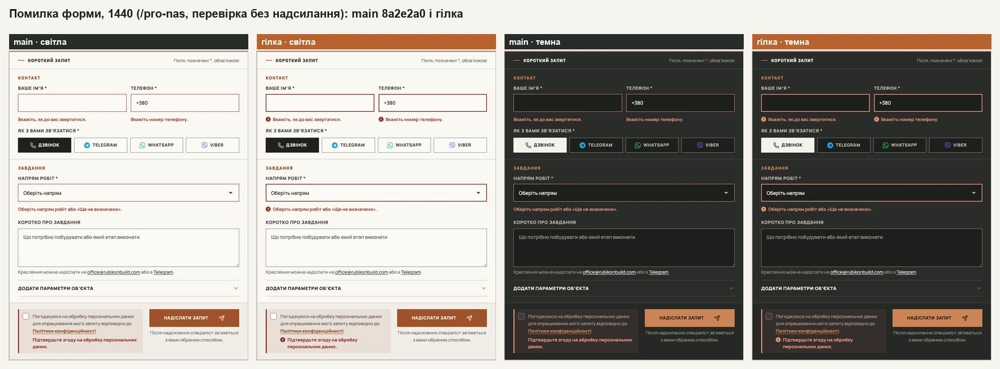
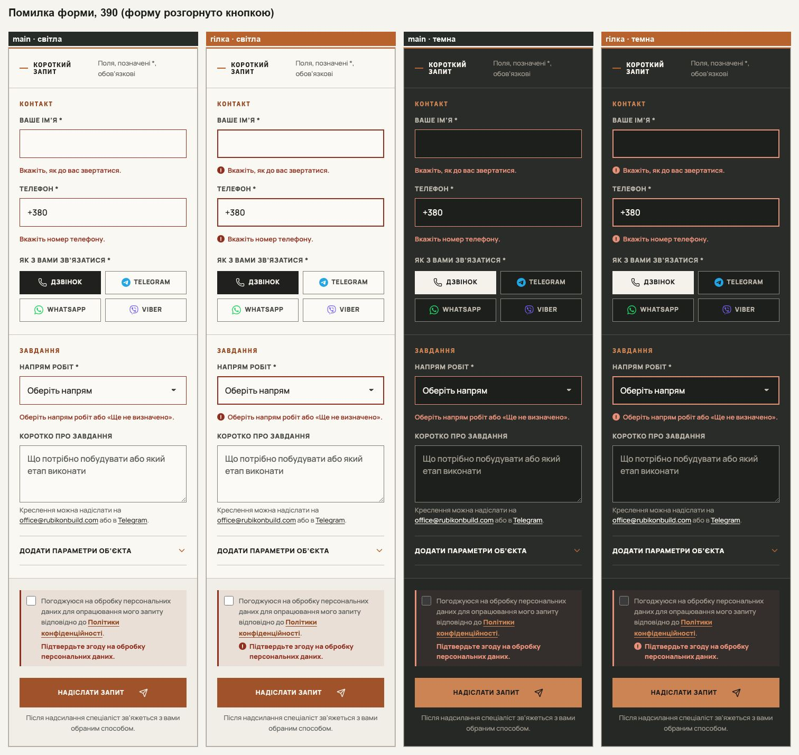
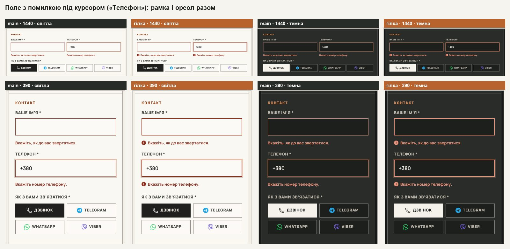
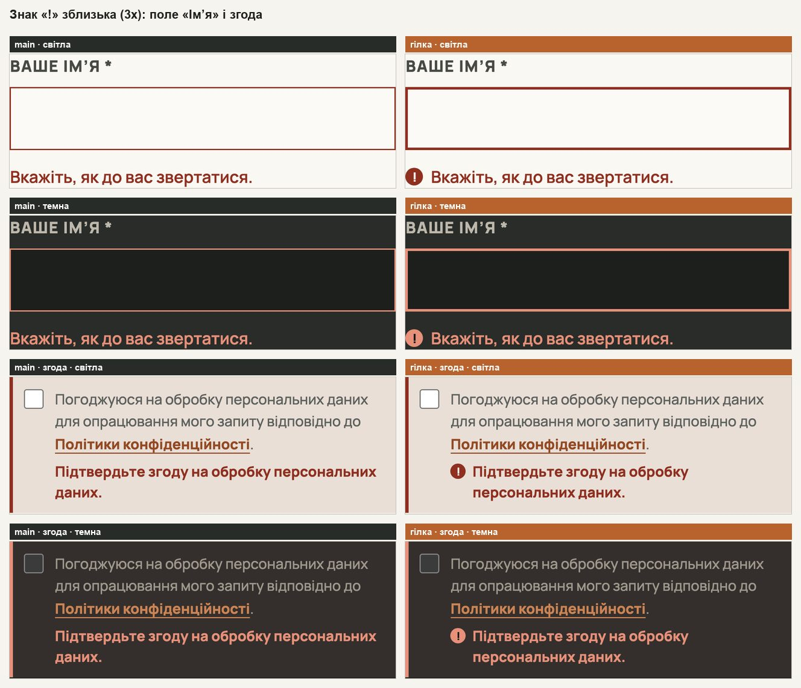
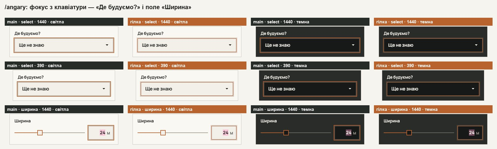

# Handoff · Помилка форми — знак «!» і рамка 2 px; фокус полів конфігуратора як у форми (W3-07 · PDO-86 B, PDO-24)

| | |
|---|---|
| Дата | 2026-10-25 |
| Виконавець | Claude Code |
| Підстава | Рішення власника 25.10 щодо брифу Wave 03: W3-07, відкрита частина — помилка форми варіант **B** («!» і рамка 2 px, колір той самий) і фокус полів конфігуратора **ореолом, як у полів форми** (PDO-86, PDO-24, OD-PX-46) |
| PR | Draft. **Merge і production deploy — лише з окремого OK Дмитра** (DEC-30) |
| Гілка / base | `fix/w307-form-error-focus` від `main` `8a2e2a0` |
| Коміти | **`6210d7e`** — CSS і тест · цей handoff |
| Змінено | `app/globals.css` — фокус полів форми, знак і рамка помилки. `app/components/configurator/configurator-controls.css` — фокус `.hc-select`, hover полів. `app/configurator-preview/configurator.css` — фокус полів розмірів. Тест: новий `tests/e2e/inquiry-error-focus.spec.ts` |
| Не змінено | Колір помилки й інші токени (`theme.css`), тексти повідомлень, логіка перевірки, висота select форми (#240), вигляд блоку згоди й квадратика згоди |

## Що було

**Помилка форми.** Повідомлення про помилку (#8F2F20 у світлій темі, #E7907A у темній) стоїть поруч із мідними підписами «КОНТАКТ» і «ЗАВДАННЯ» (#934923 / #CC8455): різниця кольору ΔE 13,7 і 14,9. Текст помилки є, тож правило «не лише кольором» формально виконано, але на око помилка читалася як ще один мідний підпис. Поле з помилкою мало лише рамку 1 px кольору помилки.

**Фокус поля в конфігураторі /angary.** Select «Де будуємо?» і поля розмірів («Ширина» та інші) показували фокус мідним контуром 2 px з відступом 1 px. Поля форми на тій самій сторінці — мідною рамкою й ореолом 3 px. Тобто на одній сторінці було два вигляди фокусу поля.

**Режим примусових кольорів (forced colors).** Поля форми мали `outline: none`, а ореол (box-shadow) у цьому режимі не малюється: фокус поля не було видно взагалі.

## Що зроблено

- **Знак «!».** Перед кожним повідомленням про помилку (під полем і під згодою) — коло 14 px кольору помилки зі знаком «!» кольору сторінки. Текст стоїть поруч зі знаком, а другий рядок повідомлення — під текстом, не під знаком. Висота повідомлень не змінилась: 18,19 px (один рядок) і 37,69 px (згода, два рядки).
- **Рамка 2 px.** Поле з помилкою обведене рамкою 2 px: наявна рамка 1 px і ще 1 px усередині (внутрішня тінь), тому поле не росте й нічого не зсувається. Діє і тоді, коли помилку позначила форма (після спроби надіслати), і тоді, коли її знайшов сам браузер (поле змінили й лишили невірним).
- **Рамка і фокус разом.** Коли курсор стоїть у полі з помилкою, рамка помилки лишається, а ореол фокуса — навколо неї. У прототипі брифу рамка перекривала ореол; тут обидві тіні вказані разом. Поле, яке невірним знайшов сам браузер, раніше мало м’яке кільце 3 px кольору помилки — і з курсором, і без, тож мідного ореолу фокуса в ньому не було. Тепер замість кільця рамка, а з курсором — ще й мідний ореол, як у всіх полів.
- **Читач екрана.** Знак не промовляється: `content: '!' / ''` (з простим `'!'` перед ним для старих браузерів). Перевірено в дереві доступності Chromium: назви й описи полів однакові на main і на гілці.
- **Примусові кольори.** Там коло набуло б кольору сторінки й зникло, тому в цьому режимі воно кольору тексту, а знак — кольору сторінки. Фокус полів форми й конфігуратора тепер має прозорий контур 2 px замість `none`: у звичайному режимі його не видно, у режимі примусових кольорів його малює система.
- **Конфігуратор.** Select «Де будуємо?» і поля розмірів отримали той самий фокус, що й поля форми: мідна рамка й ореол 3 px. Обчислені значення збігаються з полем форми до символу в обох темах. Наведення курсора на поле з фокусом більше не перефарбовує його мідну рамку.
- **Що не змінилося.** Квадратик згоди лишив свій вигляд: блок згоди позначає помилку цілим (тло, смуга зліва, повідомлення, тепер зі знаком). Обчислені тіні квадратика однакові на main і на гілці.

## До / після

Локальний production build `main` `8a2e2a0` (ліворуч) і гілки (праворуч, мідний підпис). Помилки викликано перевіркою форми без надсилання (`form.checkValidity()`); запит у мережу не йшов. Сторінка /pro-nas: там напрям робіт ще не вибрано, тож видно всі чотири помилки.

## Перевірка

| Що | Результат |
|---|---|
| `inquiry-error-focus` (новий) — desktop-chromium + mobile-chromium, на `main` (127.0.0.1:4370) | 6 failed, 1 passed, 7 skipped. Падають знак, рамка, рамка з ореолом, forced colors і фокус конфігуратора на 1440 і 390; проходить лише «контур select конфігуратора видно у forced colors» (на main він теж був) |
| Те саме на гілці | 7 passed, 7 skipped; ×3 — 21 passed; ×4 (desktop) — 28 passed |
| 12 специфікацій: `inquiry-error-focus`, `form`, `inquiry-select`, `first-contact`, `consent`, `inquiry-brief-handoff`, `configurator-phase4-inquiry`, `configurator-behaviour`, `configurator-palette-accessibility`, `smoke`, `pr-critical`, `responsive-a11y-phase1` — desktop + mobile chromium | 340 passed, 64 skipped, 0 failed |
| `vitest` | 93 файли, 1446 passed |
| `eslint`, `tsc` | чисто |
| Висота полів «Ім’я» і «Напрям робіт» до / після помилки, Chromium і WebKit, обидві теми | 50 → 50 px (1440), 54 → 54 px (390) |
| Обчислений вигляд поля з помилкою, Chromium і WebKit | main: рамка 1 px, тіні немає → гілка: рамка 1 px + `inset 0 0 0 1px` кольору помилки |
| Поле з помилкою під курсором | main: лише ореол → гілка: внутрішня тінь 1 px + мідний ореол 3 px |
| Поле, яке невірним знайшов браузер (`:user-invalid`: «І» в імені, поле покинуто) | main: кільце 3 px кольору помилки 16 % і без курсора, і з ним → гілка: рамка 2 px; з курсором — рамка + мідний ореол |
| Квадратик згоди з помилкою (знятий прапорець; після перевірки форми) | тіні однакові на main і гілці |
| Контраст помилки на полі | 7,75:1 (світла) і 6,85:1 (темна) — без змін; знак у колі — 7,11:1 і 7,29:1 |
| Фокус «Де будуємо?» з клавіатури, /angary, обидві теми, Chromium і WebKit | main: контур 2 px #B76432, тінь 2 px кольору сторінки → гілка: рамка, ореол і прозорий контур — ті самі значення, що в поля форми |
| Примусові кольори (Chromium, emulateMedia) | фокус поля форми: контур `none` → `solid 2px` системного кольору; коло знака: прозоре → кольору тексту (знак кольору сторінки) |
| Дерево доступності Chromium (CDP) | назви й описи полів і згоди однакові на main і гілці; вузла тексту зі «!» немає |
| Запити до /api/leads під час тестів | 0 (тест перехоплює й перевіряє) |
| DEC-18 `dec18.cjs` | 0 змінених з 42 |

Firefox локально не встановлено, тож перевірено в Chromium і WebKit.

## Еталони (DEC-18)

Не оновлено й не потрібно: `dec18.cjs` — **0 з 42** цілей змінюються, як і передбачав бриф. У еталонах немає ні стану помилки, ні фокусу.

**Для власника:** подивитися стан помилки й фокус «Де будуємо?» у справжньому Safari на Mac та iPhone (L4 / L5), як для #240.

## Поза цим кроком

Повідомлення про помилку стоїть усередині `<label>`, тому Chromium додає його і до назви поля («ВАШЕ ІМ’Я * Вкажіть, як до вас звертатися.»), і до опису. Тобто читач екрана може прочитати повідомлення двічі. Так було й до цього кроку, тут не змінено: питання до окремого рішення.

## Відкат

`git revert 6210d7e`.
