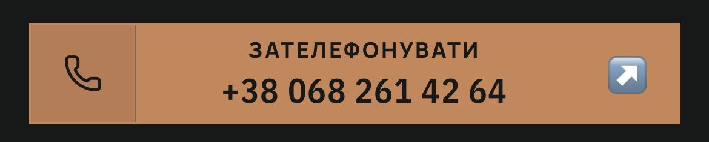
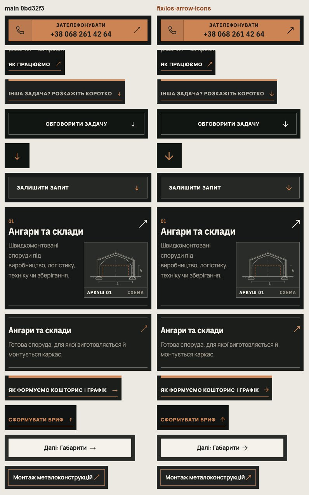
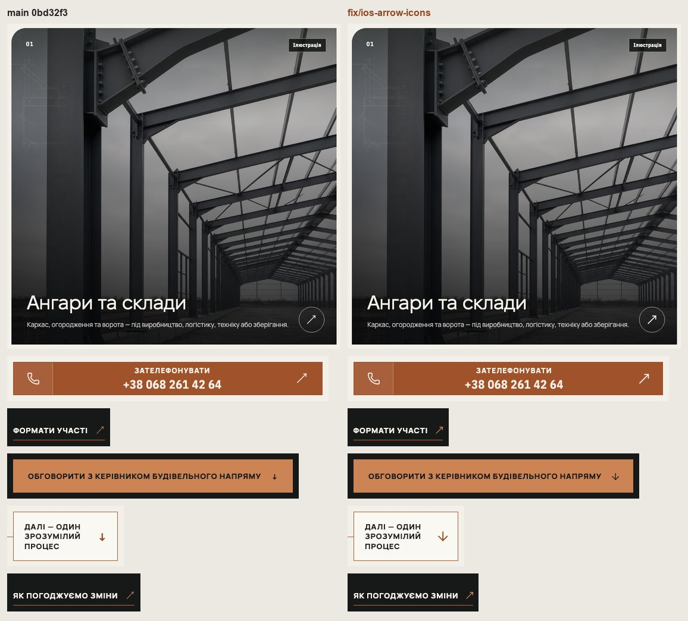

# Handoff · Стрілки сайту — намальовані, без емодзі на iPhone

| | |
|---|---|
| Дата | 2026-10-26 |
| Виконавець | Claude Code |
| Підстава | Власник 26.10, скріншот з iPhone: «треба поправити ці стрілочки iOS на нормальні, підходять для сайту. Давай з цим наведемо лад» |
| PR | Draft. **Merge і production deploy — лише з окремого OK Дмитра** (DEC-30) |
| Гілка / base | `fix/ios-arrow-icons` від `main` `0bd32f3` |
| Змінено | Новий `app/components/Arrow.tsx` (стрілка-іконка lucide) і правило розміру в `app/globals.css`. Символи стрілок замінено компонентом у 27 файлах `app/`; дані героїв (`directionPages.ts`, `grainPage.ts`) і тип `DirectionHeroAction.arrow` — назви напрямків (`'down'`, `'up-right'`) замість символів. Підпис «Змінити у конфігураторі / в планувальнику» — без «↑» у тексті (стрілка — іконка поруч). Тести: новий `tests/unit/arrows.test.ts`; 11 e2e-специфікацій оновлено під текст без символу |
| Не змінено | Стрілки в технічних текстах («плита → колона → балка», ланцюги вузлів і модулів, `content: '→'` у легендах), символи-позначки «↓ Навантаження», «⇲», «◎», «✓», «↺». Кольори, тексти, розміри кнопок і посилань |

## Що було

**iPhone.** Символ «↗» (U+2197) є в Unicode-списку емодзі, а в шрифтах сайту (Fixel, Manrope, IBM Plex Sans Condensed) його немає. iOS бере відсутній символ з Apple Color Emoji, тож на iPhone замість мідної стрілки стояв синій квадрат-емодзі: у кнопці «Зателефонувати», у «Як працюємо», у картках напрямів і т. д. (скріншот власника нижче). У HTML сторінок main таких символів 91 на 9 сторінках (головна 14, /napryamky 18, /pro-nas 14, напрями по 8–10, /yak-pratsyuiemo 3).

**Усюди.** «↓ ↑ →» не є емодзі, але брались з того шрифту, де вони є: «↓» у посиланнях — дрібний Manrope 800, «↓» у кнопках — тонкий системний, «↗» — волосяний системний. Тобто стрілки однієї ролі мали різний розмір і товщину, а на Linux CI — ще й інший рисунок (нотатка 24.10 про стрілки поза шрифтами сайту в еталонах).

## Що зроблено

- **Одна стрілка сайту.** `Arrow` малює іконку lucide (ту саму бібліотеку й той самий штрих 1,75, що в телефона та інших іконок, W3-06) кольором свого місця (`currentColor`): `up-right`, `down`, `up`, `right`, `left`, `left-right`. Розмітка — `<svg …>`: та сама обгортка, що була в посилань W3-06, тож їхній зсув стрілки при наведенні й фокусі працює як був. Для «↗» — `MoveUpRight`: рисунок на 14 з 24 одиниць, як у «↓ →»; `ArrowUpRight` займає 10 і поруч із великими літерами виглядав кутиком на розмір менше.
- **Розмір і місце.** Іконка = 1,375 × кегль свого місця: 18 px біля 13 px підпису дії (як «Про напрям» на телефоні), більша там, де символ був більший (картки напрямів, кнопка прокрутки). Вона займає те саме місце, що символ: тримач заввишки рівно в рядок (`height: 1lh`), іконка по центру й виступає за нього, а завширшки — як рисунок (`viewBox="5 0 14 24"`: lucide малює в середніх 14 з 24 одиниць). Тож жоден рядок, плашка чи кнопка не стали вищими. Перші спроби це довели від протилежного: повна ширина іконки (18 px замість ~10 px символу) переносила «Обговорити з керівником будівельного напряму» на /angary (360 px) у 3 рядки; від’ємні поля давали горизонтальне переповнення «Інша задача?» на 320 px і −1,35 px плашки «Далі — один зрозумілий процес» на /yak (3 еталони DEC-18 на 768).
- **Де стрілка є дією** — посилання W3-06, кнопки, кнопка прокрутки під героєм, картки напрямів, «Пов’язані напрямки», робочі теги /pro-nas, кроки конфігуратора, «Сформувати бриф», «До заявки», «Змінити у конфігураторі» — усюди тепер `Arrow`. «↔» у планувальнику зерна — теж (`left-right`).
- **Запобіжник.** `tests/unit/arrows.test.ts` проходить усі рядки й JSX-текст у `app/` і `public/` (коментарі не рахуються, CSS `content`, HTML, JSON, `\u2197`, `&nearr;` — рахуються) і падає на будь-якій стрілці зі списку емодзі (↔ ↕ ↖ ↗ ↘ ↙ ↩ ↪ ⤴ ⤵ ➡ ⬅ ⬆ ⬇) без селектора тексту U+FE0E. Винятки — два рядки планувальника зерна (`brief.ts`, `understanding.ts`): /planner-preview на проді — 404 (X-01), а рядки звіряються з golden-виходом прототипу; дати їм U+FE0E, коли планувальник вийде.
- **Тести під новий текст.** Назва й текст посилань більше не містять символ («Сформувати бриф», не «Сформувати бриф ↑»): 11 специфікацій оновлено, де можна — з перевіркою, що стрілка намальована (`[data-arrow] svg`). `links-buttons-focus` знаходив «посилання зі стрілкою» за символом у кінці тексту; тепер — за `[data-arrow]` останнім дочірнім (інакше тест тихо нічого б не перевіряв), і ширина слів рахується разом зі стрілкою.

## До / після

Локальний production build `main` `0bd32f3` (ліворуч) і гілки (праворуч). Chromium на macOS: тут «↗» не стає емодзі — це видно лише на iPhone; кадри показують однаковість стрілок і що розкладка не зсунулась.

## Перевірка

| Що | Результат |
|---|---|
| Емодзі-стрілки в HTML сторінок (`curl`, U+2194–2199), 9 сторінок + політика + 404 | main **91** → гілка **0** |
| Усі стрілки-дії в DOM (Chromium, 9 сторінок, 320 / 360 / 390 / 768 / 1440, світла й темна): елементів зі стрілкою | 380 + 297 пар main ↔ гілка; символів U+2197 у тексті: 182 → **0**; намальованих стрілок — 370 |
| Висота кожного такого елемента, main ↔ гілка | **0 змін** на 320, 360, 390, 1440. На 768 — лише «Пов’язані напрямки» на /angary: −21 px: колонка стрілки 17 → 13,6 px, і «Покрівельні роботи» вміщається в один рядок замість двох, тож ряд з трьох карток більше не тягнеться під неї (185 → 163,8 px) |
| Ширина | посилання й кнопки −1,8…−6,6 px (стрілка займає місце свого рисунка, менше за старий символ); жодна не ширша більш ніж на +0,6 px |
| Кнопка «Обговорити з керівником будівельного напряму», /angary, 360 px | 61,1 px (2 рядки) на main і на гілці |
| `vitest` | 95 файлів, 1468 passed |
| `tsc`, `eslint` | чисто |
| E2E на фінальній збірці, desktop + mobile chromium, 4 workers: `links-buttons-focus`, `angary-route-phone`, `angary-editorial`, `configurator-phase4-inquiry`, `configurator-behaviour`, `inquiry-brief-handoff`, `grain-planner-handoff`, `phase3-shorter-pages`, `pr-critical`, `direction-route-cards`, `ux-conversion-phase2`, `home-phone-directions`, `home-proof-contour`, `hero-video`, `consent-pending-hero`, `smoke` | **595 passed**, 217 skipped, 2 failed — обидва `home-proof-contour:2684` («Навантаження» чекає анімацій, кнопка без змін) |
| `home-proof-contour:2684`, по одному, ×3 на desktop і mobile | main: 3 з 6 падають; гілка: 4 з 6 — нестабільний тест на таймінг, і на main так само |
| Попередні прогони | 4 падіння (`ux-conversion-phase2:46/:134`, `grain-planner-handoff:147`, `pr-critical:978`) були таймаутами, бо паралельно йшов мій повний прогін; без навантаження всі passed і на main, і на гілці. `configurator-behaviour:87` того разу впав і на main |
| `tests/unit/arrows.test.ts` на коді main (тимчасовий worktree) | падає: 19 місць — 17 «↗» і 2 «↔» |

Firefox і справжній Safari локально не запускались; WebKit на macOS символ «↗» малює як текст, тож емодзі ним не відтворюється. Виправлення не залежить від браузера: символу на сторінці більше немає.

**Для власника:** подивитися на iPhone головну (кнопка «Зателефонувати», «Як працюємо»), /napryamky (картки) і /pro-nas (теги) після merge (L4 / L5).

## Еталони (DEC-18)

Прогноз `dec18.cjs` (42 цілі visual-chromium, header/footer logo, configurator, grain planner; знято як у специфікаціях, порівняно компаратором Playwright з допуском специфікацій) — свіжий `main` `0bd32f3` проти гілки: **0 з 42 змінюються**. Еталони не оновлено. Стрілки в кадрах таки інші, але різниця в межах допуску; остаточно покаже Main Regression на CI (Linux).

## Відкат

Після squash-merge — `git revert` коміту PR.
