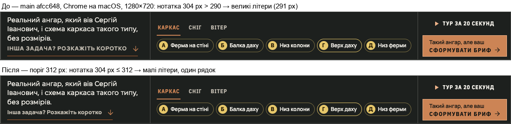

# Handoff · main червоний після #252: лист X-Ray на HOME «дихав» на Linux

| | |
|---|---|
| Дата | 2026-10-26 |
| Виконавець | Claude Code |
| Підстава | Main Regression [40313616334](https://github.com/leusd100/rubikon-build/actions/runs/40313616334) на `afcc648` (#252 «стрілки сайту — намальовані іконки») — червоні шарди E2E 2/6 і 3/6; попередній `0bd32f3` зелений |
| PR | [#254](https://github.com/leusd100/rubikon-build/pull/254), Draft. **Merge — лише з окремого OK Дмитра** |
| Гілка / base | `fix/main-red-after-252` від `main` `afcc648` |
| Коміти | **`978cad4`** — CSS і тест · handoff (лише `docs/`) |
| Змінено | `app/home-v2.css` (один поріг контейнерного запиту + коментар), `tests/e2e/links-buttons-focus.spec.ts` (поріг у тесті + нова перевірка) |
| Не змінено | Еталони DEC-18 (жоден PNG), решта тестів, JS, розмітка, `Arrow.tsx` |

## Висновок

Це баг сайту, а не застарілі тести. Його заклав W3-06 (#249), а #252 лише проявив на Linux.

Під нотаткою листа X-Ray стоїть посилання «Інша задача? Розкажіть коротко». Великими літерами воно йде лише тоді, коли нотатка (`.sheet-cell-note b`) ширша за поріг контейнерного запиту. Поріг був 290 px — ширина великих літер на macOS (291 px). Chrome на Linux ставить кожну літеру на цілі пікселі («І» 4 px замість 3,86, «Р» 9 замість 8,45), і там великі літери займають **306 px**. Тому на Linux нотатка 290–306 px отримувала великі літери, які в неї не влазили. Посилання переносилось на другий рядок, і заголовний блок ставав вищим на 15 px.

Висоту блоку міряє `ProofContour` (`--hv2-sheet-rest`), і від неї залежить ширина листа на ноутбуці. Звідси петля:

1. Нотатка 291 px → великі літери в 2 рядки → блок 181 px.
2. Лист звужується до 1170,6 px → нотатка 277,7 px → поріг 290 скидає великі літери → 1 рядок → блок 166 px.
3. Лист розширюється до 1184 px → нотатка знову 291 px → крок 1.

І так кожен кадр. Запис у контейнері linux/amd64 на `afcc648`, 1280×720 — лист міняє ширину щокадру:

```
0 rest=181px sheetW=1170.6 capH=108.0 link 25 px | noteB=277.73
1 rest=166px sheetW=1184.0 capH=122.7 link 42 px | noteB=291.17
2 rest=181px sheetW=1170.6 capH=108.0 link 25 px | noteB=277.73
…
```

**Чому саме після #252.** У «Сформувати бриф» символ «→» став SVG-стрілкою. На Linux кнопка звузилась на 7 px (197,8 → 190,8 px), і нотатка на 1280×720 виросла з 284,2 до 291,2 px — через поріг 290. До #252 1280×720 був поза смугою, але **баг уже був**: на `0bd32f3` у Linux 8 вікон 1288–1302×720 «дихали», а ще 8 вікон 1288–1302×800 мали посилання у 2 рядки (розгортка нижче). Тести ці вікна просто не відвідували.

## Виправлення

`app/home-v2.css`: `@container (max-width: 290px)` → `@container (max-width: 312px)`. Великі літери лишаються тільки в нотатці, ширшій за найширший їхній набір: 306 px на Linux і 6 px запасу. Тепер посилання завжди в один рядок, висота блоку не залежить від ширини нотатки, і петлі немає.

**Видима зміна — лише на Mac у вузькій смузі.** На macOS нотатка 291–312 px (лист ≈1170–1192 px; на висоті від 720 px це вікна ≈1267–1288 px завширшки) тепер показує посилання малими літерами, хоча великі там влізли б. Це вигляд, який власник уже прийняв для короткого вікна (1440×700, 1250×613). На 1280×720 на Mac:



Якщо великі літери на Mac 1280 важливі, є альтернатива: вирішувати «влазять чи ні» в JS (міряти ширину великих літер і порівнювати з нотаткою) — точно на кожній платформі, але це ще одна вимірювальна гілка в `ProofContour`. Для цього PR вибрано мінімальну зміну в CSS.

**Рішення власника (26.10):** «Малі літери посилання на Mac 1280 — ок, лишаємо поріг 312 px у #254». JS-вимір не робимо.

Еталони DEC-18 не зачеплено: знімки HOME роблять на 375, 768 і 1440. На 768 і 1440 нотатка 634 і 439 px (Linux) — далеко від порогу, а на 375 цього посилання немає (до 760 px воно стоїть у рядку дій).

## Тести — по кожному

| Тест | Що було в CI | Причина | Що зроблено |
|---|---|---|---|
| `home-proof-contour.spec.ts:3089` | 1280×720: `--hv2-sheet-rest` 166 ≠ виміряні 181 (і навпаки в retry) | петля — значення змінюється між читаннями | тест не змінено; з виправленням проходить |
| `home-proof-contour.spec.ts:3193` (flaky) | fallback 181 ≠ виміряні 166 | та сама петля | не змінено |
| `home-proof-contour.spec.ts:3208` | «Каркас»: `element is not stable` 150 с | лист міняє ширину щокадру, кнопка рухається | не змінено |
| `home-proof-contour.spec.ts:1869` | «Каркас»: `element is not stable` до кінця шарду | та сама петля | не змінено |
| `home-proof-contour.spec.ts:3235` | 1280×720: шов 61,9 % ≠ 62 %, потім `mouse.move` timeout | позиція вказівника рахується від ширини листа, яка стрибає | не змінено |
| `home-proof-contour.spec.ts:2961` (flaky) | `open()` не дочекався листа в спокої | ішов паралельно з тестами, що крутили петлю 1–3 хв на повному CPU | не змінено |
| `home-proof-contour.spec.ts:2054` | кадри «plotting» до 907–930 мс при межі 900 | вікно 1440×900 (петлі там немає); у шарді 2 паралельно 3 хв крутився :1869 | не змінено |
| `links-buttons-focus.spec.ts:112` | 1280×720: `scrollIntoViewIfNeeded` — `element is not stable` | петля | поріг у тесті 290 → 312 (тест дзеркалить CSS). **Додано** перевірку: посилання великими літерами не ширше за 312 px. Перевірка посилена, не послаблена |
| `responsive-a11y-phase1.spec.ts:175` ×2 | `Test was interrupted` | шард 3/6 вичерпав глобальний ліміт 12 хв на тестах вище | не змінено |

## Перевірка

Linux — у контейнері `mcr.microsoft.com/playwright:v1.62.1-noble` linux/amd64. Він рендерить шрифти сайту байт у байт як CI (нотатка 24.10). Сервер — `vinext build` + `vinext start` на хості.

| Що | Результат |
|---|---|
| Відтворення на `afcc648`, linux/amd64: `home-proof-contour:3089`, `:3193`, `links-buttons-focus:112` | `:3089` — `166px ≠ 181px` на 1280×720, `:112` — `element is not stable`, як у CI (`:3193` пройшов: у CI він теж flaky) |
| Покадровий запис 1280×720, linux/amd64 | `afcc648`: лист 1170,6 ↔ 1184 px щокадру. З виправленням: 1184 px, блок 108 px, посилання 25 px у всіх 12 кадрах |
| Розгортка 1240–1400 px через 2 px × висоти 720 і 800 (162 вікна): лист стоїть 8 кадрів, посилання в один рядок | linux/amd64: `0bd32f3` — **16 поганих** (1288–1302×720 «дихають», 1288–1302×800 — 2 рядки); з виправленням — **0**. macOS Chrome з виправленням — 0 |
| Ширини на Linux / macOS | великі літери 305,83 / 290,94 px; малі 247,42 / 235,30 px; «І» 4 / 3,86 px, «Р» 9 / 8,45 px |
| macOS Chrome, виправлена збірка: уся `links-buttons-focus` + 7 колишніх червоних із `home-proof-contour` + `responsive-a11y-phase1:175` | **65 passed** |
| linux/amd64, ті самі тести | 59 passed, 6 failed — усі на повільності емуляції Rosetta: 5 таймаутів і «2 кадри plotting замість >3» (`:2054`). Повтор цих 6 з 1 воркером: 3 passed; `:3193` — повзунок ще неактивний через 5 с (гідрація), `:3089` — фото не завантажилось за 90 с, `:2054` — 3 кадри замість >3. Жодне падіння не схоже на петлю (немає ні `166 ≠ 181`, ні `not stable`) |
| `vitest run` · `eslint` spec-файлу · `tsc --noEmit` | 1468 passed · чисто · чисто |
| **Main Regression на гілці** — [40327265423](https://github.com/leusd100/rubikon-build/actions/runs/40327265423) на `978cad4` | **success**: E2E 6/6 і visual 2/2 зелені, без retries (`failOnFlakyTests`). Найдовший шард — 10,2 хв (на main — обрізаний на 12,0). Колишні червоні: `:3089` 20,2 с, `:3193` 7,5 с, `:3208` 49,8 с (було 3 × 2,6 хв), `:3235` 12,5 с (було 3 × 1,1 хв), `:2961` 15,7 с, `:1869` 38,0 с, `:2054` 6,9 с, `links-buttons-focus:112` 5,7 с, `responsive-a11y:175` /metalokonstruktsii і /pro-nas — 10–11 с |

Коміт handoff змінює лише `docs/`.

## Поза цим PR

- Така петля можлива для будь-якого кроку, де вужчий лист робить заголовний блок *нижчим* (тут — скидання великих літер). Загальний запобіжник від коливання в `ProofContour` не додано: зараз такий крок один, і його прибрано.
- Гілки Motion v1 (`refactor/m1-1-motion-tokens`, `perf/m1-3-lenis-idle`) відгалужені від `afcc648` і успадкують ці ж червоні тести, доки не синхронізуються з main після merge цього PR.

## Відкат

`git revert 978cad4`.
