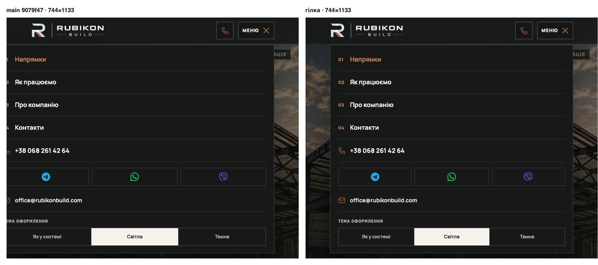
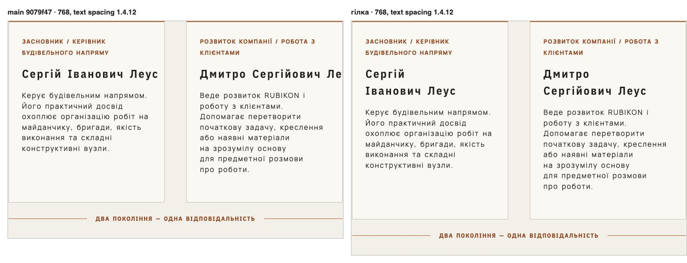

# Handoff · Краї адаптиву й доступності: панель меню 685–760 px, поля конфігуратора на сенсорних екранах, імена /pro-nas під text spacing

| | |
|---|---|
| Дата | 2026-10-27 — 2026-10-28 |
| Виконавець | Claude Code |
| Підстава | Engineering Excellence brief 27.10, знахідки RA-01, RA-03, RA-04 (звіт «Responsive і доступність», з поправками незалежної перевірки) |
| PR | [#263](https://github.com/leusd100/rubikon-build/pull/263), Draft. **Merge і production deploy — лише з окремого OK Дмитра** (DEC-30) |
| Гілка / base | `fix/responsive-a11y-edges` від `main` `9079f47` |
| Коміти | **`f29e196`** — CSS і тести · цей коміт — handoff |
| Змінено | `app/globals.css`: панель меню в шарі до 760 px — не ширша за колонку (RA-01); правило «поля 16 px» — і на сенсорних екранах ширших за 760 px (RA-03); без `white-space: nowrap` в імені команди в шарі до 1050 px і без його скасування в шарі до 760 px (RA-04). `app/pro-nas/about.css`: без `white-space: nowrap` в імені й без його скасування на телефоні (RA-04). `app/components/configurator/configurator-controls.css`: метр у полі розміру — за тим самим запитом, що й значення (RA-03). Тести: `mobile-menu-panel.spec.ts` (+2), `configurator-polish.spec.ts` (+1), `typography.spec.ts` (+1) |
| Не змінено | Панель меню до 652 px і її 310 px від 761 px; поля на телефоні й поля з мишею; кегль, інтервали й рядок імен за звичайних налаштувань; еталони DEC-18, бюджети Lighthouse, CSP; JS, розмітка, тексти, залежності (0 нових) |

## Що було

**RA-01 · панель меню за лівим краєм на 685–760 px.** У шарі до 760 px колонка — `min(100% - 32px, 620px)`, а панель меню — `calc(100vw - 32px)`, прикладена правим краєм до «Меню» на правому краю колонки. Від 653 px панель ширша за колонку, від 685 px — за вікно: ліва межа = 342 − vw/2. На main `9079f47` (кожна ширина 320–800): ліва межа від'ємна на 76 ширинах, 685–760; 720 px (1440 при 200 %) — −18 px (зрізані рамка й поля, текст ще видно); 744 px (iPad mini вертикально) — −30 px; 760 px — −38 px. Від 727 px зрізано номери 01–04, піктограми телефону й пошти, початок «ТЕМА ОФОРМЛЕННЯ» (14–15 видимих елементів лівіше за вікно). Назви пунктів, месенджери й перемикач теми лишались читабельні й клікабельні.

**RA-03 · поля конфігуратора 15 px на сенсорних екранах ширших за 760 px.** Правило «поля 16 px» (iOS Safari збільшує сторінку при фокусі поля з текстом менше 16 px) діяло лише до 760 px. Ширше «Де будуємо?» (`.hc-select`, `configurator-controls.css`) і чотири поля розмірів (`configurator.css`) мали 15 px — на телефоні горизонтально (844×390, 932×430), на планшеті (1024×768, 1180×820, 1366×1024). Метр у полі (`.hc-field-unit`) окремо ставав 16 px лише до 760 px. На 9 публічних сторінках при сенсорному 1024×768 полів менше 16 px — 5, усі на `/angary`. Поля форми запиту — 16 px скрізь.

**RA-04 · імена /pro-nas не переносяться під text spacing (WCAG 1.4.12).** Ім'я тримали в одному рядку два однакові правила: `about.css` (усі ширини) і `globals.css` у шарі до 1050 px; до 760 px обидва скасовувались. З перевизначенням інтервалів 1.4.12 «Дмитро Сергійович Леус» на main виходить за свою картку на кожній ширині 761–833 px: +31,6 px (761), +28,6 (768), +14,7 (800), +6,1 (820); на 761–766 px сторінка прокручується вбік (до 3 px, `scrollWidth` 764 на 761). Без перевизначення імена вміщаються в рядок із запасом не менше 23,6 px.

## Що зроблено

- **RA-01.** `.mobile-menu nav { width: min(100vw - 32px, 620px); }` у шарі до 760 px: панель — ширина колонки й не ширша. До 652 px нічого не змінюється (там `100vw - 32px` ≤ 620), від 761 px діє правило планшета (310 px). Варіант із вердикту перевірки, без змін.
- **RA-03.** Запит правила полів — `@media (max-width: 760px), (pointer: coarse)`, і той самий запит у метра `.hc-field-unit`, щоб одиниця лишалась розміром зі значенням (поправка перевірки: без цього метр лишався 15 px біля 16-піксельного значення). `(pointer: coarse)` у проєкті вже вживається (`home-v2.css`, `configurator.css`). Миша (`pointer: fine`) лишає 15 px, тож вигляд на комп'ютері й усі еталони (visual-chromium — Desktop Chrome без дотику) не змінюються.
- **RA-04.** Прибрано обидва `white-space: nowrap` (поправка перевірки: якщо прибрати лише `about.css`, на 761–1050 px нічого не змінюється) і два `white-space: normal`, що лише скасовували їх на телефоні. Ім'я має `text-wrap: balance` від `:where(h1, h2, h3)`, тож під перевизначенням переноситься рівно, а за звичайних інтервалів вміщається в рядок, як і раніше.
- **Тести.**
  - `mobile-menu-panel.spec.ts`, «RA-01 · the menu panel between the phone column and the tablet»: 744×1133 і 760×800, обидва проєкти (сенсорний планшет і вікно десктопа при 175–200 %): `box.x ≥ 0`, правий край ≤ ширини вікна, ширина 620 px, лівий край = лівий край колонки (±1), без горизонтальної прокрутки.
  - `configurator-polish.spec.ts`, RA-03: окремі контексти — дотик 844×390 і 1024×768: `#hc-object-region` і чотири поля розмірів 16 px, кожен метр 16 px; миша 1024×768: усе 15 px. Перевіряє й те, що `(pointer: coarse)` у контексті такий, як задумано.
  - `typography.spec.ts`, «/pro-nas team names under text spacing (WCAG 1.4.12)»: 761, 768, 820, 1024 — без перевизначення кожне ім'я в один рядок; з перевизначенням (той самий `TEXT_SPACING`, що в тестах акцентної фрази) жодне ім'я не виходить за свій заголовок і картку, сторінка не прокручується вбік.
  - На збірці main усі нові тести падають з числами знахідок (−30 / −38 px; 15px замість 16px; «ends 29px past its card», «page scrolls sideways»); на гілці проходять.

## До / після

Локальні production-збірки `main` `9079f47` (ліворуч) і гілки (праворуч), Chrome 156, DPR 1.

## Перевірка

Середовище: Google Chrome 156.0.8078.47 (Playwright `channel: 'chrome'`, headless) на macOS; збірки main `9079f47` і гілки на 127.0.0.1; DPR 1, reduced motion, згода «відхилено», запити Google — порожні 200, відео перервано. Mac спільний з іншим агентом (load average 3–47 під час замірів): часу тут немає, лише геометрія й обчислені стилі. Вони детерміновані: заміри 27.10 і 28.10 (різні збірки того самого коду) збігаються побайтово, крім позначки часу. Тож n = 2 на кожну конфігурацію, розкиду немає. Прохід кожною шириною — n = 1 на збірку.

**RA-01, панель меню** (сенсорний контекст на `/angary` і миша на `/` дали однакові числа; ліворуч — межа панелі, у дужках — межа вмісту):

| Ширина | main: ліва межа / ширина | гілка: ліва межа / ширина | Елементів лівіше за вікно, main → гілка |
|---|---|---|---|
| 320, 390, 600, 652 | 16 / 288…620 | 16 / 288…620 (без змін) | 0 → 0 |
| 653 | 15,5 / 621 | 16,5 / 620 | 0 → 0 |
| 685 | −0,5 (20,5) / 653 | 32,5 / 620 | 0 → 0 |
| 720 | −18 (3) / 688 | 50 / 620 | 0 → 0 |
| 727 | −21,5 (−0,5) / 695 | 53,5 / 620 | 14 → 0 |
| 744 | −30 (−9) / 712 | 62 / 620 | 15 → 0 |
| 760 | −38 (−17) / 728 | 70 / 620 | 15 → 0 |
| 761, 768, 1024 | 310 px від «Меню» | без змін | 0 → 0 |
| Кожна ширина 320–800 | ліва межа < 0 на 76 ширинах (685–760) | **0 ширин**; на 653–760 ліва межа = ліва межа колонки | — |

Висота панелі на кожній ширині та сама, що на main; горизонтальна прокрутка — 0 скрізь, як і на main.

**RA-03, поля `/angary`** (обчислений `font-size`; `#hc-object-region`, `#hc-dimension-width/length/height/ridge` / чотири метри):

| Контекст | main | гілка |
|---|---|---|
| Дотик 390×844, 760×1024 | 16 / 16 | 16 / 16 (без змін) |
| Дотик 761×1024, 844×390, 932×430, 1024×768, 1180×820, 1366×1024 | **15 / 15** | **16 / 16** |
| Миша 760×1024 | 16 / 16 | 16 / 16 |
| Миша 761×1024, 820×1180, 844×390, 1024×768, 1440×900 | 15 / 15 | 15 / 15 (без змін) |

Розмір полів (84×46 px) і висота панелі керування не змінились у жодному контексті. Поля менше 16 px на 9 публічних сторінках, дотик 1024×768: main 5 (усі на `/angary`) → гілка **0**; миша: 5 → 5 (без змін). Поля форми запиту — 16 px скрізь в обох збірках.

**RA-04, імена /pro-nas** (Δ — наскільки текст «Дмитро Сергійович Леус» виходить за картку, «+» — назовні):

| Ширина | Без перевизначення, main і гілка | З перевизначенням 1.4.12, main | З перевизначенням, гілка |
|---|---|---|---|
| 761 | 1 рядок, геометрія однакова | 1 рядок, **+31,6**, `scrollWidth` 764 | 2 рядки, −79,5, `scrollWidth` 761 |
| 768 | 1 рядок, однакова | 1 рядок, **+28,6** | 2 рядки, −82,5 |
| 800 | 1 рядок, однакова | 1 рядок, **+14,7** | 2 рядки, −96,4 |
| 820 | 1 рядок, однакова | 1 рядок, **+6,1** | 2 рядки, −105 |
| 900 | 1 рядок, однакова | 1 рядок, −28,5 (за заголовок +0,5) | 2 рядки, −139,6 |
| 1024–1920 | 1 рядок, однакова | 1 рядок, всередині | 1 рядок, без змін |
| Кожна ширина 761–1440 | 0 імен у 2+ рядки, запас до заголовка ≥ 23,6 px — в обох збірках | за карткою на 73 ширинах (761–833), за заголовком на 139 (761–899), прокрутка вбік на 761–766 | **0** за карткою, **0** за заголовком, прокрутки немає; 2 рядки на 761–901 |

Без перевизначення на 14 ширинах (320–1920) розміри заголовків, кількість рядків, висота блоку команди однакові на main і гілці; змінилось лише обчислене `white-space` (`nowrap` → `normal`). «Сергій Іванович Леус» під перевизначенням на 761–800 також виходив за свій заголовок (+19,8 / +16,8 / +2,9), тепер переноситься.

**Розмір CSS** (13 таблиць стилів `/`, `/pro-nas`, `/angary`): 439 922 → 439 857 B (−65 B); gzip −9: 83 088 → 83 097 B (+9 B) — у межах шуму стиснення. Запитів, JS і DOM зміна не додає.

**Тести.**

| Що | Результат |
|---|---|
| Нові тести (6 випадків), гілка, desktop-chromium + mobile-chromium | **6 passed**, 2 skipped (за задумом: RA-03 і RA-04 задають вікна самі, один проєкт) |
| Ті самі тести на збірці main | **6 failed**: −30 і −38 px (обидва проєкти), 15px замість 16px, 9 порушень на /pro-nas |
| Пов'язані e2e, гілка, 2 workers: `mobile-menu-panel`, `header-tablet-nav`, `header-hierarchy`, `configurator-polish`, `configurator-sheet`, `typography`, `editorial-focus`, `pro-nas-capability`, `pro-nas-practice`, `shorter-pro-nas-yak`, `yak-pro-nas-touch`, `words-whole`, `responsive-a11y-phase1`, `inquiry-error-focus`, `sheet-field`, `grain-builder-phone`, `form`, `smoke` | 279 passed, 146 skipped, 3 failed — усі `typography.spec.ts:70` «late fonts» на mobile-chromium (CLS 0,0578 при межі 0,01) |
| `typography.spec.ts:70` окремо, 1 worker | main: 3 failed (0,0568 / 0,0578 / 0,0578); гілка: 3 failed (0,0578 ×3) — локальна вада на macOS, на main так само; гілка її не зачіпає (ширина 412 px, `/pro-nas` серед маршрутів тесту немає) |
| `vitest run` | 98 файлів, 1542 passed |
| `tsc --noEmit`, `eslint` | чисто |

Докази (локальний архів, за назвою й SHA-256):

| Файл | SHA-256 |
|---|---|
| `measure-main-r3.json` | `e30fc7c260b53f2b8d961ef377016e9194cb4c0eb131a88f7727ab9cd5f944d1` |
| `measure-branch-r3.json` | `29eff2516b1f849b901faf04ed9e5be0ec704f24062553984f3d3aed60a7991f` |
| `sweep-main.json` | `081535324174d1e3d833d0b31760cd70ec5e400cadd828928b92b6e65c7688a2` |
| `sweep-branch.json` | `df00e9000ea04bc229db5f34de764b515cce8521b8725c2c8b351d9857dedd64` |
| `compare-main-r3-vs-branch-r3.tsv` | `e809f2174a0c25b51b8ff9c1ec15d6fd17b30ef8a9b310893d670cb7a124188b` |
| `branch-vs-main-r3.log` | `790eadcfa9082438889da8fcbbcd5c4adc97f2819a240bbcd132f69dd1c9e11c` |
| `main-vs-main-r3.log` | `4829860bde9d3c0f5a1d93bea513c549835ce652f50a2751776be338bf3aa599` |
| `e2e-new-branch-r3.log` | `3b3479afb4367c25a754d2317fd404130bdfc5493fd0e4ef83828bac4b93964c` |
| `e2e-new-main-r3.log` | `d88a195421903e277972b8c40c6cac308be99348302b7f257db30aca88bb7457` |
| `e2e-related-branch-r3.log` | `ff5968c8a249dddcbba038c196ec20c7d4e4f3250d1738ce3a3d1f7a6f50b3cc` |
| `e2e-latefonts-4400.log` (main) | `bebb6271077f7739db612f26585023116aaa7b6231021a04910ed504acff3431` |
| `e2e-latefonts-4414.log` (гілка) | `062eb42e39620a488737feac952ca706d8ca129a9132cc875b4344e806316ad2` |

## Еталони (DEC-18)

Еталони не оновлено.

Прогноз — самі візуальні специфікації проєкту visual-chromium (`visual`, `brand-logo-visual`, `configurator-visual`, `configurator-3d-visual`, `grain-planner-visual`: 66 тестів, 68 знімків) з їхнім власним компаратором і допусками. Знімки збірки main `9079f47` записано як тимчасові еталони поза репозиторієм, потім ті самі тести на збірці гілки порівняно з ними: **змінюються 0 з 68**, 66 passed. Контроль — main проти тих самих еталонів: 66 passed. Прогін 27.10 дав той самий результат (0 з 68), але під load average ~130 частину тестів довелося перезапускати після таймаутів; 28.10 таймаутів не було.

Так і має бути: visual-chromium — Desktop Chrome без дотику (`pointer: fine`, RA-03 не діє; `configurator-h-tablet-820` і `configurator-3d-tablet-820` без змін), меню на знімках закрите (RA-01), `/pro-nas` у знімках немає (RA-04). Знято в Chrome на macOS; остаточно покаже Main Regression на CI (Linux).

**Стани без еталонів**, які зачіпають зміни (знято однаково з обох збірок, порівняно компаратором Playwright з допуском візуальних специфікацій `threshold .25`, `maxDiffPixelRatio .02`; повтор main проти main і гілки проти гілки, 27.10 проти 28.10 — 0 пікселів різниці на всіх 30):

| Стан | Результат |
|---|---|
| Відкрите меню, дотик: 390, 600, 652, 761, 1024 | 0 пікселів різниці |
| Відкрите меню: 653, 700 | у межах допуску (1593 і 7879 пікселів) |
| Відкрите меню: 720, 744, 760 | **змінюється** (панель на місці колонки) |
| `/pro-nas`, блок команди без перевизначення: 390, 760, 761, 768, 800, 820, 900, 1024, 1280, 1440 | 0 пікселів різниці |
| `/pro-nas` з перевизначенням 1.4.12: 768, 820 | **змінюється** (імена в 2 рядки, блок +36 px) |
| `/angary`, крок «Розміри», миша: 768, 820, 1024, 1440 | 0 пікселів різниці |
| `/angary`, крок «Розміри», дотик: 390 | 0 пікселів різниці |
| `/angary`, крок «Розміри», дотик: 820, 844, 1024 | у межах допуску (82–91 піксель: цифри й метр на 1 px більші) |

## Ризики

1. **`(pointer: coarse)` ширше за iOS.** 16 px отримують усі поля на будь-якому екрані ширшому за 760 px, де головний вказівник — дотик (Android-планшети, телефон горизонтально, iPad). На 9 публічних сторінках це лише 5 полів конфігуратора `/angary`, на 1 px більші; розмір полів не змінюється. Ноутбук із сенсорним екраном і тачпадом зазвичай повідомляє `pointer: fine` і лишається на 15 px.
2. **iPad із трекпадом або Magic Keyboard.** Яке значення `pointer` повідомляє iPadOS Safari в такому разі — не перевірено; за `fine` поля лишаться 15 px, як на main (не гірше).
3. **Імена без `nowrap`.** За звичайних інтервалів запас до переносу — 23,6 px (найвужче місце, 761). Якщо ім'я колись стане довшим або шрифт ширшим, воно перенесеться в 2 рядки замість виходу за картку; тест `editorial-focus.spec.ts` (1 рядок на 820 і 1024) і новий тест (761–1024) це покажуть.
4. **Панель меню з класичною смугою прокрутки** (Windows): `100vw` включає смугу, `100%` колонки — ні, тож до ~652 px панель на ширину смуги ширша за колонку — як і на main, ця частина не змінена. На 653–760 px панель 620 px і з 15–17-піксельною смугою лишається у вікні (розрахунок; не перевірено на Windows).

## Не перевірено

- Справжні iPhone та iPad Safari: чи зникає збільшення при фокусі (RA-03), яке `pointer` повідомляє iPad, вигляд меню на iPad mini (RA-01). Усе тут — емуляція Chrome.
- Firefox і WebKit локально не запускались (на цьому Mac немає вбудованих браузерів Playwright); прогноз еталонів — Chrome на macOS, остаточно покаже Main Regression на CI (Linux).
- Lighthouse не запускався: зміна не додає запитів, JS чи DOM, CSS −65 B.
- Android на реальному пристрої, системний масштаб тексту.

## Відкат

Після squash-merge — `git revert` коміту PR. Зміни лише в CSS (7 правил у 3 файлах) і тестах; даних, міграцій, налаштувань Cloudflare немає.
