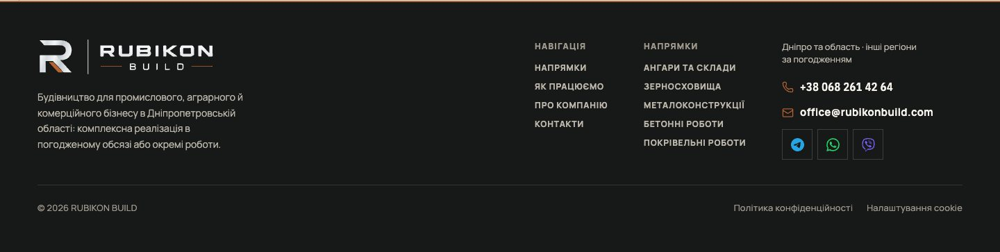
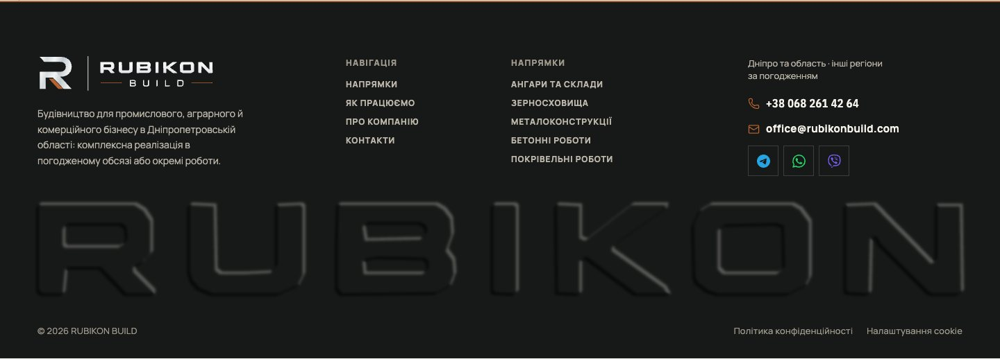
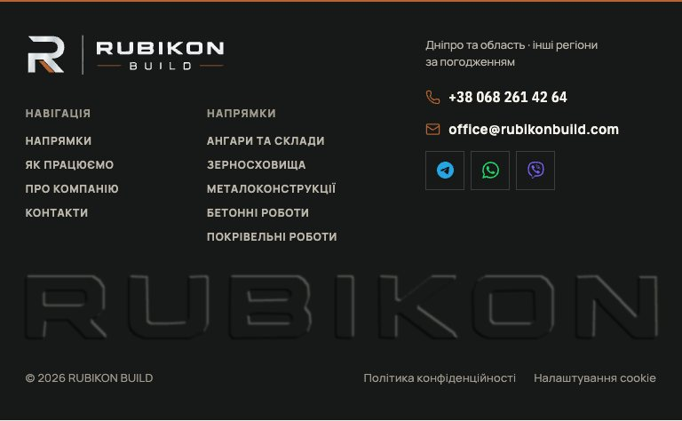
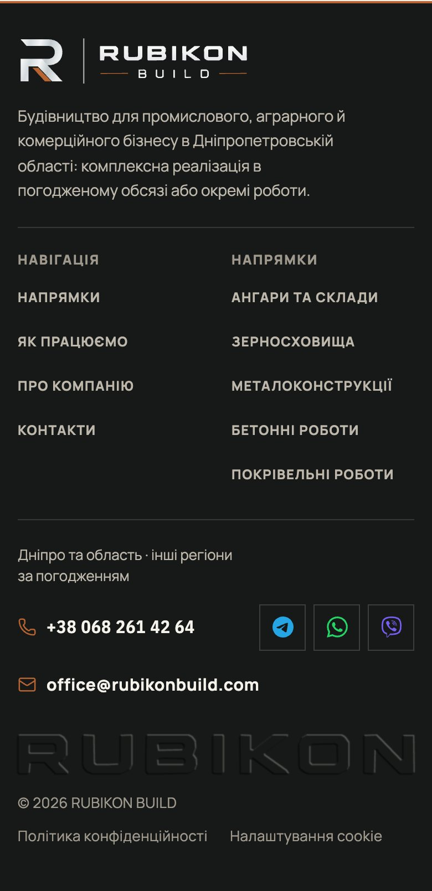

# Handoff · Футер: рівні колонки й тиснений RUBIKON

| | |
|---|---|
| Дата | 2026-11-01 |
| Виконавець | Claude Code |
| Підстава | Власник, 01.11: «поправ підвал… зараз воно більше до правого краю», після макетів обрав варіант «Підпис» («Так, футер у PR») |
| PR | Draft. **Merge і production deploy — лише з окремого OK Дмитра** (DEC-30) |
| Гілка / base | `design/footer-signature` від `main` `299a161d` |
| Коміти | `079e73f3` — футер і тести · наступний коміт — цей handoff |
| Змінено | `app/globals.css` (сітка футера, слово, відступи телефона), `app/components/FooterSignature.tsx` (новий), `app/components/SiteChrome.tsx` (вставка), `tests/e2e/footer-composition.spec.ts` |
| Не змінено | Тексти, посилання, контакти, логотип, планшетна розкладка колонок, еталони, бюджети, залежності |

## Що було

На десктопі (≥ 1181 px) колонки стояли біля правого краю: `.footer-grid` мав `minmax(260px, 1.2fr) auto auto auto`, тож перша колонка забирала всю вільну ширину. На 1440 px між описом компанії й «Навігацією» лишалась порожнеча, а права частина була щільною.

## Що зроблено

- **Сітка.** Від 1181 px: `4fr 2fr 3fr 3fr`, тобто 4 + 2 + 3 + 3 з дванадцяти, проміжки 32 px, відступи 76 / 28 px.
- **Слово RUBIKON.** Між колонками й юридичним рядком, на всю ширину вмісту, на всіх екранах. Геометрія взята з логотипа, без рядка BUILD. Лінія над юридичним рядком прибрана: цю роль виконує слово.
- **Рельєф.** SVG-фільтр: різниця двох зсунутих розмитих форм дає світлий край з боку світла й тінь з протилежного, пласкі ділянки прозорі. Вбудовано в HTML: 0 запитів, різко на будь-якій ширині. Прихований від допоміжних технологій, назва компанії є в логотипі.

Телефон і планшет:

**Відхилено після примірки:**

- Три шари однієї форми зі зсувом: на 1440 px вийшов тонкий контур замість м'якого рельєфу. Це той клас ліній, який власник уже відхилив як дешевий.
- Растр WebP із макета: 23 КБ при 1×, для retina більше, і ще один запит на кожній сторінці. Фільтр дає той самий вигляд без запиту.
- Варіанти «Контакт» (великий телефон) і «Рівна сітка» без слова: показані власнику, обрано «Підпис».

## Перевірка

| Перевірка | Команда / прогін | Результат |
|---|---|---|
| Типи | `tsc --noEmit --incremental false` | чисто |
| Lint | `eslint . --ignore-pattern dist --ignore-pattern .next` | чисто |
| Unit | `vitest run` | 1707 passed, 1 skipped |
| Збірка | `vinext build` | успішно |
| Футер і пошта, production-збірка | `playwright test footer-composition company-email`, desktop і mobile | 35 passed, 13 skipped (навмисні `test.skip` за проєктом) |
| Критичні сценарії, production-збірка | `playwright test pr-critical --project=desktop-chromium` | 60 passed |
| Заміри в браузері | Chrome, `/pro-nas`, 1920, 1440, 1181, 1180, 961, 768, 390, 320 px | слово збігається з краями вмісту, горизонтального переповнення 0 |

Тест перевіряє положення всіх трьох колонок з точністю до 1 px на 1280, 1440 і 1920 px, місце слова на всіх ширинах і `aria-hidden`.

Висота футера на `/pro-nas`: 1440 px — 517 px, 768 px — 473 px, 390 px — 804 px. Значення «до» окремо не міряли.

На dev-сервері тест «Налаштування cookie» падав 3 із 3: клік випереджав гідратацію. На production-збірці, яку ганяє CI, він проходить. Футер тут ні до чого, тест не змінювався.

## Еталони

Не змінювались. `tests/e2e/visual.spec.ts` футера не знімає, `brand-logo-visual` знімає лише посилання-логотип. Очікування підтвердить CI.

## Успадковані червоні перевірки

Немає відомих. Стан CI цього PR дивитись у самому PR.

## Ризики

- **Safari і Firefox не перевірені.** Фільтр побудований на базових примітивах SVG 1.1 (`feGaussianBlur`, `feOffset`, `feComposite`, `feFlood`, `feMerge`), але перевірено лише в Chrome. WebKit і Firefox для Playwright локально не встановлені. Якщо Safari відмалює фільтр нижчою роздільністю, рельєф стане м'якшим, але читатись буде.
- Футер став вищим, бо додано рядок зі словом. Це свідоме рішення власника.

## Що перевірити власнику

1. На прев'ю гілки в Safari на iPhone і Mac: слово видно як м'який рельєф.
2. Відстань між контактами й словом на телефоні.

## Відкат

Revert коміту `079e73f3`. Міграцій і залежностей немає.

## Пропоновані оновлення control (лише після OK)

Рядок у `DECISIONS`: футер «Підпис» затверджено власником 01.11, реалізовано цим PR.
